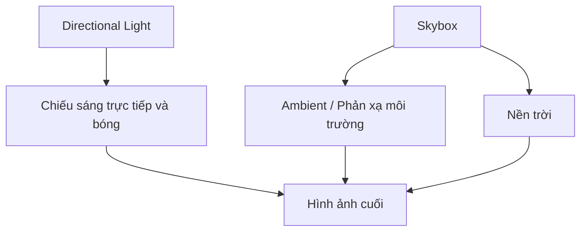

# Bài 03 — Thiết lập Directional Light và Skybox cho cảnh ngoài trời

*Creative Core · Lighting · Unity 6.3 · Configure the Directional Light and skybox*

## 1. Tổng quan và mục tiêu

Ánh sáng mặt trời thường được xấp xỉ bằng `Directional Light`: các tia gần như song song khi xét một khu vực nhỏ. `Skybox` tạo nền trời và có thể được sử dụng làm nguồn cho ambient lighting/reflection. Hai thành phần này có vai trò khác nhau: **Skybox không tự thay thế một nguồn nắng trực tiếp**, còn Directional Light không tự vẽ một bầu trời đầy đủ.

Bạn sẽ tạo bố cục **chiều tối → đêm muộn**, định hướng bóng, tạo `Procedural Skybox` và kiểm tra sự đồng bộ của môi trường.

## 2. Kiến thức cần nắm

**Hướng của Directional Light** quyết định hướng tia và bóng; vị trí GameObject thường không chi phối phép chiếu sáng của nguồn này như đèn Point/Spot. `Intensity` quyết định độ mạnh của ánh sáng; `Color` hoặc `Use Color Temperature` (nếu khả dụng) tạo tông ấm/lạnh. Trong Scene View, hãy bật chế độ Scene Lighting để quan sát đúng tác động của ánh sáng thay vì chế độ tiện lợi để biên tập.

Ánh sáng tự nhiên có thể chia thành mặt trời/trăng, bầu trời (diffuse environment), nguồn phát địa phương và đèn nhấn bố cục. Sự phân chia này giúp tránh làm cho một đèn duy nhất vừa chiếu sáng trực tiếp, vừa giả lập mọi ánh sáng nền.

## 3. Chuẩn bị

Tạo một scene URP với mặt sàn và vài khối cao thấp khác nhau. Nếu dùng dự án mẫu Creative Core, mở `TutorialScene_Lighting_Outdoor`. Lưu scene thành bản sao để giữ phiên bản so sánh. Mở `Window > Rendering > Lighting` và `Light Explorer` để điều chỉnh tập trung.

## 4. Các bước thực hiện

1. **Đặt góc camera cố định.** Chọn một camera nhìn thấy sàn, bậc thềm và đường chân trời. Chụp ảnh trạng thái ban đầu.
2. **Đổi hướng nắng.** Chọn `Directional Light`, dùng công cụ Rotate (`E`) để ánh sáng tới xiên hơn. So sánh chiều dài bóng, vùng sáng và khuất.
3. **Tạo bầu trời mới.** Tạo `Material`; chọn shader skybox thích hợp, ví dụ `Skybox/Procedural` khi shader này có trong dự án. Tên gợi ý `Sky_Night`.
4. **Gán Skybox.** Trong cửa sổ Lighting, đặt `Environment > Skybox Material` thành material vừa tạo. Với Procedural Skybox, điều chỉnh tint, atmosphere và thông số mặt trời nếu Inspector cung cấp.
5. **Liên kết nguồn mặt trời.** Khi có nhiều Directional Lights, kiểm tra `Sun Source` để skybox đồng bộ với nguồn chủ đạo; hiệu ứng phụ thuộc loại skybox.
6. **Chuyển sang đêm.** Giảm ánh sáng trực tiếp theo mục tiêu nghệ thuật, đổi hue/tint của Skybox, điều chỉnh ambient trong Lighting. Bầu trời không nhất thiết phải đen hoàn toàn: màu xanh tím giúp vật thể vẫn đọc được ở xa.
7. **So sánh ảnh.** Với cùng camera, xuất ảnh trước/sau và ghi lại thông số thay đổi. Nếu ambient/probe đã bake, cần cập nhật dữ liệu ánh sáng tương ứng trước khi kết luận.

## 5. Điểm kiểm tra

- [ ] Hướng bóng thay đổi khi xoay Directional Light.
- [ ] Skybox mới hiển thị trong Game view.
- [ ] Màu trời và ambient không mâu thuẫn với ánh sáng mặt đất.
- [ ] Không có vùng quá sáng vô cớ khi đã chuyển sang đêm.

## 6. Lỗi thường gặp

| Hiện tượng | Cách kiểm tra |
|---|---|
| Xoay đèn nhưng mặt trời trong Skybox không đổi | Kiểm tra `Sun Source`, shader procedural, và cách shader dùng hướng đèn |
| Skybox thay mà vật thể không đổi sáng | Kiểm tra `Environment Lighting`, nguồn ambient và dữ liệu đã bake |
| Xoay đèn không nhìn thấy bóng | Kiểm tra Shadow Type, Cast Shadows của renderer, shadow settings trong URP asset |
| Scene đẹp nhưng Game view tối | Kiểm tra Camera, exposure/post-processing, Scene Lighting và quality settings |

## 7. Sản phẩm cần lưu

Nộp hai ảnh cùng camera, một scene sau chỉnh sửa, và bảng 3 cột **tham số – thay đổi – kết quả thị giác**. Đây là cơ sở đánh giá độc lập, không cần thông số cố định vì scene và pipeline của từng máy có thể khác nhau.

## 8. Câu hỏi ôn tập trắc nghiệm

### Câu 1

Thao tác nào thay đổi hướng bóng của ánh sáng mặt trời mô phỏng?

A. Di chuyển Directional Light ra xa  
B. Xoay Directional Light  
C. Đổi tên Skybox  
D. Tăng Scale của Light  

**Đáp án:** B. **Giải thích:** Directional Light được xác định chủ yếu bởi hướng chứ không phải vị trí.

### Câu 2

Đặt Skybox Material mới có đảm bảo cập nhật ngay dữ liệu GI đã bake không?

A. Có, luôn cập nhật  
B. Chỉ khi tăng FPS  
C. Không, có thể cần cập nhật bake  
D. Không bao giờ ảnh hưởng ambient  

**Đáp án:** C. **Giải thích:** Dữ liệu ánh sáng tính trước phải được tạo lại khi thay đổi nguồn môi trường có liên quan.

### Câu 3

Vai trò chính của Skybox trong cảnh là gì?

A. Thay thế Collider  
B. Tạo nền trời và đóng góp ambient/reflection theo cấu hình  
C. Tạo mọi bóng realtime  
D. Gắn UV cho Mesh  

**Đáp án:** B. **Giải thích:** Skybox hiển thị nền trời và có thể đóng góp môi trường nhưng không đồng nghĩa nguồn direct.

### Câu 4

Cảnh đêm có thể vẫn có ánh sáng xanh dịu là vì sao?

A. Ánh sáng bầu trời và ý đồ diễn tả không gian  
B. Lightmap bắt buộc màu xanh  
C. Không thể làm tối bằng Directional Light  
D. Đèn Point chỉ phát màu xanh  

**Đáp án:** A. **Giải thích:** Ambient sky giúp mắt nhìn được hình và tạo bầu không khí đêm.

### Câu 5

Khi có hai Directional Light và sky procedural, cần kiểm tra gì nếu biểu tượng mặt trời lệch?

A. Mesh Collider  
B. Sun Source  
C. Audio Listener  
D. Occlusion Culling  

**Đáp án:** B. **Giải thích:** Sun Source chỉ định nguồn sáng đóng vai trò mặt trời cho môi trường khi phù hợp.

## 9. Tài liệu tham khảo và lưu ý phiên bản

- [Unity Learn — Configure the Directional Light and skybox](https://learn.unity.com/course/creative-core-lighting/tutorial/configure-the-directional-light-and-skybox?version=6.3) (Unity 6.3).

**Lưu ý:** Menu và tùy chọn có thể khác theo URP Asset, Quality Level, Unity Editor và loại shader đang dùng. Nội dung là bài giảng tiếng Việt độc lập được biên soạn và bổ sung để học tập, không phải bản dịch chính thức hay lời chép toàn văn của Unity.
