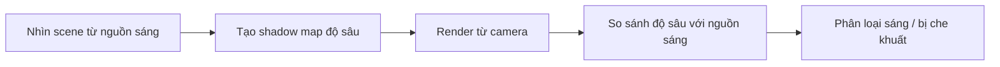

# Bài 05 — Cấu hình bóng đổ, shadow cascades và hậu kỳ

*Creative Core · Lighting · Unity 6.3 · Configure shadows in your scene*

## 1. Tổng quan và mục tiêu

Bóng đổ cho người xem biết độ cao, khoảng cách, sự tiếp xúc và hướng ánh sáng. Khi render thời gian thực, Unity thường biểu diễn bóng bằng **shadow map**: dữ liệu độ sâu nhìn từ phía nguồn sáng. Chất lượng bóng phụ thuộc đồng thời vào đèn, vật thể, render pipeline và camera; tăng độ phân giải mà không khảo sát toàn hệ thống có thể vừa tốn tài nguyên vừa không giải quyết đúng lỗi.

## 2. Shadow map hoạt động thế nào?

Khi so sánh độ sâu, sai số số học hoặc độ phân giải quá thấp có thể gây **shadow acne** (vệt tối sai trên mặt). `Depth Bias` và `Normal Bias` giảm lỗi nhưng giá trị quá lớn làm bóng tách khỏi chân vật (*peter-panning*). Bóng mềm mô phỏng vùng chuyển tiếp (*penumbra*) bằng kỹ thuật lọc/phương pháp sampling; không nên hiểu Soft Shadows luôn tạo độ mềm vật lý đúng cho mọi kích thước nguồn.

## 3. Hệ thống tham số cần kiểm tra

| Phạm vi | Thiết lập | Ảnh hưởng |
|---|---|---|
| URP Asset | Shadows / Main Light Shadows | Cho phép render bóng của đèn chính |
| URP Asset | Additional Light Shadows | Bóng từ Spot/Point phụ (khi pipeline hỗ trợ) |
| URP Asset | Shadow Resolution, Max Distance | Độ chi tiết và khoảng cách tối đa vẽ bóng |
| URP Asset | Cascade Count / Splits | Phân bố độ phân giải bóng theo khoảng cách camera cho đèn hướng |
| Light component | Shadow Type | None/Hard/Soft tùy cấu hình |
| Mesh Renderer | Cast Shadows / Receive Shadows | Vật có tạo hoặc nhận bóng không |

**Cascaded Shadow Maps** chia dải khoảng cách từ camera thành nhiều vùng; vùng gần có thể được cấp texel tốt hơn. Nhiều cascades không luôn "tốt hơn tuyệt đối": tăng chi phí và cần điều chỉnh phân bố phù hợp với camera.

## 4. Thực hành

1. Chọn URP Asset thực sự đang được gán cho Quality level của dự án. Với project mẫu, tìm asset tương ứng trong `Assets/CreativeCore_Lighting/Settings/Rendering` (ví dụ `UniversalRP_HighQuality`).
2. Mở phần Shadows: thử thay `Max Distance` từ gần 0 lên khoảng cách đủ bao trùm cảnh. Chú ý vùng bóng biến mất theo khoảng cách tới camera.
3. Thử `Depth Bias` và `Normal Bias` với một mô hình có vệt shadow acne. Ghi lại lúc lỗi biến mất và lúc bóng bắt đầu rời chân vật.
4. Bật Soft Shadows trong URP Asset và chọn `Soft Shadows` cho `Directional Light` nếu giao diện cho phép. Quan sát rìa bóng ở cùng góc camera.
5. Đổi số cascades (ví dụ từ một mức thấp lên mức cao hơn được hỗ trợ) và nhìn vùng gần camera. Kiểm tra chất lượng bóng và tốc độ khung hình.
6. Đánh giá hậu kỳ: Bloom, Color Adjustments/Exposure, Tonemapping và Ambient Occlusion có thể **thay đổi cảm nhận bóng**, nhưng không thay shadow map thực chất.

## 5. Kiểm tra kết quả và lỗi thường gặp

- **Bóng bị răng cưa**: thử tăng shadow resolution hợp lý, giảm phạm vi Max Distance hoặc cân nhắc cascade distribution.
- **Bóng lấm tấm**: chỉnh bias từng bước nhỏ và quan sát mặt phẳng gần nguồn sáng.
- **Bóng rời vật**: giảm bias quá mức, kiểm tra mesh/normal.
- **Không có bóng của đèn phụ**: kiểm tra Additional Light Shadows trong URP Asset và cài đặt Light.
- **Bóng chỉ xuất hiện gần camera**: kiểm tra shadow distance, không nhầm với vấn đề lightmap.

## 6. Minh chứng bắt buộc

Chụp ba ảnh cùng camera: **Hard**, **Soft**, và **đã điều chỉnh cascades**. Ghi frame time hoặc GPU time nếu có, nhưng không tự khẳng định một mức tối ưu khi chưa đo trên thiết bị đích.

## 7. Câu hỏi ôn tập trắc nghiệm

### Câu 1

Nguyên nhân chủ yếu của hiện tượng shadow acne là gì?

A. Sai số và giới hạn biểu diễn độ sâu trong shadow mapping  
B. Thiếu Audio Source  
C. Material không có Albedo  
D. Camera không có Collider  

**Đáp án:** A. **Giải thích:** So sánh độ sâu thiếu chính xác có thể làm vùng sáng bị phân loại nhầm là bóng.

### Câu 2

Tăng Bias quá nhiều có thể dẫn đến điều gì?

A. Bóng tách khỏi chân vật  
B. Tạo nhiều Light Probes  
C. Mặt trời mất màu  
D. Tăng UV channel  

**Đáp án:** A. **Giải thích:** Bias quá lớn làm vị trí phép so sánh bóng dịch quá xa bề mặt.

### Câu 3

Cascades chủ yếu giúp vấn đề nào?

A. Tăng số bóng trong toàn bộ scene  
B. Phân bổ chất lượng bóng Directional Light theo khoảng cách camera  
C. Tạo phản xạ gương  
D. Bật emission  

**Đáp án:** B. **Giải thích:** Cascades cải thiện phân bố shadow map độ sâu cho các vùng khoảng cách.

### Câu 4

Vì sao Soft Shadows không được coi là phương pháp luôn chính xác vật lý?

A. Vì có thể dùng lọc/lấy mẫu để xấp xỉ penumbra  
B. Vì bóng mềm không tồn tại  
C. Vì chỉ hoạt động với âm thanh  
D. Vì bỏ qua Light component  

**Đáp án:** A. **Giải thích:** Bóng mềm realtime thường được xấp xỉ từ shadow maps và bộ lọc.

### Câu 5

Nếu chỉ mất bóng từ một Spot Light, nên kiểm tra đầu tiên nhóm nào?

A. Additional Lights Shadows và Shadow Type của đèn  
B. Font chữ UI  
C. Tệp animation  
D. NavMesh  

**Đáp án:** A. **Giải thích:** Đèn phụ cần được pipeline cho phép render bóng và bật ở Light component.

## 8. Tài liệu tham khảo và lưu ý phiên bản

- [Unity Learn — Configure shadows in your scene](https://learn.unity.com/course/creative-core-lighting/tutorial/configure-shadows-in-your-scene?version=6.3) (Unity 6.3).

**Lưu ý:** Menu và tùy chọn có thể khác theo URP Asset, Quality Level, Unity Editor và loại shader đang dùng. Nội dung là bài giảng tiếng Việt độc lập được biên soạn và bổ sung để học tập, không phải bản dịch chính thức hay lời chép toàn văn của Unity.
