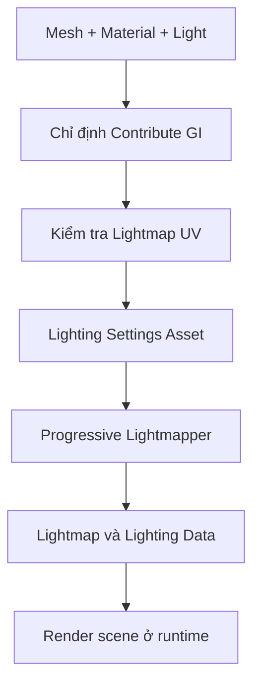

# Bài 06 — Baking Lightmap: lưu ánh sáng tĩnh và tối ưu cảnh

*Creative Core · Lighting · Unity 6.3 · Bake a lightmap for your scene*

## 1. Tổng quan và mục tiêu

*Lightmapping* tính trước ánh sáng trên các bề mặt tĩnh và lưu kết quả vào texture. Trong một cảnh có kiến trúc không thay đổi, phương pháp này giảm chi phí tính ánh sáng và bóng ở runtime, đồng thời cho phép hiệu ứng ánh sáng nảy mà các đèn trực tiếp đơn giản không thể tự tái hiện. Bài này tập trung vào **chuẩn bị geometry, Light Mode, Lighting Settings Asset, UV và cập nhật bake**.

## 2. Tại sao một Lightmap cần UV riêng?

Mỗi bề mặt cần ánh xạ lên một vị trí texture để nhận đúng dữ liệu chiếu sáng. **Lightmap UV** thường phải không chồng lấn, có khoảng cách biên đủ lớn giữa các UV islands để tránh màu sắc/bóng từ vùng này tràn sang vùng khác. Trong Unity, dữ liệu UV cho baked lightmap thường nằm ở `Mesh.uv2` (kênh UV thứ hai; một số DCC gọi là UV1).

Lightmap là dữ liệu *tính trước*, không phải một texture Base Map thay thế vật liệu. Mô hình động thường không trực tiếp có lightmap bake riêng của scene ở vị trí runtime và cần Light Probes để nhận thông tin gián tiếp tương ứng.

## 3. Chuẩn bị scene

1. Mở cảnh ngoài trời hoặc tạo kiến trúc đơn giản (sàn, tường, bậc thang). Đánh dấu các Mesh Renderer thuộc hình học cố định bằng **Contribute GI**; kiểm tra `Receive Global Illumination = Lightmaps` nếu tùy chọn hiện ra.
2. Với model nhập từ Blender/Maya, chọn asset gốc trong Project, mở tab **Model** của Import Settings, bật **Generate Lightmap UVs** nếu chưa cung cấp UV hợp lệ, sau đó `Apply`. Đối với Mesh primitive có sẵn, xác nhận Unity đã tạo UV phù hợp.
3. Chọn `Directional Light` và các nguồn sáng không chuyển động, đổi `Mode = Baked` để thử, giữ một đèn cần realtime làm đối chứng nếu muốn.
4. Mở `Window > Rendering > Lighting`, tạo hoặc gán **Lighting Settings Asset**, bật `Baked Global Illumination` trong cấu hình hỗ trợ.

## 4. Điều chỉnh bake và quan sát kết quả

Trong Lighting Settings, quan sát các tham số tương ứng phiên bản như `Lightmap Resolution` (texels trên một đơn vị), `Lightmap Padding`, số lần bounce/indirect samples, cài đặt denoiser, và **Max Lightmap Size**. Tăng độ phân giải có thể làm bóng sắc nét hơn nhưng tăng thời gian bake và bộ nhớ; padding thiếu dễ gây rò màu giữa UV islands.

1. Bấm **Generate Lighting** (hoặc dùng cơ chế tự cập nhật nếu dự án hỗ trợ). Đợi hoàn thành và kiểm tra cảnh, Console cùng Lighting Data.
2. Đổi vị trí hoặc màu của một đèn **Baked**; quan sát dữ liệu cũ chưa thay đổi như mong đợi. Chạy Generate Lighting lại để cập nhật.
3. Thêm `Area Light` tĩnh và đặt thành chế độ được URP hỗ trợ cho bake. Ánh sáng diện tích thường cho vùng sáng và bóng chuyển tiếp mềm hợp lý trong cảnh tĩnh.
4. Chuyển một nguồn cố định sang `Mixed`; kiểm tra **Mixed Lighting Mode** và so sánh phần ánh sáng trực tiếp với gián tiếp trên vật thể tĩnh và động.

## 5. Khi nào Mixed khác Baked?

| Trường hợp | Baked | Mixed |
|---|---|---|
| Đèn và kiến trúc không đổi | Rất phù hợp | Phù hợp nếu cần thêm tương tác với vật động |
| Nhân vật đi qua vùng sáng | Cần Light Probes cho dữ liệu bake | Có thể nhận trực tiếp realtime theo cấu hình |
| Đổi vị trí đèn lúc chơi | Không cập nhật lightmap | Không cập nhật phần đã bake; không nên dùng để thay đổi bố cục đèn lớn |
| Bóng động lên môi trường | Không có từ riêng đèn Baked | Có thể hỗ trợ tùy Lighting Mode |

## 6. Debug có phương pháp

**Mảng tối/loang sau bake:** kiểm tra UV overlap, padding, sample count, normal, tường quá mỏng. **Lightmap không thay đổi:** xem `Contribute GI`, `Mode`, asset lighting và thời điểm hoàn thành bake. **Thời gian bake tăng mạnh:** so sánh Lightmap Resolution, số lượng mesh/texels và cài đặt samples. **Dynamic Sphere bị tối:** không coi là lỗi UV của Sphere; cần kiểm tra Light Probes và đèn realtime.

## 7. Kết quả và checklist

- [ ] Có một Lighting Settings Asset và dữ liệu bake tồn tại trong scene.
- [ ] Baked Lightmap diagnostic cho thấy các bề mặt cần bake có dữ liệu.
- [ ] Model nhập có UV không chồng lấn hoặc được xử lý bằng Generate Lightmap UVs.
- [ ] Có ảnh trước/sau bake và ảnh sau khi thay một tham số rồi rebake.

Không đặt con số "Lightmap Resolution chuẩn" cho mọi cảnh; chỉ có cấu hình phù hợp với khoảng nhìn, kích thước mesh và ngân sách bộ nhớ cụ thể.

## 8. Câu hỏi ôn tập trắc nghiệm

### Câu 1

Dữ liệu được lưu bởi lightmapping là gì?

A. Mô hình AI  
B. Texture chứa kết quả chiếu sáng tính trước  
C. Collider tối ưu  
D. File âm thanh  

**Đáp án:** B. **Giải thích:** Lightmap là texture lưu sự chiếu sáng đã được xử lý trước khi runtime.

### Câu 2

Vì sao UV islands của lightmap cần tránh chồng lấn?

A. Để mỗi vùng bề mặt nhận dữ liệu sáng riêng chính xác  
B. Để đèn sáng hơn  
C. Để đổi shader sang Unlit  
D. Để tạo nhiều Camera  

**Đáp án:** A. **Giải thích:** UV overlap khiến hai vùng khác nhau dùng chung texel không mong muốn.

### Câu 3

Sau khi đổi vị trí một Baked Light, thao tác cần làm để cập nhật dữ liệu là gì?

A. Đổi Camera FOV  
B. Rebake  
C. Reset Rigidbody  
D. Đổi tên object  

**Đáp án:** B. **Giải thích:** Kết quả tính trước cần được tạo lại sau thay đổi ảnh hưởng lighting.

### Câu 4

Tăng Lightmap Resolution thường dẫn đến điều gì?

A. Giảm chi phí bộ nhớ trong mọi trường hợp  
B. Tăng chi tiết và thường tăng chi phí bake/bộ nhớ  
C. Xóa vật liệu  
D. Tự chuyển sang Realtime  

**Đáp án:** B. **Giải thích:** Nhiều texel hơn tăng chi tiết nhưng cần thêm dung lượng và xử lý.

### Câu 5

Contribute GI quan trọng vì sao?

A. Chọn geometry có tham gia tính GI/bake  
B. Cho phép Rigidbody di chuyển  
C. Định nghĩa audio range  
D. Điều khiển tốc độ Camera  

**Đáp án:** A. **Giải thích:** Đối tượng cần tham gia bake phải được khai báo đúng cách.

## 9. Tài liệu tham khảo và lưu ý phiên bản

- [Unity Learn — Bake a lightmap for your scene](https://learn.unity.com/course/creative-core-lighting/tutorial/bake-a-lightmap-for-your-scene?version=6.3) (Unity 6.3).
- [Tài liệu UV cho lightmap](https://docs.unity3d.com/6000.3/Documentation/Manual/LightingGiUvs-GeneratingLightmappingUVs.html).
- [Tài liệu về Mixed Lighting](https://docs.unity3d.com/kr/current/ScriptReference/MixedLightingMode.html).

**Lưu ý:** Menu và tùy chọn có thể khác theo URP Asset, Quality Level, Unity Editor và loại shader đang dùng. Nội dung là bài giảng tiếng Việt độc lập được biên soạn và bổ sung để học tập, không phải bản dịch chính thức hay lời chép toàn văn của Unity.
