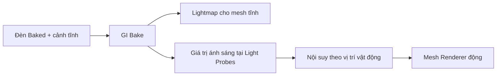

# Bài 07 — Light Probes: chiếu sáng vật thể động trong môi trường đã bake

*Creative Core · Lighting · Unity 6.3 · Improve your lighting with Light Probes*

## 1. Tổng quan và mục tiêu

Một quả cầu di động đi dưới đèn đã bake có thể không nhận được ánh sáng như nền đất xung quanh, vì lightmap gắn với bề mặt tĩnh chứ không bao phủ mọi vị trí trong không gian. **Light Probes** giải quyết sự không liên tục này bằng cách lưu thông tin chiếu sáng khuếch tán tại các điểm mẫu trong không gian và nội suy cho renderer chuyển động.

Bài học yêu cầu giải thích nguyên lý, bố trí probes theo thể tích 3D và kiểm chứng ở vùng có sự thay đổi ánh sáng mạnh.

## 2. Light Probes chứa thông tin gì?

Unity dùng biểu diễn gọn dựa trên **spherical harmonics (SH)** để xấp xỉ ánh sáng chiếu đến từ nhiều hướng, thường hữu ích cho thành phần diffuse GI. Khi vật di chuyển, hệ thống xác định các probes lân cận (theo phép phân hoạch không gian) và nội suy dữ liệu. Vì tính gọn, các probe **không thay thế phản xạ sắc nét** và cũng không tự tạo bóng realtime từ vật động.

## 3. Bố trí probes có chủ đích

Nguyên tắc quan trọng là đặt probes **trong không gian nhân vật thực sự đi qua**, không chỉ trên sàn. Vùng chuyển tiếp từ sáng sang tối, gần cửa, cạnh đèn, gầm cầu hoặc lối đi hẹp cần nhiều điểm mẫu hơn; phòng có chiếu sáng tương đối đồng đều có thể dùng thưa hơn. Tránh đặt probes xuyên quá sâu vào bề mặt đặc hoặc thẳng một mặt phẳng duy nhất nếu cần nội suy thể tích 3D.

## 4. Thực hành trên cảnh ngoài trời

1. Bảo đảm scene đã có tường/sàn được bake và một đèn Baked chiếu xuống mặt đất.
2. Tạo `Sphere` không đánh dấu Contribute GI, đặt giữa đường đi và kéo qua các vùng sáng/tối. Ghi lại sự chênh lệch so với sàn.
3. Tạo `Light Probe Group` qua menu GameObject/Rendering (tùy bản Unity) hoặc `Add Component > Light Probe Group`.
4. Bố trí nhiều điểm probe thành các lớp độ cao: gần mặt đất, ngang thân nhân vật và gần đầu nhân vật. Tăng mật độ tại các ranh giới sáng/tối, bảo đảm các điểm không bị tất cả cùng nằm trên một mặt phẳng.
5. Trong `Mesh Renderer` của Sphere, kiểm tra chế độ `Light Probes` là `Blend Probes` hoặc chế độ phù hợp, sau đó Generate Lighting.
6. Kéo Sphere qua đường đi cũ với camera/material không đổi. So sánh cảm giác hòa nhập với cảnh và sự thay đổi sắc thái.
7. Dùng các chế độ diagnostic/Probe Visualization để đánh giá mẫu sáng; kiểm tra lại vị trí probe quá gần vật cản.

## 5. Lỗi thực tế và hướng khắc phục

| Hiện tượng | Nguyên nhân đáng kiểm tra |
|---|---|
| Vật động tối bất thường | Renderer không nhận probes, chưa bake lại, probe phân bố sai |
| Sáng đột ngột khi di chuyển | Probes quá thưa tại ranh giới, phân bố không đại diện |
| Vật lớn có một phía sáng, một phía tối nhưng shading đồng đều | Renderer dùng sample quá thô; nghiên cứu Light Probe Proxy Volume khi hỗ trợ |
| Bóng nhân vật không hiện trên nền tĩnh | Light Probes không sinh bóng động; cần đèn/shadow realtime hoặc hệ thống khác |

## 6. Tối ưu và nghiệm thu

Không rải probes đều cực dày trên toàn bản đồ. Chất lượng thông tin ánh sáng phụ thuộc **vị trí lấy mẫu**, không chỉ số lượng. Mục tiêu là có đủ probes ở những nơi thay đổi lighting. Bài hoàn thành khi có ảnh Sphere ở ít nhất ba vị trí, trước và sau khi thêm probes, cùng chú thích lý do đặt mẫu.

## 7. Câu hỏi ôn tập trắc nghiệm

### Câu 1

Light Probes phù hợp nhất với nhu cầu nào?

A. Tạo mesh địa hình  
B. Cung cấp dữ liệu chiếu sáng môi trường cho vật di động  
C. Thay thế mọi phản xạ gương  
D. Chỉnh góc Spot Light  

**Đáp án:** B. **Giải thích:** Probes giúp nội suy lighting khuếch tán cho renderer không dùng lightmap tĩnh.

### Câu 2

Nên tăng mật độ Light Probes ở khu vực nào?

A. Vùng lighting thay đổi mạnh như gần cửa  
B. Mọi nơi bất kể điều kiện  
C. Chỉ bên ngoài camera  
D. Chỉ bên trong vật đặc  

**Đáp án:** A. **Giải thích:** Lấy mẫu dày hơn tại vùng biến thiên giúp nội suy bám sát ánh sáng thực.

### Câu 3

Light Probes có thay thế bóng realtime từ nhân vật không?

A. Có, luôn  
B. Chỉ trên material Metallic  
C. Không  
D. Chỉ khi bật Bloom  

**Đáp án:** C. **Giải thích:** Dữ liệu SH gián tiếp không phải bản đồ bóng động theo thời gian.

### Câu 4

Vì sao các điểm chỉ nằm trên một mặt sàn có thể không đủ?

A. Vì cần nội suy thể tích ở nhiều độ cao  
B. Vì Sphere bắt buộc bay  
C. Vì UV bắt buộc bằng 0  
D. Vì chỉ có Directional Light  

**Đáp án:** A. **Giải thích:** Nhân vật có chiều cao, probes phải mô tả được thay đổi theo không gian ba chiều.

### Câu 5

Khi nhân vật không nhận ánh sáng probe, thành phần nào cần kiểm tra?

A. Light Probes của Mesh Renderer  
B. Audio Mixer  
C. NavMesh Surface  
D. Animator Controller  

**Đáp án:** A. **Giải thích:** Renderer phải có cấu hình nhận dữ liệu probes phù hợp.

## 8. Tài liệu tham khảo và lưu ý phiên bản

- [Unity Learn — Improve your lighting with Light Probes](https://learn.unity.com/course/creative-core-lighting/tutorial/improve-your-lighting-with-light-probes?version=6.3) (Unity 6.3).
- [Tài liệu UV cho lightmap](https://docs.unity3d.com/6000.3/Documentation/Manual/LightingGiUvs-GeneratingLightmappingUVs.html).
- [Tài liệu về Mixed Lighting](https://docs.unity3d.com/kr/current/ScriptReference/MixedLightingMode.html).

**Lưu ý:** Menu và tùy chọn có thể khác theo URP Asset, Quality Level, Unity Editor và loại shader đang dùng. Nội dung là bài giảng tiếng Việt độc lập được biên soạn và bổ sung để học tập, không phải bản dịch chính thức hay lời chép toàn văn của Unity.
