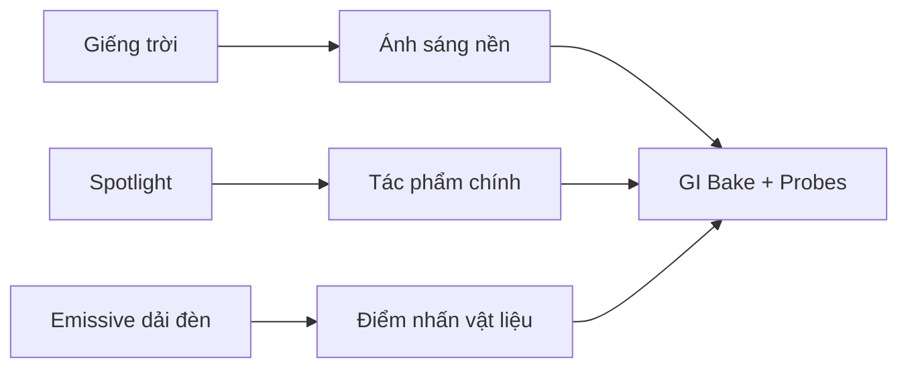

# Bài 08 — Thiết kế chiếu sáng nội thất, Emission và hệ thống probe 3D

*Creative Core · Lighting · Unity 6.3 · Examine and complete the indoor scene*

## 1. Tổng quan và mục tiêu

Không gian trong nhà khác ngoài trời ở chỗ có nhiều bề mặt chắn sáng, phản xạ nhiều lần và các nguồn cục bộ rất đa dạng. Một gallery có giếng trời, đèn rọi tác phẩm, dải đèn màu và đèn trang trí là bối cảnh thích hợp để khảo sát **nguồn sáng có động cơ**, **Emission** và cách bố trí Light Probes dạng thể tích.

## 2. Phân loại các nguồn sáng trong gallery

| Nguồn | Công việc thị giác | Gợi ý kỹ thuật |
|---|---|---|
| Giếng trời | Tạo chiếu sáng nền và hướng chính | Directional/ambient, môi trường và GI phù hợp |
| Spotlight trên bục | Tập trung mắt vào hiện vật | Spot Light với Range, Angle và Shadows hợp lý |
| Dải đèn sát tranh | Tạo nhịp điệu và sắc màu | Emissive material kết hợp nguồn Baked/Area nếu cần chiếu sáng |
| Đèn bàn/đèn đứng | Tạo vùng ấm cục bộ | Point/Spot Light và emissive bulb |

`Emission` là tham số material làm bề mặt trông tự phát sáng; nếu workflow bake hỗ trợ, bạn có thể cấu hình đóng góp GI của emissive surface. Tuy nhiên, bản thân hiển thị màu HDR/Emission **không tự bảo đảm** phát ánh sáng realtime ra vật xung quanh.

## 3. Thực hành khảo sát và hoàn thiện

1. Mở `FinalScene_Lighting_Indoor` trong project mẫu để xác định giếng trời, spotlight trên bục, dải đèn trên tường và các đạo cụ đèn. Sau đó mở `TutorialScene_Lighting_Indoor` để làm việc riêng, tránh chỉnh bản chuẩn đối chiếu.
2. Dùng **Light Explorer** kiểm tra Mode/Type/Color và đánh dấu nguồn cố định có thể bake, nguồn cần tương tác realtime.
3. Chọn một vật thể đại diện cho bóng đèn hoặc dải đèn. Tạo `Material` sử dụng shader tương thích URP (ví dụ `Universal Render Pipeline/Lit`), bật **Emission**, chọn màu phát sáng và áp dụng material lên phần hình học cần thiết.
4. Xem scene ở chế độ **Emission diagnostic** nếu bản Editor/Rendering Debugger hỗ trợ. Kiểm tra xem material có thực sự phát sáng khi tắt các hiệu ứng hậu kỳ như Bloom. Bloom chỉ khiến vùng sáng nhìn thấy có quầng; nó không tự biến emission thành GI.
5. Nếu muốn bề mặt Emission chiếu sáng kiến trúc tĩnh, kiểm tra `Contribute GI`, cách material xuất emission vào bake, rồi chạy Generate Lighting và so sánh ảnh.
6. Bố trí `Light Probe Group` theo ba chiều trong gallery: dọc lối đi, trên/giữa các bục trưng bày và gần vùng giếng trời. Thử một vật thể di động đi qua dải sáng.
7. Điều chỉnh các Spotlight từng nguồn để vừa phân cấp thị giác vừa tránh vùng trưng bày bị rọi quá mạnh.

Sơ đồ cho thấy cách ba loại nguồn sáng phục vụ vai trò khác nhau; mũi tên từ Emission tới bake chỉ có tác dụng khi shader và hệ thống GI được cấu hình để lấy đóng góp này.

## 4. Kiểm tra và sửa sai

- **Tranh quá sáng còn nền quá tối**: giảm Spot trước khi tăng toàn bộ ambient; cân bằng key/fill và GI.
- **Đèn LED rực nhưng tường không sáng theo**: phân biệt emission hiển thị và đóng góp GI hoặc tạo Light phụ.
- **Bóng xuyên qua tường**: rà soát geometry, lightmapping UV, light leakage và vị trí đèn.
- **Quả cầu đi trong gallery đổi sáng giật cục**: tăng Light Probes ở vùng chuyển tiếp và kiểm tra thiết lập renderer.

## 5. Sản phẩm thực hành

Hoàn thiện gallery với tối thiểu một Material Emission, một Spotlight làm nổi vật trưng bày và Light Probes theo không gian 3D. Nộp ảnh ở **Game view** và ảnh chẩn đoán **Emission/Lighting** (nếu công cụ hỗ trợ), kèm mô tả các quyết định chiếu sáng.

## 6. Câu hỏi ôn tập trắc nghiệm

### Câu 1

Emission trên vật liệu có luôn chiếu sáng môi trường theo thời gian thực không?

A. Có  
B. Không, còn phụ thuộc GI và cách cấu hình  
C. Chỉ khi vật là Sphere  
D. Chỉ khi tắt Skybox  

**Đáp án:** B. **Giải thích:** Emission có thể chỉ ảnh hưởng biểu hiện của chính bề mặt.

### Câu 2

Vai trò phù hợp nhất của Spot Light trên bục trưng bày là gì?

A. Nhấn vật thể quan trọng  
B. Tạo skybox  
C. Thay thế lightmap UV  
D. Làm nền trời phát sáng  

**Đáp án:** A. **Giải thích:** Một Spotlight có hướng giúp hướng sự chú ý vào hiện vật.

### Câu 3

Đặt probe chỉ dưới chân nhân vật trong phòng có vấn đề gì?

A. Mô tả chưa tốt gradient ánh sáng theo độ cao  
B. Làm tăng số Camera  
C. Thay đổi mesh topology  
D. Không thể tạo shadow map  

**Đáp án:** A. **Giải thích:** Các probes cần bao phủ thể tích nơi vật di chuyển.

### Câu 4

Bloom đóng vai trò nào với đèn LED?

A. Tự tính GI nảy sáng lên tường  
B. Tạo quầng sáng cảm nhận ở vùng cường độ cao  
C. Thêm Collider  
D. Tạo shadowmask  

**Đáp án:** B. **Giải thích:** Bloom là hiệu ứng hậu kỳ, không thay thế nguồn sáng GI.

### Câu 5

Vì sao nguồn từ giếng trời và đèn rọi cần xử lý khác nhau?

A. Vì chúng có hướng, vùng phủ và chức năng hình ảnh khác nhau  
B. Vì chỉ giếng trời có màu  
C. Vì ánh sáng nhân tạo không có bóng  
D. Vì Scene chỉ cho phép một Light  

**Đáp án:** A. **Giải thích:** Thiết kế chiếu sáng cần phù hợp phạm vi và mục tiêu của từng nguồn.

## 7. Tài liệu tham khảo và lưu ý phiên bản

- [Unity Learn — Examine and complete the indoor scene](https://learn.unity.com/course/creative-core-lighting/tutorial/examine-and-complete-the-indoor-scene?version=6.3) (Unity 6.3).

**Lưu ý:** Menu và tùy chọn có thể khác theo URP Asset, Quality Level, Unity Editor và loại shader đang dùng. Nội dung là bài giảng tiếng Việt độc lập được biên soạn và bổ sung để học tập, không phải bản dịch chính thức hay lời chép toàn văn của Unity.
