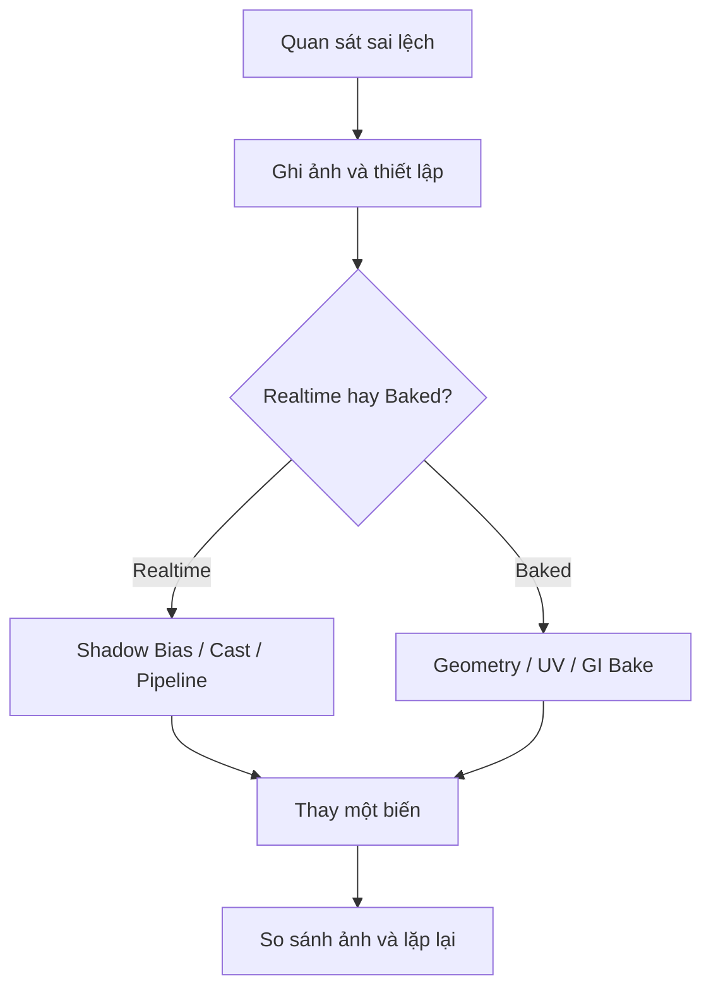

# Bài 09 — Chẩn đoán rò sáng, lỗi bóng và UV Lightmap của mô hình nhập

*Creative Core · Lighting · Unity 6.3 · Refine and troubleshoot the indoor scene*

## 1. Tổng quan và mục tiêu

Một scene nội thất thường gặp những vấn đề khó phát hiện nếu chỉ nhìn ảnh đẹp/xấu: **bóng sai**, **rò ánh sáng qua khe**, **góc tối thiếu ánh sáng gián tiếp**, hoặc **UV lightmap bị lỗi**. Bài này đưa ra quy trình chẩn đoán có thể lặp lại nhằm tìm đúng nguyên nhân trước khi chỉnh thông số.

## 2. Phân biệt các nhóm hiện tượng

| Hiện tượng | Giả thuyết cần thử | Công cụ quan sát |
|---|---|---|
| Đường sáng chạy xuyên góc tường | Hình học có khe hở, tường quá mỏng, bake sampling hoặc UV | Scene view, Wireframe, Baked Lightmap debug |
| Vật đen bất thường | Thiếu ambient/indirect bounce, normal ngược, probes sai | Inspector, Lighting/Albedo diagnostics |
| Bóng có vệt sọc | Bias, shadow resolution, normal | URP Asset và Light component |
| Đốm sáng tối bất quy tắc trên model nhập | UV overlap, padding thiếu, normal hoặc GI | Model Import Settings, UV/lightmap visualization |

Tình trạng **light leak** là ánh sáng xuất hiện ở nơi lẽ ra bị chắn. Không thể quy về một nguyên nhân duy nhất: có thể do khe hở geometry, độ dày bề mặt, dữ liệu lightmap lẫn màu, hoặc cách shadowing/gián tiếp được tính.

## 3. Quy trình sửa theo từng nguyên nhân

1. **Kiểm tra shadow setup.** Tắt từng Light để xác định nguồn. Chụp ảnh cùng camera trước/sau khi chỉnh bias hoặc Shadow Type.
2. **Tăng ánh sáng phòng có kiểm soát.** Xem xét `Environment Lighting`, Indirect Lighting/Bounces và nguồn sáng phản xạ hợp lý. Không chỉ tăng Intensity trực tiếp vì có thể làm vật thể cháy sáng nhưng góc phòng vẫn thiếu chiều sâu.
3. **Khắc phục light leaks.** Bật wireframe để tìm khe hở, mặt phẳng một phía hoặc tường mỏng; kiểm tra UV2 và padding; bake lại sau mỗi thay đổi. Nếu chỉnh thông số bake cải thiện, vẫn cần xác minh lỗi geometry gốc.
4. **Kiểm tra model nhập có UV hỏng.** Import một FBX có lightmap UV sai (bài mẫu có `Apple_BrokenLightmapUVs.fbx`, nếu tải từ trang Unity Learn), đặt nó trong gallery, bật `Contribute GI` rồi quan sát Baked Lightmap diagnostic.
5. **Tạo UV mới.** Chọn FBX tại Project, tab `Model` > `Generate Lightmap UVs` > `Apply`. Kiểm tra cảnh bake lại; với model phức tạp, có thể unwrap thủ công bằng công cụ DCC thay vì phụ thuộc hoàn toàn vào auto unwrap.
6. **Đo trước/sau.** Cùng camera, cùng exposure, cùng quality level và cùng độ phân giải output để kết quả so sánh có ý nghĩa.

## 4. Hiểu đúng lỗi UV

UV texture màu (Base Map) có thể **cố ý chồng lấn** để tái sử dụng chi tiết. Nhưng baked lightmap thường yêu cầu **UV islands không chồng lấn** và có khoảng cách. Do đó, một model hiển thị texture màu hoàn toàn bình thường vẫn có thể bake lỗi. Unity sử dụng `Mesh.uv2` làm kênh baked lightmap ở cấu hình thông dụng; đừng nhầm với tên UV layer được hiển thị trong Blender.

## 5. Báo cáo kiểm thử

Tạo bảng `Hiện tượng → Giả thuyết → Thay đổi → Kết quả → Bước tiếp theo`. Ít nhất ghi ba tình huống: một lỗi bóng realtime, một light leak và một UV bake lỗi. Nếu vấn đề chưa được giải quyết, nêu điều kiện tái hiện thay vì ghi "đã sửa". Bài hoàn thành khi có minh chứng lỗi trước/sau, không phải khi scene chỉ trông sáng hơn.

## 6. Câu hỏi ôn tập trắc nghiệm

### Câu 1

Một vùng sáng xuất hiện xuyên qua góc tường là dấu hiệu điển hình của gì?

A. Light leak  
B. Reflection Probe chuẩn  
C. Normal map hoạt động đúng  
D. Âm thanh 3D  

**Đáp án:** A. **Giải thích:** Light leak chỉ ánh sáng xuất hiện tại khu vực đáng lẽ bị chắn.

### Câu 2

Texture màu đẹp nhưng lightmap bị vệt lạ: điều nào đáng kiểm tra?

A. UV lightmap riêng của model  
B. Tần số âm thanh  
C. Tag camera  
D. Rigidbody mass  

**Đáp án:** A. **Giải thích:** UV cho base color có thể đúng trong khi UV2 cho baked lightmap hỏng.

### Câu 3

Khi gặp lỗi bóng và bake cùng lúc, quy trình tốt nhất là gì?

A. Tăng mọi cường độ cùng lúc  
B. Tách nhóm realtime/baked rồi thử từng giả thuyết  
C. Xóa tất cả vật thể  
D. Tắt ánh sáng mãi mãi  

**Đáp án:** B. **Giải thích:** Thử nghiệm có kiểm soát giúp gắn kết quả với nguyên nhân.

### Câu 4

Generate Lightmap UVs nên được áp dụng ở đâu với FBX nhập?

A. Model Import Settings  
B. Audio Mixer  
C. Animator State  
D. Physics Material  

**Đáp án:** A. **Giải thích:** Unity cung cấp chức năng tự unwrap lightmap UV trong tab Model.

### Câu 5

Tại sao cần giữ góc camera và exposure cố định khi so sánh ảnh?

A. Để nhận biết ảnh hưởng từ biến lighting đang thử  
B. Để giảm số mesh  
C. Để tăng FPS tự động  
D. Để tạo thêm texture  

**Đáp án:** A. **Giải thích:** Thay camera hoặc exposure làm phép so sánh thiếu kiểm soát.

## 7. Tài liệu tham khảo và lưu ý phiên bản

- [Unity Learn — Refine and troubleshoot the indoor scene](https://learn.unity.com/course/creative-core-lighting/tutorial/refine-and-troubleshoot-the-indoor-scene?version=6.3) (Unity 6.3).
- [Tài liệu UV cho lightmap](https://docs.unity3d.com/6000.3/Documentation/Manual/LightingGiUvs-GeneratingLightmappingUVs.html).
- [Tài liệu về Mixed Lighting](https://docs.unity3d.com/kr/current/ScriptReference/MixedLightingMode.html).

**Lưu ý:** Menu và tùy chọn có thể khác theo URP Asset, Quality Level, Unity Editor và loại shader đang dùng. Nội dung là bài giảng tiếng Việt độc lập được biên soạn và bổ sung để học tập, không phải bản dịch chính thức hay lời chép toàn văn của Unity.
