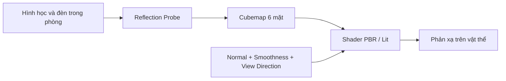

# Bài 10 — Reflection Probes và cubemap: phản xạ chính xác hơn trong nội thất

*Creative Core · Lighting · Unity 6.3 · Improve reflections in your scene*

## 1. Tổng quan và mục tiêu

Một quả táo kim loại đặt trong gallery có thể vẫn phản xạ bầu trời ngoài trời: đó là giới hạn của **environment reflection mặc định**. `Reflection Probe` lưu một đại diện phản xạ của môi trường cục bộ, giúp bề mặt bóng phản xạ không gian mà nó thực sự đang ở trong đó.

## 2. Reflection Probe lưu thông tin như thế nào?

**Cubemap** biểu diễn môi trường theo sáu hướng quanh một điểm quan sát. Shader dùng hướng phản xạ cùng độ nhẵn/smoothness để lấy màu từ môi trường (thường là cubemap đã lọc theo roughness). Với bề mặt metal, phản xạ môi trường có vai trò lớn trong cảm nhận chất liệu.

Khác `Light Probe`, Reflection Probe chủ yếu đại diện **môi trường phản xạ cho thành phần specular**. Nó không tự thay thế lightmap hoặc mô phỏng mọi phản xạ chính xác theo vị trí từng pixel. Những phản xạ cục bộ có thể có sai lệch phối cảnh, đặc biệt gần tường/ góc phòng.

## 3. Các chế độ và đánh đổi

| Chế độ | Đặc điểm | Khi dùng |
|---|---|---|
| `Baked` | Cubemap tính trước, cập nhật khi bake lại | Nội thất, vật tĩnh |
| `Realtime` | Có thể cập nhật cubemap trong runtime | Môi trường thay đổi, cân nhắc chi phí cao |
| `Custom` | Dùng cubemap do người tạo cung cấp | Kiểm soát nghệ thuật hoặc nguồn ảnh HDRI |

Probe có vùng ảnh hưởng (*influence volume*), `Box Size`, `Box Offset`, ưu tiên/blending và tùy chọn **Box Projection** khi hệ thống hỗ trợ. Đặt probe đúng thể tích phòng giúp tránh bề mặt trong nhà phản xạ nền trời. Tuy vậy, nhiều probe chồng lấn không có nghĩa luôn hiệu quả hơn: ảnh hưởng đến blending, chất lượng và tài nguyên.

## 4. Thực hành tại gallery

1. Chuẩn bị một vật thể bóng dùng URP/Lit, chỉnh `Metallic` cao và `Smoothness` ở mức dễ thấy phản xạ. Đặt gần đèn triển lãm.
2. Chụp ảnh khi scene chỉ có phản xạ môi trường mặc định: ghi lại những chi tiết ngoài trời không phù hợp phản xạ trong nhà.
3. Thêm `Reflection Probe`, đặt gần trung tâm không gian cần phản xạ, mở rộng `Size` để bao phủ khu vực gallery; hạn chế vùng cắt vào khu không liên quan.
4. Chọn `Type = Baked`, chỉnh `Culling Mask` khi cần để giới hạn geometry xuất hiện trong cubemap; chạy **Bake** của probe hoặc Generate Lighting tùy UI.
5. Quan sát quả táo/đồ kim loại với camera và material không đổi. Nếu cần, bật Box Projection phù hợp cho phòng dạng hộp và kiểm tra hiệu quả khi đứng gần tường.
6. Thử thay `Smoothness`: bề mặt nhám làm phản xạ mờ đi, không phải probe bị thiếu độ phân giải.
7. Nếu phản xạ vẫn sai, kiểm tra **Reflection Probe Static** của các object được bake, khoảng clipping và thiết lập Blend Probes/Reflection Probes ở Renderer.

## 5. Các lỗi cần biết

- **Probe không hiện tác dụng**: chưa bake, renderer/material không dùng reflection, volume không bao phủ vật thể hoặc cài đặt priority sai.
- **Vẫn phản chiếu Skybox**: object ngoài influence volume, fallback default reflection đang được sử dụng, hoặc độ đóng góp probe thấp.
- **Phản xạ méo**: do cubemap ghi từ một điểm; cân nhắc vị trí capture, Box Projection và phạm vi áp dụng. Không kỳ vọng Reflection Probe tái tạo phản xạ gương phẳng chính xác tuyệt đối.
- **Tốn GPU**: Realtime Probe cập nhật cubemap nhiều mặt, cần giới hạn tần suất update.

## 6. Kết quả cần đạt

Tạo một ảnh before/after của vật bóng trong gallery, minh chứng phản xạ không còn chứa bầu trời sai bối cảnh; lưu thiết lập probe, mô tả ưu/nhược điểm của baked so với realtime reflection.

## 7. Câu hỏi ôn tập trắc nghiệm

### Câu 1

Reflection Probe thường lưu môi trường dưới dạng gì?

A. Cubemap 6 mặt  
B. Lightmap UV đơn sắc  
C. Rigidbody data  
D. Audio clip  

**Đáp án:** A. **Giải thích:** Cubemap ghi hình môi trường theo sáu hướng quanh vị trí probe.

### Câu 2

Nếu vật kim loại trong phòng phản chiếu bầu trời sai bối cảnh, cách hợp lý là gì?

A. Thêm local Reflection Probe bao phủ vùng vật  
B. Xóa tất cả mesh  
C. Tắt mọi shadow  
D. Tăng Collider  

**Đáp án:** A. **Giải thích:** Reflection Probe cục bộ thay đổi nguồn môi trường phản xạ cho vật thể.

### Câu 3

Vì sao Reflection Probe không phải bản thay thế Light Probe?

A. Vì Light Probe là texture Base Map  
B. Vì Reflection Probe hỗ trợ specular environment, Light Probe chủ yếu cấp diffuse lighting  
C. Vì hai công cụ giống nhau hoàn toàn  
D. Vì chỉ một công cụ hoạt động trong URP  

**Đáp án:** B. **Giải thích:** Diffuse và specular được mô tả bởi hệ thống dữ liệu khác nhau.

### Câu 4

Bề mặt giảm Smoothness thường dẫn đến điều gì?

A. Phản xạ mờ/loang hơn  
B. Bắt buộc mất phản xạ mọi lúc  
C. Tăng dung lượng Cubemap  
D. Xóa dữ liệu camera  

**Đáp án:** A. **Giải thích:** Roughness tăng làm phản xạ môi trường được lọc mờ hơn.

### Câu 5

Điểm yếu quan trọng của Realtime Reflection Probe là gì?

A. Không hỗ trợ bất cứ thay đổi nào  
B. Có thể tốn GPU do cập nhật nhiều góc nhìn  
C. Không có Type  
D. Luôn chính xác vật lý tuyệt đối  

**Đáp án:** B. **Giải thích:** Cập nhật cubemap theo runtime có chi phí render đáng kể.

## 8. Tài liệu tham khảo và lưu ý phiên bản

- [Unity Learn — Improve reflections in your scene](https://learn.unity.com/course/creative-core-lighting/tutorial/improve-reflections-in-your-scene?version=6.3) (Unity 6.3).
- [Tài liệu UV cho lightmap](https://docs.unity3d.com/6000.3/Documentation/Manual/LightingGiUvs-GeneratingLightmappingUVs.html).
- [Tài liệu về Mixed Lighting](https://docs.unity3d.com/kr/current/ScriptReference/MixedLightingMode.html).

**Lưu ý:** Menu và tùy chọn có thể khác theo URP Asset, Quality Level, Unity Editor và loại shader đang dùng. Nội dung là bài giảng tiếng Việt độc lập được biên soạn và bổ sung để học tập, không phải bản dịch chính thức hay lời chép toàn văn của Unity.
