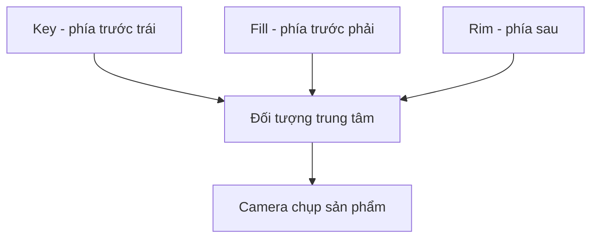

# Bài 11 — Ánh sáng studio và kỹ thuật Three-Point Lighting

*Creative Core · Lighting · Unity 6.3 · Showcase your work with lighting*

## 1. Tổng quan và mục tiêu

Trình bày sản phẩm 3D đòi hỏi ánh sáng giúp người xem đọc được hình dáng, bề mặt và chất liệu. **Three-point lighting** là kỹ thuật phổ biến trong chụp ảnh, phim và diễn họa sản phẩm: một nguồn chính, một nguồn bổ trợ và một đèn tách chủ thể khỏi nền. Bạn sẽ thử ánh sáng ba điểm với một đạo cụ trong studio ảo của Unity.

## 2. Phân vai ánh sáng

| Vai trò | Công dụng | Vị trí thường gặp |
|---|---|---|
| `Key Light` | Định hình diện sáng chính, xác lập hướng nhìn | Trước và lệch một phía chủ thể |
| `Fill Light` | Kiểm soát tương phản phía tối | Phía đối diện nguồn chính |
| `Back / Rim Light` | Tạo vành sáng tách chủ thể khỏi nền | Phía sau hoặc chếch sau |

**Đây là vai trò thị giác, không phải tên bắt buộc của một Component Unity.** Ba đèn thường là Spot/Point với màu và góc thích hợp. Trong project Unity Learn, studio có hai đèn màu xanh/cam tương đương độ mạnh đặt đối diện nhau và một đèn trắng phía sau; đó là **biến thể** của three-point, không phải công thức cứng rằng Key luôn mạnh hơn Fill.

Sơ đồ chỉ diễn tả tương quan chứ không quy định góc đặt đèn tuyệt đối. Vật thể bóng, nhám, thủy tinh và vải cần xử lý specular và vùng nhấn khác nhau.

## 3. Xây dựng studio

1. Mở `FinalScene_Lighting_Studio` trong project mẫu để quan sát, sau đó duplicate scene trước khi chỉnh sửa.
2. Thay quả táo/đạo cụ mẫu bằng một model 3D của bạn, chẳng hạn tượng nhỏ, chai nước hoặc sản phẩm thiết kế. Tạo nền cong studio hoặc phông đơn sắc để tách đường chân trời.
3. Tắt hai đèn còn lại, chỉ bật **Key Light**. Quan sát vùng sáng và hướng bóng. Chọn góc tốt nhất làm hướng chính của shot.
4. Bật **Fill Light**. Tăng dần tác động của đèn này đến khi phần tối vẫn còn chi tiết mà không làm vật thể phẳng. Có thể dùng màu ấm/lạnh đối lập nhưng cần có chủ đích.
5. Bật **Rim Light** và di chuyển ra phía sau. Điều chỉnh góc và cường độ để tạo đường viền mà không cháy sáng hoặc tạo chấm highlight vô cớ.
6. Chỉnh `Spot Angle`, `Range`, `Intensity`, `Color`, `Inner/Outer Spot Angle` (nếu khả dụng), đặt Camera cố định. Thay đổi backdrop và kiểm tra tính nhất quán của phản xạ vật liệu.
7. Chụp ảnh **chỉ Key / Key + Fill / đủ ba đèn**. Với mẫu phức tạp, kiểm tra lại Reflection Probe hoặc environment reflection.

## 4. Thiết kế mood

Một tông ấm trung tính với phông sáng thường truyền cảm giác tin cậy, thân thiện; tương phản cam–xanh tăng tính kịch tính, hiện đại. Đây chỉ là **quy ước thị giác có tính bối cảnh**, không phải ánh sáng màu nào cũng gắn với một cảm xúc duy nhất. Với ảnh portfolio, độ nhận biết sản phẩm và hình dáng vẫn quan trọng hơn việc thêm nhiều hiệu ứng.

## 5. Đánh giá chất lượng

Một shot studio tốt cần trả lời được: người xem nhìn vào đâu đầu tiên; rìa vật có tách nền không; chi tiết vật liệu có bị cháy hay mất trong bóng không; highlight có diễn tả đúng độ nhẵn không; có vùng phản xạ sai môi trường không. Có thể dùng Unity Recorder (nếu cài đặt tương thích) để xuất ảnh/video; ảnh chụp màn hình cũng chấp nhận được cho bài thực hành.

## 6. Sản phẩm nộp

Ba ảnh phân tách vai trò đèn, một ảnh cuối chất lượng cao, mô tả ngắn về tông màu/mood và bảng các thay đổi `Key / Fill / Rim`. Không bắt buộc dùng ba đèn nếu có phương án nghệ thuật rõ ràng, nhưng phải chứng minh được vai trò từng nguồn.

## 7. Câu hỏi ôn tập trắc nghiệm

### Câu 1

Đèn nào thường dùng để tạo vành sáng tách vật khỏi phông?

A. Key  
B. Fill  
C. Rim/Back  
D. Ambient  

**Đáp án:** C. **Giải thích:** Back/Rim chiếu từ phía sau tạo đường viền tách bối cảnh.

### Câu 2

Chức năng phổ biến của Fill Light là gì?

A. Làm mất toàn bộ bóng  
B. Giảm độ tương phản quá gắt ở phía tối  
C. Tạo ánh sáng mặt trời trực tiếp  
D. Tạo lightmap UV  

**Đáp án:** B. **Giải thích:** Fill bù chi tiết vào phần bóng để kiểm soát tương phản.

### Câu 3

Three-point lighting có bắt buộc Key luôn mạnh hơn Fill không?

A. Có, theo định nghĩa Unity  
B. Không, có thể dùng biến thể với hai đèn màu ngang nhau  
C. Chỉ khi có Skybox  
D. Không được dùng Spot Light  

**Đáp án:** B. **Giải thích:** Bố cục studio có thể biến đổi theo ý đồ nhưng vẫn giữ vai trò chiếu sáng.

### Câu 4

Vì sao phải chụp các trạng thái bật từng đèn?

A. Để thấy đóng góp riêng và chỉnh theo nguyên nhân  
B. Để bỏ mọi vật liệu  
C. Để tạo GI realtime  
D. Để Unity thay model  

**Đáp án:** A. **Giải thích:** A/B giữa các nguồn giúp tìm đúng ánh sáng ảnh hưởng từng vùng.

### Câu 5

Ảnh sản phẩm bị cháy sáng làm mất texture: nên làm gì trước?

A. Tăng exposure  
B. Giảm/điều chỉnh key, rim hoặc exposure theo nguyên nhân  
C. Thêm đèn cường độ cao  
D. Tắt Camera  

**Đáp án:** B. **Giải thích:** Kiểm soát cường độ và dải sáng trước khi dùng hiệu ứng làm ảnh sáng thêm.

## 8. Tài liệu tham khảo và lưu ý phiên bản

- [Unity Learn — Showcase your work with lighting](https://learn.unity.com/course/creative-core-lighting/tutorial/showcase-your-work-with-lighting?version=6.3) (Unity 6.3).

**Lưu ý:** Menu và tùy chọn có thể khác theo URP Asset, Quality Level, Unity Editor và loại shader đang dùng. Nội dung là bài giảng tiếng Việt độc lập được biên soạn và bổ sung để học tập, không phải bản dịch chính thức hay lời chép toàn văn của Unity.
