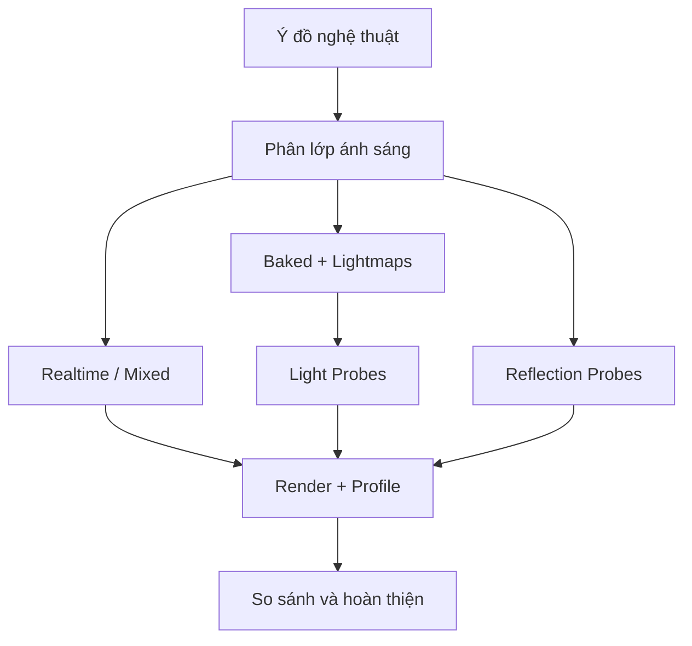

# Bài 13 — Áp dụng hệ thống chiếu sáng vào dự án Unity cá nhân

*Creative Core · Lighting · Unity 6.3 · Apply lighting to your guided project*

## 1. Bài toán

Một Guided Project có thể là không gian trưng bày, cảnh game, mô phỏng kiến trúc hoặc sản phẩm 3D. Yêu cầu không chỉ là làm cho vật thể nhìn thấy được; hệ thống lighting phải hỗ trợ **mục tiêu trải nghiệm**, hoạt động đúng trên render pipeline đang dùng và có thể kiểm chứng. Bài thực hành này tạo một vòng triển khai hoàn chỉnh từ phân tích đến kết quả.

## 2. Mục tiêu sản phẩm

Hoàn thiện lighting trong **một scene của chính dự án** với: một mô tả mục tiêu thị giác, phương án light source phù hợp, lựa chọn realtime/baked có căn cứ, shadow tối ưu cơ bản, probes nơi cần thiết và ảnh before/after ở góc camera cố định.

## 3. Xác định ràng buộc trước khi triển khai

| Câu hỏi | Gợi ý quyết định |
|---|---|
| Đối tượng nào chuyển động? | Giữ đèn realtime/mixed hoặc đặt Light Probes phù hợp |
| Kiến trúc có cố định không? | Ưu tiên xét bake cho geometry tĩnh |
| Người chơi thấy vùng nào nhiều nhất? | Dồn chất lượng shadow/lightmap ở vùng quan trọng |
| Có vật liệu bóng và không gian nội thất? | Kiểm tra Reflection Probes cục bộ |
| Mục tiêu chạy trên điện thoại hay PC? | Đặt ngân sách đèn, bóng, lightmap, đo trên thiết bị đích |

Không chuyển toàn bộ nguồn sáng sang Baked nếu gameplay thực sự yêu cầu đèn di chuyển hoặc đổi bố cục. Ngược lại, không dùng nhiều đèn Realtime cho nội thất cố định chỉ vì dễ chỉnh trong Editor.

## 4. Kiến trúc hệ thống lighting

Chú ý rằng lựa chọn Light Probes/Reflection Probes là **để giải quyết các vấn đề khác nhau**: ánh sáng khuếch tán với vật không dùng lightmap và phản xạ môi trường của vật bóng.

## 5. Các mốc triển khai

**Mốc A – Lighting baseline.** Lưu scene thành bản sao, đặt camera, bật đúng project URP Asset, chụp ảnh ban đầu. Ghi rõ nguồn sáng chủ đạo, hướng bóng, palette màu và đối tượng được ưu tiên.

**Mốc B – Light source và environment.** Cấu hình Directional/Skybox nếu ngoài trời; Spot/Point cho nguồn địa phương; ambient đủ để không mất toàn bộ thông tin vùng khuất. Thử một thay đổi mỗi lần và xem Game view.

**Mốc C – Bake.** Quyết định mesh tĩnh, kiểm tra `Contribute GI`, UV2 và thiết lập bake. Generate Lighting rồi kiểm tra bằng diagnostic. Nếu scene thay đổi, ghi lại những asset/dữ liệu bake cần cập nhật.

**Mốc D – Probes, reflection và bóng.** Di chuyển một vật thể thử qua scene, so sánh Lighting với probes. Với vật bóng, kiểm tra reflection và culling volumes. Tinh chỉnh Shadow Distance/Bias/Soft Shadows và chú ý cost GPU.

**Mốc E – Kiểm thử.** Test ở Play Mode và trong build khi có điều kiện; dùng Profiler/Frame Debugger hoặc các diagnostic liên quan. Ghi frame time thực tế thay vì chỉ đo FPS không kiểm soát điều kiện.

## 6. Definition of Done

- [ ] Lighting chủ đạo có lý do rõ ràng và dẫn mắt tới mục tiêu.
- [ ] Không có lỗi hình ảnh nổi bật do UV, shadow hoặc reflection.
- [ ] Chế độ Light phù hợp tính chất tĩnh/động của scene.
- [ ] Có ảnh before/after với cùng góc camera và chất lượng render.
- [ ] Lưu bảng thông số/cấu hình đã thử; biết yếu tố nào cần rebake.
- [ ] Có ít nhất một cải tiến đo được hoặc giải thích bằng đối chiếu trực quan.

## 7. Câu hỏi ôn tập

1. Với dự án có chu kỳ ngày đêm thay đổi liên tục, phần ánh sáng nào khó chỉ dùng Baked Lightmap?
2. Khi nhân vật đi vào căn phòng bake và trông không hòa nhập, thành phần gì cần kiểm tra?
3. Vì sao một metal shader trong nhà có thể phản xạ bầu trời dù phòng kín?
4. Bạn ưu tiên sửa lỗi shadow acne hay tăng lightmap resolution khi bóng lỗi trong một đèn realtime? Vì sao?
5. Muốn chứng minh tiến bộ, bạn sẽ giữ cố định những yếu tố nào trong hai ảnh đối chiếu?

Không cần có cấu hình giống một dự án khác; một phương án tốt phải chứng minh được **đúng với yêu cầu scene của bạn**.

## 8. Tài liệu tham khảo và lưu ý phiên bản

- [Unity Learn — Apply lighting to your guided project](https://learn.unity.com/course/creative-core-lighting/tutorial/apply-lighting-to-your-guided-project?version=6.3) (Unity 6.3).
- [Tài liệu UV cho lightmap](https://docs.unity3d.com/6000.3/Documentation/Manual/LightingGiUvs-GeneratingLightmappingUVs.html).
- [Tài liệu về Mixed Lighting](https://docs.unity3d.com/kr/current/ScriptReference/MixedLightingMode.html).

**Lưu ý:** Menu và tùy chọn có thể khác theo URP Asset, Quality Level, Unity Editor và loại shader đang dùng. Nội dung là bài giảng tiếng Việt độc lập được biên soạn và bổ sung để học tập, không phải bản dịch chính thức hay lời chép toàn văn của Unity.
