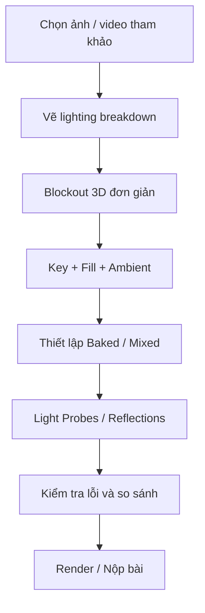

# Bài 12 — Thử thách: tái tạo ánh sáng điện ảnh từ hình ảnh tham khảo

*Creative Core · Lighting · Unity 6.3 · Challenge: Complete a cinematic lighting study*

## 1. Mục tiêu thử thách

Hãy dựng một **cinematic lighting study** lấy cảm hứng từ khung hình phim, trò chơi, ảnh nghệ thuật hoặc một không gian do bạn tự thiết kế. Đây là bài đánh giá khả năng **đọc ảnh tham khảo → lập kế hoạch nguồn sáng → dựng scene → bake → phản biện kết quả**. Ưu tiên chất lượng ánh sáng, không ưu tiên số lượng polygon hoặc độ phức tạp của model.

Bạn được quyền dùng geometry đơn giản, ProBuilder/Terrain hoặc asset có giấy phép hợp lệ để tạo bố cục. Không cần tái tạo trung thực từng nhân vật hay chi tiết thuộc tác phẩm tham khảo; mục đích là học cấu trúc ánh sáng và cách xây dựng cảm xúc.

## 2. Yêu cầu tối thiểu

Sản phẩm cần đáp ứng các điểm cốt lõi sau:

- Nhận diện và mô phỏng hợp lý mọi nguồn sáng quan trọng, bao gồm **ambient/diffuse environmental lighting**.
- Thể hiện rõ **mood** và ngôn ngữ thị giác của hình tham khảo.
- Có **baked lighting** được cấu hình và tạo dữ liệu thành công.
- Có **Light Probes** cho các vị trí hoặc vật động cần thiết; dùng **Reflection Probes** khi vật liệu/không gian cần phản xạ cục bộ.
- Có ảnh hoặc video chứng minh bố cục cuối và giải thích ngắn cho từng nguồn sáng.

Nếu có nhiều bối cảnh, chỉ chọn một scene hoàn chỉnh và phân tích sâu thay vì làm nhiều scene sơ sài.

## 3. Quy trình đề xuất

### 3.1. Phân tích và lập kế hoạch

Chọn một khung hình đủ rõ nguồn sáng và bề mặt. Đánh dấu (1) nguồn sáng chính; (2) các nguồn sáng phụ; (3) hướng bóng; (4) vùng tối cần giữ; (5) màu nền và màu nhấn; (6) chất liệu dễ phản chiếu. Ghi chú phần nào có thể bake, phần nào cần realtime. Nếu nguồn sáng nằm ngoài khung hình, vẫn mô tả hướng và tác dụng.

### 3.2. Blockout và triển khai

Dùng Cube, Plane, Sphere, ProBuilder hoặc model low-poly để tái tạo kích thước và silhouette quan trọng. Đặt camera khớp bố cục ảnh trước khi điều chỉnh đèn. Thiết lập ambient/skybox, đặt Light chính, rồi từng Light phụ. Chỉ sau khi bố cục sáng/tối đã tương đối ổn mới làm vật liệu hoặc post-processing phức tạp.

### 3.3. Bake và sửa lỗi

Đánh dấu Contribute GI cho hình học tĩnh, kiểm tra UV, tạo Lighting Settings Asset, Generate Lighting. Đặt probes ở nơi vật động đi qua; dùng reflection local với bề mặt bóng trong nhà. Kiểm tra ít nhất ba lỗi khả dĩ: light leak, shadow acne và phản xạ sai nguồn; ghi lại thay đổi thực tế.

## 4. Tiêu chí đánh giá gợi ý

| Tiêu chí | Trọng số gợi ý |
|---|---:|
| Tương đồng bố cục và mood của ánh sáng | 30% |
| Phân bố nguồn sáng, bóng và ambient hợp lý | 25% |
| Thiết lập Baked và Light Probes đúng chức năng | 20% |
| Reflection và vật liệu nhất quán | 10% |
| Minh chứng và khả năng giải thích quyết định kỹ thuật | 15% |

Đây là **rubric tự học**, không phải thang chấm chính thức của Unity. Người chấm nên xem ảnh tham khảo và ảnh scene đặt cạnh nhau ở cùng tỷ lệ gần đúng.

## 5. Deliverables và checklist

- [ ] Một project hoặc scene có thể mở và chạy trong Unity.
- [ ] Ảnh tham khảo kèm nguồn/giấy phép sử dụng hoặc liên kết gốc.
- [ ] Ảnh blockout, ảnh lighting breakdown và ảnh render cuối.
- [ ] Bảng các Light, Mode, nhiệm vụ thị giác và lý do chọn.
- [ ] Có dữ liệu bake và probes thực sự được dùng.
- [ ] Có nhật ký ít nhất một lần thử sai/sửa và sự khác biệt trước/sau.

## 6. Câu hỏi tự đánh giá

1. Tắt Key Light đi thì thông tin hình khối nào bị mất?
2. Vì sao cần ambient thay vì cố thay thế nó bằng nhiều Point Light?
3. Phần nào trong scene có thể bake mà không ảnh hưởng mục tiêu mô phỏng?
4. Vật chuyển động ở vùng sáng/tối đang nhận đúng Light Probes chưa?
5. Đâu là khác biệt khó tái tạo nhất so với ảnh tham khảo: hướng bóng, dải tương phản, phản xạ, hay màu sắc?

**Không có đáp án mẫu duy nhất**: mỗi lựa chọn cần được bảo vệ bằng ảnh kiểm chứng và giải thích ngắn.

## 7. Tài liệu tham khảo và lưu ý phiên bản

- [Unity Learn — Challenge: Complete a cinematic lighting study](https://learn.unity.com/course/creative-core-lighting/tutorial/challenge-complete-a-cinematic-lighting-study?version=6.3) (Unity 6.3).

**Lưu ý:** Menu và tùy chọn có thể khác theo URP Asset, Quality Level, Unity Editor và loại shader đang dùng. Nội dung là bài giảng tiếng Việt độc lập được biên soạn và bổ sung để học tập, không phải bản dịch chính thức hay lời chép toàn văn của Unity.
