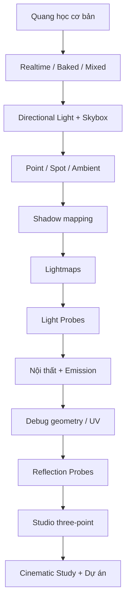

# Unity Creative Core — Lighting (Unity 6.3) | Giáo trình tiếng Việt

Bộ 14 bài học từ nền tảng ánh sáng, URP, baked GI đến Light Probes, Reflection Probes, ánh sáng studio và bài thử thách điện ảnh. Các bài được biên soạn độc lập, có ví dụ thực hành và ôn tập chuyên đề; không thay thế bản gốc trên Unity Learn.

## Lộ trình học

01. [Nhập môn nghệ thuật và khoa học ánh sáng](001-get-started-with-lighting.md) — *lesson*
02. [Ánh sáng trực tiếp, gián tiếp và các hệ thống Lighting trong Unity](002-get-started-with-lighting-in-unity.md) — *lesson*
03. [Thiết lập Directional Light và Skybox cho cảnh ngoài trời](003-configure-the-directional-light-and-skybox.md) — *lab*
04. [Thêm Point Light, Spot Light và ánh sáng môi trường](004-add-light-sources-to-your-scene.md) — *lab*
05. [Cấu hình bóng đổ, shadow cascades và hậu kỳ](005-configure-shadows-in-your-scene.md) — *lab*
06. [Baking Lightmap: lưu ánh sáng tĩnh và tối ưu cảnh](006-bake-a-lightmap-for-your-scene.md) — *lab*
07. [Light Probes: chiếu sáng vật thể động trong môi trường đã bake](007-improve-your-lighting-with-light-probes.md) — *lab*
08. [Thiết kế chiếu sáng nội thất, Emission và hệ thống probe 3D](008-examine-and-complete-the-indoor-scene.md) — *lab*
09. [Chẩn đoán rò sáng, lỗi bóng và UV Lightmap của mô hình nhập](009-refine-and-troubleshoot-the-indoor-scene.md) — *lab*
10. [Reflection Probes và cubemap: phản xạ chính xác hơn trong nội thất](010-improve-reflections-in-your-scene.md) — *lab*
11. [Ánh sáng studio và kỹ thuật Three-Point Lighting](011-showcase-your-work-with-lighting.md) — *lab*
12. [Thử thách: tái tạo ánh sáng điện ảnh từ hình ảnh tham khảo](012-challenge-complete-a-cinematic-lighting-study.md) — *exercise*
13. [Áp dụng hệ thống chiếu sáng vào dự án Unity cá nhân](013-apply-lighting-to-your-guided-project.md) — *project*
14. [Bài kiểm tra tổng hợp kiến thức Lighting – Unity Creative Core](014-creative-core-lighting-quiz.md) — *assessment*

## Bản đồ kiến thức

## Tài nguyên học tập và phương pháp

- [Unity Learn — Creative Core: Lighting](https://learn.unity.com/project/creative-core-lighting) (bộ bài chính thức).
- [Unity Learn — Lighting pathway](https://learn.unity.com/pathway/creative-core/unit/lighting?version=6.3).
- [Unity Manual — Lighting](https://docs.unity3d.com/6000.3/Documentation/Manual/LightingOverview.html).
- [Lightmap UVs trong Unity](https://docs.unity3d.com/6000.3/Documentation/Manual/LightingGiUvs-GeneratingLightmappingUVs.html).

**Cách học:** mở từng bài độc lập, thực hiện thí nghiệm trên scene bản sao, giữ góc camera cố định khi so sánh ảnh và ghi lại nguyên nhân của từng thay đổi. Bài 12 là thử thách mở, bài 14 là bài tự kiểm tra không kèm đáp án trong đề.
