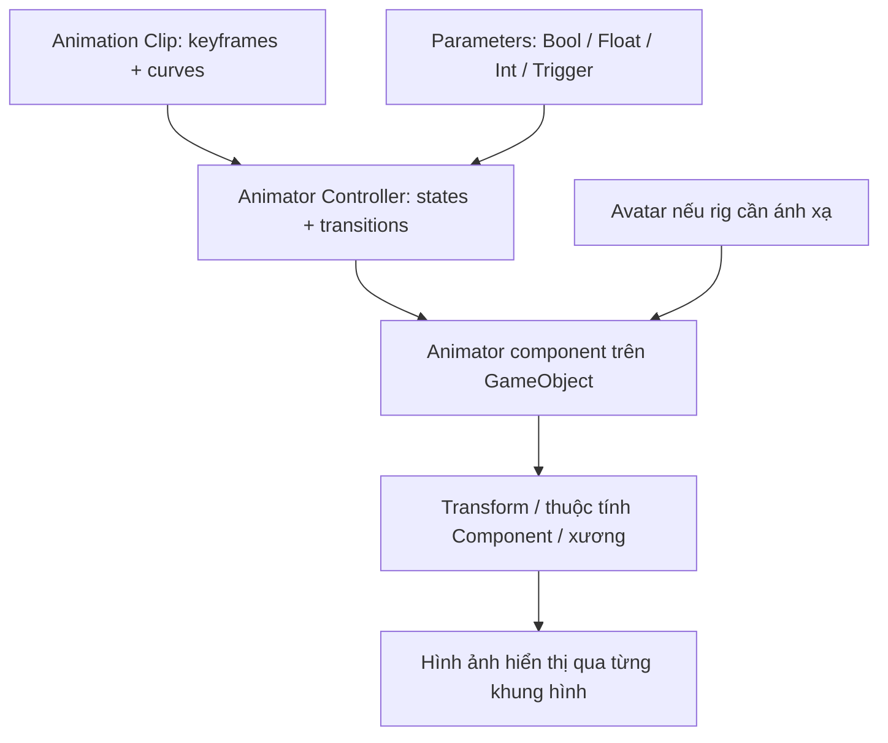

# Bài 01 — Nhập môn Animation trong Unity

> **Creative Core · Animation · Unity 6.3 · Bài học nền tảng**

## 1. Tóm tắt

Animation (hoạt ảnh) là quá trình mô tả sự thay đổi của một hoặc nhiều thuộc tính theo thời gian để tạo cảm giác chuyển động. Trong Unity, chuyển động không chỉ áp dụng cho nhân vật: cửa tự mở, đèn thay đổi cường độ, biển hiệu xoay, vật thể nhún lên xuống và một đối tượng dịch chuyển đều có thể được thực hiện bằng hoạt ảnh. Trọng tâm của bài này là phân biệt **dữ liệu chuyển động** với **cơ chế điều khiển lúc phát chuyển động**.

## 2. Mục tiêu học tập

Sau khi hoàn thành, người học có thể:

1. Giải thích quan hệ giữa `Animation Clip`, `Animator Controller`, `Animator` và `Avatar`.
2. Phân biệt `Animation` window với `Animator` window.
3. Tạo một hoạt ảnh chuyển vị đơn giản cho GameObject và quan sát trạng thái chạy.
4. Chẩn đoán được các lỗi cơ bản khi đối tượng không chuyển động.

## 3. Bối cảnh và nguyên lý

Một đối tượng trong scene có nhiều thuộc tính: `Transform.position`, `Transform.rotation`, `Transform.localScale`, màu hoặc cường độ ánh sáng. Thay vì thay đổi các thuộc tính này thủ công ở mỗi khung hình, ta đặt những **keyframe** tại các thời điểm xác định. Unity tính các giá trị trung gian bằng **interpolation** (nội suy) giữa các keyframe.

Ví dụ, khối lập phương ở vị trí Y = 0 tại giây 0 và Y = 2 tại giây 1. Nếu đường cong vị trí dùng nội suy tuyến tính thì ở giây 0,5, Y ≈ 1. Nếu chuyển sang đường cong Ease In/Out thì đối tượng tăng tốc và giảm tốc thay vì giữ tốc độ đều; giá trị tại cùng một thời điểm phụ thuộc vào hình dạng đường cong.

### 3.1. Các thành phần của hệ thống

| Thành phần | Bản chất | Trách nhiệm |
|---|---|---|
| `Animation Clip` (`.anim`) | Asset dữ liệu | Chứa keyframe, curves và các thuộc tính được animate |
| `Animator Controller` (`.controller`) | Asset điều khiển | Tổ chức các state, transition, parameter và việc chọn clip |
| `Animator` | Component gắn trên GameObject | Đánh giá hoạt ảnh từ Controller trong thời gian chạy |
| `Avatar` | Ánh xạ rig, đặc biệt quan trọng với Humanoid | Cho phép hệ thống diễn giải chuyển động xương và retargeting |
| `Animation` window | Cửa sổ biên tập | Tạo clip, sửa keyframe, Dope Sheet và Curves |
| `Animator` window | Cửa sổ điều khiển | Xây dựng đồ thị state/transition của Controller |

Một GameObject hình khối cơ bản có thể animate mà **không cần Humanoid Avatar**. Nhân vật rigged có thể phải cấu hình Avatar phù hợp với loại rig.

### 3.2. Dòng dữ liệu hoạt ảnh

**Ý nghĩa:** Clip mô tả *diễn ra như thế nào*; Controller quyết định *phát hoạt ảnh nào và khi nào*; Animator áp dụng kết quả lên GameObject. Một Controller có thể tham chiếu nhiều clip, nhưng không tự trở thành dữ liệu chuyển động.

## 4. Phân biệt các loại chuyển động

- **Keyframe animation:** ghi lại thay đổi thuộc tính theo thời gian; phù hợp cửa, vật thể, ánh sáng, hiệu ứng đơn giản.
- **Skeletal animation:** thay đổi tư thế khung xương (rig); phù hợp nhân vật, động vật, robot có khớp.
- **Imported animation:** clip tạo từ Blender, Maya hoặc công cụ DCC và đưa vào Unity; cần kiểm tra rig và import settings.
- **Procedural animation:** chuyển động tính bằng code hoặc hệ thống như IK; không phải mọi chuyển động trong Unity đều cần keyframe.

Một clip có thể được phát tự động khi vào scene hoặc thông qua transition có điều kiện. **Play Mode** là môi trường để kiểm tra hành vi, còn Animation window có thể preview clip trước khi chạy toàn bộ scene.

## 5. Thực hành: khối lập phương chuyển động

**Chuẩn bị:** tạo project 3D, scene mới; chọn `GameObject > 3D Object > Cube`; đổi tên thành `AnimatedCube`; bảo đảm GameObject đang active.

1. Chọn `AnimatedCube` trong Hierarchy, mở `Window > Animation > Animation`.
2. Nếu chưa có clip, chọn **Create**, lưu `Assets/Animations/CubeMove.anim`. Unity thường đồng thời tạo Animator Controller và thêm Animator vào GameObject khi tạo clip đầu tiên bằng quy trình này.
3. Trong Animation window, bật chế độ ghi (**Record**) hoặc thêm property track với **Add Property > Transform > Position**.
4. Ở thời điểm **0:00**, đặt `Position = (0, 0, 0)`; tại **1:00** (giây thứ nhất), đặt `Position = (0, 2, 0)` để tạo keyframe. Kiểm tra rõ đơn vị **seconds/frames** hiển thị trên timeline, tránh nhầm `1:00` với một phút.
5. Tắt Record. Kéo playhead để quan sát khối thay đổi vị trí. Mở `Window > Animation > Animator` và xem clip đang là state mặc định.
6. Nhấn Play, kiểm tra chuyển động trong Game view. Nếu muốn lặp, chọn clip trong Project và bật `Loop Time` ở Inspector (khi tuỳ chọn được hỗ trợ).

**Kết quả mong đợi:** Khối dịch chuyển giữa hai vị trí. Hai keyframe tạo một chuyển động tuyến tính hoặc theo curve hiện có; chuyển động lặp hay dừng tùy cấu hình clip/state.

## 6. Lỗi thường gặp và quy trình kiểm tra

| Hiện tượng | Nguyên nhân khả dĩ | Cách kiểm tra |
|---|---|---|
| Khối đứng yên trong Play | Animator bị vô hiệu hoá, thiếu Controller hoặc state không có Motion | Inspector > `Animator`; mở state mặc định xem Motion |
| Clip preview đúng nhưng Play sai | Controller đang chọn state khác hoặc transition thay đổi state | Quan sát state sáng trong Animator khi Play |
| Khối bị đổi vị trí ngoài dự kiến | Keyframe ghi cả các trục Position hoặc một property không chủ đích | Xem danh sách property trong Animation window |
| Thay đổi Inspector không giữ sau khi Play | Thay đổi đang thực hiện trong Play Mode | Thoát Play, chỉnh lại trong Edit Mode và lưu scene |
| Nhân vật rig không di chuyển đúng | Avatar hoặc ánh xạ xương không tương thích | Kiểm tra Model Importer > Rig > Avatar |

**Quy trình debug chuẩn:** tái hiện → kiểm tra Console → xem Animator/Controller/clip → kiểm tra property track → thay đổi một biến → chạy lại.

## 7. Bài tập vận dụng

Tạo `FloatingOrb` bằng Sphere, thêm hoạt ảnh di chuyển theo trục Y, sau đó thử tăng chiều cao tối đa nhưng giữ thời lượng clip cố định. Quan sát sự thay đổi cảm nhận tốc độ. Tạo thêm một hoạt ảnh xoay có tốc độ khác và giải thích vì sao không nên vô tình animate vị trí của cha và con cùng lúc khi chúng có chuyển động chồng lấn.

**Tiêu chí đạt:** Có scene chạy được, tối thiểu hai keyframe, phân biệt rõ clip và controller; ghi lại ảnh Animation window và Animator window.

## 8. Câu hỏi ôn tập trắc nghiệm

### 8.1. Câu 1

Vì sao `Animation Clip` và `Animator Controller` không thể coi là cùng một thành phần?

**A.** Clip chỉ chứa hình học, Controller chứa texture.  
**B.** Clip lưu biến đổi theo thời gian; Controller quyết định các trạng thái và chuyển trạng thái.  
**C.** Controller chỉ dùng để render đối tượng.  
**D.** Clip bắt buộc có Humanoid Avatar.  

**Đáp án:** B. **Giải thích:** Một bên là dữ liệu chuyển động, bên còn lại là logic điều khiển phát.

### 8.2. Câu 2

Đối tượng Cube chỉ có Transform cần dùng thành phần nào để phát clip theo Mecanim?

**A.** Animator và Controller phù hợp.  
**B.** Humanoid Avatar bắt buộc.  
**C.** Skinned Mesh Renderer bắt buộc.  
**D.** Rigidbody bắt buộc.  

**Đáp án:** A. **Giải thích:** Hoạt ảnh thuộc tính trên Cube không đòi rig Humanoid hay vật lý.

### 8.3. Câu 3

Cần chỉnh hình dạng gia tốc của chuyển động theo thời gian thì dùng đâu?

**A.** Console.  
**B.** Lighting Settings.  
**C.** Animator Parameters.  
**D.** Curves trong Animation window.  

**Đáp án:** D. **Giải thích:** Curves và tangents kiểm soát giá trị nội suy qua các keyframe.

### 8.4. Câu 4

Một clip preview đúng nhưng runtime chơi clip khác. Bước kiểm tra nào hữu ích nhất?

**A.** Đổi màu material.  
**B.** Xoá toàn bộ clip.  
**C.** Xem active state và transitions trong Animator.  
**D.** Đổi camera sang orthographic.  

**Đáp án:** C. **Giải thích:** Controller có thể chuyển sang state khác khi chạy.

### 8.5. Câu 5

Thay đổi Inspector trong Play Mode rồi tắt Play có hiện tượng gì thường gặp?

**A.** Thay đổi thử nghiệm không được lưu như chỉnh sửa scene ở Edit Mode.  
**B.** Unity luôn tự tạo Prefab mới.  
**C.** Clip bị xoá khỏi thư mục.  
**D.** Shader tự động chuyển sang URP.  

**Đáp án:** A. **Giải thích:** Play Mode dùng để thử nghiệm; thay đổi trong đó thường được hoàn nguyên khi thoát.

## 9. Tổng kết

- `Animation Clip` lưu biến đổi theo thời gian; `Animator Controller` quản lý luồng phát; `Animator` thực thi trên GameObject.
- `Animation` window để dựng/hiệu chỉnh chuyển động, `Animator` window để điều khiển các trạng thái.
- Hãy kiểm tra clip, state, parameter và các thuộc tính đã được ghi trước khi thay đổi project settings.

## 10. Tài liệu học thêm

1. [Unity Learn — Creative Core Animation](https://learn.unity.com/pathway/creative-core/unit/animation?version=6.3).
2. [Unity 6.3 — Animation window](https://docs.unity.com/en-us/engine/6000.3/manual/animation-section/animation-mecanim/animation-clips/animation-editor-guide).
3. [Unity 6.3 — Animator Controller](https://docs.unity.com/en-us/engine/6000.3/manual/animation-section/animation-mecanim/animation-animator-controller).
4. [Unity 6.3 — Humanoid Avatar](https://docs.unity.com/en-us/engine/6000.3/manual/animation-section/animation-mecanim/avatar-creationand-setup).
