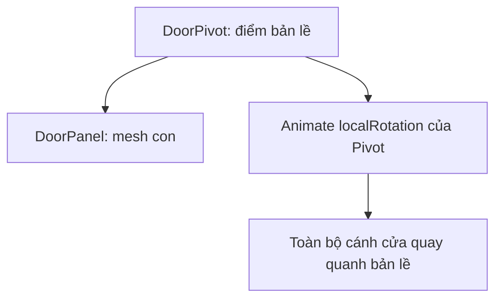

# Bài 02 — Tạo hoạt ảnh 3D đầu tiên bằng Keyframe

> **Creative Core · Animation · Unity 6.3 · Bài thực hành có hướng dẫn**

## 1. Tóm tắt

Keyframe animation cho phép tạo chuyển động 3D mà không cần viết mã hoặc dựng rig phức tạp. Bài này tập trung vào quy trình thiết kế chuyển động có chủ đích: xác định điểm bắt đầu, điểm kết thúc, thời lượng, phương chuyển động, thuộc tính được điều khiển và cách kiểm tra kết quả.

## 2. Mục tiêu học tập

1. Tạo và lưu hai Animation Clip độc lập cho một GameObject.
2. Đặt các keyframe `Position`, `Rotation` hoặc `Scale` đúng mốc thời gian.
3. Dự đoán ảnh hưởng của khoảng cách/thời gian đến tốc độ và nhận diện trục local–world.
4. Kiểm tra clip có được phát đúng bằng Animator Controller hay không.

## 3. Nguyên lý về keyframe và timeline

### 3.1. Keyframe là gì?

Keyframe ghi lại giá trị của thuộc tính tại một thời điểm. Ví dụ, cánh cửa có rotation Y = 0° ở t = 0 và Y = 90° ở t = 1 giây. Các góc giữa hai thời điểm được dựng bằng thuật toán nội suy. Không cần đặt keyframe ở từng frame trừ khi hiệu ứng đòi chính xác từng bước.

Đối với chuyển động tuyến tính theo một trục, tốc độ trung bình được ước lượng bởi:

$$
v_{tb} = \frac{|x_{cuối} - x_{đầu}|}{\Delta t}
$$

Trong ví dụ vật di chuyển 2 đơn vị trong 1 giây, tốc độ trung bình là 2 đơn vị/giây. **Lưu ý:** đây không nhất thiết là tốc độ tức thời khi áp dụng ease-in/ease-out.

### 3.2. Position, Rotation và Scale

| Thuộc tính | Chuyển động phù hợp | Lưu ý |
|---|---|---|
| `Transform.localPosition`/track Position | Tịnh tiến/nhún | Animation trên Transform thường được đánh giá theo quan hệ cha–con; chú ý local space |
| `Transform.localRotation`/track Rotation | Mở cửa, quay biển hiệu | Cần xác định pivot chính xác |
| `Transform.localScale`/track Scale | Phóng to, thu nhỏ, pulse | Scale gần 0 có thể làm đối tượng biến mất và méo hình |

**Pivot** là tâm quay/biến đổi của đối tượng. Với cửa, nên đặt pivot cạnh bản lề: tạo GameObject rỗng `DoorPivot` tại vị trí bản lề, cho mesh cánh cửa làm con và animate `DoorPivot` thay vì xoay một cube quanh tâm của nó.

## 4. Thực hành A: tạo bóng nhún lên xuống

1. Tạo `Sphere` tên `BouncingBall`, đặt tại `(0, 0.5, 0)` để không xuyên sàn `Plane`.
2. Mở Animation window, chọn **Create** để tạo `BallBounce.anim`.
3. Thêm Position track. Đặt keyframe mẫu (giá trị Y chỉ mang tính thực hành, cần điều chỉnh theo kích thước bóng):

   | Thời điểm | Position Y | Ý nghĩa |
   |---|---:|---|
   | 0.0 s | 0.5 | Bóng ở thấp |
   | 0.3 s | 1.6 | Bóng lên cao |
   | 0.6 s | 0.5 | Bóng rơi về vị trí ban đầu |

4. Bật `Loop Time` cho clip khi muốn chuyển động liên tục.
5. Thử Play, quan sát điểm cực trị và chu kỳ. Nếu bóng đi xuyên nền, tăng vị trí Y ở keyframe thấp hoặc sửa collider/mesh cho khớp.

Trong bài tập này không có mô phỏng lực hấp dẫn thực sự: đường bay được xác định bởi keyframe. Nếu cần va chạm vật lý thực, phải cân nhắc hệ thống `Rigidbody`, không đồng thời ghi vị trí theo Animation một cách tùy tiện.

## 5. Thực hành B: tạo cửa mở/đóng

1. Tạo `DoorPivot` rỗng và mesh `DoorPanel` con; đặt pivot cạnh bản lề.
2. Tạo clip `DoorOpen.anim`. Tại t=0: Rotation Y=0°; t=1: Rotation Y=90°.
3. Tạo clip `DoorClose.anim`. Tại t=0: Rotation Y=90°; t=1: Rotation Y=0°.
4. Dùng Animation window để preview từng clip. Nếu Unity chỉ hiển thị một clip, dùng danh sách chọn clip ở góc trên của Animation window để chuyển.
5. Mở Animator Controller để đảm bảo mỗi clip có một state tương ứng. Chưa cần viết logic mở/đóng phức tạp ở bài này.

### 5.1. Hệ trục và trật tự đối tượng



Nếu animate chính mesh `DoorPanel` nhưng nó có tâm ở giữa, cửa có thể quay giống cánh quạt. Nếu animate cả parent lẫn child trên cùng thuộc tính, chuyển động kết hợp có thể khó dự đoán.

## 6. Cách tổ chức asset

```text
Assets/
  Animations/
    BallBounce.anim
    DoorOpen.anim
    DoorClose.anim
    DoorAnimator.controller
  Scenes/
    KeyframePractice.unity
```

Tên rõ ràng giúp phân biệt dữ liệu chuyển động với Controller. Nên lưu scene sau khi tạo clip, kiểm tra asset trong Project, tránh chỉ thấy kết quả đúng trong chế độ preview.

## 7. Khắc phục lỗi và bài thực hành thêm

- **Không thấy Add Property:** chọn đúng GameObject và đúng clip; xác nhận đối tượng có thành phần animatable.
- **Keyframe không xuất hiện:** kiểm tra Record đang bật hoặc đã dùng chức năng Add Keyframe/Key đúng cách.
- **Cửa quay lệch:** kiểm tra vị trí `DoorPivot` và hierarchy của panel.
- **Chuyển động bất ngờ đổi Scale:** mở danh sách property track và xoá các track được ghi nhầm (không xoá cả clip).
- **Cửa bật về góc cũ:** xem state đang phát, thời lượng transition và các clip khác có ghi cùng thuộc tính.

**Bài tập:** tạo một `Platform` nâng lên 1,5 đơn vị trong 2 giây rồi quay về, so sánh với cùng chuyển động chỉ trong 0,5 giây. Ghi nhận cảm giác tốc độ và khả năng tái sử dụng clip.

## 8. Câu hỏi ôn tập trắc nghiệm

### 8.1. Câu 1

Hai keyframe ở 0 s và 2 s có cùng độ dời 4 đơn vị. Tốc độ trung bình theo trục đó là bao nhiêu?

**A.** 8 đơn vị/s  
**B.** 2 đơn vị/s  
**C.** 0,5 đơn vị/s  
**D.** 4 đơn vị/s  

**Đáp án:** B. **Giải thích:** Độ dời chia thời gian: 4/2 = 2 đơn vị/s.

### 8.2. Câu 2

Cách bố trí nào phù hợp nhất cho cửa xoay quanh bản lề?

**A.** Đặt pivot tại bản lề và animate rotation của pivot.  
**B.** Xoay trực tiếp mesh quanh tâm hình học bất kể vị trí.  
**C.** Dùng Scale X để thay đổi góc mở.  
**D.** Chỉ đổi màu cửa.  

**Đáp án:** A. **Giải thích:** Transform cha ở bản lề cho trục xoay hình học đúng.

### 8.3. Câu 3

Muốn tạo hiệu ứng bóng bật lên và rơi xuống lặp lại, phương án nào phù hợp?

**A.** Chỉ keyframe một thời điểm.  
**B.** Tạo Animator mà không gắn Clip.  
**C.** Tạo các keyframe ở thấp–cao–thấp rồi cấu hình loop.  
**D.** Xoá thành phần Transform.  

**Đáp án:** C. **Giải thích:** Phải ghi một chu kỳ chuyển động trước khi bật lặp.

### 8.4. Câu 4

Điều nào đúng về animation vị trí và Rigidbody?

**A.** Luôn có lực hấp dẫn thực nếu đặt keyframe.  
**B.** Phải thêm Rigidbody mới phát được clip.  
**C.** Animator tự giải mọi va chạm.  
**D.** Animate Transform và di chuyển bằng physics đồng thời có thể xung đột.  

**Đáp án:** D. **Giải thích:** Hai hệ cùng điều khiển Transform có thể tạo hành vi khó kiểm soát.

### 8.5. Câu 5

Để phát được clip sau khi bấm Play trong quy trình Mecanim, cần kiểm tra mục nào?

**A.** Animator được gán Controller có state tham chiếu clip.  
**B.** Chỉ cần Material có texture.  
**C.** Chỉ cần thiết lập camera Field of View.  
**D.** Phải có Light Probe.  

**Đáp án:** A. **Giải thích:** Controller và Animator quyết định clip được thực thi khi chạy scene.

## 9. Tổng kết

- Keyframe ghi trạng thái thuộc tính tại mốc thời gian; curve quyết định nội suy giữa các mốc.
- Pivot và hierarchy ảnh hưởng trực tiếp tới chuyển động quay và các phép biến đổi local.
- Thử từng clip trong Animation window rồi kiểm chứng ở Play Mode với Controller thực tế.

## 10. Tài liệu học thêm

1. [Unity 6.3 — Animation window](https://docs.unity.com/en-us/engine/6000.3/manual/animation-section/animation-mecanim/animation-clips/animation-editor-guide).
2. [Unity 6.3 — Animation Curves](https://docs.unity.com/en-us/engine/6000.3/manual/animation-section/animation-mecanim/animation-clips/animation-editor-guide/animeditor-animation-curves).
3. [Unity Learn — Creative Core Animation](https://learn.unity.com/pathway/creative-core/unit/animation?version=6.3).
