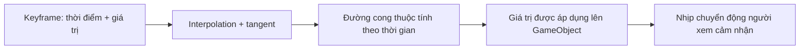

# Bài 03 — Tinh chỉnh chuyển động bằng Animation Curves

> **Creative Core · Animation · Unity 6.3 · Bài lý thuyết kết hợp thực hành**

## 1. Tóm tắt

Hoạt ảnh có keyframe đúng vẫn có thể trông cứng nếu mọi thay đổi đều tuyến tính. Tinh chỉnh animation nghĩa là thiết kế cảm giác về **timing** (thời lượng), **spacing** (khoảng dịch chuyển giữa các thời điểm), **easing** (tăng/giảm tốc) và **độ mượt của chuyển trạng thái**. Unity cung cấp Dope Sheet và Curves để làm việc này mà không cần vẽ thêm từng khung hình.

## 2. Mục tiêu học tập

1. Phân biệt Dope Sheet với Curves và nhận diện keyframe/tangent.
2. Dự đoán hiệu ứng của Linear, Constant và đường cong có easing.
3. Tinh chỉnh chuyển động nhún, xoay hoặc mở cửa bằng cách thay đổi vị trí keyframe và tangents.
4. Nhận biết vấn đề khi nội suy rotation theo Euler so với Quaternion.

## 3. Nguyên lý thời gian và nội suy

### 3.1. Thời điểm và giá trị không phải một

Một curve mô tả hàm thuộc tính theo thời gian: $p(t)$ với trục hoành là thời gian và trục tung là giá trị thuộc tính. Kéo keyframe sang **trái/phải** thay đổi thời điểm. Kéo **lên/xuống** thay đổi giá trị. Hai thao tác này có tác động khác nhau đối với nhịp chuyển động.

- **Linear:** tốc độ biến đổi không đổi giữa hai keyframe (đối với property vô hướng).
- **Constant/Stepped:** giữ giá trị cũ cho tới khi sang keyframe kế tiếp; hữu ích với trạng thái bật/tắt hoặc chuyển đổi giật cấp.
- **Ease In/Out:** độ dốc curve thay đổi theo thời gian, tạo cảm giác vào/ra chuyển động mềm mại.

Về mặt toán học, với một thuộc tính vô hướng được nội suy tuyến tính giữa $p_0$ và $p_1$:

$$
p(t) = p_0 + u(p_1-p_0),\quad u=\frac{t-t_0}{t_1-t_0},\quad 0\le u\le 1
$$

Đường cong Hermite/Bezier trong công cụ biên tập có thể thay đổi gia tốc và tạo overshoot tùy tangents; không nên mặc định mọi curve đều đi qua các giá trị trung gian như tuyến tính.

### 3.2. Dope Sheet và Curves

| Chế độ | Thể hiện | Khi nên dùng |
|---|---|---|
| **Dope Sheet** | Các keyframe trên những hàng thuộc tính | Canh nhịp, dời nhóm keyframe, so sánh các sự kiện |
| **Curves** | Đồ thị giá trị theo thời gian | Kiểm soát tốc độ, độ dốc, easing, loại bỏ overshoot |

Không có sự khác biệt dữ liệu cơ bản giữa hai chế độ: Dope Sheet và Curves là hai góc nhìn trên cùng clip.

## 4. Thực hành: sửa chuyển động của một quả bóng

**Chuẩn bị:** GameObject có clip `BallBounce.anim` với keyframe tại Y = 0,5 ở 0,0 s; Y = 1,6 ở 0,3 s; Y = 0,5 ở 0,6 s. Có thể tạo lại từ đầu nếu chưa có scene.

1. Chọn GameObject và mở `Window > Animation > Animation`.
2. Chọn clip tương ứng, đổi từ **Dopesheet** sang **Curves**.
3. Chọn track Position Y, kiểm tra đồ thị. Khi preview, quan sát tốc độ trước và sau đỉnh.
4. Với pha lên, thử đặt tangent để đường cong **chậm ở đỉnh**; với pha xuống, thử tăng độ dốc trước khi chạm đáy. Đặc điểm vật rơi nhanh dần tạo ấn tượng có trọng lực, dù đây vẫn là hoạt ảnh thủ công.
5. Sau đó thêm keyframe ngắn gần đáy nếu muốn có pha nén/giãn: giảm nhẹ `Scale Y` đồng thời tăng `Scale X`/`Scale Z` nhưng giữ hiệu ứng ở mức nhỏ. Nên thêm scale track có chủ đích, không ghi nhầm các thuộc tính khác.
6. So sánh bản thô và bản chỉnh sửa bằng hai clip riêng (`BallBounce_Blocking.anim` và `BallBounce_Polished.anim`).

**Bài quan sát:** xem quả bóng có dừng quá lâu ở đỉnh hay xuyên sàn lúc chạm đáy. Không đánh giá chỉ bằng hình dạng đồ thị; cần xem chuyển động ở tốc độ phát thực.

## 5. Lưu ý quan trọng khi xoay 3D

Các phép quay trong Unity được lưu nội bộ theo **Quaternion**, nhưng người dùng thường nhập **Euler angles** trong Inspector. Khi nội suy rotation, cách chọn biểu diễn có thể khiến chuyển động quay khác kỳ vọng:

- **Quaternion interpolation** thường đi theo đường quay ngắn hơn; một cặp orientation không mô tả trực tiếp vòng quay nhiều hơn 180° theo cùng một trục.
- **Euler interpolation** trực quan hơn khi cần quay theo góc lớn hoặc kiểm soát từng trục, nhưng có thể phát sinh các vấn đề về cách biểu diễn góc và gimbal lock trong một số trường hợp.
- Đối với biển quảng cáo quay 360°, nên thử kết quả thật, kiểm tra chế độ nội suy và chia vòng quay thành các keyframe thích hợp nếu cần.

Không nên chỉnh trực tiếp các thành phần x/y/z/w của Quaternion như bốn góc Euler. Chỉ thay đổi khi đã hiểu hình học phép quay.

## 6. Kỹ thuật dựng chuyển động dễ quan sát

- **Blocking trước, polishing sau:** đặt các pose/key chính trước khi tinh chỉnh curve.
- **Giữ silhouette rõ:** ở mỗi thời điểm quan trọng, tư thế phải đọc được.
- **Đừng lạm dụng overshoot:** nếu spline đẩy giá trị vượt ngưỡng, cửa có thể xoay quá khung hoặc vật thể đi xuyên nền.
- **Tách thuộc tính được điều khiển:** nếu clip chỉ cần thay đổi Y, tránh vô tình ghi cả X/Z theo giá trị không chủ đích.
- **Chỉnh trong thời lượng thực:** một curve đẹp trên biểu đồ vẫn có thể chậm hoặc quá nhanh khi xem Play.

## 7. Lỗi thường gặp và kiểm thử

| Lỗi | Dấu hiệu | Cách sửa |
|---|---|---|
| Overshoot | Vật vượt ngoài giá trị dự định | Đặt tangent phù hợp hoặc thêm keyframe giới hạn |
| Chuyển động giật | Giá trị bật giữa các frame | Kiểm tra Constant tangent hoặc keyframe đặt quá gần |
| Cú xoay ngược | Đối tượng xoay hướng không mong muốn | Kiểm tra nội suy Quaternion/Euler và các góc key |
| Tốc độ không đều | Đối tượng tăng tốc bất thường | Quan sát độ dốc curve, sửa tangents |
| Sửa nhầm clip | Mất hiệu ứng ở một state khác | Đọc tên clip ở thanh chọn trước khi Record |

**Thực hành ngắn:** tạo hai chuyển động cửa cùng mở 90° trong 1 giây: bản A tuyến tính, bản B Ease In/Out. Quay video so sánh, ghi lý do lựa chọn một kiểu cho cửa tự động và một kiểu cho cửa va đập.

## 8. Câu hỏi ôn tập trắc nghiệm

### 8.1. Câu 1

Trong Curves, kéo keyframe sang phải mà không đổi độ cao sẽ thay đổi yếu tố nào?

**A.** Giá trị thuộc tính tại keyframe.  
**B.** Thời điểm keyframe.  
**C.** Loại GameObject.  
**D.** Loại rig.  

**Đáp án:** B. **Giải thích:** Tọa độ ngang của đồ thị biểu diễn thời gian.

### 8.2. Câu 2

Cách nào hợp lý nhất để tạo cảm giác cửa khởi động chậm rồi tăng tốc?

**A.** Giữ Constant interpolation.  
**B.** Xoá Animator.  
**C.** Chỉnh tangent/easing của curve.  
**D.** Chỉ đổi màu vật liệu.  

**Đáp án:** C. **Giải thích:** Độ dốc curve quyết định sự thay đổi giá trị trên mỗi đơn vị thời gian.

### 8.3. Câu 3

Tại sao cần xem Play Mode sau khi sửa curve?

**A.** Hình dạng đồ thị không thể hiện đầy đủ cảm nhận chuyển động trong scene.  
**B.** Unity không lưu keyframe trong Edit Mode.  
**C.** Animation window luôn hiển thị sai.  
**D.** Animator không hỗ trợ preview.  

**Đáp án:** A. **Giải thích:** Tốc độ phát, camera, hierarchy và những clip khác có thể ảnh hưởng kết quả.

### 8.4. Câu 4

Muốn quay biển 360° nhưng nội suy Quaternion chọn đường ngắn, nên làm gì?

**A.** Xoá mọi keyframe.  
**B.** Chỉ tăng scale.  
**C.** Thêm Rigidbody.  
**D.** Xem lại chế độ nội suy và chia/chỉnh các keyframe quay thích hợp.  

**Đáp án:** D. **Giải thích:** Quaternion biểu diễn orientation, không tự mã hóa mọi số vòng quay chỉ với cặp tư thế.

### 8.5. Câu 5

Overshoot trong curve là gì?

**A.** Đổi tên file asset.  
**B.** Giá trị nội suy vượt quá mức của keyframe mong muốn.  
**C.** Clip được phát tự động.  
**D.** Một GameObject có nhiều Component.  

**Đáp án:** B. **Giải thích:** Tangents của curve có thể tạo cực trị ngoài khoảng mong đợi.

## 9. Tổng kết

- Timing xác định khi nào xảy ra chuyển động; curve xác định chuyển động diễn tiến ra sao.
- Dope Sheet dùng canh keyframe, Curves dùng canh vận tốc và easing.
- Luôn kiểm tra rotation interpolation, overshoot và cảm nhận chuyển động ở thời gian thực.

## 10. Tài liệu học thêm

1. [Unity 6.3 — Animation Curves](https://docs.unity.com/en-us/engine/6000.3/manual/animation-section/animation-mecanim/animation-clips/animation-editor-guide/animeditor-animation-curves).
2. [Unity 6.3 — Animation window](https://docs.unity.com/en-us/engine/6000.3/manual/animation-section/animation-mecanim/animation-clips/animation-editor-guide).
3. [Unity Learn — Creative Core Animation](https://learn.unity.com/pathway/creative-core/unit/animation?version=6.3).
