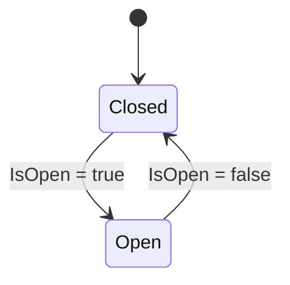

# Bài 04 — Điều khiển hoạt ảnh bằng Animator Controller

> **Creative Core · Animation · Unity 6.3 · Bài học điều khiển trạng thái**

## 1. Tóm tắt

Một đối tượng có nhiều hoạt ảnh phải lựa chọn clip theo điều kiện, chẳng hạn cửa ở trạng thái đóng, mở hoặc đang chuyển động. `Animator Controller` giải quyết bài toán này bằng **finite state machine** (máy trạng thái hữu hạn): từng trạng thái chứa chuyển động, các mũi tên là **transition**, còn **parameter** là đầu vào xác định điều kiện chuyển. Unity có thể trộn (blend) hai hoạt ảnh trong khoảng chuyển trạng thái để tránh nhảy tư thế.

## 2. Mục tiêu học tập

1. Tạo Controller với ít nhất hai state và một tham số `Bool`.
2. Cấu hình chuyển hai chiều, phân biệt `Has Exit Time` và `Conditions`.
3. Sử dụng `Animator.SetBool()` trong C# để kích hoạt hoạt ảnh.
4. Gỡ lỗi transition bị kẹt, sai parameter, clip đang bị loop hoặc blend không phù hợp.

## 3. Thành phần của Animator Controller

### 3.1. State, Motion và Default State

`State` thường tham chiếu một `Animation Clip` qua thuộc tính `Motion`. Controller có một **default state** khi khởi động (đường nối từ Entry tới state mặc định). Màu nền và cách hiển thị state có thể khác nhau theo phiên bản Editor.

`Animator` (Component) gắn vào GameObject không phải cửa sổ Animator. Component này có trường `Controller` tham chiếu asset `.controller`. Trong Play Mode, mở Animator window để quan sát state đang hoạt động và transition diễn ra.

### 3.2. Parameter

| Loại | Ý nghĩa | Ví dụ |
|---|---|---|
| `Bool` | Cờ đúng/sai duy trì đến khi đổi | `IsOpen` |
| `Float` | Giá trị liên tục | `Speed` |
| `Int` | Giá trị nguyên phân loại | `Direction` |
| `Trigger` | Tín hiệu sự kiện để kích hoạt chuyển trạng thái | `Jump` hoặc `Open` một lần |

Chọn **Bool** khi trạng thái nên tồn tại liên tục; dùng **Trigger** cho hành động sự kiện. Trigger được tiêu thụ/reset theo quá trình xử lý của Controller; không dùng thay thế dữ liệu trạng thái dài hạn.

### 3.3. Transition và hai tiêu chí thường nhầm

- `Conditions` là điều kiện dựa trên parameter. **Nếu có nhiều conditions trên cùng transition, tất cả phải thỏa**.
- `Has Exit Time` là ràng buộc thời điểm trong chu kỳ state hiện tại; giá trị `Exit Time = 0.75` nghĩa là khoảng 75% thời lượng chuẩn hóa của state.
- Khi **bật cả Exit Time và Conditions**, transition chỉ có thể được xét tại thời điểm thích hợp và khi các điều kiện thỏa. Điều này thường làm cửa phản hồi trễ ngoài ý muốn.
- `Transition Duration` xác định thời lượng pha blend; nó không phải thời lượng của Animation Clip.

## 4. Thiết kế đồ thị trạng thái cửa



Ở đây `Closed` là state mặc định và giữ pose cửa đóng; `Open` giữ pose cửa mở. **Transition Duration** tạo chuyển động trộn giữa hai pose. Cách này tránh lỗi phát lại một clip đóng cửa 90° → 0° khi scene vừa khởi động. Với cửa cần chuyển động phức tạp, có thể mở rộng thành bốn state `ClosedPose → Opening → OpenPose → Closing` và quy định rõ cách ngắt/đảo chiều.

## 5. Thực hành chi tiết với hai nút UI

### 5.1. Cấu hình trong Editor

1. Tạo `DoorPivot` ở bản lề. Dựng hai clip **pose giữ**: `DoorClosed.anim` có góc Y = 0° ở đầu và cuối; `DoorOpened.anim` có góc Y = 90° ở đầu và cuối. Đặt thời lượng mẫu khoảng 1 giây/clip; bảo đảm cả hai chỉ ghi cùng property Rotation. Các clip này không tạo chuyển động độc lập mà cung cấp hai tư thế đích để transition blend.
2. Trong Project: `Create > Animator Controller`, đặt tên `DoorAnimator.controller` và gán vào `Animator` của `DoorPivot`.
3. Mở `Window > Animation > Animator`; kéo hai clip vào graph tạo state `Closed` và `Open`. Đặt `Closed` làm default state, gắn `DoorClosed.anim`; state `Open` gắn `DoorOpened.anim`.
4. Tab **Parameters**: tạo `Bool` tên `IsOpen` (phân biệt chữ hoa/thường với code).
5. Chuột phải state `Closed` > **Make Transition** > `Open`. Bỏ chọn `Has Exit Time`, thêm Condition `IsOpen == true`.
6. Tạo transition ngược `Open` > `Closed`, bỏ `Has Exit Time`, Condition `IsOpen == false`. Ở hai transition, bật **Fixed Duration** và chọn `Transition Duration` khoảng 0,4 giây để cửa đi giữa hai tư thế có tốc độ quan sát được (giá trị chỉ là cấu hình ví dụ).
7. Vào Play Mode, thay đổi `IsOpen` trực tiếp ở Parameters để xác nhận luồng và chuyển động đúng trước khi viết code.

### 5.2. Điều khiển qua C#

Tạo script `DoorAnimatorControl.cs` và gắn lên GameObject chứa `Animator`:

```csharp
using UnityEngine;

[RequireComponent(typeof(Animator))]
public class DoorAnimatorControl : MonoBehaviour
{
    private static readonly int IsOpen = Animator.StringToHash("IsOpen");
    private Animator animator;

    private void Awake()
    {
        animator = GetComponent<Animator>();
    }

    public void OpenDoor()
    {
        animator.SetBool(IsOpen, true);
    }

    public void CloseDoor()
    {
        animator.SetBool(IsOpen, false);
    }
}
```

Tạo hai `Button` trong Canvas, cấu hình `On Click()` để tham chiếu GameObject chứa `DoorAnimatorControl`, lần lượt chọn `OpenDoor()` và `CloseDoor()`. Bài này không phụ thuộc vào hệ thống nhập bàn phím cũ hay mới.

**Điều quan trọng:** Code chỉ **thay đổi parameter**, không trực tiếp đổi góc cánh cửa. Cấu hình trong Controller phải nhất quán với tên `IsOpen`, state và conditions. Khi cần điều khiển bằng bàn phím, có thể dùng Input System của dự án để gọi hai phương thức công khai.

### 5.3. Kiểm tra kết quả

- Khi Play: thấy state mặc định chạy và nhận giá trị `IsOpen=false`.
- Bấm nút mở: thấy parameter đổi thành true và state chuyển sang `Open`.
- Bấm nút đóng: thấy parameter đổi thành false và state về `Closed`.
- Quan sát cửa có đổi góc mượt, có bị chớp/vấp khi bấm liên tiếp hay không.

Ở ví dụ này, các state `Closed` và `Open` chính là **pose giữ**; chuyển động mở/đóng được tạo bằng cách blend trong transition. Nếu muốn gia tốc theo curve riêng, âm thanh khớp chuyển động, hoặc đảo chiều chính xác giữa chừng, hãy thiết kế clip động tác/state trung gian và kiểm tra thuộc tính interruption của transition.

## 6. Các kỹ thuật bổ sung

- **Any State:** thích hợp cho hành động có thể được kích hoạt từ nhiều trạng thái, nhưng lạm dụng dễ gây transition ngoài ý muốn.
- **Blend Tree:** trộn các motion gần nhau theo `Float` như `Speed`, thường dùng Idle–Walk–Run. Không cần dùng cho cửa chỉ có hai trạng thái.
- **Layers và Avatar Mask:** tách các phần cơ thể; ví dụ nhân vật chạy với chân nhưng vẫy tay ở lớp thân trên.
- **Root Motion:** lựa chọn lấy chuyển động từ animation để điều khiển vị trí/hướng gốc hay do script điều khiển; cần tránh hai nơi cùng ghi Transform.

## 7. Sửa lỗi thực tế

| Triệu chứng | Nguyên nhân có thể | Cách xử lý |
|---|---|---|
| Bấm nút mà state không đổi | Tên parameter sai; OnClick không nối script | So sánh chính xác `IsOpen`, xem Inspector Button, quan sát Parameters khi Play |
| Đổi state chậm | `Has Exit Time` vẫn bật | Tắt nếu muốn chuyển ngay theo parameter |
| Chuyển nhưng không có chuyển động | State `Motion` rỗng; thiếu track | Kiểm tra clip gắn vào state |
| Cửa về sai góc | Clip ghi giá trị không nhất quán; transition blend | Đặt keyframe góc đầu/cuối chính xác, giảm blend và kiểm tra state |
| Animation phát liên tục | `Loop Time` bật cho clip cần phát một lần | Tắt loop trong Import/Clip Settings |
| Cửa bị giật khi nhấn liên tiếp | Bị đổi hướng giữa transition hoặc thiết kế state không phù hợp | Thiết kế state trung gian/giữ pose và quy tắc interruption |

**Thực hành ngắn:** đổi controller từ cửa sang đèn cảnh báo: `Idle` và `Blink`, tham số `Bool` `AlarmActive`; viết script hai hàm `EnableAlarm()`/`DisableAlarm()`. Giải thích vì sao các clip thay đổi cường độ ánh sáng thay vì cần di chuyển GameObject.

## 8. Câu hỏi ôn tập trắc nghiệm

### 8.1. Câu 1

Điều kiện chuyển trạng thái dựa trên `IsOpen` nên khai báo ở đâu?

**A.** Trong Material.  
**B.** Trong Lightmap.  
**C.** Trong Animator Controller Parameters và Transition Conditions.  
**D.** Trong Camera Clear Flags.  

**Đáp án:** C. **Giải thích:** Parameters cung cấp đầu vào, Conditions xác định khi nào state đổi.

### 8.2. Câu 2

Muốn chuyển state ngay khi Bool đổi, lựa chọn nào thường cần thiết?

**A.** Bật Has Exit Time = 1.  
**B.** Bỏ Has Exit Time khi transition phải phản hồi ngay.  
**C.** Xoá cả hai state.  
**D.** Chỉ tăng tốc clip.  

**Đáp án:** B. **Giải thích:** Exit Time có thể chặn transition cho tới mốc thời gian chuẩn hóa.

### 8.3. Câu 3

Khi một transition có hai conditions, Unity yêu cầu điều gì?

**A.** Chỉ một điều kiện đúng.  
**B.** Hai điều kiện tự động bị bỏ qua.  
**C.** Bắt buộc phải có 2 Controller.  
**D.** Thông thường tất cả conditions đều phải thỏa.  

**Đáp án:** D. **Giải thích:** Nhiều conditions trên cùng transition được kết hợp theo AND.

### 8.4. Câu 4

Trong script, `animator.SetBool("IsOpen", true)` tác động trực tiếp tới đâu?

**A.** Tham số trong Animator Controller.  
**B.** Màu của Main Camera.  
**C.** Scale của cửa mà không thông qua Controller.  
**D.** Asset FBX trong Project.  

**Đáp án:** A. **Giải thích:** SetBool chỉ đặt giá trị parameter; state machine quyết định hoạt ảnh.

### 8.5. Câu 5

Tình huống nào thích hợp dùng `Trigger` hơn `Bool`?

**A.** Lưu một cấu hình màu vĩnh viễn.  
**B.** Giữ trạng thái cửa mở cho tới khi đổi.  
**C.** Báo một hành động ngắn như kích hoạt animation Jump.  
**D.** Biểu diễn tốc độ liên tục.  

**Đáp án:** C. **Giải thích:** Trigger đại diện sự kiện một lần, không phải cờ trạng thái dài hạn.

## 9. Tổng kết

- Animator Controller tổ chức state, parameter và transition; component Animator đánh giá chúng khi chạy.
- `Has Exit Time`, conditions và duration tác động đến ba khía cạnh khác nhau của chuyển trạng thái.
- Trước khi viết C#, hãy kiểm tra đồ thị bằng cách thay parameter trực tiếp trong Animator khi Play.

## 10. Tài liệu học thêm

1. [Unity 6.3 — Animator Controller](https://docs.unity.com/en-us/engine/6000.3/manual/animation-section/animation-mecanim/animation-animator-controller).
2. [Unity 6.3 — Animation transitions](https://docs.unity.cn/6000.3/Documentation/Manual/class-Transition.html).
3. [Unity 6.3 — Animator scripting API](https://docs.unity.com/en-us/engine/6000.3/script-reference/unityengine/animator).
4. [Unity Learn — Animation](https://learn.unity.com/pathway/creative-core/unit/animation?version=6.3).
