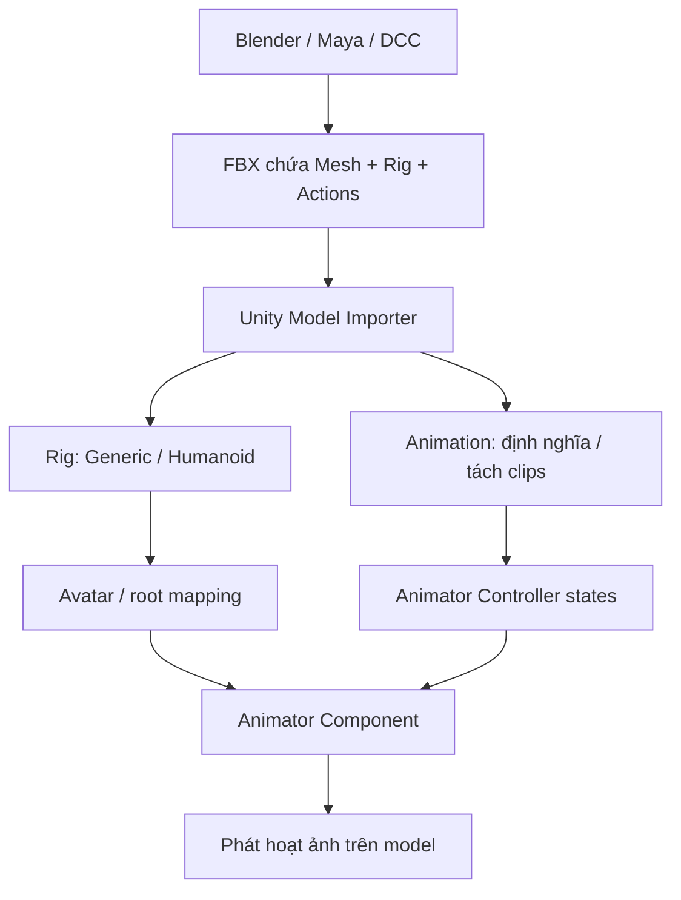

# Bài 05 — Nhập Animation từ Blender và các công cụ 3D vào Unity

> **Creative Core · Animation · Unity 6.3 · Bài học nhập và cấu hình asset**

## 1. Tóm tắt

Không phải hoạt ảnh nào cũng được tạo trong Unity Editor. Trong quy trình sản xuất, nhân vật và động tác thường được tạo bằng Blender, Maya hoặc phần mềm DCC (Digital Content Creation), sau đó xuất sang file trung gian như FBX. Unity cần phân biệt **model**, **rig/skeleton**, **Avatar** và **Animation Clip** để phát động tác đúng trên đối tượng. Bài này hướng dẫn cách nhận diện rig, chia clip và kiểm tra lỗi retargeting.

## 2. Mục tiêu học tập

1. Phân biệt `Generic` và `Humanoid` rig, chọn kiểu cho từng loại đối tượng.
2. Cấu hình tab `Rig` và `Animation` trong Model Import Settings.
3. Xác định các clip con, cắt khoảng frame, kiểm tra loop và preview chuyển động.
4. Kiểm tra Avatar mapping và xử lý các lỗi scale, orientation, root motion hoặc skeleton không tương thích.

## 3. Các thành phần khi import

### 3.1. Model, rig và clip là ba lớp khác nhau

- **Mesh:** hình học bề mặt được vẽ; có thể là cánh tay, chân, vỏ robot hay hình khối.
- **Skeleton/Rig:** hệ thống bone/transform cùng quan hệ cha–con dùng để tạo tư thế.
- **Skinning:** ảnh hưởng của bone lên vertex mesh, cho phép mesh biến dạng theo khung xương.
- **Animation Clip:** các keyframe chuyển động, có thể chứa animation của Transform/bone hoặc các thuộc tính hỗ trợ khác.
- **Avatar:** tài nguyên ánh xạ rig được dùng trong hệ thống Mecanim; đặc biệt quan trọng khi retarget các clip `Humanoid` giữa nhân vật khác nhau.

Mỗi tầng phải khớp nhau. Chỉ kéo FBX vào scene không đảm bảo Unity biết khi nào phát động tác.

### 3.2. Chọn Generic hay Humanoid

| Tiêu chí | `Generic` | `Humanoid` |
|---|---|---|
| Đối tượng | Robot phi người, sinh vật bốn chân, vật có rig tùy ý; có thể dùng cho nhân vật người nếu không cần retarget | Nhân vật có cấu trúc xương người hợp lệ |
| Ánh xạ | Xác định root node/skeleton phù hợp | Ánh xạ các phần cơ thể người trong Avatar |
| Retarget giữa nhân vật | Không có cơ chế humanoid retarget tổng quát | Có thể dùng lại chuyển động giữa các Avatar đã cấu hình |
| Khi nên chọn | Rig bất kỳ hoặc chuyển động cần giữ đúng skeleton riêng | Nhân vật hình người, muốn tái dùng clip walk/run/idle |

**Lưu ý kỹ thuật:** không phải mọi model hai tay hai chân đều tự động đạt chuẩn Humanoid; Avatar mapping phải hợp lệ. Generic vẫn có Avatar theo dạng mapping/root hỗ trợ nhưng **không phải Humanoid Avatar có giao diện body mapping**.

## 4. Quy trình nhập FBX

### 4.1. Chuẩn bị ở Blender/DCC

Trước khi export, kiểm tra đơn vị scale, hướng up/forward, cấu trúc bones, tên bone, pose gốc, frame range và có thực sự keyframe cho Action cần xuất hay chưa. Tránh áp dụng các phép biến đổi ngẫu nhiên lên mesh và skeleton mà không kiểm tra kết quả skinning. Các tùy chọn export khác nhau theo công cụ và phiên bản, vì vậy nên xác minh bằng một file mẫu nhỏ trước.

### 4.2. Import vào Unity

1. Sao chép/đưa file `.fbx` vào thư mục `Assets/Models/` trong Unity Project.
2. Chọn **asset FBX trong Project**, không phải instance đang ở Hierarchy; Inspector sẽ hiện các tab Import Settings.
3. Trong **Model**, kiểm tra scale và orientation hiển thị ở Preview. Khi có thay đổi cấu hình import, nhấn **Apply**.
4. Trong **Rig**, chọn `Animation Type`:
   - `Humanoid` nếu là nhân vật người đủ bone. Chọn `Avatar Definition: Create From This Model`, nhấn **Apply** và kiểm tra cấu hình/avatar mapping khi cần.
   - `Generic` với rig không chuẩn người. Kiểm tra `Root node` phù hợp để xác định transform gốc.
5. Trong **Animation**, bật `Import Animation` nếu file có animation. Xem danh sách clip; đặt tên clip cụ thể như `Idle`, `Walk`, `Run` hoặc `Attack`.
6. Nếu một timeline chứa nhiều động tác, định nghĩa riêng từng đoạn frame (`Start` / `End` theo giao diện import) cho từng clip. Không đoán frame; đối chiếu với keyframes đã export.
7. Với hoạt ảnh lặp (walk/idle), bật `Loop Time`; có thể kiểm tra thêm `Loop Pose` và các thiết lập root transform. Với động tác một lần (attack/open), thường không bật loop.
8. Xem Preview, nhấn **Apply** rồi kéo model vào scene. Thêm/gán Controller với state sử dụng các clip vừa nhập.

### 4.3. Kiểm tra Humanoid Avatar

Khi dùng `Humanoid`, xem mapping của các vùng cốt lõi (hông, cột sống, đầu, tay, chân). Nếu Unity không nhận diện hợp lệ, sửa bone assignment hoặc cấu trúc skeleton tại nguồn rồi import lại. Nếu dùng animation từ FBX khác có skeleton tương thích, có thể tham khảo `Avatar Definition: Copy From Other Avatar` theo thiết kế asset.

**Retargeting** không bảo đảm chuyển động luôn giống hoàn toàn. Tỷ lệ cơ thể, chiều dài xương, pose ban đầu, root motion và chất lượng animation nguồn đều ảnh hưởng kết quả.

## 5. Imported clip và khả năng chỉnh sửa

Clip nằm dưới FBX là **asset con được tạo từ quá trình import**, các đường cong gốc thường không được sửa trực tiếp như một `.anim` tự tạo. Khi cần chỉnh keyframe trong Unity, có thể tạo clip độc lập/copy animation data theo cách mà phiên bản Editor hỗ trợ hoặc sửa tại DCC rồi export lại. Nên giữ FBX nguồn để tái tạo pipeline và tránh sửa tay khó kiểm soát.

### 5.1. Root Motion vs in-place

- **In-place:** tư thế đi bộ nhưng gốc nhân vật ở gần một chỗ; gameplay/script thường điều khiển vị trí thế giới.
- **Root Motion:** dữ liệu chuyển động gốc đóng góp vào di chuyển/hướng của nhân vật khi `Animator` được cấu hình phù hợp.

Nếu nhân vật vừa di chuyển bằng script vừa có root motion đẩy gốc, có thể bị tốc độ gấp đôi hoặc sai hướng. Kiểm tra `Apply Root Motion` và các lựa chọn `Root Transform` của clip.

## 6. Bài thực hành chuẩn hóa asset

**Kịch bản A – một nhân vật người:** nhập FBX chứa Idle/Walk, cấu hình `Humanoid`, xác nhận Avatar hợp lệ, tạo Controller với hai state, phát thử trong scene.

**Kịch bản B – robot bốn chân:** nhập FBX có rig tùy chỉnh, cấu hình `Generic`, xác định root node, phát clip đi bộ, so sánh với khi chọn sai Humanoid.

**Sản phẩm:** một scene kiểm tra import, ảnh chụp tab Rig/Animation, tên clip, preview hợp lệ và ghi chú lý do chọn rig.

## 7. Xử lý sự cố

| Hiện tượng | Hướng kiểm tra |
|---|---|
| FBX có mesh nhưng không có clip | Động tác có được export không; `Import Animation` có bật không; các frame range có hợp lệ không |
| Humanoid Avatar báo invalid | Kiểm tra mapping bone bắt buộc, pose và skeleton nguồn |
| Nhân vật bị méo/giật xương | Kiểm tra skin weights, bind pose và skeleton tương thích |
| Nhân vật di chuyển sai hướng | Kiểm tra DCC orientation, root transform, root motion và parent transform |
| Walk có bước giật tại điểm loop | Kiểm tra frame đầu/cuối, cycle tính liên tục và Loop Pose |
| Controller hoạt động nhưng mesh đứng yên | Kiểm tra Avatar/Animator trên đúng root, clip/rig type và Motion của state |

**Lưu ý:** Các thiết lập chi tiết của các tab import có thể thay đổi giữa các phiên bản Unity 6.x. Đối chiếu tài liệu chính thức nếu vị trí một checkbox hoặc nhãn khác giao diện đang dùng.

## 8. Câu hỏi ôn tập trắc nghiệm

### 8.1. Câu 1

Model nhân vật người có Avatar hợp lệ, mục tiêu tái sử dụng cùng clip đi bộ giữa nhiều nhân vật, nên chọn loại nào?

**A.** Humanoid.  
**B.** Legacy.  
**C.** Không có Animator.  
**D.** Đổi clip thành texture.  

**Đáp án:** A. **Giải thích:** Humanoid có hệ Avatar mapping phục vụ retargeting giữa rig người.

### 8.2. Câu 2

Đối tượng robot bốn chân có skeleton riêng nên bắt đầu với loại nào?

**A.** Humanoid bắt buộc.  
**B.** Chỉ sử dụng Animation window.  
**C.** Generic.  
**D.** UI Animation.  

**Đáp án:** C. **Giải thích:** Generic được thiết kế cho rig không thỏa cấu trúc humanoid.

### 8.3. Câu 3

Để tách một FBX chứa nhiều động tác thành Idle và Walk, thao tác nào phù hợp?

**A.** Chỉnh Camera FOV.  
**B.** Định nghĩa clip và frame ranges trong tab Animation của FBX.  
**C.** Tạo hai Material.  
**D.** Xoá skeleton.  

**Đáp án:** B. **Giải thích:** Model Importer có khả năng chia các khoảng frame thành clip riêng.

### 8.4. Câu 4

Khi nhân vật được script điều khiển vị trí và Apply Root Motion cũng hoạt động, nguy cơ nào xuất hiện?

**A.** Luôn tự thêm collider.  
**B.** Không có vấn đề nào có thể xảy ra.  
**C.** Shader bị chuyển sang Standard.  
**D.** Hai cơ chế cùng tác động vị trí, gây di chuyển sai.  

**Đáp án:** D. **Giải thích:** Root Motion và script đều có thể điều khiển chuyển động gốc.

### 8.5. Câu 5

Muốn sửa trực tiếp keyframe của clip con được import trong FBX, cách làm bền vững là gì?

**A.** Chỉ chỉnh trong Lighting.  
**B.** Sửa clip trong nguồn DCC và export lại, hoặc tạo clip `.anim` độc lập để biên tập.  
**C.** Xoá Animator.  
**D.** Đổi FBX thành PNG.  

**Đáp án:** B. **Giải thích:** Các clip con nhập từ FBX không tương đương clip `.anim` hoàn toàn độc lập.

## 9. Tổng kết

- Import hoạt ảnh đòi đúng mesh, rig, avatar/root và các đoạn frame của clip.
- `Humanoid` ưu tiên nhân vật hình người cần retarget; `Generic` dành cho skeleton phi người và rig tùy ý.
- Kiểm tra root motion, loop, mapping và chuyển động trong Play Mode chứ không chỉ Preview.

## 10. Tài liệu học thêm

1. [Unity 6.3 — Importing models into Unity](https://docs.unity.com/en-us/engine/6000.3/manual/assets-and-media/asset-types/models/importing).
2. [Unity 6.3 — Humanoid Avatar](https://docs.unity.com/en-us/engine/6000.3/manual/animation-section/animation-mecanim/avatar-creationand-setup).
3. [Unity 6.3 — Animator Controller](https://docs.unity.com/en-us/engine/6000.3/manual/animation-section/animation-mecanim/animation-animator-controller).
4. [Unity Learn — Creative Core Animation](https://learn.unity.com/pathway/creative-core/unit/animation?version=6.3).
