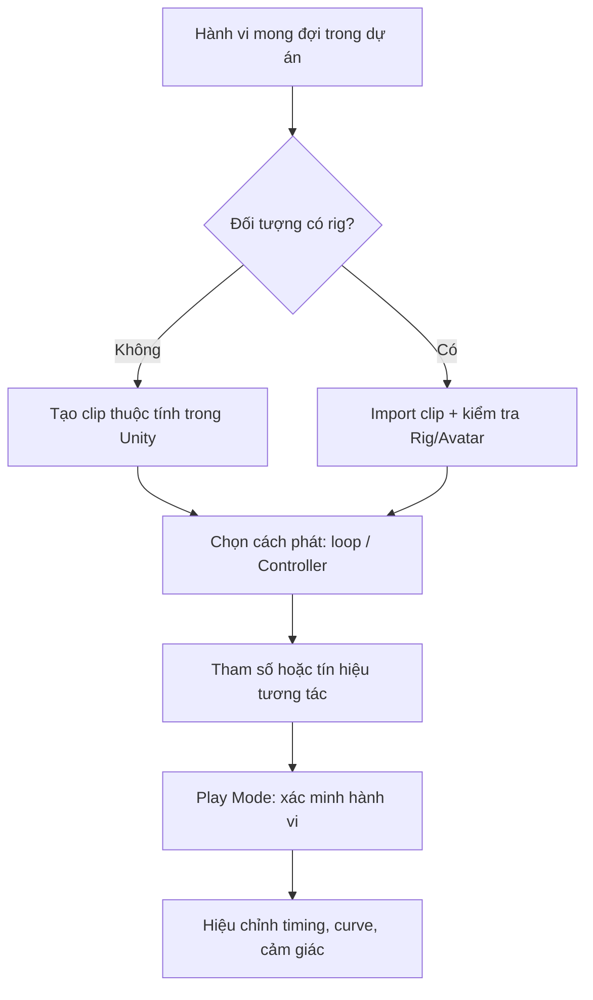

# Bài 07 — Ứng dụng Animation vào dự án cá nhân

> **Creative Core · Animation · Unity 6.3 · Bài ứng dụng theo dự án (Guided Project)**

## 1. Bối cảnh

Hoạt ảnh chỉ phát huy giá trị khi nó hỗ trợ mục tiêu thiết kế của một dự án. Trong bài này, người học chọn **một thay đổi mang ý nghĩa** trong scene hiện có: tạo hướng dẫn nhìn (visual guidance), phản hồi khi tương tác hoặc cảm giác không gian sống động. Quy trình triển khai nên giữ nhất quán asset, hierarchy, material, ánh sáng và gameplay đã có trong dự án.

## 2. Mục tiêu học tập và kết quả

1. Xác định được nhu cầu animation cụ thể trong scene, không thêm chuyển động chỉ để trang trí.
2. Chọn clip tự tạo hay nhập từ DCC phù hợp mức độ phức tạp.
3. Triển khai animation trong scene hiện có mà không làm hỏng những hệ thống khác.
4. Kiểm thử tương tác và đánh giá tác động tới trải nghiệm người dùng.

**Sản phẩm cần có:** một scene có animation thực sự phục vụ trải nghiệm, bản giải thích ngắn về lựa chọn thiết kế, và bằng chứng trước/sau khi áp dụng.

## 3. Bước 1 — Xác định mục đích thiết kế

Chọn một trong những kịch bản sau (hoặc tự xây dựng phương án tương đương):

| Kịch bản | Mục đích | Animation phù hợp |
|---|---|---|
| Phòng trưng bày | Dẫn mắt đến vật trưng bày | Xoay chậm/vật nhún nhẹ với loop |
| Cửa đi giữa hai phòng | Phản hồi khi tương tác | Clip mở/đóng và Controller |
| Nhân vật NPC | Làm rõ hành động/trạng thái | Humanoid Idle/Walk với Avatar hợp lệ |
| Mô hình máy móc | Giải thích cơ chế | Piston, bánh răng hoặc cần gạt chuyển động theo keyframe |
| Đèn báo trạng thái | Phản hồi sự kiện | Animate intensity/color với state logic |

Với mỗi kịch bản, viết một câu có thể kiểm chứng: *“Khi người chơi chọn nút mở, cánh cửa chuyển từ đóng sang mở, không quay quá giới hạn và có phản hồi nhìn thấy.”*

## 4. Bước 2 — Thiết kế luồng hoạt ảnh



Luồng nhấn mạnh rằng **lựa chọn công nghệ phụ thuộc yêu cầu**, không phải đối tượng nào cũng cần rig. Một cánh cửa quay quanh bản lề sẽ đơn giản hơn nếu animate `DoorPivot`; nhân vật người tái sử dụng động tác đi bộ nên cần rig/Avatar tương thích.

## 5. Bước 3 — Tích hợp với scene có sẵn

### 5.1. Quản lý asset và hierarchy

Đề xuất tổ chức:

```text
Assets/
  Scenes/
    GuidedProject.unity
  Models/
  Animations/
    DoorOpen.anim
    DoorClose.anim
  Controllers/
    DoorAnimator.controller
  Scripts/
    DoorAnimatorControl.cs
```

Không di chuyển bừa các asset ngoài Editor nếu dự án đã có nhiều tham chiếu. Thường nên thay đổi tên/thư mục bằng thao tác trong Project window để Unity duy trì liên kết asset.

### 5.2. Thêm animation mà không gây xung đột

- Kiểm tra **ai đang sở hữu thuộc tính**: Animator, script điều khiển Transform, physics, hay Timeline. Nhiều hệ cùng ghi một property có thể gây rung/giật.
- Nếu đối tượng có Rigidbody, xác định mô hình điều khiển vật lý/kinematic trước khi animate vị trí.
- Khi dùng prefab, kiểm tra instance overrides sau khi chỉnh Animator, Controller hoặc hierarchy.
- Khi nhập nhân vật mới, xem `Rig`, `Avatar`, `Scale`, `Apply Root Motion` và clip loop trước khi ghép gameplay.
- Kiểm tra Game view từ camera người chơi; một chuyển động rõ trong Scene view có thể nằm ngoài khung hình camera.

### 5.3. Ví dụ ứng dụng: cửa phản hồi nút điều khiển

1. Tạo pivot và hai clip pose giữ `DoorClosed.anim` (0°), `DoorOpened.anim` (90°); dùng duration của transition để nội suy giữa hai pose. Nếu cần hoạt ảnh cửa chi tiết hơn, thay bằng các state động tác riêng.
2. Tạo Controller với tham số `Bool IsOpen` và hai transition hai chiều.
3. Gắn script `DoorAnimatorControl` (bài 04) vào đối tượng có `Animator`.
4. Thêm hai nút UI `Mở` và `Đóng`, nối `OnClick` với hai hàm công khai.
5. Chỉnh ánh sáng và camera đủ để cảm nhận trạng thái trước/sau.
6. Chạy lại project ở scene chính, không chỉ scene thử nghiệm riêng.

### 5.4. Kiểm tra khả năng tái sử dụng

Nếu có nhiều cánh cửa cùng cấu trúc, xem xét sử dụng prefab và Controller chung. Tuy nhiên cần kiểm tra trục quay, pivot, hướng đặt model và cách clip ghi property path: dùng lại clip không có nghĩa sẽ luôn tạo ra kết quả giống hệt trên mọi hierarchy.

## 6. Bước 4 — Kế hoạch kiểm thử

| Trường hợp | Thao tác | Kỳ vọng |
|---|---|---|
| Khởi động | Chạy scene chính | Đối tượng ở trạng thái ban đầu đúng |
| Tương tác | Nhấn Open/Close | Controller nhận parameter và đổi state |
| Chuyển liên tiếp | Nhấn nút nhiều lần | Không lỗi logic, không nhảy tư thế bất thường |
| Phối hợp hệ thống | Quan sát camera/physics/script | Không có hệ thống khác ghi đè animation |
| Build | Chạy bản build tối giản | Tương tác hoạt động ngoài Editor |

Nên quan sát cả **Console**, **Animator** khi Play và kết quả thực tế trong Game view. Với scene lớn, tắt tạm các hệ thống chưa liên quan để khoanh vùng lỗi rồi bật lại sau khi xác minh.

## 7. Bàn giao và tiêu chí đạt

### 7.1. Deliverables

- Scene dự án đã tích hợp hoạt ảnh.
- Các clip/controller/script hoặc mô hình nhập có tổ chức.
- Video ngắn hoặc bộ ảnh minh họa trước–sau.
- README nêu mục đích, thao tác kích hoạt, những giới hạn hiện có.

### 7.2. Definition of Done

- [ ] Animation tạo ra thay đổi có ý nghĩa cho trải nghiệm.
- [ ] Có mô tả rõ vì sao chọn clip tự tạo/imported.
- [ ] Play Mode và build chạy được theo kịch bản kiểm thử.
- [ ] Không có lỗi Console ảnh hưởng trực tiếp đến animation.
- [ ] Scene cũ không bị mất các hành vi chính.

## 8. Bài tập mở rộng

Tạo thêm một animation không dùng để gây chú ý mà để **phản hồi trạng thái hệ thống**, ví dụ đèn báo khi cửa đang khóa. Tự xác định parameter, trạng thái và bảng test. So sánh mức độ dễ hiểu của giao diện trước/sau khi thêm phản hồi này.

## 9. Câu hỏi ôn tập trắc nghiệm

### 9.1. Câu 1

Lý do hợp lý nhất để thêm animation vào Guided Project là gì?

**A.** Để mọi đối tượng cùng chuyển động.  
**B.** Để thay thế toàn bộ UI.  
**C.** Để thể hiện hành vi hoặc phản hồi có ý nghĩa cho trải nghiệm.  
**D.** Để tăng số lượng file asset.  

**Đáp án:** C. **Giải thích:** Animation nên giải quyết một mục đích thiết kế cụ thể.

### 9.2. Câu 2

Cánh cửa không có rig cần mở quanh bản lề nên ưu tiên gì?

**A.** Dùng Humanoid retargeting.  
**B.** Tạo pivot hợp lý và animate rotation của Transform.  
**C.** Bắt buộc cài phần mềm motion capture.  
**D.** Thêm Skinned Mesh Renderer mới.  

**Đáp án:** B. **Giải thích:** Mô hình này đơn giản hơn và phù hợp keyframe trực tiếp.

### 9.3. Câu 3

Một object vừa di chuyển qua script vừa animate Position và bị giật. Bước đầu nào đúng?

**A.** Đổi texture.  
**B.** Xoá camera.  
**C.** Tăng Field of View.  
**D.** Xác định hệ thống nào đang ghi cùng thuộc tính Transform.  

**Đáp án:** D. **Giải thích:** Hai nguồn điều khiển cùng một property thường gây tranh chấp trạng thái.

### 9.4. Câu 4

Vì sao phải kiểm tra Game view hoặc build?

**A.** Scene view không phản ánh trọn góc nhìn và hành vi người dùng cuối.  
**B.** Animation window không có keyframe.  
**C.** Animator chỉ chạy trong editor.  
**D.** Script không dùng được với animation.  

**Đáp án:** A. **Giải thích:** Camera và runtime quyết định điều người chơi thực sự quan sát được.

### 9.5. Câu 5

Muốn áp dụng Controller chung cho nhiều prefab khác nhau, cần lưu ý nhất điều nào?

**A.** Chỉ cần tên Material giống nhau.  
**B.** Những prefab phải có cùng số light.  
**C.** Property path, pivot và hierarchy phải tương thích với clip.  
**D.** Phải tắt tất cả Animation Clips.  

**Đáp án:** C. **Giải thích:** Clip áp dụng trên cấu trúc transform/đường dẫn property cụ thể.

## 10. Tổng kết

Animation hiệu quả không chỉ trông đẹp mà còn truyền đạt chức năng, trạng thái và phản hồi. Khi tích hợp vào scene thật, cần kiểm soát nguồn điều khiển thuộc tính, tính tương thích của asset và kiểm chứng theo góc nhìn người sử dụng.

## 11. Tài liệu học thêm

1. [Unity Learn — Creative Core Animation](https://learn.unity.com/pathway/creative-core/unit/animation?version=6.3).
2. [Unity 6.3 — Animator Controller](https://docs.unity.com/en-us/engine/6000.3/manual/animation-section/animation-mecanim/animation-animator-controller).
3. [Unity 6.3 — Import Models](https://docs.unity.com/en-us/engine/6000.3/manual/assets-and-media/asset-types/models/importing).
4. [Unity 6.3 — Animation Curves](https://docs.unity.com/en-us/engine/6000.3/manual/animation-section/animation-mecanim/animation-clips/animation-editor-guide/animeditor-animation-curves).
