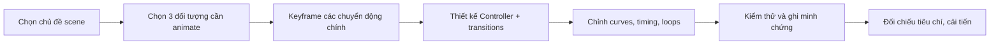

# Bài 06 — Thử thách: Thổi sức sống vào một Scene 3D

> **Creative Core · Animation · Unity 6.3 · Bài tập dự án nhỏ**

## 1. Bài toán

Một scene 3D tĩnh thường thiếu tín hiệu thị giác về nhịp sống. Hãy thiết kế một **góc triển lãm cơ khí** hoặc **căn phòng giả tưởng** gồm các đối tượng có animation có chủ đích. Người xem phải nhận biết được điều gì đang diễn ra qua chuyển động, không cần đọc hướng dẫn dài. Bài tập ưu tiên xây dựng scene hoạt động đúng, chứ không yêu cầu model hay hiệu ứng đồ họa phức tạp.

## 2. Mục tiêu sản phẩm

Xây dựng một scene có ít nhất **ba hành vi hoạt ảnh khác nhau**:

1. Một animation **lặp lại**: quạt xoay, đèn pulse, logo nhún hoặc vật trang trí chuyển động theo chu kỳ.
2. Một animation **kích hoạt bởi hành động người dùng**: cửa mở/đóng, công tắc điều khiển robot, trụ nâng hạ.
3. Một animation được **tinh chỉnh về nhịp điệu** bằng Curves: tăng/giảm tốc hoặc dừng đúng chỗ.

Ít nhất một đối tượng phải được điều khiển qua Animator Controller có **parameter và transition**. Có thể dùng model tự tạo từ primitive hoặc model nhập khẩu có quyền sử dụng phù hợp.

## 3. Yêu cầu kỹ thuật và giới hạn

| Mục | Yêu cầu hoàn thành |
|---|---|
| Scene | Có camera và ánh sáng đủ để nhìn chuyển động |
| Clip | Mỗi hành vi có clip riêng, tên rõ ràng |
| Controller | Ít nhất một Controller có hai state và chuyển có điều kiện |
| Keyframe | Ít nhất một clip có nhiều hơn hai keyframe |
| Curves | Có minh chứng điều chỉnh easing/timing |
| Điều khiển | Có UI Button, tương tác trực tiếp hoặc cơ chế kích hoạt có thể kiểm thử |
| Kiểm chứng | Phát đúng trong Play Mode, không báo lỗi Console do cấu hình animation |
| Bàn giao | Scene/project, ảnh graph Animator, ảnh Curves, video hoặc ảnh chụp trạng thái |

**Lưu ý:** Đây là tiêu chí bài tập thực hành được thiết kế để người học áp dụng kỹ năng, không phải bảng yêu cầu chấm điểm chính thức của Unity Learn.

## 4. Kế hoạch triển khai đề xuất

### 4.1. Milestone 1 — Scene có bố cục đọc được

Thiết lập sàn, bàn, cửa, vật chuyển động và ánh sáng. Quy định vùng camera chính sao cho người xem thấy được hướng di chuyển hoặc góc xoay. Trước khi animate, mỗi đối tượng phải có hierarchy và pivot thích hợp.

**Checkpoint:** thay đổi thử rotation của từng đối tượng trong Inspector và xác nhận quay đúng bản lề/trục mong muốn.

### 4.2. Milestone 2 — Blocking animation

Tạo keyframe chính cho từng vật, bảo đảm có **pose đầu**, **pose giữa** (nếu cần) và **pose kết**. Ví dụ, quạt xoay liên tục, cửa đóng–mở, một viên ngọc nâng lên hạ xuống. Chưa cần chỉnh curve tinh vi.

**Checkpoint:** mọi clip đều preview được trong Animation window và không thay đổi nhầm thuộc tính của đối tượng khác.

### 4.3. Milestone 3 — Logic điều khiển

Dựng Controller cho đối tượng có tương tác, định nghĩa parameter `Bool` hoặc `Trigger`, thiết lập các transition hợp lý. Kiểm tra trực tiếp Parameters khi Play trước khi nối UI/button.

**Checkpoint:** có thể chuyển trạng thái theo điều kiện; nếu cần phản hồi nhanh, không để Exit Time gây độ trễ ngoài ý muốn.

### 4.4. Milestone 4 — Polishing và kiểm thử

Chỉnh Curves: chuyển động chậm khi đến đích, không vượt quá biên hình học, giữ đều với animation tuần hoàn. Chạy scene, thay đổi parameter nhiều lần, xem cả tình huống điều khiển liên tiếp.

**Checkpoint:** các clip lặp không có cú giật rõ rệt tại mốc đầu/cuối (trừ khi chủ ý); clip phát một lần không bị loop vô hạn.

## 5. Các tình huống kiểm thử bắt buộc

- **TC-01 — Khởi tạo:** Vào Play Mode, scene ở trạng thái mặc định hợp lý, không có animation sai hướng.
- **TC-02 — Kích hoạt:** Gửi tín hiệu mở/đóng hai lần; state của Animator và hình ảnh phải nhất quán.
- **TC-03 — Lặp:** Quan sát tối thiểu ba chu kỳ của animation loop và chú ý seam giữa cuối và đầu.
- **TC-04 — Giới hạn:** Bảo đảm vật không xuyên sàn/cửa không xoay vượt góc kỳ vọng.
- **TC-05 — Khôi phục:** Thoát Play và vào lại, trạng thái khởi tạo phải có thể tái lập.

## 6. Sản phẩm cần nộp và cách tự đánh giá

Thư mục bàn giao nên chứa `Scenes/AnimatedRoom.unity`, các file `Animations/*.anim`, `Controllers/*.controller`, script nếu sử dụng, ảnh/video test và một `README.md` ngắn giải thích cách chạy.

### 6.1. Rubric tự đánh giá (10 điểm)

| Tiêu chí | Điểm tối đa |
|---|---:|
| Chuyển động phù hợp vật thể, pivot đúng | 2 |
| Clip và keyframe chính xác | 2 |
| Controller, parameter, transitions hoạt động | 2 |
| Curves, timing và loop được tinh chỉnh | 2 |
| Kiểm thử, minh chứng, tổ chức file | 2 |

Không cần tạo thêm một mô hình nhân vật humanoid nếu điều đó làm mất trọng tâm của bài tập. Ưu tiên một scene nhỏ nhưng kiểm chứng tốt.

## 7. Gợi ý khi gặp khó khăn (không phải lời giải)

- Nếu chưa biết animate gì, bắt đầu bằng một primitive `Cube`, `Sphere` và `Cylinder`.
- Nếu cửa quay sai, vẽ lại hierarchy và pivot trước khi sửa keyframe.
- Nếu transition bị kẹt, chỉ kiểm tra `Animator > Parameters`, `Has Exit Time` và Conditions của một mũi tên mỗi lần.
- Nếu clip giật, kiểm tra `Loop Time`, key đầu/cuối, curve và các state khác đang ghi cùng thuộc tính.

## 8. Câu hỏi tự đánh giá

1. Tại sao từng đối tượng trong scene cần một lý do thị giác để chuyển động?
2. Nếu cửa mở chậm hơn dự kiến, nên kiểm tra thời lượng clip hay Transition Duration trước? Hãy mô tả cách phân biệt hai nguyên nhân.
3. Một animation loop giật tại ranh giới chu kỳ có thể được cải thiện bằng cách nào?
4. Làm thế nào để chứng minh có một cải tiến giữa bản blocking và bản polished?
5. Khi một property bị điều khiển bởi cả clip và script, cách bạn sẽ khoanh vùng xung đột là gì?

## 9. Checklist hoàn thành

- [ ] Scene hoạt động được trong Play Mode.
- [ ] Có đủ ba dạng chuyển động theo đề bài.
- [ ] Có Animator Controller với transition có điều kiện.
- [ ] Có bằng chứng tinh chỉnh Curves.
- [ ] Đã kiểm tra khởi tạo, lặp, tương tác và trường hợp lỗi.
- [ ] Đã lưu toàn bộ project/asset và minh chứng.

## 10. Tài liệu hỗ trợ

1. [Unity Learn — Creative Core Animation](https://learn.unity.com/pathway/creative-core/unit/animation?version=6.3).
2. [Unity 6.3 — Animation window](https://docs.unity.com/en-us/engine/6000.3/manual/animation-section/animation-mecanim/animation-clips/animation-editor-guide).
3. [Unity 6.3 — Animator Controller](https://docs.unity.com/en-us/engine/6000.3/manual/animation-section/animation-mecanim/animation-animator-controller).
