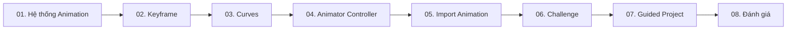

# Creative Core — Animation (Unity 6.3) | Giáo trình tiếng Việt

## Giới thiệu

Bộ tài liệu thực hành Unity Animation bằng tiếng Việt gồm **8 bài độc lập**. Nội dung tập trung keyframe, animation curves, Animator Controller, nhập animation, bài thử thách, ứng dụng vào guided project và bài đánh giá.

> Mục tiêu: học theo hướng hiểu nguyên lý → thực hành → kiểm thử. Các ví dụ, bài tập và câu hỏi được biên soạn để học độc lập; không phải bản dịch toàn văn hoặc đáp án chính thức của Unity Learn.

## Mục lục

1. [Nhập môn Animation trong Unity](01-Tutorials/001-get-started-with-animation.md)
2. [Tạo hoạt ảnh 3D đầu tiên bằng Keyframe](01-Tutorials/002-create-your-first-3d-animations.md)
3. [Tinh chỉnh chuyển động bằng Animation Curves](01-Tutorials/003-refine-your-animation.md)
4. [Điều khiển hoạt ảnh bằng Animator Controller](01-Tutorials/004-control-animation-with-an-animator.md)
5. [Nhập Animation từ Blender và các công cụ 3D](01-Tutorials/005-import-animation.md)
6. [Thử thách: Thổi sức sống vào một Scene 3D](02-Exercises/006-challenge-bring-the-scene-to-life.md)
7. [Ứng dụng Animation vào dự án cá nhân](01-Tutorials/007-apply-animation-to-your-guided-project.md)
8. [Kiểm tra tổng hợp: Creative Core Animation](03-Quizzes/008-creative-core-animation-quiz.md)

## Lộ trình gợi ý

## Yêu cầu chuẩn bị

- Unity Editor tương thích với mục lục **Creative Core 6.3**; chọn project 3D để thuận tiện cho bài thực hành.
- Biết thao tác Hierarchy, Inspector, Project window, GameObject và Play Mode.
- Bài 04 và 07 có ví dụ C# cơ bản, nhưng có thể thử parameter trong Animator mà chưa dùng code.
- Các sơ đồ được viết bằng Mermaid; trình đọc Markdown cần hỗ trợ Mermaid để hiển thị đồ họa.

## Tài liệu chính thức để đối chiếu

- [Unity Learn — Creative Core / Animation](https://learn.unity.com/pathway/creative-core/unit/animation?version=6.3)
- [Unity 6.3 — Animation window](https://docs.unity.com/en-us/engine/6000.3/manual/animation-section/animation-mecanim/animation-clips/animation-editor-guide)
- [Unity 6.3 — Animation curves](https://docs.unity.com/en-us/engine/6000.3/manual/animation-section/animation-mecanim/animation-clips/animation-editor-guide/animeditor-animation-curves)
- [Unity 6.3 — Animator Controller](https://docs.unity.com/en-us/engine/6000.3/manual/animation-section/animation-mecanim/animation-animator-controller)
- [Unity 6.3 — Humanoid Avatar](https://docs.unity.com/en-us/engine/6000.3/manual/animation-section/animation-mecanim/avatar-creationand-setup)
- [Unity 6.3 — Model Import Settings](https://docs.unity.com/en-us/engine/6000.3/manual/assets-and-media/asset-types/models/importing)

## Hướng dẫn sử dụng

Mở từng file `.md` theo số thứ tự, thực hành bằng scene nhỏ và lưu lại kết quả. Bài thử thách và bài kiểm tra là **đề để tự làm**, không kèm lời giải hoàn chỉnh. Những bài học còn lại có câu hỏi trắc nghiệm, đáp án và giải thích.

## Giáo trình gộp

[Đọc bản gộp tám bài](TOAN_BO_GIAO_TRINH.md)
