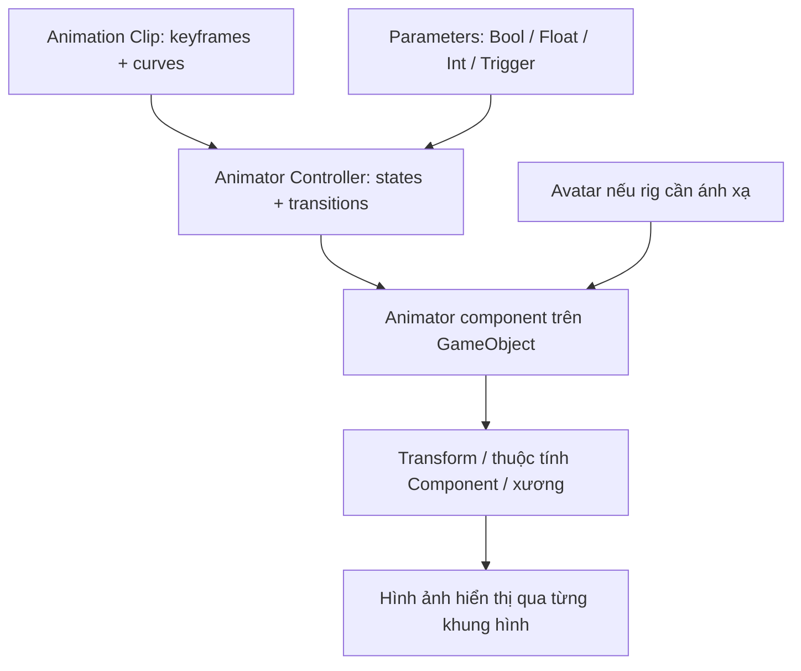
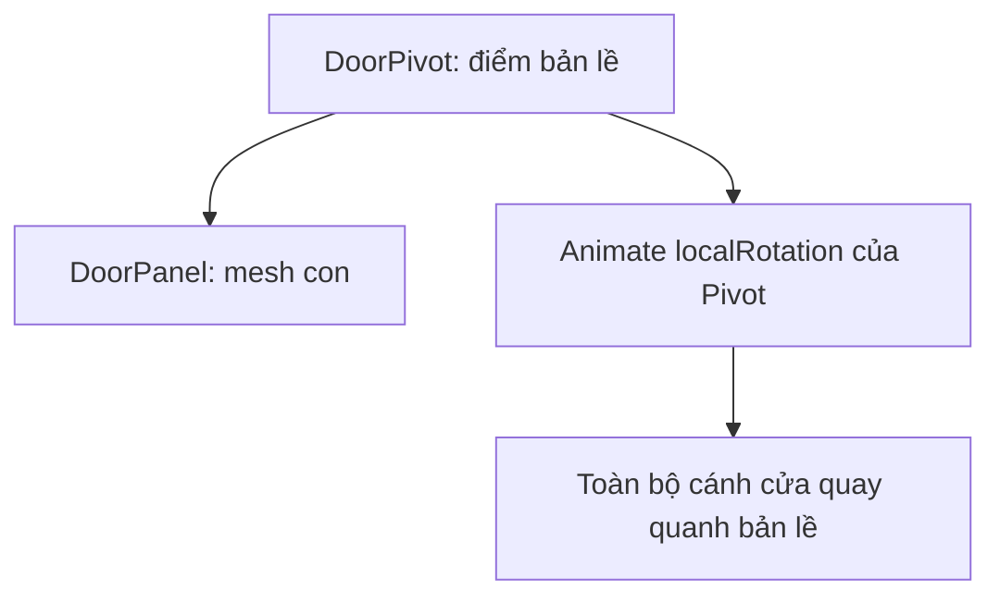
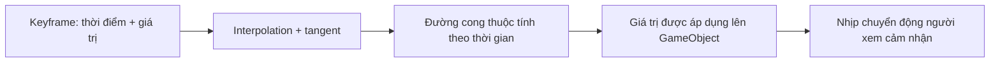
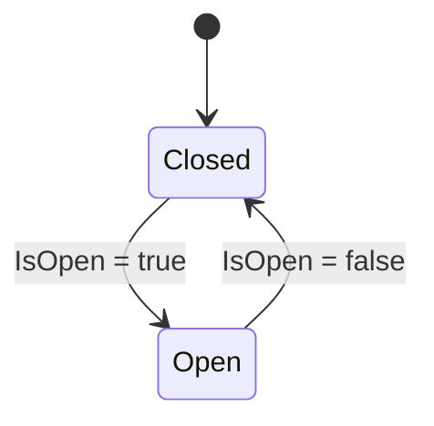
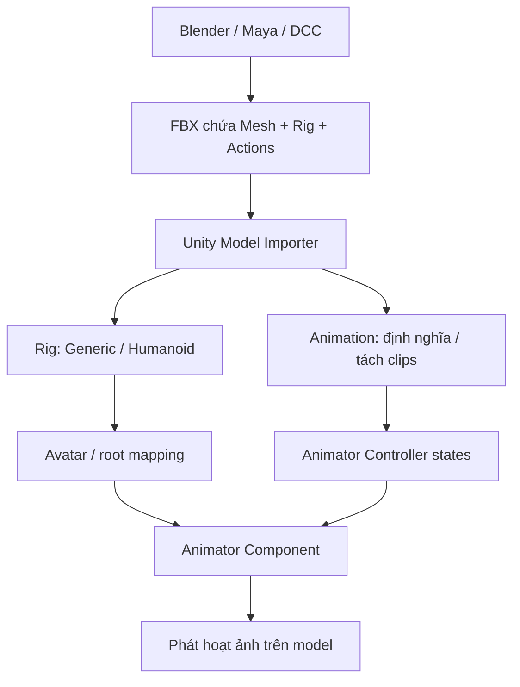
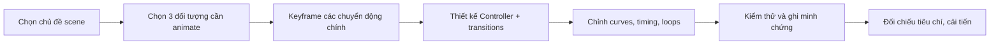
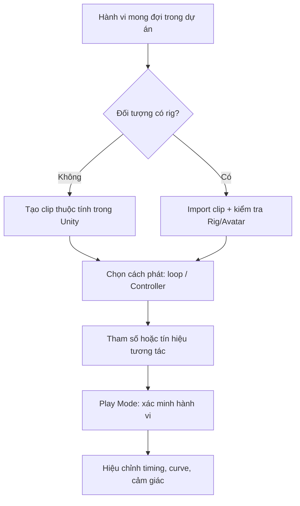

# Creative Core — Animation (Unity 6.3): Giáo trình tiếng Việt tổng hợp

Bản gộp tám bài; các file .md riêng vẫn là bản học độc lập được khuyến nghị.


---

## Bài 01 — Nhập môn Animation trong Unity

> **Creative Core · Animation · Unity 6.3 · Bài học nền tảng**

### 1. Tóm tắt

Animation (hoạt ảnh) là quá trình mô tả sự thay đổi của một hoặc nhiều thuộc tính theo thời gian để tạo cảm giác chuyển động. Trong Unity, chuyển động không chỉ áp dụng cho nhân vật: cửa tự mở, đèn thay đổi cường độ, biển hiệu xoay, vật thể nhún lên xuống và một đối tượng dịch chuyển đều có thể được thực hiện bằng hoạt ảnh. Trọng tâm của bài này là phân biệt **dữ liệu chuyển động** với **cơ chế điều khiển lúc phát chuyển động**.

### 2. Mục tiêu học tập

Sau khi hoàn thành, người học có thể:

1. Giải thích quan hệ giữa `Animation Clip`, `Animator Controller`, `Animator` và `Avatar`.
2. Phân biệt `Animation` window với `Animator` window.
3. Tạo một hoạt ảnh chuyển vị đơn giản cho GameObject và quan sát trạng thái chạy.
4. Chẩn đoán được các lỗi cơ bản khi đối tượng không chuyển động.

### 3. Bối cảnh và nguyên lý

Một đối tượng trong scene có nhiều thuộc tính: `Transform.position`, `Transform.rotation`, `Transform.localScale`, màu hoặc cường độ ánh sáng. Thay vì thay đổi các thuộc tính này thủ công ở mỗi khung hình, ta đặt những **keyframe** tại các thời điểm xác định. Unity tính các giá trị trung gian bằng **interpolation** (nội suy) giữa các keyframe.

Ví dụ, khối lập phương ở vị trí Y = 0 tại giây 0 và Y = 2 tại giây 1. Nếu đường cong vị trí dùng nội suy tuyến tính thì ở giây 0,5, Y ≈ 1. Nếu chuyển sang đường cong Ease In/Out thì đối tượng tăng tốc và giảm tốc thay vì giữ tốc độ đều; giá trị tại cùng một thời điểm phụ thuộc vào hình dạng đường cong.

#### 3.1. Các thành phần của hệ thống

| Thành phần | Bản chất | Trách nhiệm |
|---|---|---|
| `Animation Clip` (`.anim`) | Asset dữ liệu | Chứa keyframe, curves và các thuộc tính được animate |
| `Animator Controller` (`.controller`) | Asset điều khiển | Tổ chức các state, transition, parameter và việc chọn clip |
| `Animator` | Component gắn trên GameObject | Đánh giá hoạt ảnh từ Controller trong thời gian chạy |
| `Avatar` | Ánh xạ rig, đặc biệt quan trọng với Humanoid | Cho phép hệ thống diễn giải chuyển động xương và retargeting |
| `Animation` window | Cửa sổ biên tập | Tạo clip, sửa keyframe, Dope Sheet và Curves |
| `Animator` window | Cửa sổ điều khiển | Xây dựng đồ thị state/transition của Controller |

Một GameObject hình khối cơ bản có thể animate mà **không cần Humanoid Avatar**. Nhân vật rigged có thể phải cấu hình Avatar phù hợp với loại rig.

#### 3.2. Dòng dữ liệu hoạt ảnh



**Ý nghĩa:** Clip mô tả *diễn ra như thế nào*; Controller quyết định *phát hoạt ảnh nào và khi nào*; Animator áp dụng kết quả lên GameObject. Một Controller có thể tham chiếu nhiều clip, nhưng không tự trở thành dữ liệu chuyển động.

### 4. Phân biệt các loại chuyển động

- **Keyframe animation:** ghi lại thay đổi thuộc tính theo thời gian; phù hợp cửa, vật thể, ánh sáng, hiệu ứng đơn giản.
- **Skeletal animation:** thay đổi tư thế khung xương (rig); phù hợp nhân vật, động vật, robot có khớp.
- **Imported animation:** clip tạo từ Blender, Maya hoặc công cụ DCC và đưa vào Unity; cần kiểm tra rig và import settings.
- **Procedural animation:** chuyển động tính bằng code hoặc hệ thống như IK; không phải mọi chuyển động trong Unity đều cần keyframe.

Một clip có thể được phát tự động khi vào scene hoặc thông qua transition có điều kiện. **Play Mode** là môi trường để kiểm tra hành vi, còn Animation window có thể preview clip trước khi chạy toàn bộ scene.

### 5. Thực hành: khối lập phương chuyển động

**Chuẩn bị:** tạo project 3D, scene mới; chọn `GameObject > 3D Object > Cube`; đổi tên thành `AnimatedCube`; bảo đảm GameObject đang active.

1. Chọn `AnimatedCube` trong Hierarchy, mở `Window > Animation > Animation`.
2. Nếu chưa có clip, chọn **Create**, lưu `Assets/Animations/CubeMove.anim`. Unity thường đồng thời tạo Animator Controller và thêm Animator vào GameObject khi tạo clip đầu tiên bằng quy trình này.
3. Trong Animation window, bật chế độ ghi (**Record**) hoặc thêm property track với **Add Property > Transform > Position**.
4. Ở thời điểm **0:00**, đặt `Position = (0, 0, 0)`; tại **1:00** (giây thứ nhất), đặt `Position = (0, 2, 0)` để tạo keyframe. Kiểm tra rõ đơn vị **seconds/frames** hiển thị trên timeline, tránh nhầm `1:00` với một phút.
5. Tắt Record. Kéo playhead để quan sát khối thay đổi vị trí. Mở `Window > Animation > Animator` và xem clip đang là state mặc định.
6. Nhấn Play, kiểm tra chuyển động trong Game view. Nếu muốn lặp, chọn clip trong Project và bật `Loop Time` ở Inspector (khi tuỳ chọn được hỗ trợ).

**Kết quả mong đợi:** Khối dịch chuyển giữa hai vị trí. Hai keyframe tạo một chuyển động tuyến tính hoặc theo curve hiện có; chuyển động lặp hay dừng tùy cấu hình clip/state.

### 6. Lỗi thường gặp và quy trình kiểm tra

| Hiện tượng | Nguyên nhân khả dĩ | Cách kiểm tra |
|---|---|---|
| Khối đứng yên trong Play | Animator bị vô hiệu hoá, thiếu Controller hoặc state không có Motion | Inspector > `Animator`; mở state mặc định xem Motion |
| Clip preview đúng nhưng Play sai | Controller đang chọn state khác hoặc transition thay đổi state | Quan sát state sáng trong Animator khi Play |
| Khối bị đổi vị trí ngoài dự kiến | Keyframe ghi cả các trục Position hoặc một property không chủ đích | Xem danh sách property trong Animation window |
| Thay đổi Inspector không giữ sau khi Play | Thay đổi đang thực hiện trong Play Mode | Thoát Play, chỉnh lại trong Edit Mode và lưu scene |
| Nhân vật rig không di chuyển đúng | Avatar hoặc ánh xạ xương không tương thích | Kiểm tra Model Importer > Rig > Avatar |

**Quy trình debug chuẩn:** tái hiện → kiểm tra Console → xem Animator/Controller/clip → kiểm tra property track → thay đổi một biến → chạy lại.

### 7. Bài tập vận dụng

Tạo `FloatingOrb` bằng Sphere, thêm hoạt ảnh di chuyển theo trục Y, sau đó thử tăng chiều cao tối đa nhưng giữ thời lượng clip cố định. Quan sát sự thay đổi cảm nhận tốc độ. Tạo thêm một hoạt ảnh xoay có tốc độ khác và giải thích vì sao không nên vô tình animate vị trí của cha và con cùng lúc khi chúng có chuyển động chồng lấn.

**Tiêu chí đạt:** Có scene chạy được, tối thiểu hai keyframe, phân biệt rõ clip và controller; ghi lại ảnh Animation window và Animator window.

### 8. Câu hỏi ôn tập trắc nghiệm

#### 8.1. Câu 1

Vì sao `Animation Clip` và `Animator Controller` không thể coi là cùng một thành phần?

**A.** Clip chỉ chứa hình học, Controller chứa texture.  
**B.** Clip lưu biến đổi theo thời gian; Controller quyết định các trạng thái và chuyển trạng thái.  
**C.** Controller chỉ dùng để render đối tượng.  
**D.** Clip bắt buộc có Humanoid Avatar.  

**Đáp án:** B. **Giải thích:** Một bên là dữ liệu chuyển động, bên còn lại là logic điều khiển phát.

#### 8.2. Câu 2

Đối tượng Cube chỉ có Transform cần dùng thành phần nào để phát clip theo Mecanim?

**A.** Animator và Controller phù hợp.  
**B.** Humanoid Avatar bắt buộc.  
**C.** Skinned Mesh Renderer bắt buộc.  
**D.** Rigidbody bắt buộc.  

**Đáp án:** A. **Giải thích:** Hoạt ảnh thuộc tính trên Cube không đòi rig Humanoid hay vật lý.

#### 8.3. Câu 3

Cần chỉnh hình dạng gia tốc của chuyển động theo thời gian thì dùng đâu?

**A.** Console.  
**B.** Lighting Settings.  
**C.** Animator Parameters.  
**D.** Curves trong Animation window.  

**Đáp án:** D. **Giải thích:** Curves và tangents kiểm soát giá trị nội suy qua các keyframe.

#### 8.4. Câu 4

Một clip preview đúng nhưng runtime chơi clip khác. Bước kiểm tra nào hữu ích nhất?

**A.** Đổi màu material.  
**B.** Xoá toàn bộ clip.  
**C.** Xem active state và transitions trong Animator.  
**D.** Đổi camera sang orthographic.  

**Đáp án:** C. **Giải thích:** Controller có thể chuyển sang state khác khi chạy.

#### 8.5. Câu 5

Thay đổi Inspector trong Play Mode rồi tắt Play có hiện tượng gì thường gặp?

**A.** Thay đổi thử nghiệm không được lưu như chỉnh sửa scene ở Edit Mode.  
**B.** Unity luôn tự tạo Prefab mới.  
**C.** Clip bị xoá khỏi thư mục.  
**D.** Shader tự động chuyển sang URP.  

**Đáp án:** A. **Giải thích:** Play Mode dùng để thử nghiệm; thay đổi trong đó thường được hoàn nguyên khi thoát.

### 9. Tổng kết

- `Animation Clip` lưu biến đổi theo thời gian; `Animator Controller` quản lý luồng phát; `Animator` thực thi trên GameObject.
- `Animation` window để dựng/hiệu chỉnh chuyển động, `Animator` window để điều khiển các trạng thái.
- Hãy kiểm tra clip, state, parameter và các thuộc tính đã được ghi trước khi thay đổi project settings.

### 10. Tài liệu học thêm

1. [Unity Learn — Creative Core Animation](https://learn.unity.com/pathway/creative-core/unit/animation?version=6.3).
2. [Unity 6.3 — Animation window](https://docs.unity.com/en-us/engine/6000.3/manual/animation-section/animation-mecanim/animation-clips/animation-editor-guide).
3. [Unity 6.3 — Animator Controller](https://docs.unity.com/en-us/engine/6000.3/manual/animation-section/animation-mecanim/animation-animator-controller).
4. [Unity 6.3 — Humanoid Avatar](https://docs.unity.com/en-us/engine/6000.3/manual/animation-section/animation-mecanim/avatar-creationand-setup).

---

## Bài 02 — Tạo hoạt ảnh 3D đầu tiên bằng Keyframe

> **Creative Core · Animation · Unity 6.3 · Bài thực hành có hướng dẫn**

### 1. Tóm tắt

Keyframe animation cho phép tạo chuyển động 3D mà không cần viết mã hoặc dựng rig phức tạp. Bài này tập trung vào quy trình thiết kế chuyển động có chủ đích: xác định điểm bắt đầu, điểm kết thúc, thời lượng, phương chuyển động, thuộc tính được điều khiển và cách kiểm tra kết quả.

### 2. Mục tiêu học tập

1. Tạo và lưu hai Animation Clip độc lập cho một GameObject.
2. Đặt các keyframe `Position`, `Rotation` hoặc `Scale` đúng mốc thời gian.
3. Dự đoán ảnh hưởng của khoảng cách/thời gian đến tốc độ và nhận diện trục local–world.
4. Kiểm tra clip có được phát đúng bằng Animator Controller hay không.

### 3. Nguyên lý về keyframe và timeline

#### 3.1. Keyframe là gì?

Keyframe ghi lại giá trị của thuộc tính tại một thời điểm. Ví dụ, cánh cửa có rotation Y = 0° ở t = 0 và Y = 90° ở t = 1 giây. Các góc giữa hai thời điểm được dựng bằng thuật toán nội suy. Không cần đặt keyframe ở từng frame trừ khi hiệu ứng đòi chính xác từng bước.

Đối với chuyển động tuyến tính theo một trục, tốc độ trung bình được ước lượng bởi:

$$
v_{tb} = \frac{|x_{cuối} - x_{đầu}|}{\Delta t}
$$

Trong ví dụ vật di chuyển 2 đơn vị trong 1 giây, tốc độ trung bình là 2 đơn vị/giây. **Lưu ý:** đây không nhất thiết là tốc độ tức thời khi áp dụng ease-in/ease-out.

#### 3.2. Position, Rotation và Scale

| Thuộc tính | Chuyển động phù hợp | Lưu ý |
|---|---|---|
| `Transform.localPosition`/track Position | Tịnh tiến/nhún | Animation trên Transform thường được đánh giá theo quan hệ cha–con; chú ý local space |
| `Transform.localRotation`/track Rotation | Mở cửa, quay biển hiệu | Cần xác định pivot chính xác |
| `Transform.localScale`/track Scale | Phóng to, thu nhỏ, pulse | Scale gần 0 có thể làm đối tượng biến mất và méo hình |

**Pivot** là tâm quay/biến đổi của đối tượng. Với cửa, nên đặt pivot cạnh bản lề: tạo GameObject rỗng `DoorPivot` tại vị trí bản lề, cho mesh cánh cửa làm con và animate `DoorPivot` thay vì xoay một cube quanh tâm của nó.

### 4. Thực hành A: tạo bóng nhún lên xuống

1. Tạo `Sphere` tên `BouncingBall`, đặt tại `(0, 0.5, 0)` để không xuyên sàn `Plane`.
2. Mở Animation window, chọn **Create** để tạo `BallBounce.anim`.
3. Thêm Position track. Đặt keyframe mẫu (giá trị Y chỉ mang tính thực hành, cần điều chỉnh theo kích thước bóng):

   | Thời điểm | Position Y | Ý nghĩa |
   |---|---:|---|
   | 0.0 s | 0.5 | Bóng ở thấp |
   | 0.3 s | 1.6 | Bóng lên cao |
   | 0.6 s | 0.5 | Bóng rơi về vị trí ban đầu |

4. Bật `Loop Time` cho clip khi muốn chuyển động liên tục.
5. Thử Play, quan sát điểm cực trị và chu kỳ. Nếu bóng đi xuyên nền, tăng vị trí Y ở keyframe thấp hoặc sửa collider/mesh cho khớp.

Trong bài tập này không có mô phỏng lực hấp dẫn thực sự: đường bay được xác định bởi keyframe. Nếu cần va chạm vật lý thực, phải cân nhắc hệ thống `Rigidbody`, không đồng thời ghi vị trí theo Animation một cách tùy tiện.

### 5. Thực hành B: tạo cửa mở/đóng

1. Tạo `DoorPivot` rỗng và mesh `DoorPanel` con; đặt pivot cạnh bản lề.
2. Tạo clip `DoorOpen.anim`. Tại t=0: Rotation Y=0°; t=1: Rotation Y=90°.
3. Tạo clip `DoorClose.anim`. Tại t=0: Rotation Y=90°; t=1: Rotation Y=0°.
4. Dùng Animation window để preview từng clip. Nếu Unity chỉ hiển thị một clip, dùng danh sách chọn clip ở góc trên của Animation window để chuyển.
5. Mở Animator Controller để đảm bảo mỗi clip có một state tương ứng. Chưa cần viết logic mở/đóng phức tạp ở bài này.

#### 5.1. Hệ trục và trật tự đối tượng



Nếu animate chính mesh `DoorPanel` nhưng nó có tâm ở giữa, cửa có thể quay giống cánh quạt. Nếu animate cả parent lẫn child trên cùng thuộc tính, chuyển động kết hợp có thể khó dự đoán.

### 6. Cách tổ chức asset

```text
Assets/
  Animations/
    BallBounce.anim
    DoorOpen.anim
    DoorClose.anim
    DoorAnimator.controller
  Scenes/
    KeyframePractice.unity
```

Tên rõ ràng giúp phân biệt dữ liệu chuyển động với Controller. Nên lưu scene sau khi tạo clip, kiểm tra asset trong Project, tránh chỉ thấy kết quả đúng trong chế độ preview.

### 7. Khắc phục lỗi và bài thực hành thêm

- **Không thấy Add Property:** chọn đúng GameObject và đúng clip; xác nhận đối tượng có thành phần animatable.
- **Keyframe không xuất hiện:** kiểm tra Record đang bật hoặc đã dùng chức năng Add Keyframe/Key đúng cách.
- **Cửa quay lệch:** kiểm tra vị trí `DoorPivot` và hierarchy của panel.
- **Chuyển động bất ngờ đổi Scale:** mở danh sách property track và xoá các track được ghi nhầm (không xoá cả clip).
- **Cửa bật về góc cũ:** xem state đang phát, thời lượng transition và các clip khác có ghi cùng thuộc tính.

**Bài tập:** tạo một `Platform` nâng lên 1,5 đơn vị trong 2 giây rồi quay về, so sánh với cùng chuyển động chỉ trong 0,5 giây. Ghi nhận cảm giác tốc độ và khả năng tái sử dụng clip.

### 8. Câu hỏi ôn tập trắc nghiệm

#### 8.1. Câu 1

Hai keyframe ở 0 s và 2 s có cùng độ dời 4 đơn vị. Tốc độ trung bình theo trục đó là bao nhiêu?

**A.** 8 đơn vị/s  
**B.** 2 đơn vị/s  
**C.** 0,5 đơn vị/s  
**D.** 4 đơn vị/s  

**Đáp án:** B. **Giải thích:** Độ dời chia thời gian: 4/2 = 2 đơn vị/s.

#### 8.2. Câu 2

Cách bố trí nào phù hợp nhất cho cửa xoay quanh bản lề?

**A.** Đặt pivot tại bản lề và animate rotation của pivot.  
**B.** Xoay trực tiếp mesh quanh tâm hình học bất kể vị trí.  
**C.** Dùng Scale X để thay đổi góc mở.  
**D.** Chỉ đổi màu cửa.  

**Đáp án:** A. **Giải thích:** Transform cha ở bản lề cho trục xoay hình học đúng.

#### 8.3. Câu 3

Muốn tạo hiệu ứng bóng bật lên và rơi xuống lặp lại, phương án nào phù hợp?

**A.** Chỉ keyframe một thời điểm.  
**B.** Tạo Animator mà không gắn Clip.  
**C.** Tạo các keyframe ở thấp–cao–thấp rồi cấu hình loop.  
**D.** Xoá thành phần Transform.  

**Đáp án:** C. **Giải thích:** Phải ghi một chu kỳ chuyển động trước khi bật lặp.

#### 8.4. Câu 4

Điều nào đúng về animation vị trí và Rigidbody?

**A.** Luôn có lực hấp dẫn thực nếu đặt keyframe.  
**B.** Phải thêm Rigidbody mới phát được clip.  
**C.** Animator tự giải mọi va chạm.  
**D.** Animate Transform và di chuyển bằng physics đồng thời có thể xung đột.  

**Đáp án:** D. **Giải thích:** Hai hệ cùng điều khiển Transform có thể tạo hành vi khó kiểm soát.

#### 8.5. Câu 5

Để phát được clip sau khi bấm Play trong quy trình Mecanim, cần kiểm tra mục nào?

**A.** Animator được gán Controller có state tham chiếu clip.  
**B.** Chỉ cần Material có texture.  
**C.** Chỉ cần thiết lập camera Field of View.  
**D.** Phải có Light Probe.  

**Đáp án:** A. **Giải thích:** Controller và Animator quyết định clip được thực thi khi chạy scene.

### 9. Tổng kết

- Keyframe ghi trạng thái thuộc tính tại mốc thời gian; curve quyết định nội suy giữa các mốc.
- Pivot và hierarchy ảnh hưởng trực tiếp tới chuyển động quay và các phép biến đổi local.
- Thử từng clip trong Animation window rồi kiểm chứng ở Play Mode với Controller thực tế.

### 10. Tài liệu học thêm

1. [Unity 6.3 — Animation window](https://docs.unity.com/en-us/engine/6000.3/manual/animation-section/animation-mecanim/animation-clips/animation-editor-guide).
2. [Unity 6.3 — Animation Curves](https://docs.unity.com/en-us/engine/6000.3/manual/animation-section/animation-mecanim/animation-clips/animation-editor-guide/animeditor-animation-curves).
3. [Unity Learn — Creative Core Animation](https://learn.unity.com/pathway/creative-core/unit/animation?version=6.3).

---

## Bài 03 — Tinh chỉnh chuyển động bằng Animation Curves

> **Creative Core · Animation · Unity 6.3 · Bài lý thuyết kết hợp thực hành**

### 1. Tóm tắt

Hoạt ảnh có keyframe đúng vẫn có thể trông cứng nếu mọi thay đổi đều tuyến tính. Tinh chỉnh animation nghĩa là thiết kế cảm giác về **timing** (thời lượng), **spacing** (khoảng dịch chuyển giữa các thời điểm), **easing** (tăng/giảm tốc) và **độ mượt của chuyển trạng thái**. Unity cung cấp Dope Sheet và Curves để làm việc này mà không cần vẽ thêm từng khung hình.

### 2. Mục tiêu học tập

1. Phân biệt Dope Sheet với Curves và nhận diện keyframe/tangent.
2. Dự đoán hiệu ứng của Linear, Constant và đường cong có easing.
3. Tinh chỉnh chuyển động nhún, xoay hoặc mở cửa bằng cách thay đổi vị trí keyframe và tangents.
4. Nhận biết vấn đề khi nội suy rotation theo Euler so với Quaternion.

### 3. Nguyên lý thời gian và nội suy

#### 3.1. Thời điểm và giá trị không phải một

Một curve mô tả hàm thuộc tính theo thời gian: $p(t)$ với trục hoành là thời gian và trục tung là giá trị thuộc tính. Kéo keyframe sang **trái/phải** thay đổi thời điểm. Kéo **lên/xuống** thay đổi giá trị. Hai thao tác này có tác động khác nhau đối với nhịp chuyển động.

- **Linear:** tốc độ biến đổi không đổi giữa hai keyframe (đối với property vô hướng).
- **Constant/Stepped:** giữ giá trị cũ cho tới khi sang keyframe kế tiếp; hữu ích với trạng thái bật/tắt hoặc chuyển đổi giật cấp.
- **Ease In/Out:** độ dốc curve thay đổi theo thời gian, tạo cảm giác vào/ra chuyển động mềm mại.

Về mặt toán học, với một thuộc tính vô hướng được nội suy tuyến tính giữa $p_0$ và $p_1$:

$$
p(t) = p_0 + u(p_1-p_0),\quad u=\frac{t-t_0}{t_1-t_0},\quad 0\le u\le 1
$$

Đường cong Hermite/Bezier trong công cụ biên tập có thể thay đổi gia tốc và tạo overshoot tùy tangents; không nên mặc định mọi curve đều đi qua các giá trị trung gian như tuyến tính.

#### 3.2. Dope Sheet và Curves

| Chế độ | Thể hiện | Khi nên dùng |
|---|---|---|
| **Dope Sheet** | Các keyframe trên những hàng thuộc tính | Canh nhịp, dời nhóm keyframe, so sánh các sự kiện |
| **Curves** | Đồ thị giá trị theo thời gian | Kiểm soát tốc độ, độ dốc, easing, loại bỏ overshoot |



Không có sự khác biệt dữ liệu cơ bản giữa hai chế độ: Dope Sheet và Curves là hai góc nhìn trên cùng clip.

### 4. Thực hành: sửa chuyển động của một quả bóng

**Chuẩn bị:** GameObject có clip `BallBounce.anim` với keyframe tại Y = 0,5 ở 0,0 s; Y = 1,6 ở 0,3 s; Y = 0,5 ở 0,6 s. Có thể tạo lại từ đầu nếu chưa có scene.

1. Chọn GameObject và mở `Window > Animation > Animation`.
2. Chọn clip tương ứng, đổi từ **Dopesheet** sang **Curves**.
3. Chọn track Position Y, kiểm tra đồ thị. Khi preview, quan sát tốc độ trước và sau đỉnh.
4. Với pha lên, thử đặt tangent để đường cong **chậm ở đỉnh**; với pha xuống, thử tăng độ dốc trước khi chạm đáy. Đặc điểm vật rơi nhanh dần tạo ấn tượng có trọng lực, dù đây vẫn là hoạt ảnh thủ công.
5. Sau đó thêm keyframe ngắn gần đáy nếu muốn có pha nén/giãn: giảm nhẹ `Scale Y` đồng thời tăng `Scale X`/`Scale Z` nhưng giữ hiệu ứng ở mức nhỏ. Nên thêm scale track có chủ đích, không ghi nhầm các thuộc tính khác.
6. So sánh bản thô và bản chỉnh sửa bằng hai clip riêng (`BallBounce_Blocking.anim` và `BallBounce_Polished.anim`).

**Bài quan sát:** xem quả bóng có dừng quá lâu ở đỉnh hay xuyên sàn lúc chạm đáy. Không đánh giá chỉ bằng hình dạng đồ thị; cần xem chuyển động ở tốc độ phát thực.

### 5. Lưu ý quan trọng khi xoay 3D

Các phép quay trong Unity được lưu nội bộ theo **Quaternion**, nhưng người dùng thường nhập **Euler angles** trong Inspector. Khi nội suy rotation, cách chọn biểu diễn có thể khiến chuyển động quay khác kỳ vọng:

- **Quaternion interpolation** thường đi theo đường quay ngắn hơn; một cặp orientation không mô tả trực tiếp vòng quay nhiều hơn 180° theo cùng một trục.
- **Euler interpolation** trực quan hơn khi cần quay theo góc lớn hoặc kiểm soát từng trục, nhưng có thể phát sinh các vấn đề về cách biểu diễn góc và gimbal lock trong một số trường hợp.
- Đối với biển quảng cáo quay 360°, nên thử kết quả thật, kiểm tra chế độ nội suy và chia vòng quay thành các keyframe thích hợp nếu cần.

Không nên chỉnh trực tiếp các thành phần x/y/z/w của Quaternion như bốn góc Euler. Chỉ thay đổi khi đã hiểu hình học phép quay.

### 6. Kỹ thuật dựng chuyển động dễ quan sát

- **Blocking trước, polishing sau:** đặt các pose/key chính trước khi tinh chỉnh curve.
- **Giữ silhouette rõ:** ở mỗi thời điểm quan trọng, tư thế phải đọc được.
- **Đừng lạm dụng overshoot:** nếu spline đẩy giá trị vượt ngưỡng, cửa có thể xoay quá khung hoặc vật thể đi xuyên nền.
- **Tách thuộc tính được điều khiển:** nếu clip chỉ cần thay đổi Y, tránh vô tình ghi cả X/Z theo giá trị không chủ đích.
- **Chỉnh trong thời lượng thực:** một curve đẹp trên biểu đồ vẫn có thể chậm hoặc quá nhanh khi xem Play.

### 7. Lỗi thường gặp và kiểm thử

| Lỗi | Dấu hiệu | Cách sửa |
|---|---|---|
| Overshoot | Vật vượt ngoài giá trị dự định | Đặt tangent phù hợp hoặc thêm keyframe giới hạn |
| Chuyển động giật | Giá trị bật giữa các frame | Kiểm tra Constant tangent hoặc keyframe đặt quá gần |
| Cú xoay ngược | Đối tượng xoay hướng không mong muốn | Kiểm tra nội suy Quaternion/Euler và các góc key |
| Tốc độ không đều | Đối tượng tăng tốc bất thường | Quan sát độ dốc curve, sửa tangents |
| Sửa nhầm clip | Mất hiệu ứng ở một state khác | Đọc tên clip ở thanh chọn trước khi Record |

**Thực hành ngắn:** tạo hai chuyển động cửa cùng mở 90° trong 1 giây: bản A tuyến tính, bản B Ease In/Out. Quay video so sánh, ghi lý do lựa chọn một kiểu cho cửa tự động và một kiểu cho cửa va đập.

### 8. Câu hỏi ôn tập trắc nghiệm

#### 8.1. Câu 1

Trong Curves, kéo keyframe sang phải mà không đổi độ cao sẽ thay đổi yếu tố nào?

**A.** Giá trị thuộc tính tại keyframe.  
**B.** Thời điểm keyframe.  
**C.** Loại GameObject.  
**D.** Loại rig.  

**Đáp án:** B. **Giải thích:** Tọa độ ngang của đồ thị biểu diễn thời gian.

#### 8.2. Câu 2

Cách nào hợp lý nhất để tạo cảm giác cửa khởi động chậm rồi tăng tốc?

**A.** Giữ Constant interpolation.  
**B.** Xoá Animator.  
**C.** Chỉnh tangent/easing của curve.  
**D.** Chỉ đổi màu vật liệu.  

**Đáp án:** C. **Giải thích:** Độ dốc curve quyết định sự thay đổi giá trị trên mỗi đơn vị thời gian.

#### 8.3. Câu 3

Tại sao cần xem Play Mode sau khi sửa curve?

**A.** Hình dạng đồ thị không thể hiện đầy đủ cảm nhận chuyển động trong scene.  
**B.** Unity không lưu keyframe trong Edit Mode.  
**C.** Animation window luôn hiển thị sai.  
**D.** Animator không hỗ trợ preview.  

**Đáp án:** A. **Giải thích:** Tốc độ phát, camera, hierarchy và những clip khác có thể ảnh hưởng kết quả.

#### 8.4. Câu 4

Muốn quay biển 360° nhưng nội suy Quaternion chọn đường ngắn, nên làm gì?

**A.** Xoá mọi keyframe.  
**B.** Chỉ tăng scale.  
**C.** Thêm Rigidbody.  
**D.** Xem lại chế độ nội suy và chia/chỉnh các keyframe quay thích hợp.  

**Đáp án:** D. **Giải thích:** Quaternion biểu diễn orientation, không tự mã hóa mọi số vòng quay chỉ với cặp tư thế.

#### 8.5. Câu 5

Overshoot trong curve là gì?

**A.** Đổi tên file asset.  
**B.** Giá trị nội suy vượt quá mức của keyframe mong muốn.  
**C.** Clip được phát tự động.  
**D.** Một GameObject có nhiều Component.  

**Đáp án:** B. **Giải thích:** Tangents của curve có thể tạo cực trị ngoài khoảng mong đợi.

### 9. Tổng kết

- Timing xác định khi nào xảy ra chuyển động; curve xác định chuyển động diễn tiến ra sao.
- Dope Sheet dùng canh keyframe, Curves dùng canh vận tốc và easing.
- Luôn kiểm tra rotation interpolation, overshoot và cảm nhận chuyển động ở thời gian thực.

### 10. Tài liệu học thêm

1. [Unity 6.3 — Animation Curves](https://docs.unity.com/en-us/engine/6000.3/manual/animation-section/animation-mecanim/animation-clips/animation-editor-guide/animeditor-animation-curves).
2. [Unity 6.3 — Animation window](https://docs.unity.com/en-us/engine/6000.3/manual/animation-section/animation-mecanim/animation-clips/animation-editor-guide).
3. [Unity Learn — Creative Core Animation](https://learn.unity.com/pathway/creative-core/unit/animation?version=6.3).

---

## Bài 04 — Điều khiển hoạt ảnh bằng Animator Controller

> **Creative Core · Animation · Unity 6.3 · Bài học điều khiển trạng thái**

### 1. Tóm tắt

Một đối tượng có nhiều hoạt ảnh phải lựa chọn clip theo điều kiện, chẳng hạn cửa ở trạng thái đóng, mở hoặc đang chuyển động. `Animator Controller` giải quyết bài toán này bằng **finite state machine** (máy trạng thái hữu hạn): từng trạng thái chứa chuyển động, các mũi tên là **transition**, còn **parameter** là đầu vào xác định điều kiện chuyển. Unity có thể trộn (blend) hai hoạt ảnh trong khoảng chuyển trạng thái để tránh nhảy tư thế.

### 2. Mục tiêu học tập

1. Tạo Controller với ít nhất hai state và một tham số `Bool`.
2. Cấu hình chuyển hai chiều, phân biệt `Has Exit Time` và `Conditions`.
3. Sử dụng `Animator.SetBool()` trong C# để kích hoạt hoạt ảnh.
4. Gỡ lỗi transition bị kẹt, sai parameter, clip đang bị loop hoặc blend không phù hợp.

### 3. Thành phần của Animator Controller

#### 3.1. State, Motion và Default State

`State` thường tham chiếu một `Animation Clip` qua thuộc tính `Motion`. Controller có một **default state** khi khởi động (đường nối từ Entry tới state mặc định). Màu nền và cách hiển thị state có thể khác nhau theo phiên bản Editor.

`Animator` (Component) gắn vào GameObject không phải cửa sổ Animator. Component này có trường `Controller` tham chiếu asset `.controller`. Trong Play Mode, mở Animator window để quan sát state đang hoạt động và transition diễn ra.

#### 3.2. Parameter

| Loại | Ý nghĩa | Ví dụ |
|---|---|---|
| `Bool` | Cờ đúng/sai duy trì đến khi đổi | `IsOpen` |
| `Float` | Giá trị liên tục | `Speed` |
| `Int` | Giá trị nguyên phân loại | `Direction` |
| `Trigger` | Tín hiệu sự kiện để kích hoạt chuyển trạng thái | `Jump` hoặc `Open` một lần |

Chọn **Bool** khi trạng thái nên tồn tại liên tục; dùng **Trigger** cho hành động sự kiện. Trigger được tiêu thụ/reset theo quá trình xử lý của Controller; không dùng thay thế dữ liệu trạng thái dài hạn.

#### 3.3. Transition và hai tiêu chí thường nhầm

- `Conditions` là điều kiện dựa trên parameter. **Nếu có nhiều conditions trên cùng transition, tất cả phải thỏa**.
- `Has Exit Time` là ràng buộc thời điểm trong chu kỳ state hiện tại; giá trị `Exit Time = 0.75` nghĩa là khoảng 75% thời lượng chuẩn hóa của state.
- Khi **bật cả Exit Time và Conditions**, transition chỉ có thể được xét tại thời điểm thích hợp và khi các điều kiện thỏa. Điều này thường làm cửa phản hồi trễ ngoài ý muốn.
- `Transition Duration` xác định thời lượng pha blend; nó không phải thời lượng của Animation Clip.

### 4. Thiết kế đồ thị trạng thái cửa



Ở đây `Closed` là state mặc định và giữ pose cửa đóng; `Open` giữ pose cửa mở. **Transition Duration** tạo chuyển động trộn giữa hai pose. Cách này tránh lỗi phát lại một clip đóng cửa 90° → 0° khi scene vừa khởi động. Với cửa cần chuyển động phức tạp, có thể mở rộng thành bốn state `ClosedPose → Opening → OpenPose → Closing` và quy định rõ cách ngắt/đảo chiều.

### 5. Thực hành chi tiết với hai nút UI

#### 5.1. Cấu hình trong Editor

1. Tạo `DoorPivot` ở bản lề. Dựng hai clip **pose giữ**: `DoorClosed.anim` có góc Y = 0° ở đầu và cuối; `DoorOpened.anim` có góc Y = 90° ở đầu và cuối. Đặt thời lượng mẫu khoảng 1 giây/clip; bảo đảm cả hai chỉ ghi cùng property Rotation. Các clip này không tạo chuyển động độc lập mà cung cấp hai tư thế đích để transition blend.
2. Trong Project: `Create > Animator Controller`, đặt tên `DoorAnimator.controller` và gán vào `Animator` của `DoorPivot`.
3. Mở `Window > Animation > Animator`; kéo hai clip vào graph tạo state `Closed` và `Open`. Đặt `Closed` làm default state, gắn `DoorClosed.anim`; state `Open` gắn `DoorOpened.anim`.
4. Tab **Parameters**: tạo `Bool` tên `IsOpen` (phân biệt chữ hoa/thường với code).
5. Chuột phải state `Closed` > **Make Transition** > `Open`. Bỏ chọn `Has Exit Time`, thêm Condition `IsOpen == true`.
6. Tạo transition ngược `Open` > `Closed`, bỏ `Has Exit Time`, Condition `IsOpen == false`. Ở hai transition, bật **Fixed Duration** và chọn `Transition Duration` khoảng 0,4 giây để cửa đi giữa hai tư thế có tốc độ quan sát được (giá trị chỉ là cấu hình ví dụ).
7. Vào Play Mode, thay đổi `IsOpen` trực tiếp ở Parameters để xác nhận luồng và chuyển động đúng trước khi viết code.

#### 5.2. Điều khiển qua C#

Tạo script `DoorAnimatorControl.cs` và gắn lên GameObject chứa `Animator`:

```csharp
using UnityEngine;

[RequireComponent(typeof(Animator))]
public class DoorAnimatorControl : MonoBehaviour
{
    private static readonly int IsOpen = Animator.StringToHash("IsOpen");
    private Animator animator;

    private void Awake()
    {
        animator = GetComponent<Animator>();
    }

    public void OpenDoor()
    {
        animator.SetBool(IsOpen, true);
    }

    public void CloseDoor()
    {
        animator.SetBool(IsOpen, false);
    }
}
```

Tạo hai `Button` trong Canvas, cấu hình `On Click()` để tham chiếu GameObject chứa `DoorAnimatorControl`, lần lượt chọn `OpenDoor()` và `CloseDoor()`. Bài này không phụ thuộc vào hệ thống nhập bàn phím cũ hay mới.

**Điều quan trọng:** Code chỉ **thay đổi parameter**, không trực tiếp đổi góc cánh cửa. Cấu hình trong Controller phải nhất quán với tên `IsOpen`, state và conditions. Khi cần điều khiển bằng bàn phím, có thể dùng Input System của dự án để gọi hai phương thức công khai.

#### 5.3. Kiểm tra kết quả

- Khi Play: thấy state mặc định chạy và nhận giá trị `IsOpen=false`.
- Bấm nút mở: thấy parameter đổi thành true và state chuyển sang `Open`.
- Bấm nút đóng: thấy parameter đổi thành false và state về `Closed`.
- Quan sát cửa có đổi góc mượt, có bị chớp/vấp khi bấm liên tiếp hay không.

Ở ví dụ này, các state `Closed` và `Open` chính là **pose giữ**; chuyển động mở/đóng được tạo bằng cách blend trong transition. Nếu muốn gia tốc theo curve riêng, âm thanh khớp chuyển động, hoặc đảo chiều chính xác giữa chừng, hãy thiết kế clip động tác/state trung gian và kiểm tra thuộc tính interruption của transition.

### 6. Các kỹ thuật bổ sung

- **Any State:** thích hợp cho hành động có thể được kích hoạt từ nhiều trạng thái, nhưng lạm dụng dễ gây transition ngoài ý muốn.
- **Blend Tree:** trộn các motion gần nhau theo `Float` như `Speed`, thường dùng Idle–Walk–Run. Không cần dùng cho cửa chỉ có hai trạng thái.
- **Layers và Avatar Mask:** tách các phần cơ thể; ví dụ nhân vật chạy với chân nhưng vẫy tay ở lớp thân trên.
- **Root Motion:** lựa chọn lấy chuyển động từ animation để điều khiển vị trí/hướng gốc hay do script điều khiển; cần tránh hai nơi cùng ghi Transform.

### 7. Sửa lỗi thực tế

| Triệu chứng | Nguyên nhân có thể | Cách xử lý |
|---|---|---|
| Bấm nút mà state không đổi | Tên parameter sai; OnClick không nối script | So sánh chính xác `IsOpen`, xem Inspector Button, quan sát Parameters khi Play |
| Đổi state chậm | `Has Exit Time` vẫn bật | Tắt nếu muốn chuyển ngay theo parameter |
| Chuyển nhưng không có chuyển động | State `Motion` rỗng; thiếu track | Kiểm tra clip gắn vào state |
| Cửa về sai góc | Clip ghi giá trị không nhất quán; transition blend | Đặt keyframe góc đầu/cuối chính xác, giảm blend và kiểm tra state |
| Animation phát liên tục | `Loop Time` bật cho clip cần phát một lần | Tắt loop trong Import/Clip Settings |
| Cửa bị giật khi nhấn liên tiếp | Bị đổi hướng giữa transition hoặc thiết kế state không phù hợp | Thiết kế state trung gian/giữ pose và quy tắc interruption |

**Thực hành ngắn:** đổi controller từ cửa sang đèn cảnh báo: `Idle` và `Blink`, tham số `Bool` `AlarmActive`; viết script hai hàm `EnableAlarm()`/`DisableAlarm()`. Giải thích vì sao các clip thay đổi cường độ ánh sáng thay vì cần di chuyển GameObject.

### 8. Câu hỏi ôn tập trắc nghiệm

#### 8.1. Câu 1

Điều kiện chuyển trạng thái dựa trên `IsOpen` nên khai báo ở đâu?

**A.** Trong Material.  
**B.** Trong Lightmap.  
**C.** Trong Animator Controller Parameters và Transition Conditions.  
**D.** Trong Camera Clear Flags.  

**Đáp án:** C. **Giải thích:** Parameters cung cấp đầu vào, Conditions xác định khi nào state đổi.

#### 8.2. Câu 2

Muốn chuyển state ngay khi Bool đổi, lựa chọn nào thường cần thiết?

**A.** Bật Has Exit Time = 1.  
**B.** Bỏ Has Exit Time khi transition phải phản hồi ngay.  
**C.** Xoá cả hai state.  
**D.** Chỉ tăng tốc clip.  

**Đáp án:** B. **Giải thích:** Exit Time có thể chặn transition cho tới mốc thời gian chuẩn hóa.

#### 8.3. Câu 3

Khi một transition có hai conditions, Unity yêu cầu điều gì?

**A.** Chỉ một điều kiện đúng.  
**B.** Hai điều kiện tự động bị bỏ qua.  
**C.** Bắt buộc phải có 2 Controller.  
**D.** Thông thường tất cả conditions đều phải thỏa.  

**Đáp án:** D. **Giải thích:** Nhiều conditions trên cùng transition được kết hợp theo AND.

#### 8.4. Câu 4

Trong script, `animator.SetBool("IsOpen", true)` tác động trực tiếp tới đâu?

**A.** Tham số trong Animator Controller.  
**B.** Màu của Main Camera.  
**C.** Scale của cửa mà không thông qua Controller.  
**D.** Asset FBX trong Project.  

**Đáp án:** A. **Giải thích:** SetBool chỉ đặt giá trị parameter; state machine quyết định hoạt ảnh.

#### 8.5. Câu 5

Tình huống nào thích hợp dùng `Trigger` hơn `Bool`?

**A.** Lưu một cấu hình màu vĩnh viễn.  
**B.** Giữ trạng thái cửa mở cho tới khi đổi.  
**C.** Báo một hành động ngắn như kích hoạt animation Jump.  
**D.** Biểu diễn tốc độ liên tục.  

**Đáp án:** C. **Giải thích:** Trigger đại diện sự kiện một lần, không phải cờ trạng thái dài hạn.

### 9. Tổng kết

- Animator Controller tổ chức state, parameter và transition; component Animator đánh giá chúng khi chạy.
- `Has Exit Time`, conditions và duration tác động đến ba khía cạnh khác nhau của chuyển trạng thái.
- Trước khi viết C#, hãy kiểm tra đồ thị bằng cách thay parameter trực tiếp trong Animator khi Play.

### 10. Tài liệu học thêm

1. [Unity 6.3 — Animator Controller](https://docs.unity.com/en-us/engine/6000.3/manual/animation-section/animation-mecanim/animation-animator-controller).
2. [Unity 6.3 — Animation transitions](https://docs.unity.cn/6000.3/Documentation/Manual/class-Transition.html).
3. [Unity 6.3 — Animator scripting API](https://docs.unity.com/en-us/engine/6000.3/script-reference/unityengine/animator).
4. [Unity Learn — Animation](https://learn.unity.com/pathway/creative-core/unit/animation?version=6.3).

---

## Bài 05 — Nhập Animation từ Blender và các công cụ 3D vào Unity

> **Creative Core · Animation · Unity 6.3 · Bài học nhập và cấu hình asset**

### 1. Tóm tắt

Không phải hoạt ảnh nào cũng được tạo trong Unity Editor. Trong quy trình sản xuất, nhân vật và động tác thường được tạo bằng Blender, Maya hoặc phần mềm DCC (Digital Content Creation), sau đó xuất sang file trung gian như FBX. Unity cần phân biệt **model**, **rig/skeleton**, **Avatar** và **Animation Clip** để phát động tác đúng trên đối tượng. Bài này hướng dẫn cách nhận diện rig, chia clip và kiểm tra lỗi retargeting.

### 2. Mục tiêu học tập

1. Phân biệt `Generic` và `Humanoid` rig, chọn kiểu cho từng loại đối tượng.
2. Cấu hình tab `Rig` và `Animation` trong Model Import Settings.
3. Xác định các clip con, cắt khoảng frame, kiểm tra loop và preview chuyển động.
4. Kiểm tra Avatar mapping và xử lý các lỗi scale, orientation, root motion hoặc skeleton không tương thích.

### 3. Các thành phần khi import

#### 3.1. Model, rig và clip là ba lớp khác nhau

- **Mesh:** hình học bề mặt được vẽ; có thể là cánh tay, chân, vỏ robot hay hình khối.
- **Skeleton/Rig:** hệ thống bone/transform cùng quan hệ cha–con dùng để tạo tư thế.
- **Skinning:** ảnh hưởng của bone lên vertex mesh, cho phép mesh biến dạng theo khung xương.
- **Animation Clip:** các keyframe chuyển động, có thể chứa animation của Transform/bone hoặc các thuộc tính hỗ trợ khác.
- **Avatar:** tài nguyên ánh xạ rig được dùng trong hệ thống Mecanim; đặc biệt quan trọng khi retarget các clip `Humanoid` giữa nhân vật khác nhau.



Mỗi tầng phải khớp nhau. Chỉ kéo FBX vào scene không đảm bảo Unity biết khi nào phát động tác.

#### 3.2. Chọn Generic hay Humanoid

| Tiêu chí | `Generic` | `Humanoid` |
|---|---|---|
| Đối tượng | Robot phi người, sinh vật bốn chân, vật có rig tùy ý; có thể dùng cho nhân vật người nếu không cần retarget | Nhân vật có cấu trúc xương người hợp lệ |
| Ánh xạ | Xác định root node/skeleton phù hợp | Ánh xạ các phần cơ thể người trong Avatar |
| Retarget giữa nhân vật | Không có cơ chế humanoid retarget tổng quát | Có thể dùng lại chuyển động giữa các Avatar đã cấu hình |
| Khi nên chọn | Rig bất kỳ hoặc chuyển động cần giữ đúng skeleton riêng | Nhân vật hình người, muốn tái dùng clip walk/run/idle |

**Lưu ý kỹ thuật:** không phải mọi model hai tay hai chân đều tự động đạt chuẩn Humanoid; Avatar mapping phải hợp lệ. Generic vẫn có Avatar theo dạng mapping/root hỗ trợ nhưng **không phải Humanoid Avatar có giao diện body mapping**.

### 4. Quy trình nhập FBX

#### 4.1. Chuẩn bị ở Blender/DCC

Trước khi export, kiểm tra đơn vị scale, hướng up/forward, cấu trúc bones, tên bone, pose gốc, frame range và có thực sự keyframe cho Action cần xuất hay chưa. Tránh áp dụng các phép biến đổi ngẫu nhiên lên mesh và skeleton mà không kiểm tra kết quả skinning. Các tùy chọn export khác nhau theo công cụ và phiên bản, vì vậy nên xác minh bằng một file mẫu nhỏ trước.

#### 4.2. Import vào Unity

1. Sao chép/đưa file `.fbx` vào thư mục `Assets/Models/` trong Unity Project.
2. Chọn **asset FBX trong Project**, không phải instance đang ở Hierarchy; Inspector sẽ hiện các tab Import Settings.
3. Trong **Model**, kiểm tra scale và orientation hiển thị ở Preview. Khi có thay đổi cấu hình import, nhấn **Apply**.
4. Trong **Rig**, chọn `Animation Type`:
   - `Humanoid` nếu là nhân vật người đủ bone. Chọn `Avatar Definition: Create From This Model`, nhấn **Apply** và kiểm tra cấu hình/avatar mapping khi cần.
   - `Generic` với rig không chuẩn người. Kiểm tra `Root node` phù hợp để xác định transform gốc.
5. Trong **Animation**, bật `Import Animation` nếu file có animation. Xem danh sách clip; đặt tên clip cụ thể như `Idle`, `Walk`, `Run` hoặc `Attack`.
6. Nếu một timeline chứa nhiều động tác, định nghĩa riêng từng đoạn frame (`Start` / `End` theo giao diện import) cho từng clip. Không đoán frame; đối chiếu với keyframes đã export.
7. Với hoạt ảnh lặp (walk/idle), bật `Loop Time`; có thể kiểm tra thêm `Loop Pose` và các thiết lập root transform. Với động tác một lần (attack/open), thường không bật loop.
8. Xem Preview, nhấn **Apply** rồi kéo model vào scene. Thêm/gán Controller với state sử dụng các clip vừa nhập.

#### 4.3. Kiểm tra Humanoid Avatar

Khi dùng `Humanoid`, xem mapping của các vùng cốt lõi (hông, cột sống, đầu, tay, chân). Nếu Unity không nhận diện hợp lệ, sửa bone assignment hoặc cấu trúc skeleton tại nguồn rồi import lại. Nếu dùng animation từ FBX khác có skeleton tương thích, có thể tham khảo `Avatar Definition: Copy From Other Avatar` theo thiết kế asset.

**Retargeting** không bảo đảm chuyển động luôn giống hoàn toàn. Tỷ lệ cơ thể, chiều dài xương, pose ban đầu, root motion và chất lượng animation nguồn đều ảnh hưởng kết quả.

### 5. Imported clip và khả năng chỉnh sửa

Clip nằm dưới FBX là **asset con được tạo từ quá trình import**, các đường cong gốc thường không được sửa trực tiếp như một `.anim` tự tạo. Khi cần chỉnh keyframe trong Unity, có thể tạo clip độc lập/copy animation data theo cách mà phiên bản Editor hỗ trợ hoặc sửa tại DCC rồi export lại. Nên giữ FBX nguồn để tái tạo pipeline và tránh sửa tay khó kiểm soát.

#### 5.1. Root Motion vs in-place

- **In-place:** tư thế đi bộ nhưng gốc nhân vật ở gần một chỗ; gameplay/script thường điều khiển vị trí thế giới.
- **Root Motion:** dữ liệu chuyển động gốc đóng góp vào di chuyển/hướng của nhân vật khi `Animator` được cấu hình phù hợp.

Nếu nhân vật vừa di chuyển bằng script vừa có root motion đẩy gốc, có thể bị tốc độ gấp đôi hoặc sai hướng. Kiểm tra `Apply Root Motion` và các lựa chọn `Root Transform` của clip.

### 6. Bài thực hành chuẩn hóa asset

**Kịch bản A – một nhân vật người:** nhập FBX chứa Idle/Walk, cấu hình `Humanoid`, xác nhận Avatar hợp lệ, tạo Controller với hai state, phát thử trong scene.

**Kịch bản B – robot bốn chân:** nhập FBX có rig tùy chỉnh, cấu hình `Generic`, xác định root node, phát clip đi bộ, so sánh với khi chọn sai Humanoid.

**Sản phẩm:** một scene kiểm tra import, ảnh chụp tab Rig/Animation, tên clip, preview hợp lệ và ghi chú lý do chọn rig.

### 7. Xử lý sự cố

| Hiện tượng | Hướng kiểm tra |
|---|---|
| FBX có mesh nhưng không có clip | Động tác có được export không; `Import Animation` có bật không; các frame range có hợp lệ không |
| Humanoid Avatar báo invalid | Kiểm tra mapping bone bắt buộc, pose và skeleton nguồn |
| Nhân vật bị méo/giật xương | Kiểm tra skin weights, bind pose và skeleton tương thích |
| Nhân vật di chuyển sai hướng | Kiểm tra DCC orientation, root transform, root motion và parent transform |
| Walk có bước giật tại điểm loop | Kiểm tra frame đầu/cuối, cycle tính liên tục và Loop Pose |
| Controller hoạt động nhưng mesh đứng yên | Kiểm tra Avatar/Animator trên đúng root, clip/rig type và Motion của state |

**Lưu ý:** Các thiết lập chi tiết của các tab import có thể thay đổi giữa các phiên bản Unity 6.x. Đối chiếu tài liệu chính thức nếu vị trí một checkbox hoặc nhãn khác giao diện đang dùng.

### 8. Câu hỏi ôn tập trắc nghiệm

#### 8.1. Câu 1

Model nhân vật người có Avatar hợp lệ, mục tiêu tái sử dụng cùng clip đi bộ giữa nhiều nhân vật, nên chọn loại nào?

**A.** Humanoid.  
**B.** Legacy.  
**C.** Không có Animator.  
**D.** Đổi clip thành texture.  

**Đáp án:** A. **Giải thích:** Humanoid có hệ Avatar mapping phục vụ retargeting giữa rig người.

#### 8.2. Câu 2

Đối tượng robot bốn chân có skeleton riêng nên bắt đầu với loại nào?

**A.** Humanoid bắt buộc.  
**B.** Chỉ sử dụng Animation window.  
**C.** Generic.  
**D.** UI Animation.  

**Đáp án:** C. **Giải thích:** Generic được thiết kế cho rig không thỏa cấu trúc humanoid.

#### 8.3. Câu 3

Để tách một FBX chứa nhiều động tác thành Idle và Walk, thao tác nào phù hợp?

**A.** Chỉnh Camera FOV.  
**B.** Định nghĩa clip và frame ranges trong tab Animation của FBX.  
**C.** Tạo hai Material.  
**D.** Xoá skeleton.  

**Đáp án:** B. **Giải thích:** Model Importer có khả năng chia các khoảng frame thành clip riêng.

#### 8.4. Câu 4

Khi nhân vật được script điều khiển vị trí và Apply Root Motion cũng hoạt động, nguy cơ nào xuất hiện?

**A.** Luôn tự thêm collider.  
**B.** Không có vấn đề nào có thể xảy ra.  
**C.** Shader bị chuyển sang Standard.  
**D.** Hai cơ chế cùng tác động vị trí, gây di chuyển sai.  

**Đáp án:** D. **Giải thích:** Root Motion và script đều có thể điều khiển chuyển động gốc.

#### 8.5. Câu 5

Muốn sửa trực tiếp keyframe của clip con được import trong FBX, cách làm bền vững là gì?

**A.** Chỉ chỉnh trong Lighting.  
**B.** Sửa clip trong nguồn DCC và export lại, hoặc tạo clip `.anim` độc lập để biên tập.  
**C.** Xoá Animator.  
**D.** Đổi FBX thành PNG.  

**Đáp án:** B. **Giải thích:** Các clip con nhập từ FBX không tương đương clip `.anim` hoàn toàn độc lập.

### 9. Tổng kết

- Import hoạt ảnh đòi đúng mesh, rig, avatar/root và các đoạn frame của clip.
- `Humanoid` ưu tiên nhân vật hình người cần retarget; `Generic` dành cho skeleton phi người và rig tùy ý.
- Kiểm tra root motion, loop, mapping và chuyển động trong Play Mode chứ không chỉ Preview.

### 10. Tài liệu học thêm

1. [Unity 6.3 — Importing models into Unity](https://docs.unity.com/en-us/engine/6000.3/manual/assets-and-media/asset-types/models/importing).
2. [Unity 6.3 — Humanoid Avatar](https://docs.unity.com/en-us/engine/6000.3/manual/animation-section/animation-mecanim/avatar-creationand-setup).
3. [Unity 6.3 — Animator Controller](https://docs.unity.com/en-us/engine/6000.3/manual/animation-section/animation-mecanim/animation-animator-controller).
4. [Unity Learn — Creative Core Animation](https://learn.unity.com/pathway/creative-core/unit/animation?version=6.3).

---

## Bài 06 — Thử thách: Thổi sức sống vào một Scene 3D

> **Creative Core · Animation · Unity 6.3 · Bài tập dự án nhỏ**

### 1. Bài toán

Một scene 3D tĩnh thường thiếu tín hiệu thị giác về nhịp sống. Hãy thiết kế một **góc triển lãm cơ khí** hoặc **căn phòng giả tưởng** gồm các đối tượng có animation có chủ đích. Người xem phải nhận biết được điều gì đang diễn ra qua chuyển động, không cần đọc hướng dẫn dài. Bài tập ưu tiên xây dựng scene hoạt động đúng, chứ không yêu cầu model hay hiệu ứng đồ họa phức tạp.

### 2. Mục tiêu sản phẩm

Xây dựng một scene có ít nhất **ba hành vi hoạt ảnh khác nhau**:

1. Một animation **lặp lại**: quạt xoay, đèn pulse, logo nhún hoặc vật trang trí chuyển động theo chu kỳ.
2. Một animation **kích hoạt bởi hành động người dùng**: cửa mở/đóng, công tắc điều khiển robot, trụ nâng hạ.
3. Một animation được **tinh chỉnh về nhịp điệu** bằng Curves: tăng/giảm tốc hoặc dừng đúng chỗ.

Ít nhất một đối tượng phải được điều khiển qua Animator Controller có **parameter và transition**. Có thể dùng model tự tạo từ primitive hoặc model nhập khẩu có quyền sử dụng phù hợp.

### 3. Yêu cầu kỹ thuật và giới hạn

| Mục | Yêu cầu hoàn thành |
|---|---|
| Scene | Có camera và ánh sáng đủ để nhìn chuyển động |
| Clip | Mỗi hành vi có clip riêng, tên rõ ràng |
| Controller | Ít nhất một Controller có hai state và chuyển có điều kiện |
| Keyframe | Ít nhất một clip có nhiều hơn hai keyframe |
| Curves | Có minh chứng điều chỉnh easing/timing |
| Điều khiển | Có UI Button, tương tác trực tiếp hoặc cơ chế kích hoạt có thể kiểm thử |
| Kiểm chứng | Phát đúng trong Play Mode, không báo lỗi Console do cấu hình animation |
| Bàn giao | Scene/project, ảnh graph Animator, ảnh Curves, video hoặc ảnh chụp trạng thái |

**Lưu ý:** Đây là tiêu chí bài tập thực hành được thiết kế để người học áp dụng kỹ năng, không phải bảng yêu cầu chấm điểm chính thức của Unity Learn.

### 4. Kế hoạch triển khai đề xuất



#### 4.1. Milestone 1 — Scene có bố cục đọc được

Thiết lập sàn, bàn, cửa, vật chuyển động và ánh sáng. Quy định vùng camera chính sao cho người xem thấy được hướng di chuyển hoặc góc xoay. Trước khi animate, mỗi đối tượng phải có hierarchy và pivot thích hợp.

**Checkpoint:** thay đổi thử rotation của từng đối tượng trong Inspector và xác nhận quay đúng bản lề/trục mong muốn.

#### 4.2. Milestone 2 — Blocking animation

Tạo keyframe chính cho từng vật, bảo đảm có **pose đầu**, **pose giữa** (nếu cần) và **pose kết**. Ví dụ, quạt xoay liên tục, cửa đóng–mở, một viên ngọc nâng lên hạ xuống. Chưa cần chỉnh curve tinh vi.

**Checkpoint:** mọi clip đều preview được trong Animation window và không thay đổi nhầm thuộc tính của đối tượng khác.

#### 4.3. Milestone 3 — Logic điều khiển

Dựng Controller cho đối tượng có tương tác, định nghĩa parameter `Bool` hoặc `Trigger`, thiết lập các transition hợp lý. Kiểm tra trực tiếp Parameters khi Play trước khi nối UI/button.

**Checkpoint:** có thể chuyển trạng thái theo điều kiện; nếu cần phản hồi nhanh, không để Exit Time gây độ trễ ngoài ý muốn.

#### 4.4. Milestone 4 — Polishing và kiểm thử

Chỉnh Curves: chuyển động chậm khi đến đích, không vượt quá biên hình học, giữ đều với animation tuần hoàn. Chạy scene, thay đổi parameter nhiều lần, xem cả tình huống điều khiển liên tiếp.

**Checkpoint:** các clip lặp không có cú giật rõ rệt tại mốc đầu/cuối (trừ khi chủ ý); clip phát một lần không bị loop vô hạn.

### 5. Các tình huống kiểm thử bắt buộc

- **TC-01 — Khởi tạo:** Vào Play Mode, scene ở trạng thái mặc định hợp lý, không có animation sai hướng.
- **TC-02 — Kích hoạt:** Gửi tín hiệu mở/đóng hai lần; state của Animator và hình ảnh phải nhất quán.
- **TC-03 — Lặp:** Quan sát tối thiểu ba chu kỳ của animation loop và chú ý seam giữa cuối và đầu.
- **TC-04 — Giới hạn:** Bảo đảm vật không xuyên sàn/cửa không xoay vượt góc kỳ vọng.
- **TC-05 — Khôi phục:** Thoát Play và vào lại, trạng thái khởi tạo phải có thể tái lập.

### 6. Sản phẩm cần nộp và cách tự đánh giá

Thư mục bàn giao nên chứa `Scenes/AnimatedRoom.unity`, các file `Animations/*.anim`, `Controllers/*.controller`, script nếu sử dụng, ảnh/video test và một `README.md` ngắn giải thích cách chạy.

#### 6.1. Rubric tự đánh giá (10 điểm)

| Tiêu chí | Điểm tối đa |
|---|---:|
| Chuyển động phù hợp vật thể, pivot đúng | 2 |
| Clip và keyframe chính xác | 2 |
| Controller, parameter, transitions hoạt động | 2 |
| Curves, timing và loop được tinh chỉnh | 2 |
| Kiểm thử, minh chứng, tổ chức file | 2 |

Không cần tạo thêm một mô hình nhân vật humanoid nếu điều đó làm mất trọng tâm của bài tập. Ưu tiên một scene nhỏ nhưng kiểm chứng tốt.

### 7. Gợi ý khi gặp khó khăn (không phải lời giải)

- Nếu chưa biết animate gì, bắt đầu bằng một primitive `Cube`, `Sphere` và `Cylinder`.
- Nếu cửa quay sai, vẽ lại hierarchy và pivot trước khi sửa keyframe.
- Nếu transition bị kẹt, chỉ kiểm tra `Animator > Parameters`, `Has Exit Time` và Conditions của một mũi tên mỗi lần.
- Nếu clip giật, kiểm tra `Loop Time`, key đầu/cuối, curve và các state khác đang ghi cùng thuộc tính.

### 8. Câu hỏi tự đánh giá

1. Tại sao từng đối tượng trong scene cần một lý do thị giác để chuyển động?
2. Nếu cửa mở chậm hơn dự kiến, nên kiểm tra thời lượng clip hay Transition Duration trước? Hãy mô tả cách phân biệt hai nguyên nhân.
3. Một animation loop giật tại ranh giới chu kỳ có thể được cải thiện bằng cách nào?
4. Làm thế nào để chứng minh có một cải tiến giữa bản blocking và bản polished?
5. Khi một property bị điều khiển bởi cả clip và script, cách bạn sẽ khoanh vùng xung đột là gì?

### 9. Checklist hoàn thành

- [ ] Scene hoạt động được trong Play Mode.
- [ ] Có đủ ba dạng chuyển động theo đề bài.
- [ ] Có Animator Controller với transition có điều kiện.
- [ ] Có bằng chứng tinh chỉnh Curves.
- [ ] Đã kiểm tra khởi tạo, lặp, tương tác và trường hợp lỗi.
- [ ] Đã lưu toàn bộ project/asset và minh chứng.

### 10. Tài liệu hỗ trợ

1. [Unity Learn — Creative Core Animation](https://learn.unity.com/pathway/creative-core/unit/animation?version=6.3).
2. [Unity 6.3 — Animation window](https://docs.unity.com/en-us/engine/6000.3/manual/animation-section/animation-mecanim/animation-clips/animation-editor-guide).
3. [Unity 6.3 — Animator Controller](https://docs.unity.com/en-us/engine/6000.3/manual/animation-section/animation-mecanim/animation-animator-controller).

---

## Bài 07 — Ứng dụng Animation vào dự án cá nhân

> **Creative Core · Animation · Unity 6.3 · Bài ứng dụng theo dự án (Guided Project)**

### 1. Bối cảnh

Hoạt ảnh chỉ phát huy giá trị khi nó hỗ trợ mục tiêu thiết kế của một dự án. Trong bài này, người học chọn **một thay đổi mang ý nghĩa** trong scene hiện có: tạo hướng dẫn nhìn (visual guidance), phản hồi khi tương tác hoặc cảm giác không gian sống động. Quy trình triển khai nên giữ nhất quán asset, hierarchy, material, ánh sáng và gameplay đã có trong dự án.

### 2. Mục tiêu học tập và kết quả

1. Xác định được nhu cầu animation cụ thể trong scene, không thêm chuyển động chỉ để trang trí.
2. Chọn clip tự tạo hay nhập từ DCC phù hợp mức độ phức tạp.
3. Triển khai animation trong scene hiện có mà không làm hỏng những hệ thống khác.
4. Kiểm thử tương tác và đánh giá tác động tới trải nghiệm người dùng.

**Sản phẩm cần có:** một scene có animation thực sự phục vụ trải nghiệm, bản giải thích ngắn về lựa chọn thiết kế, và bằng chứng trước/sau khi áp dụng.

### 3. Bước 1 — Xác định mục đích thiết kế

Chọn một trong những kịch bản sau (hoặc tự xây dựng phương án tương đương):

| Kịch bản | Mục đích | Animation phù hợp |
|---|---|---|
| Phòng trưng bày | Dẫn mắt đến vật trưng bày | Xoay chậm/vật nhún nhẹ với loop |
| Cửa đi giữa hai phòng | Phản hồi khi tương tác | Clip mở/đóng và Controller |
| Nhân vật NPC | Làm rõ hành động/trạng thái | Humanoid Idle/Walk với Avatar hợp lệ |
| Mô hình máy móc | Giải thích cơ chế | Piston, bánh răng hoặc cần gạt chuyển động theo keyframe |
| Đèn báo trạng thái | Phản hồi sự kiện | Animate intensity/color với state logic |

Với mỗi kịch bản, viết một câu có thể kiểm chứng: *“Khi người chơi chọn nút mở, cánh cửa chuyển từ đóng sang mở, không quay quá giới hạn và có phản hồi nhìn thấy.”*

### 4. Bước 2 — Thiết kế luồng hoạt ảnh



Luồng nhấn mạnh rằng **lựa chọn công nghệ phụ thuộc yêu cầu**, không phải đối tượng nào cũng cần rig. Một cánh cửa quay quanh bản lề sẽ đơn giản hơn nếu animate `DoorPivot`; nhân vật người tái sử dụng động tác đi bộ nên cần rig/Avatar tương thích.

### 5. Bước 3 — Tích hợp với scene có sẵn

#### 5.1. Quản lý asset và hierarchy

Đề xuất tổ chức:

```text
Assets/
  Scenes/
    GuidedProject.unity
  Models/
  Animations/
    DoorOpen.anim
    DoorClose.anim
  Controllers/
    DoorAnimator.controller
  Scripts/
    DoorAnimatorControl.cs
```

Không di chuyển bừa các asset ngoài Editor nếu dự án đã có nhiều tham chiếu. Thường nên thay đổi tên/thư mục bằng thao tác trong Project window để Unity duy trì liên kết asset.

#### 5.2. Thêm animation mà không gây xung đột

- Kiểm tra **ai đang sở hữu thuộc tính**: Animator, script điều khiển Transform, physics, hay Timeline. Nhiều hệ cùng ghi một property có thể gây rung/giật.
- Nếu đối tượng có Rigidbody, xác định mô hình điều khiển vật lý/kinematic trước khi animate vị trí.
- Khi dùng prefab, kiểm tra instance overrides sau khi chỉnh Animator, Controller hoặc hierarchy.
- Khi nhập nhân vật mới, xem `Rig`, `Avatar`, `Scale`, `Apply Root Motion` và clip loop trước khi ghép gameplay.
- Kiểm tra Game view từ camera người chơi; một chuyển động rõ trong Scene view có thể nằm ngoài khung hình camera.

#### 5.3. Ví dụ ứng dụng: cửa phản hồi nút điều khiển

1. Tạo pivot và hai clip pose giữ `DoorClosed.anim` (0°), `DoorOpened.anim` (90°); dùng duration của transition để nội suy giữa hai pose. Nếu cần hoạt ảnh cửa chi tiết hơn, thay bằng các state động tác riêng.
2. Tạo Controller với tham số `Bool IsOpen` và hai transition hai chiều.
3. Gắn script `DoorAnimatorControl` (bài 04) vào đối tượng có `Animator`.
4. Thêm hai nút UI `Mở` và `Đóng`, nối `OnClick` với hai hàm công khai.
5. Chỉnh ánh sáng và camera đủ để cảm nhận trạng thái trước/sau.
6. Chạy lại project ở scene chính, không chỉ scene thử nghiệm riêng.

#### 5.4. Kiểm tra khả năng tái sử dụng

Nếu có nhiều cánh cửa cùng cấu trúc, xem xét sử dụng prefab và Controller chung. Tuy nhiên cần kiểm tra trục quay, pivot, hướng đặt model và cách clip ghi property path: dùng lại clip không có nghĩa sẽ luôn tạo ra kết quả giống hệt trên mọi hierarchy.

### 6. Bước 4 — Kế hoạch kiểm thử

| Trường hợp | Thao tác | Kỳ vọng |
|---|---|---|
| Khởi động | Chạy scene chính | Đối tượng ở trạng thái ban đầu đúng |
| Tương tác | Nhấn Open/Close | Controller nhận parameter và đổi state |
| Chuyển liên tiếp | Nhấn nút nhiều lần | Không lỗi logic, không nhảy tư thế bất thường |
| Phối hợp hệ thống | Quan sát camera/physics/script | Không có hệ thống khác ghi đè animation |
| Build | Chạy bản build tối giản | Tương tác hoạt động ngoài Editor |

Nên quan sát cả **Console**, **Animator** khi Play và kết quả thực tế trong Game view. Với scene lớn, tắt tạm các hệ thống chưa liên quan để khoanh vùng lỗi rồi bật lại sau khi xác minh.

### 7. Bàn giao và tiêu chí đạt

#### 7.1. Deliverables

- Scene dự án đã tích hợp hoạt ảnh.
- Các clip/controller/script hoặc mô hình nhập có tổ chức.
- Video ngắn hoặc bộ ảnh minh họa trước–sau.
- README nêu mục đích, thao tác kích hoạt, những giới hạn hiện có.

#### 7.2. Definition of Done

- [ ] Animation tạo ra thay đổi có ý nghĩa cho trải nghiệm.
- [ ] Có mô tả rõ vì sao chọn clip tự tạo/imported.
- [ ] Play Mode và build chạy được theo kịch bản kiểm thử.
- [ ] Không có lỗi Console ảnh hưởng trực tiếp đến animation.
- [ ] Scene cũ không bị mất các hành vi chính.

### 8. Bài tập mở rộng

Tạo thêm một animation không dùng để gây chú ý mà để **phản hồi trạng thái hệ thống**, ví dụ đèn báo khi cửa đang khóa. Tự xác định parameter, trạng thái và bảng test. So sánh mức độ dễ hiểu của giao diện trước/sau khi thêm phản hồi này.

### 9. Câu hỏi ôn tập trắc nghiệm

#### 9.1. Câu 1

Lý do hợp lý nhất để thêm animation vào Guided Project là gì?

**A.** Để mọi đối tượng cùng chuyển động.  
**B.** Để thay thế toàn bộ UI.  
**C.** Để thể hiện hành vi hoặc phản hồi có ý nghĩa cho trải nghiệm.  
**D.** Để tăng số lượng file asset.  

**Đáp án:** C. **Giải thích:** Animation nên giải quyết một mục đích thiết kế cụ thể.

#### 9.2. Câu 2

Cánh cửa không có rig cần mở quanh bản lề nên ưu tiên gì?

**A.** Dùng Humanoid retargeting.  
**B.** Tạo pivot hợp lý và animate rotation của Transform.  
**C.** Bắt buộc cài phần mềm motion capture.  
**D.** Thêm Skinned Mesh Renderer mới.  

**Đáp án:** B. **Giải thích:** Mô hình này đơn giản hơn và phù hợp keyframe trực tiếp.

#### 9.3. Câu 3

Một object vừa di chuyển qua script vừa animate Position và bị giật. Bước đầu nào đúng?

**A.** Đổi texture.  
**B.** Xoá camera.  
**C.** Tăng Field of View.  
**D.** Xác định hệ thống nào đang ghi cùng thuộc tính Transform.  

**Đáp án:** D. **Giải thích:** Hai nguồn điều khiển cùng một property thường gây tranh chấp trạng thái.

#### 9.4. Câu 4

Vì sao phải kiểm tra Game view hoặc build?

**A.** Scene view không phản ánh trọn góc nhìn và hành vi người dùng cuối.  
**B.** Animation window không có keyframe.  
**C.** Animator chỉ chạy trong editor.  
**D.** Script không dùng được với animation.  

**Đáp án:** A. **Giải thích:** Camera và runtime quyết định điều người chơi thực sự quan sát được.

#### 9.5. Câu 5

Muốn áp dụng Controller chung cho nhiều prefab khác nhau, cần lưu ý nhất điều nào?

**A.** Chỉ cần tên Material giống nhau.  
**B.** Những prefab phải có cùng số light.  
**C.** Property path, pivot và hierarchy phải tương thích với clip.  
**D.** Phải tắt tất cả Animation Clips.  

**Đáp án:** C. **Giải thích:** Clip áp dụng trên cấu trúc transform/đường dẫn property cụ thể.

### 10. Tổng kết

Animation hiệu quả không chỉ trông đẹp mà còn truyền đạt chức năng, trạng thái và phản hồi. Khi tích hợp vào scene thật, cần kiểm soát nguồn điều khiển thuộc tính, tính tương thích của asset và kiểm chứng theo góc nhìn người sử dụng.

### 11. Tài liệu học thêm

1. [Unity Learn — Creative Core Animation](https://learn.unity.com/pathway/creative-core/unit/animation?version=6.3).
2. [Unity 6.3 — Animator Controller](https://docs.unity.com/en-us/engine/6000.3/manual/animation-section/animation-mecanim/animation-animator-controller).
3. [Unity 6.3 — Import Models](https://docs.unity.com/en-us/engine/6000.3/manual/assets-and-media/asset-types/models/importing).
4. [Unity 6.3 — Animation Curves](https://docs.unity.com/en-us/engine/6000.3/manual/animation-section/animation-mecanim/animation-clips/animation-editor-guide/animeditor-animation-curves).

---

## Bài 08 — Kiểm tra tổng hợp: Creative Core Animation

> **Creative Core · Animation · Unity 6.3 · Bài đánh giá kiến thức và kỹ năng**

### 1. Hướng dẫn

Bài đánh giá tập trung vào bốn năng lực: **(1) mô tả thành phần của hệ thống animation; (2) tạo và tinh chỉnh keyframe; (3) điều khiển state bằng Animator; (4) nhập và cấu hình clip từ bên ngoài**. Phần trắc nghiệm được thiết kế độc lập nhằm kiểm tra kiến thức thực hành; đây không phải bản sao câu hỏi chấm điểm chính thức trên Unity Learn.

Làm phần trắc nghiệm trước, sau đó mở Unity Editor kiểm tra những câu chưa chắc chắn. Không nên chỉ ghi đáp án: với mỗi câu, viết thêm một câu giải thích lý do hoặc nêu cách thử trong Unity.

### 2. Phần A — Trắc nghiệm (12 câu)

#### Câu 1

`Animation Clip` đảm nhiệm nhiệm vụ cốt lõi nào?

A. Tạo ánh sáng realtime cho toàn cảnh.  
B. Lưu thông tin biến đổi thuộc tính theo thời gian.  
C. Sắp xếp vị trí các Scene trong Build Settings.  
D. Thay thế Camera.

#### Câu 2

Tác dụng chính của `Animator Controller` là gì?

A. Tạo texture.  
B. Tối ưu mesh bằng LOD.  
C. Quản lý state, transition và những clip cần phát.  
D. Export FBX từ Blender.

#### Câu 3

Khi muốn chỉnh tốc độ thay đổi của thuộc tính giữa hai keyframe, cửa sổ nào hữu ích nhất?

A. Animation window ở chế độ Curves.  
B. Package Manager.  
C. Lighting window.  
D. Profiler Memory Module.

#### Câu 4

Cửa quay sai trục dù rotation keyframe đã đúng. Yếu tố nào cần kiểm tra trước?

A. Tên Material.  
B. Far Clip Plane.  
C. Skybox.  
D. Pivot và quan hệ parent–child.

#### Câu 5

Hai keyframe tịnh tiến cách nhau 3 đơn vị trong 1,5 giây. Tốc độ trung bình có độ lớn bao nhiêu?

A. 4,5 đơn vị/s.  
B. 2 đơn vị/s.  
C. 0,5 đơn vị/s.  
D. 3 đơn vị/s.

#### Câu 6

Khi chuyển state cần đáp ứng ngay với `Bool IsOpen`, lựa chọn transition nào thường hợp lý hơn?

A. Bật `Has Exit Time` với 1 chu kỳ đầy đủ.  
B. Bỏ Conditions.  
C. Tắt `Has Exit Time` và dùng Conditions đúng.  
D. Xóa state đích.

#### Câu 7

Một transition có hai Conditions. Điều gì phải xảy ra để transition đủ điều kiện?

A. Thông thường cả hai Conditions cùng đúng.  
B. Có một Condition bất kỳ đúng là đủ.  
C. Unity luôn chọn Condition đầu tiên.  
D. Conditions chỉ có tác dụng khi có Humanoid.

#### Câu 8

Khi nhập nhân vật người cần retargeting giữa nhiều nhân vật, thiết lập nào phù hợp nhất?

A. Chọn Legacy và bỏ Avatar.  
B. Chọn Generic cho mọi trường hợp.  
C. Chỉ import mesh, bỏ animation.  
D. Chọn Humanoid và kiểm tra Avatar mapping.

#### Câu 9

Một robot bốn chân có rig tùy ý phù hợp với chế độ nào?

A. Bắt buộc Humanoid.  
B. Generic.  
C. Không thể animate trong Unity.  
D. UI Toolkit.

#### Câu 10

`Apply Root Motion` ảnh hưởng nhiều nhất tới vấn đề nào?

A. Cách chuyển động gốc của model đóng góp vào vị trí/hướng GameObject.  
B. Màu sắc của skybox.  
C. Nén texture.  
D. Thiết lập anti-aliasing.

#### Câu 11

Một clip walk giật tại điểm kết thúc chu kỳ rồi phát lại. Cách xử lý nào phù hợp nhất?

A. Luôn đặt tất cả tangent thành Constant.  
B. Xóa Animator.  
C. Kiểm tra pose đầu/cuối, loop settings và curves.  
D. Tắt Scene Lighting.

#### Câu 12

Một GameObject được điều khiển vị trí bởi Animator và script cùng lúc. Điều nào cần làm?

A. Tăng số lượng AudioSource.  
B. Tăng shader quality.  
C. Đổi tên scene.  
D. Xác định nguồn nào có trách nhiệm điều khiển thuộc tính và loại bỏ xung đột.

### 3. Phần B — Đúng / Sai (giải thích ngắn)

1. Một Cube muốn animate Position trong Unity luôn phải có Humanoid Avatar.
2. `Animator Controller` có thể chứa nhiều state, mỗi state tham chiếu một Motion.
3. `Has Exit Time` và `Transition Duration` là cùng một thiết lập.
4. Clip nhập từ FBX có thể cần cấu hình frame range và loop trong Import Settings.
5. Dope Sheet và Curves hiển thị hai dạng khác nhau của cùng dữ liệu keyframe.

### 4. Phần C — Câu hỏi ngắn

1. So sánh clip, Controller và component Animator bằng một ví dụ cửa đóng–mở.
2. Phân tích vì sao curve có ease-in/ease-out tạo cảm giác khác với nội suy tuyến tính dù cùng điểm đầu/cuối.
3. Khi nhân vật Humanoid không phát đúng animation từ FBX, hãy nêu thứ tự kiểm tra tối thiểu qua Rig, Avatar, Clip và Controller.
4. Một cửa có hai state và nhận điều khiển liên tục từ người dùng. Điều gì có thể xảy ra nếu chuyển trạng thái đang dở bị đảo chiều liên tục?
5. Vì sao cần thử Animation trong Game view thay vì chỉ trong Animation Preview?

### 5. Phần D — Bài thực hành đánh giá

**Đề bài:** Trong scene 3D mới, tạo một cửa trượt bằng hai đoạn keyframe vị trí hoặc một cửa xoay có pivot đúng. Thiết lập hai trạng thái điều khiển bằng tham số `IsOpen`; thêm hai UI Button gọi `OpenDoor()`/`CloseDoor()` qua script; tinh chỉnh Curves cho ít nhất một clip. Không cần sử dụng model tải ngoài.

**Yêu cầu bắt buộc:**

- [ ] Scene có camera, ánh sáng và đối tượng cần animate.
- [ ] Có ít nhất hai clip với keyframe rõ ràng.
- [ ] Có Controller và hai transition có điều kiện.
- [ ] Có đoạn C# thay đổi parameter (không dịch chuyển trực tiếp đối tượng trong script).
- [ ] Có screenshot Animator Parameters khi Play.
- [ ] Có đoạn mô tả kiểm thử chuyển trạng thái và tình huống gặp lỗi.

### 6. Tiêu chí chấm điểm gợi ý

| Hạng mục | Tỷ trọng |
|---|---:|
| Phần A — Trắc nghiệm | 30% |
| Phần B — Đúng/Sai có giải thích | 15% |
| Phần C — Câu hỏi ngắn | 20% |
| Phần D — Scene thực hành và kiểm thử | 35% |

Người học tự đối chiếu hành vi bằng Unity Editor và các trang tài liệu tham khảo. Đối với bài thực hành, nên lưu lại trường hợp không hoạt động và ghi rõ thao tác đã khắc phục; đây là một phần của năng lực kiểm thử, không đơn thuần là điểm trừ.

### 7. Checklist cuối module

- [ ] Giải thích được quan hệ `Clip` – `Controller` – `Animator` – `Avatar`.
- [ ] Tạo và tinh chỉnh keyframe bằng Dope Sheet và Curves.
- [ ] Cấu hình parameter, state và transition chủ động.
- [ ] Phân biệt `Humanoid` và `Generic` khi nhập model.
- [ ] Phát hiện và sửa được lỗi cơ bản trong Play Mode.

### 8. Tài liệu tham khảo

- [Unity Learn — Creative Core Animation](https://learn.unity.com/pathway/creative-core/unit/animation?version=6.3).
- [Unity 6.3 — Animation window](https://docs.unity.com/en-us/engine/6000.3/manual/animation-section/animation-mecanim/animation-clips/animation-editor-guide).
- [Unity 6.3 — Animator Controller](https://docs.unity.com/en-us/engine/6000.3/manual/animation-section/animation-mecanim/animation-animator-controller).
- [Unity 6.3 — Importing Models](https://docs.unity.com/en-us/engine/6000.3/manual/assets-and-media/asset-types/models/importing).
