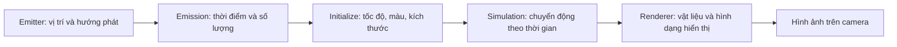

# Bài 01 — Nhập môn hiệu ứng hình ảnh (VFX) trong Unity

**Học phần:** Creative Core · VFX  | **Trình độ:** Cơ bản | **Môi trường đề xuất:** Unity 6.3, dự án URP

## 1. VFX giải quyết vấn đề gì?

Một cảnh 3D chỉ có mô hình, ánh sáng và vật liệu thường thiếu cảm giác đang vận động. Hiệu ứng hình ảnh (*visual effects*, VFX) tạo tín hiệu thị giác cho các hiện tượng như khói, lửa, mưa, tia lửa và phép thuật. Trong game, VFX còn báo hiệu trạng thái: va chạm đã xảy ra, vật phẩm đã được nhặt, chiêu thức đang nạp hoặc khu vực có nguy hiểm.

Điểm cần phân biệt: VFX không nhất thiết mô phỏng vật lý chính xác. Một đốm sáng 2D quay về phía camera vẫn có thể được nhìn nhận như một hạt lửa 3D. Mục tiêu của nghệ sĩ VFX là tạo **chuyển động dễ hiểu, có chủ đích và đủ nhẹ** trên nền tảng mục tiêu.

## 2. Mục tiêu học tập

Sau bài học, người học có thể:

- Giải thích vai trò của *emitter* (bộ phát), *particle* (hạt), *lifetime* (tuổi thọ) và *renderer*.
- Phân biệt Particle System tích hợp sẵn với Visual Effect Graph.
- Chọn cách tiếp cận phù hợp cho một hiệu ứng môi trường hoặc một hiệu ứng phát nổ ngắn.
- Thiết lập phép thử so sánh tác động thị giác và hiệu năng của hai cấu hình.

## 3. Một hiệu ứng hạt được hình thành như thế nào?

Sơ đồ thể hiện **mô hình tư duy chung**, không phải các tên module được triển khai giống hệt nhau trong hai hệ thống. Trong Particle System tích hợp sẵn, thuộc tính được tổ chức trong các module của Inspector; trong VFX Graph, quá trình này được biểu diễn bằng các *context* và *block*.

Một hạt có thể được mô tả bởi trạng thái `{position, velocity, color, size, age, lifetime}`. Trong dạng chuyển động đơn giản, sau một khoảng thời gian `Δt`, vị trí mới được tính gần đúng bằng `position_new = position_old + velocity × Δt`. Unity còn có nhiều module thay đổi vận tốc, màu, kích thước, độ nhiễu và va chạm. Đây là mô hình minh họa, không phải công thức nội bộ của mọi hiệu ứng Unity.

### 3.1. Phân biệt hai giải pháp tạo hạt

| Tiêu chí | Particle System (Built-in/Shuriken) | Visual Effect Graph |
| --- | --- | --- |
| Cách biên tập | Module và các đường cong trong Inspector | Graph với Context, Block và Operator |
| Mô phỏng | Hệ thống hạt truyền thống, dễ điều khiển bằng C# | Chủ yếu mô phỏng trên GPU |
| Điểm mạnh | Nhanh làm quen; thích hợp nhiều hiệu ứng gameplay | Hiệu ứng số lượng hạt lớn, cần logic tùy biến |
| Phụ thuộc | Có sẵn trong Unity | Cần package Visual Effect Graph; yêu cầu phần cứng/pipeline tương thích |
| Khi nên cân nhắc | Va chạm, bụi chân, khói, lửa đơn giản | Bão hạt, đám mây hiệu ứng lớn, chuyển động phức tạp |

**Không đồng nhất** “VFX Graph chạy GPU” với “luôn nhanh hơn”. Vật liệu, số pixel trong suốt bị vẽ lặp (*overdraw*), băng thông và phần cứng có thể khiến một hiệu ứng GPU vẫn rất tốn kém. Với URP, cần kiểm tra hỗ trợ tính năng và nền tảng đích, đặc biệt mobile; Built-in Render Pipeline không phải lựa chọn thích hợp để bắt đầu VFX Graph.

### 3.2. Liên tục và tức thời

Một nguồn lửa cháy cần phát hạt liên tục, trong khi một cú va chạm nên xuất hiện tập trung vào thời điểm sự kiện. Hai nhóm thường gặp:

- **Continuous emission:** liên tục phát với `Rate over Time` (hạt/giây) hoặc theo quãng đường với `Rate over Distance` (hạt/đơn vị chiều dài).
- **Burst emission:** phát một số hạt tại thời điểm xác định, có thể lặp theo chu kỳ nếu được cấu hình.

Trong trạng thái đều lý tưởng, số hạt còn sống xấp xỉ `N ≈ r × L`, với `r` là tốc độ phát hạt mỗi giây, `L` là tuổi thọ mỗi hạt (giây). Đây chỉ là ước lượng nếu hệ thống không bị giới hạn bởi `Max Particles`, không có burst và không thay đổi thời gian sống. Ví dụ minh họa: `r = 20` và `L = 3` thì khoảng 60 hạt có thể đồng thời tồn tại.

## 4. Thực hành: tạo thử hai kiểu phát hạt

1. Tạo project 3D **URP** hoặc mở scene URP có sẵn. Đặt Camera nhìn về vùng trống và tạo một mặt phẳng làm nền.
2. Tạo `GameObject > Effects > Particle System` (đường dẫn có thể khác tùy bản Editor). Đặt tên `PS_Continuous`.
3. Trong `Main`, đặt `Start Lifetime = 2`, `Start Speed = 1`, `Max Particles = 200`; giữ `Looping` bật.
4. Trong `Emission`, đặt `Rate over Time = 15` và bỏ các Burst; nhấn Play trong preview để quan sát. Các số là **giá trị thử nghiệm**, không phải thiết lập bắt buộc.
5. Nhân đôi thành `PS_Burst`. Tắt `Looping`, đặt `Rate over Time = 0`, thêm Burst tại `Time = 0` với `Count = 30`.
6. Tách hai đối tượng để nhìn rõ; so sánh thời điểm phát, độ dày hạt và thời gian biến mất. Thay `Start Lifetime` rồi giải thích sự thay đổi số hạt.
7. Kiểm tra `Renderer > Material`: vật liệu phải dùng shader tương thích pipeline, nếu không hạt có thể hiện màu hồng hoặc biến mất.

**Minh chứng:** ảnh chụp hai Particle System trong Scene/Game view và bảng ngắn ghi `Rate over Time`, `Burst Count`, `Start Lifetime`, số hạt quan sát.

## 5. Những sai lầm thường gặp

- **Không thấy hạt:** kiểm tra GameObject active, camera, `Play On Awake`, `Emission`, vật liệu và kích thước.
- **Hạt bay theo vật thể ngoài ý muốn:** kiểm tra `Main > Simulation Space`: `Local` giữ mô phỏng tương đối với đối tượng; `World` giữ trạng thái mô phỏng trong không gian thế giới.
- **Hiệu ứng quá dày:** giảm tốc độ phát, lifetime hoặc kích thước; đồng thời kiểm tra `Max Particles`.
- **Màu hồng:** shader vật liệu có thể không tương thích URP/HDRP.

## 6. Bài tập ngắn

Tạo một scene có **ngọn nến đang cháy** và **một chùm tia lửa khi nhấn nút UI**. Chọn hệ thống phù hợp cho từng hiệu ứng, sau đó diễn giải lựa chọn bằng ba tiêu chí: thời gian phát, số lượng hạt và nền tảng dự kiến.

## 7. Câu hỏi ôn tập

**Câu 1.** Một đám mây bụi cần xuất hiện đúng một lần lúc va chạm. Cấu hình nào phù hợp nhất?

A. Continuous emission tốc độ rất cao trong toàn bộ scene.  
B. Burst tại thời điểm hiệu ứng bắt đầu.  
C. Chỉ tăng Max Particles.  
D. Chỉ thay vật liệu.  
**Đáp án: B.** Burst mô tả sự kiện phát hạt tập trung tại một thời điểm.

**Câu 2.** VFX Graph khác biệt chủ yếu ở đâu?

A. Chỉ tạo được hiệu ứng 2D.  
B. Không dùng renderer.  
C. Chỉ hoạt động khi có Rigidbody.  
D. Biên tập bằng graph và mô phỏng hạt trên GPU.  
**Đáp án: D.** Đây là hai đặc điểm nền tảng của VFX Graph.

**Câu 3.** Tăng `Start Lifetime` trong một hệ phát đều, giữ nguyên các tham số khác, thường dẫn đến gì?

A. Có nhiều hạt đồng thời còn sống hơn.  
B. Mỗi hạt phát sáng hơn.  
C. Hệ thống đổi thành Burst.  
D. Không còn hạt nào được sinh.  
**Đáp án: A.** Hạt tồn tại lâu hơn nên tích lũy nhiều hơn, trừ khi bị giới hạn.

**Câu 4.** Phát biểu nào chính xác về hiệu năng?

A. VFX Graph luôn nhanh hơn trên mọi thiết bị.  
B. Không cần quan tâm vật liệu khi đã giảm số hạt.  
C. Cần đo trên phần cứng đích và tính cả overdraw.  
D. FPS là một hằng số chỉ phụ thuộc lifetime.  
**Đáp án: C.** Chi phí hiển thị phụ thuộc nhiều yếu tố, không chỉ số hạt.

**Câu 5.** Một hệ phát trông đúng trong Scene view nhưng không thấy trong Game view; kiểm tra gì trước?

A. Xóa dự án.  
B. Camera, trạng thái phát và renderer/material.  
C. Tăng mọi thông số lên cực đại.  
D. Thêm VFX Graph không điều kiện.  
**Đáp án: B.** Đây là các nguyên nhân trực tiếp cần loại trừ theo thứ tự.

## 8. Tổng kết và tài liệu đọc thêm

VFX là sự kết hợp giữa phát hạt, tiến hóa trạng thái và hiển thị. Hãy lựa chọn công cụ dựa trên **hành vi cần tạo** và **điều kiện triển khai**, không chỉ dựa trên số lượng hiệu ứng mẫu.

- [Unity Learn — Creative Core VFX](https://learn.unity.com/course/creative-core-vfx)
- [Unity 6.3 — Particle System modules](https://docs.unity.com/en-us/engine/6000.3/manual/visual-effects/particle-systems/particle-system-modules)
- [Unity 6.3 — Visual Effect Graph](https://docs.unity.com/en-us/engine/6000.3/manual/visual-effects/vfxgraph)

*Ghi chú:* Bài tự biên soạn nhằm tự học; các thông số thực hành mang tính minh họa. Không phải bản dịch hoặc nội dung quiz chính thức của Unity.
