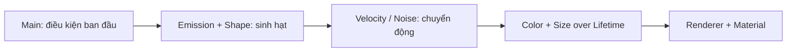

# Bài 02 — Khám phá và điều khiển Particle System

**Học phần:** Creative Core · VFX | **Loại:** Bài học kết hợp thực hành | **Môi trường đề xuất:** Unity 6.3, URP

## 1. Mục tiêu học tập

- Xác định vai trò của các module `Main`, `Emission`, `Shape`, `Velocity over Lifetime`, `Color over Lifetime`, `Size over Lifetime` và `Renderer`.
- Tạo và chỉnh sửa một Particle System trực tiếp từ Inspector.
- Giải thích mối liên hệ giữa tốc độ phát, lifetime, hình dạng nguồn phát và kết quả quan sát.
- Thực hiện phép thử thay đổi **một tham số mỗi lần** thay vì chỉnh ngẫu nhiên.

## 2. Particle System trong Unity Editor

Particle System là một **Component** gắn với GameObject. Nó quản lý nguồn phát, các hạt đang tồn tại, sự biến đổi theo thời gian và cách hiển thị. Đa số tính chất được chia thành module nhằm tránh biến Inspector thành một danh sách tham số duy nhất.

| Module | Câu hỏi mà module giải quyết | Tham số nên thử |
| --- | --- | --- |
| Main | Hạt bắt đầu và tồn tại như thế nào? | Start Lifetime, Start Speed, Start Size, Looping, Simulation Space, Max Particles |
| Emission | Phát bao nhiêu hạt, khi nào? | Rate over Time, Rate over Distance, Bursts |
| Shape | Hạt sinh ra ở đâu và theo hướng nào? | Sphere, Cone, Box, Radius, Angle |
| Velocity over Lifetime | Vận tốc thay đổi ra sao? | X/Y/Z curves |
| Color over Lifetime | Màu/độ trong suốt tiến hóa thế nào? | Gradient, alpha |
| Size over Lifetime | Hạt phình hoặc co như thế nào? | Curve |
| Noise | Chuyển động cần nhiễu/ngẫu nhiên không? | Strength, Frequency |
| Renderer | Hạt trở thành pixel trên màn hình bằng cách nào? | Render Mode, Material, Sorting |

**Main** thiết lập trạng thái ban đầu và quy tắc chung, trong khi các module `... over Lifetime` điều chỉnh trạng thái khi hạt già đi. Một gradient màu không tự tạo thêm hạt; `Emission` không tự quy định shader hiển thị.

## 3. Thời gian chuẩn hóa của hạt

Với `age` là tuổi hiện tại và `lifetime` là tuổi thọ ban đầu của hạt, có thể hình dung `normalizedAge = age / lifetime`, chạy từ 0 (mới sinh) đến 1 (sắp biến mất). Các đường cong như `Size over Lifetime` được áp dụng theo tiến trình này.

Ví dụ đường cong kích thước dạng `0 → 1 → 0` tạo hạt nhỏ khi xuất hiện, lớn ở giữa và thu nhỏ trước khi biến mất. Nếu `Start Size` thay đổi, kích thước thực tế còn phụ thuộc cách cấu hình module và chế độ nhân giá trị.

Sơ đồ là trình tự phân tích để học, không ngụ ý Unity luôn thực thi module theo đúng từng bước tuần tự như hình.

## 4. Lab: tạo chùm hạt sáng và khảo sát tham số

### 4.1. Chuẩn bị

Tạo một scene đơn giản. Thêm `Particle System`, đổi tên thành `PS_SparkStudy`, giữ Camera nhìn rõ vật thể. Nếu dùng URP, hãy chọn vật liệu hạt có shader hỗ trợ URP; tránh dùng tùy tiện material cũ từ Built-in Pipeline.

### 4.2. Cấu hình ban đầu

| Vị trí trong Inspector | Giá trị thử nghiệm | Ý nghĩa |
| --- | --- | --- |
| Main > Start Lifetime | 2 s | Mỗi hạt sống khoảng 2 giây |
| Main > Start Speed | 1 | Vận tốc lúc phát |
| Main > Start Size | 0.12 | Hạt có kích thước nhỏ |
| Main > Max Particles | 200 | Giới hạn lượng hạt |
| Emission > Rate over Time | 25 | Trung bình khoảng 25 hạt/giây |
| Shape | Cone, góc nhỏ | Hạt tỏa theo hình nón |
| Color over Lifetime | Vàng sáng → đỏ, alpha → 0 | Chuyển màu rồi mờ dần |
| Size over Lifetime | Lớn dần nhẹ → nhỏ dần | Tạo nhịp sống cho từng hạt |

Đây là **preset minh họa**, không phải benchmark hoặc cài đặt chuẩn cho mọi project. Bật từng module bằng checkbox cạnh tiêu đề, chỉnh đường cong, rồi dùng Play/Pause/Restart trong cửa sổ preview Particle Effect.

### 4.3. Thí nghiệm có kiểm soát

Thực hiện bốn lần chạy, mỗi lần chỉ thay đổi một điều kiện:

1. Tăng `Start Lifetime` từ 2 lên 4 giây; quan sát số lượng hạt đang sống.
2. Giữ lifetime = 2, tăng `Rate over Time` từ 25 lên 50; quan sát độ dày.
3. Đổi `Shape` từ `Cone` sang `Sphere`; quan sát vùng xuất phát và hướng ban đầu.
4. Đổi `Simulation Space` từ `Local` sang `World`, di chuyển GameObject trong khi phát hạt; chú ý khác biệt giữa hạt cũ và hạt mới.

Ghi kết quả vào bảng:

| Thử nghiệm | Dự đoán trước | Quan sát trong Game view | Giải thích |
| --- | --- | --- | --- |
| Lifetime × 2 | ... | ... | ... |
| Rate × 2 | ... | ... | ... |
| Cone → Sphere | ... | ... | ... |
| Local → World | ... | ... | ... |

## 5. Đọc lỗi theo nhóm nguyên nhân

- **Phát quá thưa:** `Rate over Time` thấp hoặc lifetime ngắn; kiểm tra giới hạn `Max Particles`.
- **Bật Gradient nhưng màu không đổi:** kiểm tra module đã bật, gradient có biến thiên rõ và material có hỗ trợ màu hạt; `Start Color` còn có thể nhân với giá trị gradient.
- **Hạt không xuất hiện trong Game view:** camera clip/view, vật liệu, culling, kích thước và `Play On Awake`.
- **Hạt không đi theo hướng muốn:** `Shape` tác động hướng ban đầu; `Start Speed`, `Velocity over Lifetime` và các lực có thể tiếp tục thay đổi hướng.
- **Hiệu ứng nhìn như hình chữ nhật cứng:** chọn texture có alpha mềm và shader phù hợp, thay vì chỉ thay Start Color.

## 6. Bài tập mở rộng

Biến hiệu ứng thành **bông tuyết trôi chậm**: phát từ `Box` phía trên Camera, `Start Speed` thấp, dùng `Velocity over Lifetime` cho chuyển động ngang nhẹ và `Color over Lifetime` để mờ dần. Kiểm tra xem hạt có cần ở `World` space để tạo môi trường ổn định khi camera di chuyển hay không.

## 7. Câu hỏi ôn tập

**Câu 1.** Muốn thay đổi vị trí nơi hạt được sinh ra, bạn ưu tiên module nào?  
A. Renderer  
B. Shape  
C. Color over Lifetime  
D. Trails  
**Đáp án: B.** Shape quyết định vùng phát và hướng ban đầu.

**Câu 2.** `Rate over Time` mô tả đại lượng nào?  
A. Tuổi thọ mỗi hạt  
B. Quãng đường tối đa  
C. Số hạt phát theo thời gian  
D. Số pixel được vẽ  
**Đáp án: C.** Tham số này kiểm soát tốc độ phát hạt theo giây.

**Câu 3.** Muốn hạt mờ dần ở cuối đời, thao tác nào phù hợp nhất?  
A. Đổi alpha trong Color over Lifetime  
B. Chỉ tăng Max Particles  
C. Xóa Shape  
D. Bật Rigidbody  
**Đáp án: A.** Alpha gradient có thể được thiết kế giảm dần về 0.

**Câu 4.** Khi di chuyển emitter, `World` simulation space có ý nghĩa gì?  
A. Buộc mọi hạt đi theo object ở mọi thời điểm  
B. Làm particle bất tử  
C. Bỏ qua camera  
D. Hạt đã sinh được mô phỏng trong không gian thế giới  
**Đáp án: D.** Vì vậy đường đi của hạt cũ không nhất thiết bị kéo theo emitter.

**Câu 5.** Vì sao nên đổi một tham số mỗi lần?  
A. Để làm FPS luôn bằng 60  
B. Để xác định quan hệ nguyên nhân–kết quả  
C. Để không cần camera  
D. Để bypass shader  
**Đáp án: B.** Quy trình thử nghiệm có kiểm soát giúp rút ra quy luật đáng tin cậy.

## 8. Tổng kết và tham khảo

Học Particle System hiệu quả nhất bằng quan sát có chủ đích: phát hạt → khởi tạo → chuyển động → biến đổi theo tuổi → hiển thị. Ghi lại dự đoán và thực tế giúp hiểu module nhanh hơn việc sao chép một preset.

- [Unity 6.3 — Module reference](https://docs.unity.com/en-us/engine/6000.3/manual/visual-effects/particle-systems/particle-system-modules)
- [Unity 6.3 — Shape module](https://docs.unity.com/en-us/engine/6000.3/manual/visual-effects/particle-systems/particle-system-modules/part-sys-shape-module)
- [Unity Learn — Creative Core VFX](https://learn.unity.com/course/creative-core-vfx)

*Các bài tập và giá trị số trong tài liệu là thiết kế thực hành độc lập.*
