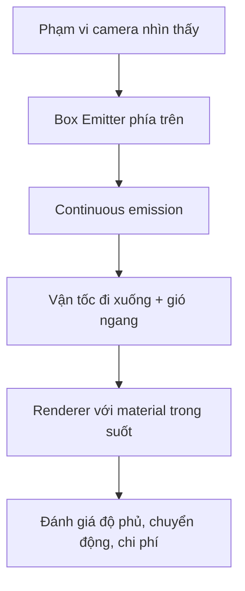

# Bài 03 — Tạo hiệu ứng môi trường bằng Particle System

**Học phần:** Creative Core · VFX | **Loại:** Lab | **Sản phẩm:** Mưa hoặc tuyết trong một không gian 3D

## 1. Mục tiêu và kết quả cần đạt

Một hiệu ứng môi trường khác với va chạm tức thời: nó có xu hướng tồn tại liên tục, bao phủ một vùng, chuyển động có tính lặp, không thu hút quá nhiều chú ý và phải tiết kiệm chi phí render khi camera quay lâu.

Hoàn thành lab này, người học sẽ:

- Tạo được một hệ phát hạt liên tục từ vùng không gian xác định.
- Cấu hình `Shape`, `Emission`, `Velocity over Lifetime`, `Color over Lifetime` và lifetime để mô phỏng mưa hoặc tuyết.
- Giải thích sự khác nhau giữa mô phỏng theo `Local` và `World` khi gắn hiệu ứng lên camera.
- Kiểm tra hạt có bị phát lãng phí ngoài vùng quan sát hay không.

## 2. Thiết kế trước khi đặt tham số

Lấy ví dụ **mưa rơi**: mỗi hạt đại diện cho một giọt nước có hình dạng kéo dài, di chuyển chủ yếu xuống dưới, được phát từ vùng cao hơn camera và biến mất khi ra khỏi khung hình hoặc hết tuổi thọ. Không nhất thiết phải tạo Collider cho từng giọt nếu nhiệm vụ chỉ là làm nền thị giác.

Khi muốn làm tuyết, vẫn có thể giữ cấu trúc này nhưng giảm tốc độ rơi, tăng biến thiên hướng và dùng texture hạt mềm, hơi xoay.

## 3. Các nhóm thông số quan trọng

| Yếu tố | Mưa | Tuyết | Ghi chú |
| --- | --- | --- | --- |
| Shape | Box phía trên vùng nhìn | Box rộng trên cao | Độ rộng phụ thuộc camera |
| Emission | Tương đối cao | Thấp hơn mưa | Tùy kích thước và mật độ mong muốn |
| Start Lifetime | Đủ để giọt đi qua vùng nhìn | Thường dài hơn | Phải khớp quãng đường và tốc độ |
| Start Speed | Hướng rơi nhanh | Rơi chậm | Cần định hướng Shape/Velocity đúng |
| Size/Material | Nhỏ, mảnh, kéo dài | Mềm, rõ alpha | Phụ thuộc renderer và texture |
| Noise | Ít, vừa phải | Rõ hơn | Không thay cho hướng rơi chính |

`Start Speed` chạy theo hướng sinh hạt từ Shape, vì vậy với `Box` mặc định có thể không tự tạo chuyển động xuống đúng ý. Cách dễ kiểm soát là đặt `Start Speed = 0` và dùng `Velocity over Lifetime` theo trục Y âm trong **một hệ tọa độ đã xác định**; hoặc xoay Shape/Transform và dùng Start Speed. Không kết hợp cả hai một cách thiếu kiểm soát.

## 4. Các bước thực hành: dựng mưa

### 4.1. Thiết lập Scene

1. Tạo Plane, Camera và nguồn sáng để nhìn thấy mưa.
2. Thêm `Particle System`, đổi tên `PS_Rain` và đặt trên cao so với mặt đất.
3. Tạo material hạt tương thích render pipeline hiện tại, có hỗ trợ alpha. Dùng texture giọt mưa hoặc hạt mềm có nền trong suốt.
4. Cố định vị trí Camera trong lần thử đầu tiên để dễ so sánh tham số.

### 4.2. Giá trị thử nghiệm ban đầu

Giả định trục Y dương hướng lên; dùng **World space** và `Start Speed = 0` để dễ kiểm soát hướng rơi.

| Module / thuộc tính | Giá trị gợi ý | Vì sao |
| --- | --- | --- |
| Main > Looping | On | Mưa liên tục |
| Main > Start Lifetime | 2.5 s | Hạt đủ thời gian rơi qua khung hình |
| Main > Start Size | 0.05–0.10 | Giọt nhỏ; điều chỉnh theo camera |
| Main > Max Particles | 1500 | Giới hạn thử nghiệm, không phải mức an toàn cho mọi máy |
| Main > Simulation Space | World | Giọt cũ không di chuyển cùng emitter |
| Emission > Rate over Time | 180 | Mật độ khởi đầu để quan sát |
| Shape > Shape | Box | Phủ vùng nhìn thấy |
| Shape > Scale | (12, 0.5, 8) | Vùng sinh rộng phía trên |
| Velocity over Lifetime > Y | -5 (Constant) | Rơi xuống theo trục Y |
| Velocity over Lifetime > X | 0.3 (Constant) | Gió ngang nhẹ |
| Color over Lifetime | Alpha thấp, về 0 cuối đời | Tránh hạt biến mất đột ngột |

**Lưu ý:** Nếu hạt bay sai trục, kiểm tra chế độ `Space` trong `Velocity over Lifetime` và hướng của Transform. `Start Size` không có một giá trị tối ưu tuyệt đối vì tỉ lệ scene và Camera thay đổi.

### 4.3. Đưa hiệu ứng theo camera

Có hai chiến lược phổ biến:

- **Emitter cố định trong thế giới:** hợp lý cho khu vực mưa cục bộ; phải mở rộng vùng phát đủ để camera di chuyển trong đó.
- **Emitter theo camera, mô phỏng World space:** giữ nguồn phát quanh người xem nhưng những hạt đã sinh tiếp tục rơi trong thế giới. Cần đặt emitter phía trên, tránh lộ ranh giới vùng phát và tránh thay đổi vị trí đột ngột gây mật độ không đều.

Không mặc định cho mưa va chạm vật lý với mọi vật thể. Nếu cần giọt bắn tung tóe khi chạm đất, hãy thử một hệ hạt riêng cho splash hoặc phát hiệu ứng theo sự kiện chạm, thay vì tăng collision cho toàn bộ giọt trong scene.

## 5. Chẩn đoán và tối ưu

1. **Không có mưa:** xem `Play On Awake`, `Looping`, `Rate over Time`, hướng vận tốc và vị trí Box.
2. **Mưa quá đặc:** điều chỉnh phạm vi Box, tốc độ phát, lifetime và alpha trước khi tăng số hạt vô hạn.
3. **Mưa nhìn như tuyết:** tăng vận tốc rơi, thu nhỏ hạt, dùng texture kéo dài; đừng chỉ đổi màu.
4. **Có vệt hạt kỳ lạ khi di chuyển camera:** kiểm tra `Simulation Space`, kích cỡ nguồn phát và cách gắn Parent.
5. **Giảm FPS:** đo trên Game view hoặc bản build, xem Rendering/GPU profiling; các quad trong suốt chồng nhau có thể gây overdraw dù số hạt không quá lớn.

### 5.1. Kiểm thử tối thiểu

- Camera đứng yên trong 10 giây: mưa có đều không?
- Camera dịch chuyển ngang: nguồn phát có bị lộ cạnh không?
- Camera nhìn lên/xuống: hiệu ứng có bao phủ hợp lý không?
- Giảm `Rate over Time` một nửa: chất lượng thị giác bị ảnh hưởng đến đâu?

## 6. Sản phẩm cần nộp

Lưu scene `EnvironmentRain.unity`, ảnh cấu hình Inspector, video ngắn camera di chuyển và ghi chú trước/sau tối ưu. Nếu làm tuyết, kèm giải thích về cách tăng nhiễu chuyển động và điều chỉnh vật liệu.

## 7. Câu hỏi ôn tập

**Câu 1.** Vì sao `Box` thường tiện cho mưa môi trường?  
A. Chỉ Box mới có thể phát hạt  
B. Box tự thêm Collider  
C. Box cho phép phủ một vùng phát rộng  
D. Box tự tạo ánh sáng  
**Đáp án: C.** Nguồn phát hình hộp dễ bao phủ khung hình camera.

**Câu 2.** Muốn mưa rơi xuống theo Y âm khi Start Speed = 0, nên làm gì?  
A. Cấu hình Velocity over Lifetime theo Y âm và kiểm tra Space  
B. Chỉ đổi Start Color  
C. Chỉ bật Trails  
D. Xóa Shape  
**Đáp án: A.** Vận tốc có thể thiết lập trực tiếp theo trục tọa độ.

**Câu 3.** Điều gì dễ làm tăng overdraw?  
A. Giảm số quad chồng nhau  
B. Mỗi particle dùng ít pixel hơn  
C. Giảm độ phân giải mục tiêu  
D. Nhiều hạt trong suốt phủ cùng vùng pixel  
**Đáp án: D.** Các pixel trong suốt có thể bị xử lý lặp lại nhiều lần.

**Câu 4.** Với emitter gắn camera, World simulation space giúp gì?  
A. Làm camera đứng yên  
B. Hạt đã phát không bị kéo theo emitter như Local  
C. Cấm phát hạt mới  
D. Tự động phát splash  
**Đáp án: B.** Hạt cũ tiếp tục được mô phỏng trong tọa độ thế giới.

**Câu 5.** Khi xây dựng tuyết từ mưa, thay đổi nào hợp lý nhất?  
A. Chỉ tăng gravity mạnh  
B. Chỉ giảm alpha về 0  
C. Giảm tốc độ rơi, thêm nhiễu và dùng hạt mềm  
D. Bắt buộc dùng VFX Graph  
**Đáp án: C.** Tuyết thường có chuyển động chậm và dao động hơn giọt mưa.

## 8. Tổng kết và tham khảo

Thiết kế VFX môi trường cần bắt đầu từ **thể tích phát hạt, chuyển động, tuổi thọ và vùng nhìn của camera**. Sau đó mới tinh chỉnh vật liệu và hiệu năng.

- [Unity 6.3 — Shape module](https://docs.unity.com/en-us/engine/6000.3/manual/visual-effects/particle-systems/particle-system-modules/part-sys-shape-module)
- [Unity 6.3 — Particle System modules](https://docs.unity.com/en-us/engine/6000.3/manual/visual-effects/particle-systems/particle-system-modules)
- [Unity — Best practices for profiling](https://activation.unity3d.com/how-to/best-practices-for-profiling-game-performance)

*Các số được chọn để thực hành; hãy hiệu chỉnh theo tỉ lệ scene và cấu hình máy.*
