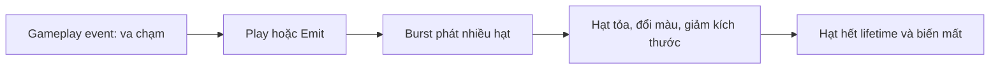

# Bài 04 — Tạo hiệu ứng phát hạt tức thời (Burst)

**Học phần:** Creative Core · VFX | **Loại:** Bài học và lab | **Sản phẩm:** Tia lửa hoặc khói khi xảy ra va chạm

## 1. Mục tiêu học tập

- Phân biệt Burst với phát liên tục trong module `Emission`.
- Tạo hiệu ứng một lần bằng `Bursts`, tắt `Looping` và `Rate over Time`.
- Tạo chuyển động tỏa tâm và đường cong kích thước/alpha để hiệu ứng có nhịp.
- Kích hoạt lại cùng hiệu ứng qua nút UI bằng API `ParticleSystem.Stop()` và `ParticleSystem.Play()`.

## 2. Bản chất của hiệu ứng Burst

Burst là một **sự kiện phát hạt có thời điểm**, không đồng nghĩa với việc tăng `Rate over Time` lên cực cao. Trong `Emission`, Burst có các thuộc tính như `Time`, `Count`, `Cycles`, `Interval`, `Probability`. Có thể bố trí nhiều burst hoặc cấu hình lặp; tuy nhiên một hiệu ứng va chạm đơn giản thường chỉ cần một Burst tại `Time = 0`.



Chất lượng của Burst không chỉ do `Count`. Các hạt cần có tốc độ và hướng xuất phát khác nhau, độ dài sự kiện hợp lý và đường cong alpha tránh biến mất cứng.

## 3. Lab: chùm tia lửa khi va chạm

### 3.1. Thiết lập emitter

1. Tạo `Particle System`, đặt tên `PS_ImpactSpark`.
2. Trong `Main`, tắt `Looping`, tắt `Play On Awake`; thử `Duration = 1`, `Start Lifetime = 0.4–0.8`, `Start Speed = 3–6`, `Start Size = 0.08`, `Max Particles = 150`.
3. Trong `Emission`, đặt `Rate over Time = 0`, `Rate over Distance = 0`. Thêm một Burst tại `Time = 0`, `Count = 25`. Giữ một chu kỳ và xác suất phát 100% cho thử nghiệm đầu tiên.
4. Trong `Shape`, chọn `Sphere` với bán kính rất nhỏ để các hạt tỏa nhiều hướng, hoặc `Cone` nếu cần tia lửa định hướng.
5. Bật `Color over Lifetime`: từ vàng sáng sang cam/đỏ, cuối đời giảm alpha về 0. Bật `Size over Lifetime`: lớn lúc đầu, nhỏ dần về cuối.
6. Chọn material trong suốt phù hợp URP và thử preview. Một số shader dùng blend additive tạo cảm giác phát sáng nhưng dễ bị cháy sáng; shader alpha blend thích hợp khói mềm hơn.

**Checkpoint:** khi phát một lần, chùm tia lửa bùng lên rồi hết hạt; không có các hạt mới xuất hiện liên tục.

### 3.2. Gắn hiệu ứng với sự kiện gameplay

Tạo file `BurstVFXController.cs`:

```csharp
using UnityEngine;

public class BurstVFXController : MonoBehaviour
{
    [SerializeField] private ParticleSystem impactEffect;

    // Gán vào Button.onClick hoặc gọi từ logic va chạm.
    public void TriggerBurst()
    {
        if (impactEffect == null)
        {
            Debug.LogWarning("Chưa gán Particle System.", this);
            return;
        }

        impactEffect.Stop(true, ParticleSystemStopBehavior.StopEmittingAndClear);
        impactEffect.Play(true);
    }
}
```

Gắn script lên GameObject điều khiển, kéo `PS_ImpactSpark` vào trường `Impact Effect`. Tạo một UI Button, đưa GameObject điều khiển vào sự kiện `On Click()` và chọn `BurstVFXController.TriggerBurst`. Hãy chắc chắn `Play On Awake` tắt để hiệu ứng không nổ ngay lúc scene khởi động.

`StopEmittingAndClear` xóa những hạt cũ, giúp mỗi lần gọi bắt đầu bằng một Burst mới. Nếu muốn những hạt đã sinh tiếp tục tồn tại khi kích hoạt lại, có thể thiết kế cách gọi khác; không nên mặc định xóa trong mọi tình huống. `Play()` phát theo cấu hình Emission đã có. Đừng đồng thời gọi `Emit(25)` với Burst 25 tại giây 0 nếu không muốn hai đợt phát cộng dồn.

### 3.3. Tạo hiệu ứng nhiều lớp

Một cú va chạm có thể dùng hai Particle System con:

- `Impact_Sparks`: hạt vàng nhỏ, nhanh, lifetime ngắn.
- `Impact_Smoke`: hạt xám lớn hơn, chậm, alpha giảm từ từ.

Đặt cùng cha `VFX_Impact` và cho từng hệ phát phù hợp. Nếu dùng script phía trên với tham số `Play(true)`, các Particle System con đang nằm dưới đối tượng được tham chiếu có thể được kích hoạt theo cấu trúc; cần kiểm tra cấu hình thực tế để tránh phát trùng.

## 4. Phân biệt Play, Emit và Burst

| Cơ chế | Bản chất | Dùng khi |
| --- | --- | --- |
| `Emission > Bursts` | Khai báo lịch phát hạt | Dựng nhịp của hiệu ứng trong Inspector |
| `ParticleSystem.Play()` | Bắt đầu/tiếp tục simulation theo cấu hình | Kích hoạt hiệu ứng đã được thiết kế |
| `ParticleSystem.Emit(count)` | Phát thêm lượng hạt được yêu cầu | Sự kiện điều khiển số hạt trực tiếp bằng code |
| `ParticleSystem.Stop()` | Dừng hệ, có tùy chọn xóa hạt | Reset, tắt hoặc chuẩn bị phát lại |

## 5. Lỗi phổ biến và kiểm chứng

- **Nổ liên tục:** kiểm tra `Looping` và `Rate over Time` có còn lớn hơn 0 không.
- **Nút UI không làm gì:** kiểm tra `On Click()`, tham chiếu `impactEffect`, GameObject đang active và Console.
- **Hiệu ứng mất quá nhanh:** thử tăng `Start Lifetime`; nếu quá dài, cảm giác va chạm sẽ yếu.
- **Số lượng bất thường:** kiểm tra có nhiều Burst, có gọi đồng thời `Emit()`, hoặc có nhiều hệ con cùng phát.
- **Hạt chỉ bay một phía:** `Shape` và hướng transform không phù hợp.

## 6. Bài tập thực hành

Tạo hai biến thể `Impact_Stone` và `Impact_Magic`. Một biến thể ưu tiên bụi và khói; biến thể còn lại ưu tiên tia sáng phát ra hướng vòng tròn. Cùng một nút UI phải kích hoạt được từng biến thể theo cách chủ động; lưu video 3 lần phát liên tiếp để chứng minh hiệu ứng có thể reset.

## 7. Câu hỏi ôn tập

**Câu 1.** Thiết lập nào tránh phát đều ngoài ý muốn?  
A. Bật Looping và Rate = 50  
B. Tăng Max Particles  
C. Đặt Rate over Time = 0 và thêm Burst  
D. Chỉ đổi hình Shape  
**Đáp án: C.** Burst có thể phát mà không cần tốc độ phát liên tục.

**Câu 2.** `Time = 0` trong Burst nghĩa là gì?  
A. Phát ở thời điểm bắt đầu lượt chơi của hệ  
B. Lifetime bằng 0  
C. Không bao giờ phát  
D. Dừng game ngay lập tức  
**Đáp án: A.** Time là mốc tương đối với lúc particle system bắt đầu phát.

**Câu 3.** Vì sao không gọi cả `Emit(25)` và Burst 25 nếu chỉ muốn đúng một đợt 25 hạt?  
A. Script sẽ không biên dịch  
B. Kết quả có thể cộng thêm hạt  
C. Unity chuyển sang VFX Graph  
D. Renderer tự tắt  
**Đáp án: B.** Hai cơ chế có thể cùng phát hạt.

**Câu 4.** `StopEmittingAndClear` có tác dụng nào?  
A. Thay mọi hạt bằng GameObject  
B. Tăng Start Speed  
C. Chỉ đổi màu  
D. Dừng và xóa các hạt đang tồn tại  
**Đáp án: D.** Phù hợp khi cần reset hoàn toàn hiệu ứng.

**Câu 5.** Muốn chùm tia lửa tỏa nhiều hướng, nên thử trước điều gì?  
A. Đổi scene  
B. Bật 2D Physics  
C. Sphere Shape với Start Speed thích hợp  
D. Xóa Emission  
**Đáp án: C.** Shape và vận tốc ban đầu quyết định hướng tỏa.

## 8. Tổng kết và tham khảo

Hiệu ứng Burst là một quá trình ngắn với nhịp rõ: bùng lên → mở rộng → mờ đi. Hãy ưu tiên điều khiển *timing* và hình dáng chuyển động hơn là chỉ tăng số hạt.

- [Unity 6.3 — Emission module](https://docs.unity.com/en-us/engine/6000.3/manual/visual-effects/particle-systems/particle-system-modules/part-sys-emission-module)
- [Unity 6.3 — ParticleSystem Scripting API](https://docs.unity.com/en-us/engine/6000.3/script-reference/unityengine/particlesystem)
- [Unity Learn — Creative Core VFX](https://learn.unity.com/course/creative-core-vfx)

*Các preset là ví dụ tự biên soạn và có thể phải điều chỉnh theo camera, vật liệu và tỷ lệ scene.*
