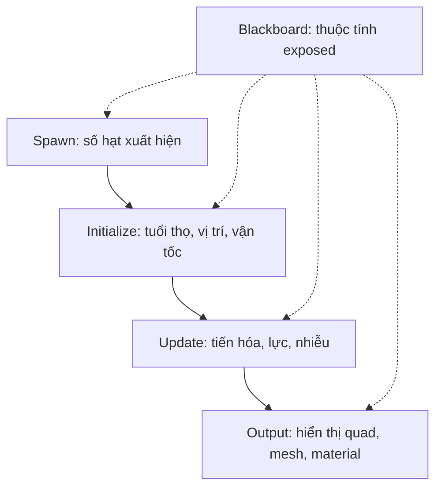

# Bài 05 — Làm quen với Visual Effect Graph

**Học phần:** Creative Core · VFX | **Loại:** Bài học/lab | **Môi trường đề xuất:** Unity 6.3, URP hoặc HDRP, có hỗ trợ Compute Shader

## 1. Mục tiêu học tập

Sau bài này, người học có thể:

- Mô tả đúng vai trò của bốn Context quan trọng: `Spawn`, `Initialize`, `Update`, `Output`.
- Phân biệt `Context`, `Block`, `Operator` và `Visual Effect Asset`.
- Mở một graph và xác định đường đi tạo một hạt đơn giản, từ sinh ra đến hiển thị.
- Đánh giá khả năng tương thích của Visual Effect Graph với pipeline và nền tảng phát hành.
- Thử thay đổi tốc độ phát, tuổi thọ và kích thước trong graph, sau đó quan sát kết quả.

## 2. Vì sao có VFX Graph?

Particle System truyền thống đáp ứng tốt nhiều hiệu ứng nhưng graph cho phép tổ chức logic phức tạp theo mạng các khối. Visual Effect Graph tính toán mô phỏng hạt chủ yếu trên GPU, hữu ích khi cần lượng hạt lớn và hành vi tùy biến. Chi phí vẫn phụ thuộc mức độ phức tạp shader, số pixel, dung lượng bộ nhớ và phần cứng.

**Điều kiện trước tiên:** Render Pipeline phải tương thích. VFX Graph dùng với **URP hoặc HDRP**, không phải Built-in Render Pipeline. Nền tảng cũng cần hỗ trợ tính năng GPU/Compute Shader tương ứng; các tính năng cụ thể của VFX Graph và URP có thể khác nhau theo phiên bản. Với bài học này, ưu tiên dự án desktop URP để giảm biến số.

## 3. Kiến trúc cơ bản của graph

Bốn Context này mô tả bốn giai đoạn chính:

1. `Spawn`: xác định lượng hạt được tạo; ví dụ tốc độ phát liên tục.
2. `Initialize`: gán trạng thái lúc hạt sinh như tuổi thọ, vị trí, vận tốc, kích thước.
3. `Update`: thay đổi hạt còn sống theo thời gian; có thể bổ sung lực hoặc nhiễu.
4. `Output`: quyết định kiểu hiển thị và cách hạt xuất hiện trên màn hình.

Trong từng Context có những **Block** thực hiện tác vụ cụ thể. **Operator** xử lý giá trị/dữ liệu và cung cấp đầu vào cho block. **Blackboard** chứa property có thể tạo và (khi được exposed) chỉnh từ bên ngoài graph, giúp tái sử dụng một hiệu ứng với nhiều cấu hình.

Bốn stage là mô hình nền tảng, nhưng graph thực tế có thể có nhiều hệ, event, nhánh output hoặc đường kết nối khác nhau; không nên giả định mọi graph đều có chính xác bốn nút.

## 4. Lab: hiệu ứng đám hạt lơ lửng

### 4.1. Kiểm tra dự án và package

1. Mở `Window > Package Manager` và kiểm tra **Visual Effect Graph** đã cài đặt. Nếu chưa, chọn nguồn Unity Registry và cài phiên bản tương thích Editor.
2. Xác nhận project đang dùng URP/HDRP. Nếu project Built-in, nên tạo một project URP riêng để học thay vì đổi pipeline tùy tiện giữa dự án đang phát triển.
3. Trong `Project`, tạo **Visual Effect Graph Asset** bằng menu `Create` phù hợp phiên bản hiện tại. Đặt tên `VFX_FloatingDust` và mở asset bằng double-click.
4. Tạo GameObject có component `Visual Effect` trong Scene, gán asset vừa tạo vào trường asset của component (tùy Editor có thể tạo GameObject trực tiếp bằng thao tác kéo graph vào scene).

### 4.2. Thiết lập graph có thể quan sát

1. Tìm hoặc thêm hệ `Spawn → Initialize Particle → Update Particle → Output Particle Quad`.
2. Trong `Spawn`, dùng block phát hạt theo tốc độ cố định (*Constant Spawn Rate* hoặc tên tương ứng trong phiên bản package). Đặt giá trị thử nghiệm 30 hạt/giây.
3. Trong `Initialize`, thiết lập `Capacity` đủ cao (ví dụ 300), tuổi thọ 3–5 giây, vị trí khởi tạo ngẫu nhiên trong một vùng hộp, kích thước nhỏ và vận tốc ban đầu thấp.
4. Trong `Update`, giữ logic tối thiểu: để hạt chuyển động hoặc thêm lực rất nhẹ. Kiểm tra cập nhật vị trí/tuổi hạt được bật theo thiết lập của Context.
5. Trong `Output`, dùng chế độ hiển thị dạng quad/sprite phù hợp với pipeline. Gán texture/material nếu cấu hình yêu cầu. Hãy đặt vật liệu/độ trong suốt để hạt hiện rõ trên nền tối.
6. Lưu graph và kiểm tra hạt có xuất hiện trong Game view không.

Các giá trị vừa nêu là **thiết kế lab**, không phải mặc định của Unity. Tên một số Block hoặc mục menu có thể thay đổi theo package. Khi không tìm thấy block, sử dụng ô tìm kiếm của Graph và đối chiếu [VFX Graph Getting Started](https://docs.unity3d.com/Packages/com.unity.visualeffectgraph@latest/index.html?subfolder=/manual/GettingStarted.html).

### 4.3. Khảo sát ba thay đổi

| Lần thử | Thay đổi | Dự đoán | Nội dung cần quan sát |
| --- | --- | --- | --- |
| A | Tăng tốc độ Spawn gấp đôi | Mật độ hạt tăng | Số hạt sống, độ dày hiệu ứng |
| B | Giảm Lifetime còn một nửa | Hạt biến mất sớm | Mật độ và thời gian hiện diện |
| C | Tăng kích thước Quad | Hạt dễ nhìn hơn | Overlap/overdraw, độ mờ |

Lưu lại ảnh chụp graph và Game view của từng lần. Đặc biệt lưu ý **Capacity**: hệ thống có giới hạn số hạt tối đa, nên không phải cứ tăng Spawn Rate là số hạt sống tăng vô hạn.

## 5. Tương tác graph với Scene

Một `Visual Effect Asset` lưu định nghĩa hiệu ứng; `Visual Effect Component` tạo một instance trong scene. Nhờ vậy, nhiều đối tượng có thể dùng chung graph nhưng dùng các thuộc tính khác nhau. Cách làm phổ biến là tạo property như `SpawnRate` hoặc `Color` trên Blackboard, đánh dấu exposed, rồi chỉnh instance từ Inspector. C# có thể truy cập thuộc tính này qua API của package nếu cần.

**Lưu ý kỹ thuật:** đối tượng `Visual Effect` khác `ParticleSystem` và không dùng cùng tập API. Không thể thay thế trực tiếp `ParticleSystem.Play()` bằng lệnh VFX Graph bất kỳ mà không kiểm tra đúng `UnityEngine.VFX` và phương thức tương ứng.

## 6. Xử lý các tình huống lỗi

- **Không có Graph Asset/menu tạo:** package VFX Graph chưa được cài hoặc cài không phù hợp phiên bản.
- **Graph hiển thị nhưng không có hạt:** kiểm tra đường nối Context, Spawn Rate, Capacity, Lifetime, Output và vị trí camera.
- **Màu hồng hoặc vô hình:** kiểm tra render pipeline, shader/Shader Graph, loại Output và material.
- **Hệ chạy khác mong đợi:** xem Blackboard property có bị override trong instance hay không.
- **Hiệu ứng chạy trên Editor nhưng không chạy ở máy khác:** kiểm tra nền tảng có Compute Shader và các khả năng đồ họa cần thiết, cùng thiết lập Graphics API.
- **Hạt mất khi quay camera:** kiểm tra bounds và culling, đặc biệt với hiệu ứng chuyển động xa vị trí phát.

## 7. Câu hỏi ôn tập

**Câu 1.** Context nào quyết định trạng thái ban đầu của hạt?  
A. Initialize  
B. Output  
C. Update  
D. Renderer của ParticleSystem  
**Đáp án: A.** Initialize tạo các thuộc tính ban đầu khi hạt ra đời.

**Câu 2.** Block trong VFX Graph có vai trò gì?  
A. Thay thế toàn bộ project  
B. Tạo Camera  
C. Thực hiện một thao tác bên trong Context  
D. Luôn là một GameObject  
**Đáp án: C.** Block bổ sung hành vi vào giai đoạn xử lý.

**Câu 3.** Chọn phát biểu đúng về tương thích.  
A. VFX Graph hoạt động đầy đủ trên mọi phần cứng.  
B. Dùng VFX Graph với URP/HDRP và phải kiểm tra nền tảng GPU.  
C. Built-in Render Pipeline được ưu tiên cho VFX Graph.  
D. Không cần package.  
**Đáp án: B.** Render pipeline và Compute Shader là các điều kiện quan trọng.

**Câu 4.** `Capacity` giúp kiểm soát gì?  
A. Tốc độ quay của Camera  
B. Cường độ ánh sáng  
C. Số scene trong project  
D. Số lượng phần tử mà hệ có thể chứa  
**Đáp án: D.** Capacity là giới hạn dung lượng hạt/hệ mô phỏng.

**Câu 5.** Muốn một graph dùng chung nhiều instance với màu khác nhau, cách tốt nhất là gì?  
A. Expose property phù hợp trên Blackboard  
B. Tạo một project riêng cho từng màu  
C. Bỏ Output  
D. Chỉ chỉnh Camera  
**Đáp án: A.** Property của graph cho phép cấu hình từng instance.

## 8. Tổng kết và nguồn đọc thêm

VFX Graph có thể đọc theo luồng `Spawn → Initialize → Update → Output`. Hiểu đường đi này trước khi thêm hiệu ứng phức tạp sẽ giúp debug và giải thích graph của người khác.

- [Unity 6.3 — Visual Effect Graph](https://docs.unity.com/en-us/engine/6000.3/manual/visual-effects/vfxgraph)
- [Unity — Getting started with VFX Graph](https://docs.unity3d.com/Packages/com.unity.visualeffectgraph@latest/index.html?subfolder=/manual/GettingStarted.html)
- [Unity — Choosing your Particle System](https://docs.unity.com/en-us/engine/6000.3/manual/visual-effects/particle-systems/choosing-your-particle-system)

*Bài học và preset được tự biên soạn; kiểm tra tên Block theo phiên bản package thực tế.*
