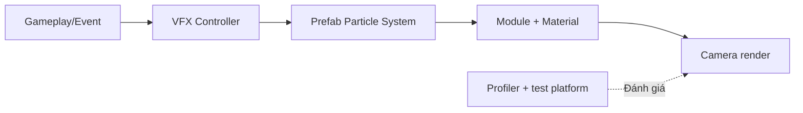

# Bài 07 — Ứng dụng VFX vào dự án thực hành

**Học phần:** Creative Core · VFX | **Loại:** Mini project | **Đầu ra:** Scene có VFX phục vụ trải nghiệm người dùng

## 1. Bài toán

Thêm VFX vào một dự án đang phát triển không chỉ là kéo một prefab vào Scene. Hiệu ứng phải đúng mục đích gameplay, đúng vị trí, tồn tại trong khoảng thời gian cần thiết, hợp phong cách đồ họa và đủ nhẹ trên thiết bị phát hành.

Trong mini project này, hãy tích hợp **một hiệu ứng môi trường** và **một hiệu ứng phản hồi hành động** vào scene hiện có. Nếu chưa có dự án, sử dụng cảnh mẫu: một quảng trường nhỏ có cột đuốc và vật phẩm tương tác.

## 2. Mục tiêu học tập

- Phân tích ít nhất hai tình huống cần VFX, xác định *trigger* và thời gian hiệu ứng.
- Tổ chức prefab và GameObject để dễ tái sử dụng.
- Tích hợp Particle System vào sự kiện gameplay hoặc UI, đồng thời giữ biệt lập phần đồ họa khỏi logic chính.
- Kiểm tra sự phù hợp camera, lighting, material và render pipeline.
- Thực hiện đo, tối ưu và ghi lại thay đổi trước/sau.

## 3. Bản thiết kế tích hợp

Mỗi VFX nên có một “hợp đồng” đầu vào/đầu ra rõ ràng:

| Thuộc tính | Ví dụ: ngọn đuốc | Ví dụ: nhặt vật phẩm |
| --- | --- | --- |
| Trigger | Bắt đầu scene, khi đuốc bật | Sự kiện người chơi nhặt vật phẩm |
| Dạng phát | Continuous | Burst |
| Định vị | Theo transform của đuốc | Tại vị trí vật phẩm |
| Điều kiện dừng | Khi đuốc tắt | Hết lifetime hoặc tự hủy instance |
| Phong cách | Ánh lửa vàng/cam, khói mỏng | Tia sáng ngắn, rõ trung tâm |
| Rủi ro | Quá nhiều emitter, alpha overdraw | Tạo quá nhiều instance liên tiếp |



Mục đích của Controller là tách logic kích hoạt hiệu ứng khỏi chi tiết chỉnh từng particle. Không nên đặt logic game quan trọng bên trong từng hệ hạt nếu nó cần tồn tại độc lập với VFX.

## 4. Triển khai theo mốc

### 4.1. Mốc 1 — Chuẩn bị scene và prefab

1. Tạo hai đối tượng `FX_TorchFlame` và `FX_CollectBurst`.
2. Với ngọn đuốc, dùng `Particle System` có `Looping` và `Rate over Time` thích hợp.
3. Với vật phẩm, dùng `Burst` không lặp, tắt `Play On Awake`.
4. Lưu từng hiệu ứng thành Prefab trong `Assets/VFX/Prefabs/`; lưu vật liệu trong `Assets/VFX/Materials/` để các hiệu ứng có cấu trúc dễ quản lý.
5. Đặt VFX đúng vị trí camera có thể nhìn rõ, kiểm tra hạt bị vật thể che như mong đợi.

### 4.2. Mốc 2 — Gắn gameplay event

Với một hiệu ứng tồn tại cố định tại vị trí vật phẩm trong scene, có thể gắn script điều khiển cho GameObject có thể tương tác và gọi khi điều kiện nhặt đã được xác nhận:

```csharp
using UnityEngine;

public class CollectibleVFXFeedback : MonoBehaviour
{
    [SerializeField] private ParticleSystem collectBurst;

    // Gọi hàm này sau khi game logic xác nhận vật phẩm được nhặt.
    public void OnCollected()
    {
        if (collectBurst == null)
        {
            Debug.LogWarning("Chưa gán hiệu ứng nhặt vật phẩm.", this);
            return;
        }

        collectBurst.Stop(true, ParticleSystemStopBehavior.StopEmittingAndClear);
        collectBurst.Play(true);
    }
}
```

Mã trên phù hợp khi `collectBurst` **vẫn còn active trong scene** sau khi `OnCollected()` chạy. Nếu bạn hủy ngay đối tượng chứa particle, hiệu ứng cũng có thể bị mất. Trong game thực tế, hãy cân nhắc đặt VFX dưới một GameObject quản lý riêng, dùng Prefab instance có thời hạn hoặc dùng object pool.

### 4.3. Mốc 3 — Kiểm tra mỹ thuật

- Kiểm tra hiệu ứng dưới ánh sáng ban ngày và ban đêm.
- Đảm bảo kích thước hạt không nuốt mất vật phẩm hoặc che UI.
- Kiểm tra góc nhìn gần và xa; đổi cỡ hạt, độ mờ hoặc vùng phát nếu cần.
- Nếu dùng Bloom, đánh giá độ sáng khi bật/tắt post-processing để tránh hiệu ứng lệ thuộc hoàn toàn vào Bloom.

### 4.4. Mốc 4 — Kiểm tra kỹ thuật và tối ưu

Trong cửa sổ `Window > Analysis > Profiler`, so sánh ba cấu hình trong cùng điều kiện camera:

| Cấu hình | CPU/GPU frame time đo được | Đánh giá hình ảnh | Quyết định |
| --- | --- | --- | --- |
| A — Bản ban đầu | Điền sau khi đo | ... | ... |
| B — Giảm mật độ emit | Điền sau khi đo | ... | ... |
| C — Giảm size/overdraw | Điền sau khi đo | ... | ... |

Khi có khả năng, hãy đo trên **build và phần cứng đích** thay vì chỉ tin FPS trong Editor. Overdraw là hiện tượng nhiều hạt trong suốt vẽ lên cùng pixel; vì vậy giảm kích thước quad hoặc số lớp chồng nhau có thể có ích ngay cả khi `particleCount` không thay đổi nhiều.

## 5. Quy trình kiểm thử

**Functional:** hiệu ứng đuốc phát đúng khi bật, dừng khi tắt; nhặt vật phẩm kích hoạt đúng một lần theo thiết kế.

**Visual:** không có material hồng, không nhấp nháy bất thường, không bị cắt bởi camera hoặc sorting ngoài chủ đích.

**Reliability:** tải lại scene, lặp hành động liên tiếp và bật/tắt GameObject nhiều lần; đảm bảo không xuất hiện trạng thái không thể reset.

**Performance:** ghi nhận frame time, particle count và các điều kiện thử. Việc giảm 50% hạt không đồng nghĩa tăng FPS theo tỷ lệ 50%.

## 6. Lỗi và giải pháp kiến trúc

| Lỗi | Khả năng nguyên nhân | Cách xử lý |
| --- | --- | --- |
| Hiệu ứng biến mất khi thu thập | Object cha bị Destroy | Đặt VFX ở object độc lập hoặc quản lý instance |
| Phát lại tạo nhiều lớp không mong muốn | Nhiều trigger gọi / không reset | Kiểm tra event, chính sách phát lại |
| FPS giảm khi sát camera | Hạt lớn chồng pixel | Giảm kích thước, lớp chồng và alpha overdraw |
| Khói chuyển động kỳ lạ khi di chuyển object | Simulation Space không phù hợp | So sánh Local và World |
| Không thấy hiệu ứng ở máy khác | Shader/pipeline/platform không hỗ trợ | Kiểm tra build target, graphics settings |

## 7. Tiêu chí hoàn thành và câu hỏi ôn tập

**Definition of Done:** scene chạy được, có 2 VFX đúng chức năng, ít nhất 1 VFX được kích hoạt bởi sự kiện, prefab/material được tổ chức, có video minh chứng và bảng đo hoặc nhận xét tối ưu.

**Câu 1.** Tại sao không nên hủy GameObject chứa Burst ngay khi Play?  
A. Vì Camera không thể thay đổi vị trí  
B. Vì các hạt thuộc object có thể biến mất theo  
C. Vì Burst tự nhân đôi  
D. Vì Unity bắt buộc có AudioSource  
**Đáp án: B.** Hủy instance có thể hủy hiệu ứng trước khi hạt kết thúc.

**Câu 2.** Vai trò quan trọng của prefab VFX là gì?  
A. Thay thế gameplay logic  
B. Chỉ cải thiện FPS  
C. Bắt buộc dùng GPU  
D. Tái sử dụng cấu hình hiệu ứng nhất quán  
**Đáp án: D.** Prefab lưu cùng thiết lập để tái sử dụng nhiều nơi.

**Câu 3.** Vì sao cần đo frame time trên build?  
A. Editor có chi phí bổ sung, kết quả không luôn giống bản phát hành  
B. Build không cần render  
C. Không thể xem Profiler trong Editor  
D. FPS chỉ phụ thuộc Camera  
**Đáp án: A.** Môi trường đo có thể tác động hiệu năng.

**Câu 4.** Tối ưu hạt trong suốt bằng gì trước khi xóa hoàn toàn hiệu ứng?  
A. Tăng mọi tham số  
B. Tạo thêm 3 camera  
C. Giảm vùng phủ pixel, density và số lớp chồng  
D. Chỉ đổi tên GameObject  
**Đáp án: C.** Đây là các yếu tố gây chi phí pixel đáng kể.

**Câu 5.** Lý do tách Gameplay Event và VFX Controller là gì?  
A. VFX Graph không có output  
B. Giữ trách nhiệm của gameplay và hiển thị độc lập, dễ bảo trì  
C. Hủy toàn bộ material  
D. Đảm bảo mỗi hạt có Rigidbody  
**Đáp án: B.** Tách phụ thuộc giúp thay hiệu ứng mà không đổi quy tắc game.

## 8. Tổng kết và nguồn tham khảo

Tích hợp VFX tốt là quá trình từ yêu cầu thị giác đến cấu trúc prefab, trigger, thử nghiệm và đo lường. Chỉ khi hiệu ứng đúng hành vi, đẹp ở góc nhìn thực và đủ nhẹ thì mới xem là hoàn thành.

- [Unity — ParticleSystem API 6.3](https://docs.unity.com/en-us/engine/6000.3/script-reference/unityengine/particlesystem)
- [Unity — Best practices for profiling](https://activation.unity3d.com/how-to/best-practices-for-profiling-game-performance)
- [Unity Learn — Creative Core VFX](https://learn.unity.com/course/creative-core-vfx)

*Đây là một mini project thực hành tự biên soạn; không thay thế yêu cầu cụ thể của Guided Project bạn đang sử dụng.*
