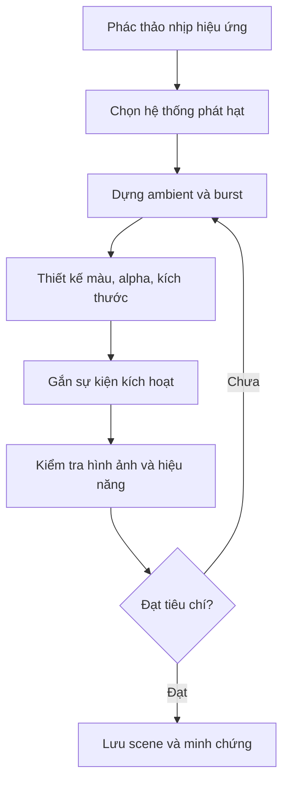

# Bài 06 — Thử thách: thêm hiệu ứng phép thuật vào Scene

**Học phần:** Creative Core · VFX | **Loại:** Bài tập thiết kế | **Hình thức:** Sản phẩm độc lập, không kèm lời giải mẫu hoàn chỉnh

## 1. Bối cảnh và mục tiêu

Bạn đang thiết kế một căn phòng có **viên pha lê ma thuật** ở giữa. Ban đầu, viên pha lê phát ra các đốm sáng chậm và thưa. Khi người chơi bấm nút *Activate*, năng lượng bùng lên thành một vòng hạt và tan dần trong không khí.

Bài tập kiểm tra khả năng chuyển một ý tưởng thị giác thành hệ thống có thể quan sát, kích hoạt và đánh giá. Hãy ưu tiên sự rõ ràng của nhịp chuyển động thay vì số lượng hạt lớn.

## 2. Yêu cầu sản phẩm

Tạo một scene gồm viên pha lê (có thể dùng Primitive), camera, ánh sáng và ít nhất **hai lớp hiệu ứng**:

1. **Ambient effect:** các hạt nhỏ sinh liên tục xung quanh viên pha lê, chuyển động chậm và biến mất mềm.
2. **Activation burst:** một đợt phát tức thời khi được kích hoạt, tỏa ra theo hình tròn hoặc hình cầu, có đổi kích thước và màu theo tuổi hạt.

Người xem phải nhận ra ba trạng thái: trước kích hoạt, đang kích hoạt và sau khi kết thúc. Bắt buộc có ít nhất **một thao tác kích hoạt**: UI Button, một tương tác gameplay hoặc cách thử có thể lặp lại.

**Giới hạn:** Không bắt buộc dùng VFX Graph. Chọn Particle System truyền thống hay VFX Graph theo khả năng giải thích, đặc điểm kỹ thuật và nền tảng đích. Tránh tải một prefab hiệu ứng hoàn thiện rồi coi đó là toàn bộ sản phẩm.

## 3. Quy trình tự triển khai

### 3.1. Lập bản thiết kế trước khi thao tác

Điền bảng ngắn sau:

| Đặc tính | Ambient effect | Activation burst |
| --- | --- | --- |
| Vị trí phát | ... | ... |
| Kiểu phát (continuous/burst) | ... | ... |
| Shape | ... | ... |
| Lifetime dự kiến | ... | ... |
| Chuyển động | ... | ... |
| Biến thiên màu/alpha | ... | ... |
| Khi nào dừng | ... | ... |

### 3.2. Milestone

**Mốc A — Chuyển động đúng:** cả hai hiệu ứng phát ở đúng vị trí và không xung đột. Ambient diễn ra liên tục; burst chỉ xuất hiện khi kích hoạt.

**Mốc B — Đọc được ý tưởng:** người quan sát hiểu đây là “tụ năng lượng rồi bùng lên” ngay cả khi chưa có âm thanh.

**Mốc C — Tương tác ổn định:** kích hoạt 3 lần liên tiếp không khiến hiệu ứng bị kẹt, phát sai nhịp hoặc tăng số hạt tồn đọng ngoài dự kiến.

**Mốc D — Hiệu năng có kiểm chứng:** giảm 30–50% tốc độ phát ambient, so sánh thị giác với bản cũ và ghi nhận FPS/frame time. Không đưa ra khẳng định tối ưu nếu chưa đo.

## 4. Tiêu chí đánh giá

| Tiêu chí | Điểm tối đa | Điều kiện đạt |
| --- | ---: | --- |
| Đúng yêu cầu và có hai lớp | 25 | Ambient liên tục, burst theo sự kiện |
| Nhịp điệu và khả năng đọc hình | 20 | Chuyển động rõ, không rối |
| Sử dụng module đúng mục đích | 20 | Giải thích được Emission/Shape/Lifetime/Color |
| Tương tác và chạy thử ổn định | 15 | Kích hoạt lặp và xử lý reset |
| Kỹ thuật và debug | 10 | Không có lỗi blocking, vật liệu tương thích |
| Minh chứng và tự đánh giá | 10 | Có ảnh/video, ghi chú phép thử |
| **Tổng** | **100** | |

## 5. Gợi ý khi gặp khó khăn

- Nếu khó thấy hạt trên background, đổi tương phản nền hoặc material trước khi tăng mật độ.
- Nếu burst có cảm giác “phun vòi” thay vì “bùng nổ”, kiểm tra hình dạng nguồn phát và hướng vận tốc ban đầu.
- Nếu ambient quá đông, giảm `Rate over Time`, lifetime hoặc kích thước đồng thời vẫn theo dõi từng tham số riêng.
- Nếu phát lại bị chồng hiệu ứng, xác định có cần xóa hạt cũ hay muốn chúng tiếp tục tồn tại.
- Nếu dùng VFX Graph, bắt đầu bằng một graph đơn giản gồm `Spawn`, `Initialize`, `Update`, `Output` rồi thêm phần tử từng bước.

## 6. Minh chứng cần nộp

- File scene/prefab (hoặc repository project) có thể mở và chạy.
- Một ảnh Scene view thể hiện cấu trúc GameObject và một ảnh Inspector/Graph quan trọng.
- Video ngắn thể hiện trạng thái trước–trong–sau kích hoạt, bao gồm ba lần kích hoạt.
- Một bảng so sánh trước/sau cải tiến; chỉ ghi con số FPS/frame time nếu đo thực tế.
- Một đoạn giải thích 150–250 từ về lựa chọn Particle System hoặc VFX Graph.

## 7. Câu hỏi phản tư

1. Bạn chọn biến đổi màu, kích thước và tốc độ như thế nào để người xem cảm nhận được cao trào?
2. Nếu phải chuyển sang thiết bị cấu hình yếu, phần nào trong hệ thống được ưu tiên giảm chi phí trước? Vì sao?
3. Nếu camera quay quanh viên pha lê, bạn dự kiến hiệu ứng trông khác thế nào? Test ra sao?
4. Nếu người dùng kích hoạt hai lần liên tiếp rất nhanh, bạn muốn “reset”, “chồng hiệu ứng” hay “không cho phát lại”? Nêu lý do thiết kế.

## 8. Checklist tự nghiệm thu và tham khảo

- [ ] Hiệu ứng ambient và burst khác biệt rõ ràng.
- [ ] Không có particle màu hồng, lỗi material hoặc lỗi Console gây ngừng chạy.
- [ ] Có ít nhất một sự kiện tương tác.
- [ ] Đã kiểm thử kích hoạt lặp lại.
- [ ] Đã thử giảm mật độ để so sánh chất lượng.
- [ ] Có ảnh/video và phần giải thích thiết kế.

Đọc thêm: [Unity Learn — Creative Core VFX](https://learn.unity.com/course/creative-core-vfx) · [Unity 6.3 — Particle modules](https://docs.unity.com/en-us/engine/6000.3/manual/visual-effects/particle-systems/particle-system-modules).

*Đề bài và rubric được thiết kế cho mục đích tự luyện, không phải nội dung chấm điểm chính thức của Unity.*
