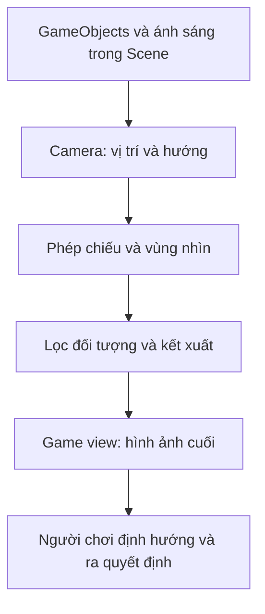

# Bài 01 — Làm quen với Camera trong Unity

> **Khóa:** Unity Creative Core · **Học phần:** Cameras · **Dạng:** Lý thuyết kết hợp trải nghiệm · **Định hướng:** Unity 6.x
>
> **Mục đích:** Nhận biết camera như công cụ truyền đạt thông tin, định hướng người chơi và tạo cảm xúc.

**Lưu ý tương thích:** Nội dung sử dụng các khái niệm của Unity 6 và cách thiết lập phổ biến trong Unity Editor. Tên nhóm thiết lập Camera có thể khác giữa Built-in Render Pipeline, URP và HDRP. Các giá trị được nêu trong bài thực hành là ví dụ để kiểm chứng, không phải cấu hình bắt buộc cho mọi dự án.

## 1. Mục tiêu học tập

Sau bài học, người học có thể giải thích vai trò của Camera trong một trải nghiệm tương tác; phân biệt Scene view và Game view; quan sát sự thay đổi định hướng và cảm xúc khi đổi góc nhìn; tự bố trí hai khung hình cho cùng một cảnh và nêu tiêu chí đánh giá.

## 2. Camera là gì và giải quyết vấn đề gì?

Trong Unity, **Camera** là một Component gắn lên GameObject, quy định điểm nhìn và cách chuyển hình học 3D thành hình ảnh hiển thị. Một scene có thể chứa nhiều Camera nhưng không nhất thiết tất cả đều cùng render ra màn hình. Đối tượng nhìn thấy trong Scene view chưa chắc xuất hiện trong Game view: **Scene view** là công cụ điều hướng của người phát triển, còn **Game view** phản ánh đầu ra của camera đang hoạt động.

Camera không chỉ phục vụ kỹ thuật hiển thị. Nó quyết định người xem có nhận ra đường đi, cảm thấy khoảng cách, đọc được tương tác và cảm nhận vị thế của nhân vật hay không. Ví dụ, camera đặt quá thấp và gần có thể làm một đoạn dốc trông như mặt phẳng; góc nhìn cao hơn có thể làm rõ hình dạng mặt dốc và lối tiếp cận. Nếu nhiệm vụ là điều khiển nhân vật tới một mục tiêu, việc giấu thông tin hình học quan trọng thường khiến thử thách trở nên khó hiểu hơn là thú vị.

Chuỗi này cho thấy ảnh trên màn hình không đơn thuần là bản sao của toàn bộ scene: nó là kết quả của **cách đặt camera** và **các quy tắc kết xuất**.

## 3. Những thành phần cần nhận biết

| Thành phần | Chức năng | Cần quan sát |
|---|---|---|
| `Main Camera` | GameObject thường có Camera chính | Có bật, hướng về chủ thể, đúng camera đang hiển thị? |
| `Transform` | Vị trí và góc quay | Di chuyển camera hoặc thay đổi góc nhìn |
| `Camera` | Phép chiếu, FOV/Size, clipping, culling | Điều chỉnh phần hình ảnh được thấy |
| `Scene view` | Chỉnh sửa scene tự do | Không đồng nhất với Game view |
| `Game view` | Quan sát đầu ra màn hình | Kiểm tra chất lượng framing |
| `Inspector` | Chỉnh thuộc tính Component | Theo dõi tham số thay đổi |

Trong nhiều dự án mới, scene mẫu có Camera sẵn, nhưng không nên coi mọi scene đều có camera hợp lệ: một scene trống hoặc camera bị tắt có thể không cho ảnh mong muốn.

## 4. Camera góp phần kể chuyện như thế nào?

**Chức năng định hướng:** giữ mục tiêu, mặt đất, chướng ngại và lối thoát trong khung hình ở thời điểm phù hợp. **Chức năng phân cấp thị giác:** vật thể gần trung tâm, lớn hoặc tương phản mạnh thường dễ thu hút sự chú ý hơn. **Chức năng diễn đạt:** góc thấp có thể tăng cảm giác uy thế; góc cao có thể khiến chủ thể nhỏ bé; khoảng trống quanh chủ thể có thể gợi sự cô lập. Đây là quy ước thị giác, **không phải định luật**: ánh sáng, diễn xuất, âm thanh và ngữ cảnh có thể đảo ngược cảm nhận.

Phải phân biệt hai câu hỏi: “Góc máy đẹp không?” và “Người chơi có đủ thông tin để hoàn thành thao tác không?”. Một góc quay điện ảnh rất đẹp vẫn có thể gây khó khi leo trèo, đánh mục tiêu hoặc đọc chữ nhỏ.

## 5. Thực hành: một cảnh, hai cách dẫn dắt

**Chuẩn bị:** tạo scene 3D, một `Plane` làm nền, một `Cube` đỏ làm mục tiêu, ba vật cản, một `Capsule` làm người chơi. Nếu có project mẫu của Unity Learn, mở `Camera_Intro_Scene` để thử trải nghiệm thiết kế gốc (ở scene mẫu có thể dùng `WASD` để di chuyển và `C` để đổi camera; phím này **không phải** phím đổi camera mặc định của Unity).

1. Đặt camera A ngang hoặc thấp so với `Capsule`, quay hướng mục tiêu để vật cản và đường dốc bị che một phần. Lưu ảnh Game view.
2. Đặt camera B cao hơn và hơi lệch ngang, để người xem nhìn rõ vật cản, đường đến mục tiêu và mối quan hệ không gian. Lưu ảnh thứ hai.
3. Quan sát cùng một scene ở hai góc; ghi rõ ảnh nào cho biết khoảng cách, độ cao, thứ tự các vật thể và khả năng dự đoán lộ trình tốt hơn.
4. Thay đổi chỉ một biến mỗi lần (vị trí, góc quay hoặc FOV); so sánh kết quả trước và sau.

| Tiêu chí | Camera A | Camera B |
|---|---|---|
| Nhìn thấy mục tiêu | Ghi nhận | Ghi nhận |
| Xác định đường đi | Ghi nhận | Ghi nhận |
| Chủ thể nổi bật | Ghi nhận | Ghi nhận |
| Tâm trạng gợi ra | Ghi nhận | Ghi nhận |

## 6. Lỗi và cách kiểm chứng

- **Game view khác Scene view:** chọn đúng Camera, kiểm tra `Transform`, Projection và camera đang active. Dùng lệnh **GameObject → Align With View** để khớp vị trí Camera với Scene view sau khi chọn Camera.
- **Nhân vật bị che:** xem lại vật cản hoặc đổi hướng camera; không nên mặc định tắt vật cản nếu nó mang thông tin gameplay.
- **Không thấy chủ thể:** kiểm tra hướng nhìn, khoảng cách, Near/Far Clip và `Culling Mask`.
- **Trong Play mode ảnh thay đổi ngoài ý muốn:** tìm script điều khiển Camera hoặc hệ thống Cinemachine đang ghi đè `Transform`.

## 7. Bài luyện tập ngắn

Chọn một ảnh chụp từ phim hoặc game và mô tả: điểm nhìn ở đâu, chủ thể nào quan trọng nhất, thông tin nào bị giấu, cảm xúc nào được tạo ra và người chơi có dễ xác định hướng di chuyển không. Sau đó tái tạo bố cục gần đúng bằng primitive trong Unity.

## 8. Câu hỏi ôn tập

**Câu 1. Vì sao Game view có thể khác Scene view?**

A. Scene view và Game view luôn dùng cùng một camera.  
B. Scene view không nhất thiết trùng góc render của Camera.  
C. Chỉ Game view mới có GameObject.  
D. Scene view luôn dùng phép chiếu Orthographic.  

**Đáp án: B.** Scene view là góc nhìn biên tập, trong khi Game view sử dụng Camera của trò chơi.

**Câu 2. Camera đặt cao thường cải thiện điều gì trong cảnh có đường dốc bị khuất?**

A. Tăng số polygon.  
B. Thay đổi va chạm của nhân vật.  
C. Làm rõ hình học đường dốc và lối đi.  
D. Bắt buộc tăng tốc độ nhân vật.  

**Đáp án: C.** Tăng khả năng quan sát mối quan hệ vị trí và độ cao của các bề mặt.

**Câu 3. Thay đổi vị trí Camera mà giữ nguyên scene có thể gây tác động nào?**

A. Thay đổi thứ người xem thấy và cách họ hiểu scene.  
B. Luôn thay đổi mesh.  
C. Làm mọi vật thể biến mất.  
D. Thay đổi Layer của tất cả GameObject.  

**Đáp án: A.** Khung hình và thông tin nhìn thấy sẽ đổi ngay cả khi thế giới không đổi.

**Câu 4. Đâu là cách kiểm tra tác động của một thông số Camera đáng tin cậy?**

A. Thay đồng thời toàn bộ thông số.  
B. Chỉ nhìn Hierarchy.  
C. Chỉ thay ánh sáng.  
D. Thay một biến và so sánh kết quả.  

**Đáp án: D.** Thay từng biến và so sánh ảnh trước/sau để xác định nguyên nhân.

**Câu 5. Tại sao một góc máy điện ảnh đẹp vẫn có thể không phù hợp gameplay?**

A. Vì góc máy đẹp luôn tốn GPU.  
B. Vì người chơi có thể thiếu thông tin cần thiết.  
C. Vì Camera không hỗ trợ 3D.  
D. Vì Scene view bị tắt.  

**Đáp án: B.** Nó có thể che các thông tin cần cho điều khiển và ra quyết định.
## 9. Tổng kết

Camera vừa là phương tiện kết xuất vừa là công cụ thiết kế trải nghiệm. Quy trình hợp lý là **xác định thông tin người chơi cần → chọn điểm nhìn → quan sát Game view → thử tương tác → điều chỉnh bố cục**.

## 10. Tài liệu tham khảo và đối chiếu

- [Unity Learn — bài 01, Creative Core: Cameras](https://learn.unity.com/course/creative-core-cameras/tutorial/get-started-with-cameras?version=6.0) — mục tiêu và bối cảnh thực hành của bài.
- [Unity Scripting API — Camera](https://docs.unity3d.com/6000.0/Documentation/ScriptReference/Camera.html) — các thuộc tính `fieldOfView`, `orthographicSize`, `nearClipPlane`, `farClipPlane`, `cullingMask`.
- [Unity Manual — Scene view navigation](https://docs.unity.cn/Manual/SceneViewNavigation.html).
