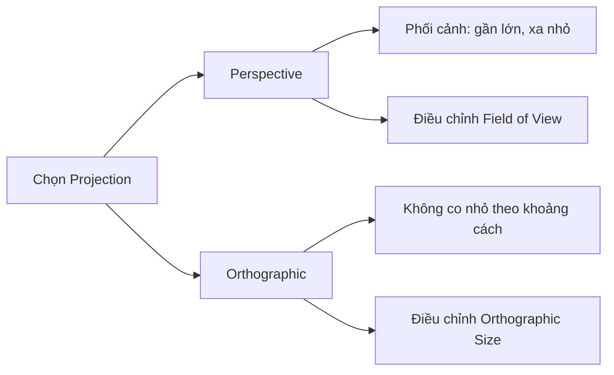

# Bài 02 — Lựa chọn phép chiếu Camera: Perspective và Orthographic

> **Khóa:** Unity Creative Core · **Học phần:** Cameras · **Dạng:** Bài học kỹ thuật · **Định hướng:** Unity 6.x
>
> **Mục đích:** Cấu hình phép chiếu và giải thích sự khác nhau về kích thước biểu kiến, FOV và Orthographic Size.

**Lưu ý tương thích:** Nội dung sử dụng các khái niệm của Unity 6 và cách thiết lập phổ biến trong Unity Editor. Tên nhóm thiết lập Camera có thể khác giữa Built-in Render Pipeline, URP và HDRP. Các giá trị được nêu trong bài thực hành là ví dụ để kiểm chứng, không phải cấu hình bắt buộc cho mọi dự án.

## 1. Mục tiêu học tập

Người học có thể so sánh **Perspective** với **Orthographic**, xác định ứng dụng thích hợp của từng kiểu, thay đổi FOV/Size và giải thích vì sao thay đổi FOV không giống di chuyển Camera.

## 2. Phép chiếu: từ tọa độ 3D đến ảnh 2D

Phép chiếu quyết định cách điểm trong không gian được ánh xạ lên mặt phẳng ảnh. Trong **Perspective**, các tia nhìn hội tụ về một tâm chiếu: vật ở xa thường hiện nhỏ hơn. Trong **Orthographic**, các tia chiếu song song: kích thước biểu kiến của hai vật thể cùng cỡ không phụ thuộc độ sâu (khi các vật nằm trong vùng render), nhưng **che khuất, clipping, lighting và thứ tự chiều sâu vẫn hoạt động**. Orthographic không có nghĩa trục Z hay chiều sâu biến mất khỏi scene.

| Tính chất | Perspective | Orthographic |
|---|---|---|
| Vật xa trông nhỏ hơn | Có | Không theo quy luật phối cảnh |
| Thông số khung nhìn chính | `Field of View` | `Size` |
| Hình dạng vùng nhìn | Chóp cụt (frustum) | Hộp chữ nhật |
| Ứng dụng thường gặp | FPS, third-person, điện ảnh 3D | 2D, bản đồ, mô hình kỹ thuật, phong cách isometric |
| Render mesh 3D và che khuất | Có | Có |

## 3. Hiểu FOV trong Perspective

**Field of View (FOV)** là góc mở của trường nhìn; đơn vị độ. Với FOV theo chiều dọc, tại khoảng cách `d` từ camera, chiều cao vùng nhìn xấp xỉ:

$$
H = 2d\tan\left(\frac{\theta}{2}\right)
$$

Trong đó `θ` là FOV dọc; `d` là khoảng cách dọc trục nhìn. Công thức giả định camera phối cảnh chuẩn, không dùng lens shift. Ví dụ ở `d = 5`, FOV 60° cho `H ≈ 5.77` đơn vị; FOV 30° cho `H ≈ 2.68` đơn vị. Bởi vậy **giảm FOV** khiến vật thể chiếm phần lớn màn hình hơn; **tăng FOV** cho phép thấy nhiều môi trường hơn nhưng dễ làm méo vùng rìa khi quá rộng.

**Điểm quan trọng:** giảm FOV và đưa camera lại gần đều có thể phóng lớn chủ thể, nhưng tạo quan hệ tiền cảnh–hậu cảnh khác nhau. Di chuyển camera đổi vị trí quan sát và độ chênh kích thước biểu kiến giữa các vật ở các độ sâu khác nhau; thay FOV tại vị trí cố định chỉ đổi góc mở.

FOV và sự thoải mái thị giác cần xét theo thể loại, màn hình, khoảng cách xem và khả năng tự điều chỉnh. Không có một con số “an toàn” cho mọi người hoặc mọi thiết bị. Trong trải nghiệm góc nhìn thứ nhất, nên cân nhắc cho phép người dùng chỉnh FOV và kiểm thử chuyển động camera thực tế.

## 4. Hiểu Size trong Orthographic

Giá trị `Camera.orthographicSize` bằng **một nửa chiều cao** vùng nhìn, tính theo đơn vị thế giới. Vì thế:

- Chiều cao nhìn thấy = `2 × orthographicSize`.
- Chiều rộng nhìn thấy ≈ `2 × orthographicSize × aspectRatio` (với viewport thông thường).

Ví dụ `Size = 5`, tỷ lệ khung hình 16:9 thì cao 10 đơn vị và rộng khoảng 17.78 đơn vị. Chuyển `Size` từ 5 xuống 3 khiến mọi vật thể trong ảnh trông lớn hơn, không tạo biến dạng phối cảnh.

Camera Orthographic **có Near/Far Clip**, vẫn có thể render các đối tượng 3D và dùng cho cảnh giả 3D hoặc isometric. Trong bài học nhập môn này, có thể xem Orthographic là phép chiếu bảo toàn tỉ lệ theo độ sâu, chứ không phải “chỉ render XY”.

## 5. Quy trình cấu hình trong Unity Editor

1. Tạo scene với ba `Cube` cùng kích thước, xếp dọc theo hướng nhìn ở các khoảng cách khác nhau. Mở `Game view`.
2. Trong `Hierarchy`, chọn `Main Camera` → tìm `Camera` Component → `Projection: Perspective`. Hướng Camera nhìn dọc hàng ba Cube.
3. Đổi `Field of View` lần lượt **30°**, **60°**, **90°**. Chụp ảnh từng cấu hình và nhận xét cả độ phóng đại, diện tích nền và méo phối cảnh.
4. Chuyển `Projection: Orthographic`, thử `Size` bằng **3**, **5**, **8**. Kiểm tra kích thước biểu kiến của ba Cube.
5. Chỉnh vị trí bằng Move/Rotate hoặc đưa Scene view đến bố cục muốn chụp, chọn `Main Camera` rồi dùng **GameObject → Align With View** (Windows: `Ctrl+Shift+F`; macOS: `Cmd+Shift+F`).
6. Thử cả khung hình 16:9 và 4:3 trong Game view: với cùng FOV dọc hoặc Orthographic Size, phần **chiều ngang** nhìn thấy có thể thay đổi.

Các giá trị trên được chọn để so sánh trực quan, không phải preset thiết kế.

## 6. Phân biệt zoom với dolly

| Thao tác | Biến đổi | Hệ quả |
|---|---|---|
| Giảm FOV (zoom ảo) | Góc nhìn hẹp hơn | Hậu cảnh và chủ thể giữ cùng vị trí camera; thay bố cục biểu kiến |
| Dolly-in | Camera tiến về phía đối tượng | Thay phối cảnh, mức che khuất, quan hệ tiền–hậu cảnh |
| Giảm Orthographic Size | Thu nhỏ vùng quan sát | Phóng to cảnh mà không tạo hiệu ứng xa nhỏ |

Có thể dùng **Physical Camera** khi cần mô phỏng thiết bị quay thật. `Focal Length` và `Sensor Size` chi phối FOV; đừng vừa tự ý đổi FOV vừa mặc định thông số vật lý độc lập với nhau.

## 7. Sai lầm phổ biến

- Cho rằng Orthographic làm mất chiều Z: thực tế Z vẫn quan trọng đối với clipping, che khuất và sắp xếp.
- Tăng FOV cực lớn để “nhìn được tất cả”: dễ làm đối tượng vùng rìa bị kéo giãn.
- Đổi FOV mà không xem lại bố cục: chủ thể có thể bị cắt đầu/chân.
- Nhầm `Size` với toàn bộ chiều cao: Size là **nửa chiều cao** vùng nhìn.

## 8. Bài tập vận dụng

Dựng hai ảnh cùng thể hiện một nhân vật bên cạnh ba tòa nhà: ảnh A nhấn mạnh chiều sâu bằng Perspective; ảnh B nhấn mạnh bố cục đồ họa bằng Orthographic. Ghi lại Projection, FOV/Size, Transform, aspect ratio và lý do lựa chọn.

## 9. Câu hỏi ôn tập

**Câu 1. Hai vật cùng kích thước đặt ở các độ sâu khác nhau sẽ có kích thước biểu kiến gần như bằng nhau với phép chiếu nào?**

A. Perspective FOV 30°.  
B. Perspective FOV 90°.  
C. Orthographic.  
D. Physical Camera bắt buộc.  

**Đáp án: C.** Orthographic loại bỏ sự co nhỏ biểu kiến theo độ sâu.

**Câu 2. Camera Orthographic có Size = 4 thì chiều cao vùng nhìn xấp xỉ bao nhiêu đơn vị?**

A. 8.  
B. 4.  
C. 2.  
D. 16.  

**Đáp án: A.** Kích thước theo chiều dọc là hai lần orthographicSize.

**Câu 3. Ở vị trí camera không đổi, tăng FOV từ 45° lên 90° thường có tác dụng gì?**

A. Thu hẹp vùng nhìn.  
B. Tăng số mesh.  
C. Bỏ Near Clip.  
D. Mở rộng vùng nhìn.  

**Đáp án: D.** Góc nhìn rộng hơn và mỗi vật thể chiếm diện tích ảnh nhỏ hơn.

**Câu 4. Vì sao dolly-in không tương đương giảm FOV?**

A. Vì dolly chỉ hoạt động ở 2D.  
B. Vì dolly thay đổi vị trí Camera và phối cảnh.  
C. Vì FOV thay Layer.  
D. Vì FOV đổi lighting.  

**Đáp án: B.** Dolly thay đổi tâm nhìn và các quan hệ phối cảnh.

**Câu 5. Để thiết kế cảnh đẳng phối cho bản đồ kỹ thuật, chọn phương án nào thường hợp lý hơn?**

A. FOV 120° tùy ý.  
B. Không dùng Camera.  
C. Orthographic với góc đặt phù hợp.  
D. Chỉ điều chỉnh Far Clip.  

**Đáp án: C.** Orthographic giúp các cạnh song song không hội tụ theo phối cảnh.
## 10. Tổng kết

Perspective mô phỏng cảm giác chiều sâu theo khoảng cách, còn Orthographic giữ kích thước biểu kiến tương đối ổn định. Chọn phép chiếu theo **nhiệm vụ thị giác**, sau đó tinh chỉnh FOV hoặc Size và kiểm tra trên các tỷ lệ màn hình.

## 11. Tài liệu tham khảo và đối chiếu

- [Unity Learn — bài 02, Creative Core: Cameras](https://learn.unity.com/course/creative-core-cameras/tutorial/select-your-camera-projection-type?version=6.0) — mục tiêu và bối cảnh thực hành của bài.
- [Unity Scripting API — Camera](https://docs.unity3d.com/6000.0/Documentation/ScriptReference/Camera.html) — các thuộc tính `fieldOfView`, `orthographicSize`, `nearClipPlane`, `farClipPlane`, `cullingMask`.
- [Unity Manual — Camera component](https://docs.unity.cn/2022.3/Documentation/Manual/class-Camera.html).
- [Unity Manual — Physical Cameras](https://docs.unity.com/en-us/engine/6000.0/manual/cameras/physical/introduction).
