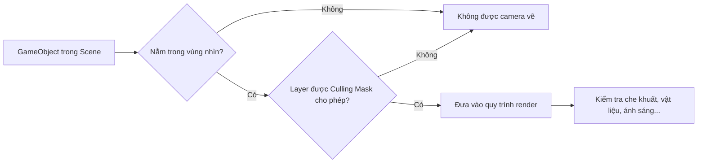

# Bài 03 — Kiểm soát những gì Camera nhìn thấy

> **Khóa:** Unity Creative Core · **Học phần:** Cameras · **Dạng:** Bài học kỹ thuật và thực hành · **Định hướng:** Unity 6.x
>
> **Mục đích:** Dùng clipping planes, culling mask và background để chọn nội dung hiển thị.

**Lưu ý tương thích:** Nội dung sử dụng các khái niệm của Unity 6 và cách thiết lập phổ biến trong Unity Editor. Tên nhóm thiết lập Camera có thể khác giữa Built-in Render Pipeline, URP và HDRP. Các giá trị được nêu trong bài thực hành là ví dụ để kiểm chứng, không phải cấu hình bắt buộc cho mọi dự án.

## 1. Mục tiêu học tập

Sau bài học, người học cấu hình được vùng nhìn trước–sau của camera; giải thích ý nghĩa `Near` và `Far`; lọc render bằng Layer; chọn nền Skybox hay Solid Color và kiểm tra tác động một cách có hệ thống.

## 2. View frustum và clipping planes

**View frustum** là thể tích có thể được xét để render. Ở Perspective, vùng này gần giống chóp cụt; với Orthographic là lăng trụ chữ nhật. Hai mặt phẳng vuông góc hướng nhìn giới hạn độ sâu: `Near` loại phần quá gần và `Far` loại phần quá xa. Đối tượng nằm ngoài vùng này không xuất hiện; điều đó không có nghĩa GameObject đã bị xóa hoặc Component đã tắt.

**Chú ý:** frustum culling và culling mask chỉ là những điều kiện trong quy trình render, không phải toàn bộ cơ chế xác định pixel cuối cùng. Một vật trong vùng nhìn vẫn có thể bị che bởi tường, vật liệu trong suốt, hoặc không được render vì lý do khác.

## 3. Near và Far: giới hạn theo độ sâu

| Thuộc tính | Nếu tăng giá trị | Vấn đề có thể gặp |
|---|---|---|
| `Near Clip Plane` | Bỏ qua nhiều vùng sát Camera hơn | Mặt nhân vật/vật sát Camera bị cắt |
| `Far Clip Plane` | Cho phép render đối tượng ở xa hơn | Có thể tăng khối lượng dữ liệu hiển thị và ảnh hưởng độ chính xác depth |

Với một camera nhìn dọc trục `forward`, khoảng cách xét clipping là **độ sâu theo hướng nhìn**, không đơn giản là bán kính hình cầu quanh Camera. Giá trị Near phải dương, Far lớn hơn Near. Near quá nhỏ trong cảnh có Far rất lớn có thể làm giảm độ chính xác của depth buffer, gây hiện tượng z-fighting tùy pipeline và nền tảng. Không nên coi giảm Far là cách tối ưu chắc chắn cho mọi dự án: mức lợi ích phụ thuộc loại scene, culling và pipeline.

### 3.1. Thử Far Clip

1. Đặt Camera ở đầu một hành lang gồm ba Cube tại các khoảng cách khác nhau.
2. Chọn Camera và giảm `Far` dần (ví dụ 100 → 10 → 4). Quan sát vật thể nào biến mất khỏi Game view.
3. Di chuyển Camera tiến dần; xác nhận vật thể quay lại khi lọt vào vùng cho phép.
4. Trả lại giá trị Far đủ lớn để không gây cảm giác bật/tắt đột ngột trong trải nghiệm dự kiến.

### 3.2. Thử Near Clip

Đặt một `Capsule` rất gần Camera rồi tăng Near. Khi lớp hình học sát mặt nhìn bị cắt, người xem có thể nhìn xuyên vào bên trong mesh. Trước khi giảm Near quá mạnh, cân nhắc **tránh Camera đi xuyên vật**, đổi điểm theo dõi hoặc xử lý va chạm camera.

## 4. Culling Mask và Layer

Unity dùng **Layer** để nhóm GameObject; thuộc tính `Camera.cullingMask` quyết định nhóm Layer nào được render bởi Camera. Layer không giống Tag: Tag thường được dùng để phân loại đối tượng cho logic, còn Layer còn phục vụ camera, raycast, va chạm theo cấu hình.

Thực hành:

1. Tạo `Capsule` đỏ, giữ nó trong vùng nhìn.
2. Mở danh sách Layer của Capsule → `Add Layer` → tạo Layer tên `HiddenFromMain` tại một User Layer còn trống.
3. Gán Layer mới cho Capsule. Khi gán cho GameObject có con, quyết định có gán cho cả các con hay không.
4. Chọn `Main Camera` → `Culling Mask` → bỏ chọn `HiddenFromMain`.
5. Quan sát Capsule biến mất **trong Game view** nhưng vẫn có mặt trong Hierarchy/Scene view. Khôi phục Layer trong mask để hiện lại.

**Tác dụng giới hạn:** Culling Mask không trực tiếp tắt Collider, script hay GameObject. Một vật bị camera ẩn vẫn có thể tham gia physics hoặc được nhìn thấy bởi Camera khác. Không dùng cách này để thực thi bảo mật hoặc ngăn truy cập dữ liệu.

## 5. Nền Camera: Skybox, Solid Color và môi trường

Nền là phần hình ảnh khi không có hình học được render. Với một số pipeline, mục liên quan nằm ở `Environment → Background Type`; trong Built-in có thể gặp `Clear Flags`. Các khái niệm phổ biến:

| Cấu hình | Hiệu ứng mong đợi | Khi nên sử dụng |
|---|---|---|
| Skybox | Hiện skybox nếu thiết lập đúng | Cảnh ngoài trời hoặc bầu trời có chủ ý |
| Solid Color | Vùng trống là màu cố định | Prototype, UI 3D, nền đồ họa đơn giản |
| Cấu hình clear/render nâng cao | Phụ thuộc pipeline và camera stacking | Hiệu ứng nhiều lớp, thiết lập render chuyên biệt |

Chọn Solid Color **không tự động xóa Skybox Material trong Lighting**; cũng không đồng nghĩa thay toàn bộ ánh sáng môi trường. Hiệu ứng GI/phản xạ và background render là các phần cần đánh giá riêng.

## 6. Thực hành tổng hợp và bảng kết quả

Tạo scene có: nền trời, 3 vật thể ở ba độ sâu, 1 vật trên Layer tùy biến. Mỗi lần chỉ thay một cấu hình:

| Lần | Cấu hình thay đổi | Dự đoán trước khi chạy | Kết quả thực tế |
|---|---|---|---|
| 1 | Giảm `Far` | Vật xa mất khỏi ảnh | Tự ghi |
| 2 | Tăng `Near` | Vật gần bị cắt | Tự ghi |
| 3 | Bỏ Layer khỏi `Culling Mask` | Vật ở Layer đó biến mất | Tự ghi |
| 4 | Skybox → Solid Color | Nền thay màu; vật vẫn còn | Tự ghi |

Nếu kết quả khác dự đoán, kiểm tra liệu Camera nào đang hoạt động; Transform, Layer của các GameObject con, render pipeline và phần mềm điều khiển camera có đang ghi đè cấu hình hay không.

## 7. Các lỗi hay nhầm

- **“Đối tượng biến mất là đã bị xóa”**: kiểm tra Hierarchy, Scene view, Layer, clipping.
- **“Culling Mask làm đối tượng không còn va chạm”**: sai; physics dùng cấu hình riêng.
- **“Chọn Solid Color thì ánh sáng Skybox biến mất”**: không nhất thiết; camera background và environment lighting là hai việc khác nhau.
- **“Giảm Far là tối ưu tối đa”**: cần đo hiệu năng và kiểm tra popping, không nên áp dụng máy móc.

## 8. Câu hỏi ôn tập

**Câu 1. Đối tượng ở xa hơn Far Clip sẽ xảy ra điều gì trong ảnh của Camera?**

A. Không được camera render.  
B. Bị xóa khỏi Scene.  
C. Tự đổi Layer.  
D. Tự tắt Collider.  

**Đáp án: A.** Nằm ngoài vùng độ sâu được Camera render.

**Câu 2. Cách đúng để ẩn nhóm vật khỏi một Camera mà vẫn giữ chúng trong Scene là gì?**

A. Xóa Transform.  
B. Tắt toàn bộ Scene.  
C. Chuyển FOV về 0.  
D. Dùng Layer và Culling Mask.  

**Đáp án: D.** Đặt Layer rồi loại Layer khỏi culling mask của Camera.

**Câu 3. Tăng Near Clip quá mức có thể dẫn đến điều gì?**

A. Tăng chất lượng texture.  
B. Vật quá gần bị cắt khỏi hình.  
C. Đổi perspective thành orthographic.  
D. Không còn che khuất.  

**Đáp án: B.** Hình học sát camera bị cắt.

**Câu 4. Khi chọn Solid Color, điều nào đúng hơn cả?**

A. Mọi ánh sáng bị tắt.  
B. Tất cả Camera luôn đổi nền theo.  
C. Camera vẽ nền màu đơn; môi trường sáng có thể vẫn giữ.  
D. Culling Mask tự về Everything.  

**Đáp án: C.** Nền Camera đổi, nhưng thiết lập Skybox cho ánh sáng môi trường không mặc nhiên bị xóa.

**Câu 5. Vật nằm trong frustum nhưng không thấy, nên ưu tiên kiểm tra gì?**

A. Layer, Culling Mask, vật cản và thiết lập render.  
B. Chỉ tên file dự án.  
C. Chỉ số FPS của màn hình.  
D. Dung lượng RAM máy khác.  

**Đáp án: A.** Culling mask, layer, che khuất và render settings là các yếu tố tiếp theo.
## 9. Tổng kết

Camera nhìn thấy một phần của scene do **Projection/Frustum**, giới hạn `Near/Far`, `Culling Mask` và quá trình kết xuất. Thiết lập nền điều khiển vùng không có đối tượng. Hãy kiểm tra bằng thí nghiệm tách biến và ghi minh chứng ở Game view.

## 10. Tài liệu tham khảo và đối chiếu

- [Unity Learn — bài 03, Creative Core: Cameras](https://learn.unity.com/course/creative-core-cameras/tutorial/control-what-your-camera-sees?version=6.0) — mục tiêu và bối cảnh thực hành của bài.
- [Unity Scripting API — Camera](https://docs.unity3d.com/6000.0/Documentation/ScriptReference/Camera.html) — các thuộc tính `fieldOfView`, `orthographicSize`, `nearClipPlane`, `farClipPlane`, `cullingMask`.
- [Unity Manual — Camera component, Clip Planes và Culling Mask](https://docs.unity.cn/2022.3/Documentation/Manual/class-Camera.html).
