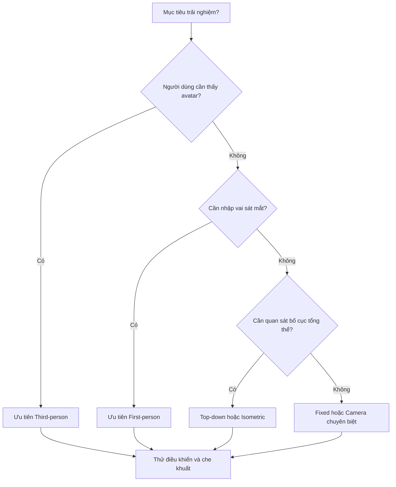

# Bài 04 — Khám phá các kiểu góc nhìn Camera trong trải nghiệm tương tác

> **Khóa:** Unity Creative Core · **Học phần:** Cameras · **Dạng:** Bài học phân tích thiết kế · **Định hướng:** Unity 6.x
>
> **Mục đích:** Chọn first-person, third-person, top-down, isometric hoặc fixed view theo nhiệm vụ người dùng.

**Lưu ý tương thích:** Nội dung sử dụng các khái niệm của Unity 6 và cách thiết lập phổ biến trong Unity Editor. Tên nhóm thiết lập Camera có thể khác giữa Built-in Render Pipeline, URP và HDRP. Các giá trị được nêu trong bài thực hành là ví dụ để kiểm chứng, không phải cấu hình bắt buộc cho mọi dự án.

## 1. Mục tiêu học tập

Người học có thể nhận diện năm kiểu góc nhìn thường gặp, phân tích ưu và nhược điểm của mỗi kiểu, lựa chọn góc phù hợp với mục tiêu tương tác, và thiết lập được một nguyên mẫu đơn giản để kiểm tra tính định hướng.

## 2. Viewpoint khác gì Projection và Shot?

**Viewpoint (kiểu góc nhìn)** mô tả quan hệ Camera với người chơi/thế giới: nhìn qua mắt nhân vật, theo sau nhân vật, nhìn từ trên cao, v.v. **Projection** là phép chiếu hình học Perspective/Orthographic. **Shot** là cách đóng khung một chủ thể trong từng cảnh quay như toàn cảnh, trung cảnh hay cận cảnh. Cùng một viewpoint có thể dùng các shot khác nhau; top-down có thể là Perspective hoặc Orthographic.

| Viewpoint | Camera thường nằm ở đâu? | Lợi thế | Hạn chế | Ứng dụng |
|---|---|---|---|---|
| First-person | Gần mắt nhân vật | Nhập vai, chú ý chi tiết | Khó quan sát avatar, dễ bị che tầm nhìn | Khám phá, mô phỏng thao tác |
| Third-person | Cách nhân vật một khoảng | Thấy avatar và môi trường | Có thể bị tường, địa hình chắn | Phiêu lưu, hành động |
| Top-down | Trên cao nhìn xuống | Đọc bố cục và lập kế hoạch | Khó cảm nhận chiều cao/chi tiết đứng | Chiến thuật, quản lý |
| Isometric/axonometric | Góc xiên cố định hoặc có điều khiển | Đọc hình khối và bố cục ổn định | Che khuất do tòa nhà, khó xác định độ cao | Mô phỏng xây dựng, chiến thuật |
| Fixed | Vị trí/góc quay xác định trước | Kiểm soát bố cục và nhịp kể chuyện | Có thể gây khó định hướng lúc chuyển máy | Kinh dị, phim tương tác, trình diễn |

**Lưu ý về isometric:** *Isometric đúng nghĩa hình học* là một dạng chiếu trục đo trong đó ba trục có tỷ lệ bằng nhau. Nhiều game được gọi “isometric” thực tế chỉ dùng góc xiên gần tương tự, đôi khi phối cảnh Perspective; không phải mọi hình từ trên chéo đều là isometric toán học.

## 3. Phân tích sâu theo mục tiêu

### 3.1. First-person và Third-person

First-person đặt người dùng ở gần mắt nhân vật, tạo cảm giác tham gia trực tiếp. Khi tiến đến vật thể, chi tiết model, texture và âm thanh vị trí trở nên quan trọng. Camera chuyển động quá đột ngột, head bob mạnh hoặc FOV không phù hợp có thể làm một số người dùng khó chịu. Nếu trò chơi yêu cầu nhảy qua nền tảng hẹp, thiếu hình ảnh toàn thân đôi khi làm việc ước lượng vị trí chân kém trực quan hơn.

Third-person cho phép nhìn thấy avatar, trang phục, chuyển động và khoảng cách tương đối. Nó phù hợp khi hình dáng nhân vật là một phần quan trọng của trải nghiệm. Đổi lại, phải xử lý Camera đi xuyên vật cản, nhân vật che mục tiêu, và vùng cần nhìn khi nhân vật chạy hoặc quay đầu. Tùy game, camera có thể đi theo cố định, xoay quanh avatar hoặc cho người chơi điều khiển độc lập.

### 3.2. Top-down và Isometric

Top-down thường hỗ trợ lập kế hoạch đường đi và đọc các đối tượng trên mặt bằng. Nó không mặc định là Orthographic và cũng không bắt buộc hoàn toàn thẳng đứng; có thể dùng góc nhìn hơi nghiêng để lộ chiều cao.

Isometric/tựa isometric sử dụng góc xiên để cho thấy đồng thời nhiều mặt của vật thể. Với camera Orthographic, độ dài của đối tượng không biến đổi biểu kiến theo khoảng cách, thuận lợi cho bố cục kỹ thuật và phong cách game chiến thuật. Cần quan tâm đến công trình che khuất nhân vật và giải pháp đổi góc nhìn, trong suốt hóa tường hoặc cắt mái.

### 3.3. Fixed Camera

Fixed Camera cho phép tác giả định hình điểm nhìn chính xác. Có thể đặt nhiều camera cố định và đổi theo khu vực, sự kiện hoặc hành động. Đây là lựa chọn tốt khi muốn kiểm soát việc hé lộ thông tin hoặc dựng một cảnh điện ảnh; nhưng nếu đổi máy liên tục, hướng điều khiển nhân vật có thể trở nên khó hiểu. Khi chuyển Camera, cần thiết kế quy tắc giữ hướng di chuyển hoặc nhắc lại vị trí/đích đến bằng bố cục.

## 4. Chọn góc nhìn bằng câu hỏi thiết kế

Sơ đồ là **quy tắc gợi ý**, không thay thế kiểm thử. Trò chơi có thể kết hợp third-person khi di chuyển, first-person khi kiểm tra đồ vật và fixed shot khi kể chuyện.

## 5. Thực hành với các góc nhìn

**Nếu dùng project Unity Learn:** mở `Camera_Views_Scene`; di chuyển tới các vùng được gắn nhãn tương ứng và quan sát khi Camera đổi tự động. Với project tự tạo, thực hiện:

1. Dựng một nhân vật đơn giản (`Capsule`), hành lang, tháp cao và một vật cần nhặt.
2. Tạo các Camera riêng: `Cam_FirstPerson`, `Cam_ThirdPerson`, `Cam_TopDown`, `Cam_Isometric`, `Cam_Fixed`.
3. Mỗi lần chỉ bật một Camera **để tránh chồng đầu ra ngoài ý muốn**. Thiết lập camera khác nhau bằng `Transform` và Projection.
4. Chụp cùng một khu vực từ năm góc, so sánh khả năng thấy đường đi, avatar, mục tiêu và không gian phía sau.
5. Ghi thêm: người dùng nên được điều khiển hướng máy hay không? Đổi máy có làm mất phương hướng không?

**Gợi ý cho Third-person follow:** nếu dự án dùng package Cinemachine 3, có thể tạo Follow Camera và gán `Tracking Target`, tinh chỉnh `Follow Offset`, `Damping`, `Rotation Composer` và xác nhận Main Camera có `Cinemachine Brain`. Cách này là hướng mở rộng, **không phải bước bắt buộc** của bài Camera cơ bản. Nếu nhân vật dùng Rigidbody, kiểm tra Rigidbody interpolation và nhịp cập nhật camera để giảm rung thay vì kết luận mọi trường hợp phải dùng một callback cố định.

## 6. Bảng đánh giá sau thử nghiệm

Chấm mỗi tiêu chí từ 1–5 và giải thích bằng quan sát:

| Tiêu chí | First-person | Third-person | Top-down | Isometric | Fixed |
|---|---:|---:|---:|---:|---:|
| Dễ phát hiện mục tiêu |  |  |  |  |  |
| Dễ điều khiển tới đích |  |  |  |  |  |
| Thấy rõ tạo hình nhân vật |  |  |  |  |  |
| Không bị vật cản che |  |  |  |  |  |
| Phù hợp cảm xúc đề bài |  |  |  |  |  |

## 7. Lỗi cần tránh

- Gọi top-down là một loại Projection: đó là **hướng đặt camera**, không phải phép chiếu.
- Đổi camera nhưng không kiểm tra hướng điều khiển và cảm giác liên tục.
- Cho rằng mọi game isometric cần giá trị quay 45°/35.264°: đây chỉ là cấu hình của một **trường hợp đẳng phối chuẩn** với giả định phù hợp.
- Thiết lập Follow nhưng không xử lý vật cản nằm giữa nhân vật và camera.

## 8. Câu hỏi ôn tập

**Câu 1. Kiểu góc nhìn nào thuận lợi nhất để phô diễn trang phục và animation của avatar trong khi di chuyển?**

A. First-person.  
B. Third-person.  
C. Chỉ Fixed shot.  
D. Chỉ UI Camera.  

**Đáp án: B.** Third-person giữ avatar trong khung hình.

**Câu 2. Cảnh chiến thuật cần người dùng nhìn phân bố quân trên bản đồ lớn nên thử góc nào trước?**

A. Top-down.  
B. First-person rất gần.  
C. Worm’s-eye.  
D. Cận cảnh một nhân vật.  

**Đáp án: A.** Top-down cho phép quan sát mối quan hệ không gian tổng thể.

**Câu 3. Isometric là tên gọi chủ yếu cho điều gì?**

A. Một loại shader.  
B. Một Layer đặc biệt.  
C. Một loại clipping plane.  
D. Một cách nhìn xiên có các đặc tính hình học riêng.  

**Đáp án: D.** Đó là một cấu hình góc nhìn/chiếu trục đo, không phải một component Camera riêng.

**Câu 4. Vấn đề quan trọng khi chuyển giữa nhiều Fixed Camera là gì?**

A. Giảm độ phân giải texture.  
B. Tắt collider.  
C. Duy trì khả năng định hướng và liên tục điều khiển.  
D. Thay đổi mã nguồn Unity.  

**Đáp án: C.** Hướng di chuyển và vị trí tương đối có thể gây mất định hướng.

**Câu 5. Một game có thể dùng top-down với Projection Perspective không?**

A. Không vì top-down chỉ là Orthographic.  
B. Có, vì viewpoint và projection là hai thuộc tính độc lập.  
C. Không vì camera không nhìn xuống được.  
D. Chỉ khi là 2D.  

**Đáp án: B.** Top-down mô tả hướng nhìn, còn Perspective mô tả phép chiếu.
## 9. Tổng kết

Không có một góc nhìn tối ưu cho mọi trò chơi. Việc lựa chọn cần dựa trên **thứ người dùng phải nhìn thấy, mức tự do tương tác, độ rõ của đối tượng và cảm xúc cần truyền đạt**, rồi kiểm thử trong tình huống sử dụng thật.

## 10. Tài liệu tham khảo và đối chiếu

- [Unity Learn — bài 04, Creative Core: Cameras](https://learn.unity.com/course/creative-core-cameras/tutorial/explore-camera-views?version=6.0) — mục tiêu và bối cảnh thực hành của bài.
- [Unity Scripting API — Camera](https://docs.unity3d.com/6000.0/Documentation/ScriptReference/Camera.html) — các thuộc tính `fieldOfView`, `orthographicSize`, `nearClipPlane`, `farClipPlane`, `cullingMask`.
- [Cinemachine 3.1 — Follow and frame a character](https://docs.unity.cn/Packages/com.unity.cinemachine@3.1/manual/setup-follow-camera.html).
- [Cinemachine 3.1 — Follow component](https://docs.unity.cn/Packages/com.unity.cinemachine@3.1/manual/CinemachineFollow.html).
