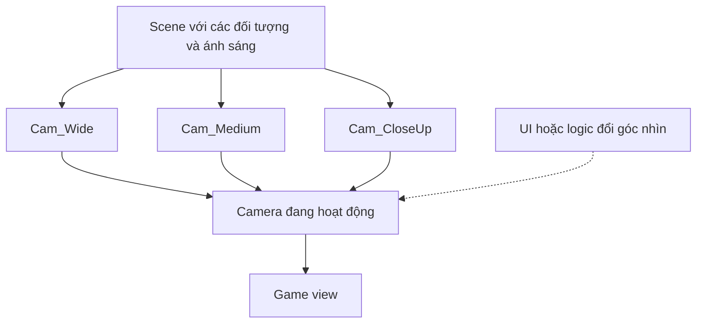

# Bài 07 — Ứng dụng Camera vào Guided Project

> **Khóa:** Unity Creative Core · **Học phần:** Cameras · **Dạng:** Dự án thực hành (project) · **Định hướng:** Unity 6.x
>
> **Mục đích:** Thiết kế bộ ba camera toàn–trung–cận và kiểm thử nhu cầu trải nghiệm theo ba lựa chọn guided project.

**Lưu ý tương thích:** Nội dung sử dụng các khái niệm của Unity 6 và cách thiết lập phổ biến trong Unity Editor. Tên nhóm thiết lập Camera có thể khác giữa Built-in Render Pipeline, URP và HDRP. Các giá trị được nêu trong bài thực hành là ví dụ để kiểm chứng, không phải cấu hình bắt buộc cho mọi dự án.

## 1. Bài toán và mục tiêu sản phẩm

Một Guided Project cần nhiều điểm nhìn để người xem quan sát tổng thể và tập trung vào từng chi tiết mà không phải tự di chuyển Camera bằng Editor. Kết quả cần hướng tới **ba shot độc lập**, có thể chuyển đổi trong hệ thống giao diện hoặc logic dự án ở giai đoạn tích hợp, kèm minh chứng rằng từng shot đáp ứng mục đích thị giác.

**Mục tiêu đo lường:** tạo được ba Camera cấu hình khác nhau, kiểm tra từng Camera trong Game view, đặt tên có ý nghĩa và giải thích được tại sao dùng Projection, FOV/Size và góc đặt máy đó.

## 2. Xác định yêu cầu từ thiết kế

Unity Learn dùng ba nhánh Guided Project. Hãy chọn **đúng một** nhánh theo dự án đang triển khai và đối chiếu mục `Project Specifications` trong tài liệu thiết kế tương ứng.

| Guided Project | Shot rộng (wide) | Shot trung (medium) | Shot cận (close-up) |
|---|---|---|---|
| Alien Video Games Shop | Toàn bộ cửa hàng | Nhân vật alien | Một trò chơi/đĩa game trưng bày |
| Beachside Town | Toàn cảnh thị trấn ven biển | Mặt tiền cửa hàng | Người đi bộ |
| Architectural Rendering | Toàn bộ không gian nội thất | Một món đồ nội thất hoặc nhân vật | Một bức tranh hoặc tác phẩm điêu khắc |

Đây là **các đối tượng cần có trong từng shot**. Hệ thống chọn camera qua UI là bước tích hợp tiếp theo và không nhất thiết phải hoàn thành toàn bộ giao diện trong bài này.

## 3. Kiến trúc camera tối thiểu



Với cấu hình đơn giản, chỉ bật một Camera có đầu ra màn hình tại một thời điểm để tránh thứ tự render chồng chéo. Nếu dùng URP Camera Stacking, Render Texture hoặc Cinemachine, luồng điều khiển có thể khác; không cần thêm độ phức tạp đó cho bài cơ bản.

## 4. Milestone 1 — Chuẩn hóa scene và các Camera

1. Lưu scene thành một bản làm việc riêng, đảm bảo có đủ vật thể cho cả ba shot.
2. Tạo ba GameObject Camera bằng cách nhân bản Main Camera hoặc `GameObject → Camera` (đường dẫn có thể khác theo menu Unity).
3. Đặt tên `Cam_Wide`, `Cam_Medium`, `Cam_CloseUp`; bảo đảm chỉ Camera dùng để hiển thị có output hoạt động trong lúc kiểm thử.
4. Với mỗi Camera, chọn Projection và ghi lại thông số FOV hoặc Size, clipping planes và culling mask.
5. Đặt ba camera tại các vị trí khác nhau và chụp từng ảnh để so sánh.

## 5. Milestone 2 — Thiết kế đúng mục đích

### 5.1. Wide shot

Shot rộng phải đủ thông tin xác định cấu trúc không gian: khuôn viên cửa hàng, phố biển hoặc phòng nội thất. Người xem phải hiểu các khối chính nằm ở đâu mà không phải xoay camera. Kiểm tra các chi tiết ở rìa ảnh: FOV quá rộng có thể làm chúng trông giãn và không tự nhiên.

### 5.2. Medium shot

Shot trung tập trung vào alien, mặt tiền cửa hàng hoặc một món nội thất. Giữ một phần bối cảnh để người xem hiểu mối liên hệ giữa chủ thể với không gian. Đừng để vật chính lẫn với nền hoặc bị cắt bởi đối tượng tiền cảnh.

### 5.3. Close-up shot

Shot cận nhấn mạnh chi tiết: vật phẩm game, khách đi đường hoặc tranh/tượng. Ưu tiên chủ thể có silhouette rõ, không bị clipping và chiếm diện tích ảnh phù hợp. Nếu vật quá sát Camera, sửa khoảng cách hoặc Near Clip một cách thận trọng.

## 6. Milestone 3 — Kiểm thử và bàn giao

Một bản bàn giao đủ dùng có thể gồm:

```text
Assets/
  Scenes/
    GuidedProject_Cameras.unity
  Scripts/                 # chỉ có nếu project cần logic đổi Camera
Documentation/
  camera_wide.png
  camera_medium.png
  camera_closeup.png
  camera_decisions.md
```

Cấu trúc này là **gợi ý tổ chức**, không phải cấu trúc project chính thức của Unity. Trong `camera_decisions.md`, mô tả camera nào dùng để làm gì, thông số chính và lỗi đã xử lý.

| Kiểm thử | Điều kiện thành công |
|---|---|
| Shot rộng | Có đầy đủ thành phần quan trọng của môi trường |
| Shot trung | Nhận diện được vật/nhân vật đích và bối cảnh liên quan |
| Shot cận | Thấy rõ chi tiết được chọn, không bị cắt ngoài ý muốn |
| Chuyển góc | Không mất toàn bộ ảnh, không có camera vô tình phủ lên nhau |
| Chạy thử | Không có lỗi Camera do thiếu component hoặc reference |

## 7. Mở rộng tùy chọn: cơ chế chuyển Camera đơn giản

Nếu muốn có thể xem ba góc khi chạy Play mode, script sau bật một Camera theo phím số **1–3**. Script dùng hệ thống `UnityEngine.Input` cũ; nếu project đặt `Active Input Handling` chỉ là **Input System Package (New)**, cần chuyển sang Input Actions hoặc bật chế độ tương thích thích hợp trước khi dùng.

```csharp
using UnityEngine;

public class SimpleCameraSwitcher : MonoBehaviour
{
    [SerializeField] private Camera[] cameras;

    private void Start() => Activate(0);

    private void Update()
    {
        if (Input.GetKeyDown(KeyCode.Alpha1)) Activate(0);
        if (Input.GetKeyDown(KeyCode.Alpha2)) Activate(1);
        if (Input.GetKeyDown(KeyCode.Alpha3)) Activate(2);
    }

    private void Activate(int index)
    {
        if (cameras == null || index >= cameras.Length) return;
        for (int i = 0; i < cameras.Length; i++)
            if (cameras[i] != null)
                cameras[i].gameObject.SetActive(i == index);
    }
}
```

Gắn script lên một GameObject quản lý (không phải một Camera bị tắt bởi script), điền các Camera theo đúng thứ tự trong Inspector. Không dùng cách này khi Camera GameObjects chứa các script quan trọng cần chạy liên tục; khi đó có thể chuyển sang điều khiển `Camera.enabled` hoặc Cinemachine để tránh tắt toàn bộ GameObject. Nếu dự án có Audio Listener trên nhiều camera, chỉ giữ **một Audio Listener đang hoạt động** tại một thời điểm.

## 8. Checklist nghiệm thu

- [ ] Xác định đúng nhánh Guided Project và yêu cầu ba shot.
- [ ] Đặt tên Camera, quản lý Camera đang hoạt động rõ ràng.
- [ ] Mỗi shot có chủ thể khác biệt, rõ ràng và đủ thông tin.
- [ ] Có tối thiểu ba ảnh chụp Game view.
- [ ] Đã kiểm thử clipping, culling, background, tỷ lệ khung hình.
- [ ] Có ghi chú ngắn giải thích mọi quyết định lớn.

## 9. Câu hỏi ôn tập

**Câu 1. Trong Guided Project cửa hàng game alien, shot trung cần nhấn mạnh đối tượng nào?**

A. Toàn cảnh biển.  
B. Nhân vật alien.  
C. Bức tranh treo tường.  
D. Toàn bộ thành phố.  

**Đáp án: B.** Shot trung dành cho nhân vật alien.

**Câu 2. Tại sao cần kiểm tra ba Camera riêng trong Game view?**

A. Vì Scene view không có vật thể.  
B. Vì Camera không thể nhân bản.  
C. Vì shot rộng luôn giống shot cận.  
D. Vì từng Camera có thể render bố cục khác nhau.  

**Đáp án: D.** Mỗi Camera có bố cục và cấu hình riêng cần được nghiệm thu.

**Câu 3. Nếu project chỉ dùng Input System mới, script ví dụ sử dụng Input.GetKeyDown cần lưu ý gì?**

A. Không cần kiểm tra Input Handling.  
B. Xóa tất cả package.  
C. Chuyển sang Input Actions hoặc cấu hình tương thích.  
D. Tăng FOV.  

**Đáp án: C.** Đó là API legacy input, cần tương thích hoặc chuyển sang Input Actions.

**Câu 4. Khi chuyển giữa ba Camera độc lập, điều gì nên tránh?**

A. Các Camera chồng render hoặc nhiều Audio Listener active.  
B. Tên Camera có dấu gạch dưới.  
C. Sử dụng Material.  
D. Đổi độ cao camera.  

**Đáp án: A.** Nhiều camera/Audio Listener hoạt động không đúng chủ đích.

**Câu 5. Điều kiện nào cho thấy shot cận đã đạt?**

A. Nhân vật luôn ở xa.  
B. Mọi vật đều xuất hiện.  
C. Không được có background.  
D. Chủ thể rõ, không bị cắt vô ý.  

**Đáp án: D.** Chi tiết cần quan sát rõ ràng và không clipping không mong muốn.
## 10. Tổng kết

Bộ camera toàn–trung–cận biến scene từ một góc nhìn chung thành trải nghiệm quan sát có chủ đích. Hoàn thành khi **cả ba camera đều hoạt động độc lập, đúng chủ thể và có minh chứng**.

## 11. Tài liệu tham khảo và đối chiếu

- [Unity Learn — bài 07, Creative Core: Cameras](https://learn.unity.com/course/creative-core-cameras/tutorial/apply-cameras-to-your-guided-project-2?version=6.0) — mục tiêu và bối cảnh thực hành của bài.
- [Unity Scripting API — Camera](https://docs.unity3d.com/6000.0/Documentation/ScriptReference/Camera.html) — các thuộc tính `fieldOfView`, `orthographicSize`, `nearClipPlane`, `farClipPlane`, `cullingMask`.
- [Unity Learn — Creative Core: Cameras](https://learn.unity.com/project/creative-core-cameras?uv=2022.3).
