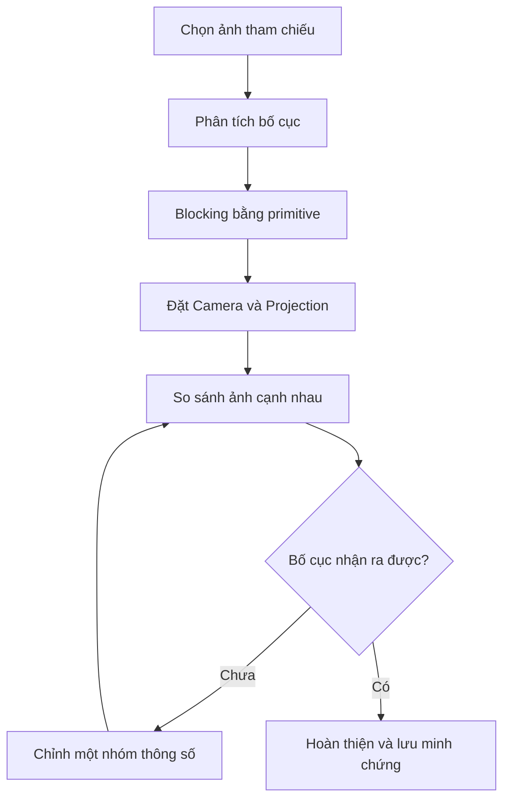

# Bài 06 — Thử thách: Tái tạo một cảnh quay tham chiếu trong Unity

> **Khóa:** Unity Creative Core · **Học phần:** Cameras · **Dạng:** Bài tập tổng hợp (exercise) · **Định hướng:** Unity 6.x
>
> **Mục đích:** Tái dựng bố cục của một khung hình từ phim/game bằng công cụ Camera và hình khối cơ bản.

**Lưu ý tương thích:** Nội dung sử dụng các khái niệm của Unity 6 và cách thiết lập phổ biến trong Unity Editor. Tên nhóm thiết lập Camera có thể khác giữa Built-in Render Pipeline, URP và HDRP. Các giá trị được nêu trong bài thực hành là ví dụ để kiểm chứng, không phải cấu hình bắt buộc cho mọi dự án.

## 1. Mục tiêu và đầu ra

**Nhiệm vụ:** chọn một khung hình tham chiếu có bố cục đủ rõ, tái dựng gần đúng trong Unity bằng các primitive hoặc asset có quyền sử dụng hợp lệ, cấu hình Camera cho phép nhận ra cảnh gốc khi đặt hai ảnh cạnh nhau. Trọng tâm là **tỷ lệ, vị trí chủ thể, góc đặt Camera, FOV/phép chiếu và cách sắp xếp vật thể**, không phải độ chi tiết model.

**Sản phẩm cần hoàn thành:** scene chạy được; ảnh tham chiếu có ghi nguồn; ảnh Game view cuối; bảng thông số Camera; ghi chú ít nhất hai lần chỉnh sửa và một quyết định nghệ thuật có lý do.

## 2. Kiến thức cần dùng

Trước khi triển khai, cần phân biệt:

| Yếu tố | Dấu hiệu trên ảnh tham chiếu | Cách điều chỉnh trong Unity |
|---|---|---|
| Phép chiếu | Đường song song có hội tụ mạnh không? | `Projection` |
| Cỡ cảnh | Chủ thể chiếm bao nhiêu khung? | Khoảng cách Camera và FOV/Size |
| Cao độ Camera | Nhìn thấy mặt trên hay mặt dưới vật? | Vị trí Y, Rotation X (tùy hệ trục scene) |
| Góc lệch ngang | Bên nào của vật xuất hiện rõ? | Vị trí X/Z, hướng quay |
| Trật tự chiều sâu | Vật nào trước, vật nào sau? | Vị trí các GameObject và Camera |
| Khung hình | 16:9, 4:3 hay tỷ lệ dọc? | Aspect ratio của Game view |
| Giới hạn hiển thị | Có vật bị cắt khỏi khung? | Framing, clipping planes |

Đừng cố bù mọi sai lệch bằng FOV. Một góc Camera chưa đúng thường không thể sửa chỉ bằng thu/phóng.

## 3. Quy trình thực hiện

### 3.1. Lựa chọn tham chiếu

Chọn ảnh có 2–5 thành phần thị giác chính và có thể tái tạo bằng khối đơn giản; ưu tiên ảnh do bạn tạo hoặc được phép dùng. Nếu sử dụng khung phim/game có bản quyền để học cá nhân, ghi rõ nguồn và chỉ chia sẻ trong phạm vi quyền sử dụng cho phép. Không mặc định được phép phân phối asset, texture hay ảnh gốc.

Phân tích bằng ghi chú: chủ thể chính nằm ở vị trí nào (tỷ lệ theo chiều ngang/dọc), đường chân trời ở đâu, vật thể nào tạo tiền cảnh, góc máy cao hay thấp, khoảng trống nằm phía nào và phương hướng nhìn của chủ thể.

### 3.2. Blocking: dựng khối trước

1. Tạo scene mới và một `Plane` làm sàn.
2. Tạo 2–5 đối tượng đơn giản: `Cube`, `Capsule`, `Cylinder`, `Sphere`; đặt đúng tương quan vị trí và kích thước lớn trước.
3. Dùng Material màu khác nhau để tách lớp tiền, trung và hậu cảnh. Chưa cần texture, animation hay VFX.
4. Chọn tỷ lệ Game view khớp tỷ lệ ảnh tham chiếu trước khi tinh chỉnh camera.

*Blocking* là giai đoạn kiểm tra hình học và bố cục, tránh sa vào chi tiết khi góc nhìn còn sai.

### 3.3. Đặt Camera theo thứ tự hợp lý

1. Chọn Perspective nếu ảnh có phối cảnh rõ; thử Orthographic nếu cần biểu đạt phẳng/chiếu trục đo.
2. Xác định độ cao Camera, vị trí ngang và hướng quay để tái tạo những mặt vật thể nhìn thấy.
3. Điều chỉnh khoảng cách Camera sao cho tỷ lệ chủ thể hợp lý.
4. Tinh chỉnh FOV/Orthographic Size, sau đó kiểm tra lại các vật tiền cảnh và hậu cảnh.
5. Chỉ khi bố cục đạt gần đúng mới chỉnh ánh sáng, màu nền và chất liệu cơ bản.

Trong Unity Editor, có thể dựng góc bằng Scene view, chọn Main Camera rồi chọn **GameObject → Align With View**. Sau thao tác đó, xem Game view và tinh chỉnh chính xác trong Inspector.

## 4. Phương pháp so sánh định lượng đơn giản

Lấy tọa độ chuẩn hóa của tâm chủ thể trên ảnh (từ 0 đến 1 theo cả hai chiều), cùng tỷ lệ kích thước chủ thể so với chiều cao ảnh. Ví dụ:

| Tiêu chí | Ảnh tham chiếu | Render | Sai lệch cần sửa |
|---|---:|---:|---|
| Tâm nhân vật theo chiều ngang | 0.33 | 0.50 | Cần dịch bố cục trái |
| Tâm nhân vật theo chiều dọc | 0.56 | 0.55 | Đã gần đúng |
| Chiều cao nhân vật / chiều cao ảnh | 0.60 | 0.42 | Chủ thể cần lớn hơn |
| Đường chân trời / chiều cao ảnh | 0.40 | 0.63 | Cần sửa góc/cao độ |

Các số trong bảng là **ví dụ minh họa phương pháp đo**, không phải kết quả thực nghiệm. Sai lệch nhỏ chưa chắc đẹp hơn nếu đường nét chính và phân cấp chủ thể không đúng; nên kết hợp chỉ số với đánh giá thị giác.

## 5. Các checkpoint

- **Checkpoint A — Hình học:** người khác có thể chỉ ra chủ thể và bố cục chính dù scene chỉ gồm primitive.
- **Checkpoint B — Phép chiếu:** mức độ hội tụ của các đường và tương quan xa–gần gần giống ảnh mẫu.
- **Checkpoint C — Framing:** các chủ thể chính ở vị trí và kích thước tương ứng; không bị cắt ngoài ý muốn.
- **Checkpoint D — Kể chuyện:** ảnh hoàn thiện truyền được điểm nhấn và không khí cơ bản của ảnh tham chiếu.

## 6. Tiêu chí đánh giá

| Tiêu chí | Trọng số gợi ý | Mô tả |
|---|---:|---|
| Bố cục tổng thể | 35% | Vị trí, tỷ lệ, khoảng trống và đường dẫn mắt |
| Góc máy và phép chiếu | 30% | Projection, độ cao, hướng Camera, cảm giác chiều sâu |
| Hình học cơ bản | 15% | Số lượng và tương quan vật thể hợp lý |
| Khả năng đọc hình | 10% | Chủ thể nhận ra được, không lỗi clipping nghiêm trọng |
| Minh chứng và diễn giải | 10% | Có ảnh cặp, tham số và lý do chỉnh sửa |

Trọng số là **rubric thực hành đề xuất**; không phải bảng chấm chính thức của Unity Learn. Tiêu chí cốt lõi của thử thách là **cảnh dựng lại có thể nhận ra khi so với ảnh tham chiếu**.

## 7. Các tình huống xử lý

- **Đúng kích thước chủ thể nhưng hậu cảnh sai:** kiểm tra khoảng cách Camera–chủ thể và FOV; xem có đang “zoom” thay vì chọn đúng vị trí Camera không.
- **Mặt trên vật thể xuất hiện quá nhiều:** góc nhìn đang quá cao hoặc quay xuống quá mạnh.
- **Một vật chặn toàn bộ chủ thể:** sửa vị trí tiền cảnh, góc lệch ngang hoặc đặt lại Camera; không vội bỏ vật nếu nó là thành phần quan trọng của tham chiếu.
- **Nhân vật bị cắt ở Camera gần:** kiểm tra Near Clip và khoảng cách đến mesh.

## 8. Gợi ý tự đánh giá (không đưa sẵn lời giải)

1. Sai lệch nào ảnh hưởng mạnh nhất đến khả năng nhận ra cảnh: phối cảnh, vị trí chủ thể hay ánh sáng? Nêu minh chứng.
2. Với cùng tỷ lệ chủ thể trên ảnh, thử một cấu hình Camera ở xa/FOV nhỏ và một cấu hình gần/FOV lớn. Hậu cảnh thay đổi thế nào?
3. Những thành phần nào có thể tối giản mà vẫn giữ được bản sắc cảnh quay?
4. Nếu chuyển cảnh sang màn hình dọc, thành phần nào nên giữ nguyên và thành phần nào cần bố cục lại?

## 9. Tài liệu tham khảo và đối chiếu

- [Unity Learn — bài 06, Creative Core: Cameras](https://learn.unity.com/course/creative-core-cameras/tutorial/challenge-recreate-the-scene?version=6.0) — mục tiêu và bối cảnh thực hành của bài.
- [Unity Scripting API — Camera](https://docs.unity3d.com/6000.0/Documentation/ScriptReference/Camera.html) — các thuộc tính `fieldOfView`, `orthographicSize`, `nearClipPlane`, `farClipPlane`, `cullingMask`.
- [Unity Learn — Creative Core Cameras, thử thách dựng cảnh](https://learn.unity.com/project/creative-core-cameras?uv=2022.3).
