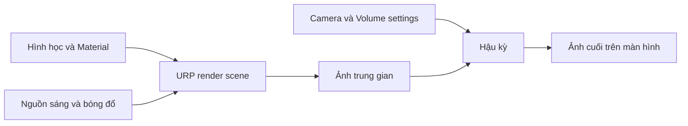
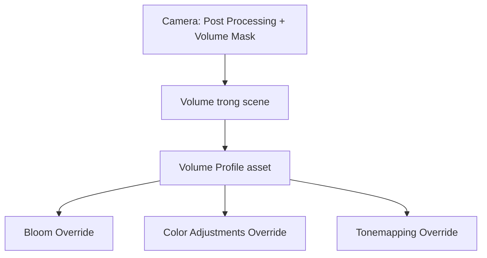

# Bài 01 — Nhập môn Post-processing trong Unity

## 1. Tóm tắt

**Post-processing** (hậu kỳ hình ảnh) là nhóm kỹ thuật tác động lên hình ảnh đã được Camera dựng, trước khi kết quả cuối cùng xuất hiện trên màn hình. Có thể hình dung nó gần với việc chỉnh màu và áp hiệu ứng cho một bức ảnh, nhưng trong game quá trình này phải chạy liên tục theo từng khung hình. Post-processing giúp thống nhất phong cách thị giác, dẫn hướng chú ý, mô phỏng đặc tính ống kính và truyền tải không khí của bối cảnh.

Bài học sử dụng **Universal Render Pipeline (URP) trên Unity 6.3**. Đây là phạm vi quan trọng: giao diện và cách cấu hình của **High Definition Render Pipeline (HDRP)** và **Built-in Render Pipeline** không hoàn toàn tương đương. URP có hệ thống hậu kỳ tích hợp, không dùng chung quy trình của gói Post Processing Stack v2 cũ.

**Kết quả cần đạt:** tạo một scene thử nghiệm, kích hoạt post-processing cho Camera, tạo Global Volume với Bloom, quan sát và giải thích được sự khác nhau trước/sau.

## 2. Mục tiêu học tập

Sau bài này, người học có thể:

1. **Giải thích** hậu kỳ hình ảnh ảnh hưởng tới ảnh cuối như thế nào và giới hạn của nó.
2. **Phân biệt** vai trò của Camera, Volume, Volume Profile và Volume Override trong URP.
3. **Cấu hình** một hiệu ứng Bloom đơn giản và kiểm chứng kết quả tại Game view.
4. **Đánh giá** khi nào nên dùng hậu kỳ thay vì chỉnh nguồn sáng, Material hoặc mô hình 3D.
5. **Chẩn đoán** một số nguyên nhân khiến hiệu ứng không xuất hiện.

## 3. Cơ chế và vị trí trong đồ họa thời gian thực

Một scene 3D chứa hình học, Material, nguồn sáng và nhiều thành phần khác. Camera tạo ra ảnh sau khi render những đối tượng nhìn thấy. Post-processing tác động lên dữ liệu ảnh đó, chẳng hạn làm lóe vùng sáng hoặc điều chỉnh màu sắc. Quy trình tổng quát:

Sơ đồ mô tả **mô hình tư duy**, không phải trình tự kỹ thuật chính xác của mọi render pass. Trong URP, một số phép biến đổi màu, khử răng cưa và xử lý HDR có thứ tự và điểm thực thi riêng.

Post-processing khác với các thao tác sau:

| Kỹ thuật | Dữ liệu tác động | Ví dụ |
|---|---|---|
| Lighting | Ánh sáng chiếu vào bề mặt, đóng góp chiếu sáng | Directional Light, điểm sáng |
| Material/Shader | Cách bề mặt phản xạ, phát sáng, trong suốt | Metallic, Smoothness, Emission |
| VFX | Hiện tượng được mô phỏng hoặc vẽ trong scene | Khói, tia lửa, bụi |
| Post-processing | Ảnh Camera đã dựng và dữ liệu đi kèm | Bloom, Color Adjustments, Depth of Field |

**Nguyên tắc:** hậu kỳ không thay thế mô hình, chiếu sáng, texture và bố cục cơ bản. Ví dụ, tăng Bloom không làm một chiếc đèn thực sự chiếu sáng những vật xung quanh; muốn vậy phải cấu hình nguồn sáng/lighting phù hợp.

## 4. Hệ thống Volume trong URP

URP điều khiển hậu kỳ chủ yếu thông qua **Volume framework**.

| Thành phần | Vai trò |
|---|---|
| `Camera` | Tạo ảnh, có tùy chọn `Post Processing` và `Volume Mask`. |
| `Volume` | Xác định bộ thiết lập nào tác động tới Camera và mức ảnh hưởng. |
| `Volume Profile` | Asset lưu cấu hình các hiệu ứng; có thể tham chiếu từ nhiều Volume. |
| `Volume Override` | Nhóm thiết lập cụ thể, ví dụ `Bloom` hoặc `Color Adjustments`. |
| Override checkbox | Quyết định một thuộc tính có thật sự tham gia ghi đè/blend hay không. |

**Global Volume** ảnh hưởng tới Camera trong toàn scene (miễn là thỏa điều kiện bật hậu kỳ, Layer và trọng số). **Local Volume** chỉ ảnh hưởng theo vùng không gian xác định bởi Collider, có thể hòa trộn dần ở biên. Unity cũng có các Volume mặc định ở cấp dự án/chất lượng; vì vậy không phải cứ không thấy Global Volume trong Hierarchy là scene hoàn toàn không có thiết lập Volume.

## 5. Các hiệu ứng tiêu biểu

### 5.1. Bloom — quầng sáng

Bloom tạo vùng lóe xung quanh điểm ảnh sáng, giúp vật phát sáng có cảm giác rực rỡ hơn.

- `Threshold`: ngưỡng độ sáng để điểm ảnh tham gia Bloom; tăng ngưỡng sẽ chọn lọc các vùng sáng mạnh hơn.
- `Intensity`: độ mạnh của hiệu ứng.
- `Scatter`: mức lan rộng của quầng sáng.
- `Tint`: màu nhuộm quầng sáng.

Bloom hữu ích cho đèn neon, màn hình hologram, ánh sáng ma thuật. Nó **không** thay thế `Emission` trên Material hay nguồn sáng chiếu vào bề mặt khác. Một scene quá sáng có thể bị Bloom tràn, giảm khả năng đọc hình.

### 5.2. Color Adjustments — chỉnh màu tổng thể

Các thuộc tính phổ biến gồm `Post Exposure`, `Contrast`, `Color Filter`, `Hue Shift`, `Saturation`. Ví dụ, giảm Saturation và tăng nhẹ Contrast có thể tạo cảm giác u ám. Nhưng độ tương phản quá cao dễ làm mất chi tiết ở vùng sáng/tối.

### 5.3. Tonemapping — ánh xạ dải sáng

Tonemapping điều chỉnh cách các giá trị màu/độ sáng trong xử lý HDR được chuyển thành ảnh phù hợp với đầu ra. URP có các chế độ như `Neutral` và `ACES`. `Neutral` phù hợp khi muốn ảnh hưởng ít hơn tới sắc độ; `ACES` có đặc điểm màu/độ tương phản khác và thường được chọn cho phong cách điện ảnh. Không có chế độ nào tốt nhất cho mọi scene.

### 5.4. Vignette, Depth of Field và Motion Blur

- `Vignette`: thay đổi độ sáng/màu về phía rìa khung hình, hữu ích để định hướng sự chú ý.
- `Depth of Field`: làm mờ các khoảng cách ngoài vùng nét, hữu ích cho cận cảnh hoặc kể chuyện bằng tiêu điểm.
- `Motion Blur`: mô phỏng hiệu ứng nhòe chuyển động, cần dùng có chủ đích để tránh giảm độ rõ và gây khó chịu.

**Phân biệt quan trọng:** các hiệu ứng sương mù hoặc Ambient Occlusion không phải lúc nào cũng là `Volume Override` theo cùng cách giữa các render pipeline. Trên URP, hãy tra tài liệu của từng tính năng thay vì suy luận từ HDRP hoặc các hướng dẫn Post Processing Stack v2.

## 6. Thực hành: tạo hậu kỳ đầu tiên

### 6.1. Chuẩn bị

- Dùng Unity 6.3 với **URP** đã được gán cho project.
- Tạo một scene có mặt sàn, vài khối 3D, một Camera và một vật thể có vùng sáng rõ ràng (chẳng hạn Material sử dụng Emission).
- Lưu scene với tên `PostProcessing_Intro`.
- Mở `Game view` để quan sát đầu ra của Camera. Scene view có công tắc hiệu ứng riêng, vì thế không nên dùng Scene view làm bằng chứng duy nhất.

### 6.2. Thực hiện

1. Chọn `Main Camera` trong `Hierarchy`; ở `Inspector`, bật tùy chọn **Post Processing** trong phần Rendering của Camera.
2. Chọn `GameObject > Volume > Global Volume` để thêm Volume vào scene.
3. Chọn đối tượng Global Volume. Trong component `Volume`, chọn **New** để tạo `Volume Profile`.
4. Chọn **Add Override**, tìm `Bloom` và thêm nó vào Profile.
5. Bật các ô ghi đè cho thuộc tính bạn muốn thay đổi; chỉnh `Intensity`, `Threshold`, `Scatter` theo từng lần thử.
6. So sánh Game view khi bật/tắt hiệu ứng. Chỉ thay đổi **một thông số mỗi lần**, ghi nhận vùng nào bị tác động.
7. Chụp hai ảnh màn hình cùng vị trí Camera, cùng Lighting và độ phân giải.

**Thông số khám phá (không phải preset bắt buộc):** bắt đầu với ngưỡng gần `0.9`, độ mạnh Bloom nhỏ và tăng dần đến khi dễ thấy nhưng không che chi tiết. Kết quả phụ thuộc HDR, độ sáng cảnh, Material và cấu hình pipeline, vì vậy không bảo đảm cùng giá trị sẽ cho cùng hình ảnh ở mọi project.

### 6.3. Kiểm chứng

| Thử nghiệm | Quan sát cần ghi nhận | Kết luận cần giải thích |
|---|---|---|
| Tắt/Bật `Post Processing` trên Camera | Có/không có hiệu ứng | Camera phải cho phép xử lý hậu kỳ. |
| Giảm `Bloom Intensity` về 0 | Quầng sáng mất đi | Intensity điều khiển mức tác động của Bloom. |
| Tăng `Bloom Threshold` | Ít vùng tham gia hơn | Bloom chọn điểm ảnh sáng theo ngưỡng. |
| Tắt checkbox của một thuộc tính Override | Thuộc tính đó không ghi đè | Có hiệu ứng trong Profile chưa đủ; cần bật override thích hợp. |

## 7. Phân tích lỗi và giới hạn

| Hiện tượng | Nguyên nhân cần kiểm tra | Cách xác minh |
|---|---|---|
| Không thấy Bloom | Camera chưa bật Post Processing | Kiểm tra Camera trong Inspector. |
| Có Volume nhưng hiệu ứng không áp dụng | `Volume Mask` loại trừ Layer chứa Volume | Đối chiếu Layer của GameObject và Volume Mask của Camera. |
| Thêm Override nhưng thay đổi không có tác dụng | Checkbox của property chưa bật hoặc giá trị không khác đáng kể | Kích hoạt ô Override, tăng/giảm từng tham số. |
| Có hiệu ứng trong Scene view nhưng Game view khác | Hai chế độ nhìn có tùy chọn và Camera khác nhau | Ưu tiên Game view, kiểm tra camera thực. |
| Bloom quá chói | Vùng sáng quá nhiều, ngưỡng thấp hoặc Intensity cao | So sánh ảnh trước/sau, giảm lần lượt các yếu tố. |
| FPS giảm | Post-processing bổ sung chi phí GPU | Đo bằng Profiler/Frame Debugger và bản build thiết bị đích. |

**Tiêu chí lựa chọn:** chỉ thêm hậu kỳ nếu nó giúp đạt một mục tiêu thị giác cụ thể; cân bằng tác động thẩm mỹ với tính dễ đọc, cảm giác người chơi và chi phí render.

## 8. Bài tập củng cố

Tạo hai biến thể cùng một scene: một cảnh **ấm áp, dịu nhẹ** và một cảnh **lạnh, bí ẩn**. Chỉ được điều chỉnh Bloom và Color Adjustments ở bước đầu. Giữ cố định Camera và nguồn sáng để phân tích tác động riêng của hậu kỳ. Ghi lại ba thông số đã thay đổi và một nguy cơ về khả năng quan sát của từng biến thể.

## 9. Câu hỏi ôn tập

**Câu 1.** Tình huống nào phù hợp nhất để dùng Bloom?

A. Làm một ngọn đèn thật sự chiếu sáng mặt bàn.  
B. Thay đổi topology của mô hình.  
C. Tạo quầng sáng quanh vùng hình ảnh có cường độ cao.  
D. Tính đường đi của NPC.

**Đáp án:** C. **Giải thích:** Bloom xử lý hình ảnh đã render; chiếu sáng bề mặt khác cần cấu hình Lighting.

**Câu 2.** Camera đã bật Post Processing nhưng Volume không có tác dụng. Điều gì nên kiểm tra trước?

A. Volume Mask có bao gồm Layer của Volume không.  
B. Có đủ Rigidbody trong scene không.  
C. Kích thước file texture có là số nguyên tố không.  
D. Số lượng Animation Clip.

**Đáp án:** A. **Giải thích:** Camera chỉ lấy Volume thuộc các Layer mà Volume Mask cho phép.

**Câu 3.** Vai trò của Volume Profile là gì?

A. Lưu mesh của từng GameObject.  
B. Xác định hệ tọa độ thế giới.  
C. Sinh Collider của Camera.  
D. Lưu các Volume Override và thiết lập của chúng.

**Đáp án:** D. **Giải thích:** Profile là asset chứa cấu hình; Volume tham chiếu Profile để áp dụng.

**Câu 4.** Khi muốn đánh giá ảnh hưởng riêng của Bloom Intensity, cách làm nào đáng tin cậy nhất?

A. Thay cùng lúc Bloom, Lighting và Camera.  
B. Giữ các yếu tố khác cố định và chỉ đổi Intensity.  
C. Chỉ xem ảnh của Scene view ở hai góc khác nhau.  
D. Tắt toàn bộ Material.

**Đáp án:** B. **Giải thích:** Kiểm soát các biến khác cho phép suy luận tác động của thông số vừa thay.

**Câu 5.** Phát biểu nào đúng về Post-processing?

A. Có thể thay thế tất cả nguồn sáng trong scene.  
B. Bắt buộc dùng riêng gói Post Processing Stack v2 với URP.  
C. Không bao giờ ảnh hưởng tới hiệu năng.  
D. Tác động lên ảnh cuối và nên được đánh giá cùng mục tiêu thị giác lẫn chi phí render.

**Đáp án:** D. **Giải thích:** Hậu kỳ tạo nhiều hiệu ứng hữu ích nhưng không thay thế Lighting và có thể tiêu tốn GPU.

## 10. Tổng kết

Hậu kỳ là bước quan trọng trong việc tạo phong cách cho scene, nhưng chỉ hiệu quả khi Camera, Lighting, Material và bố cục đã đủ rõ ràng. Trên URP, hãy ghi nhớ mối quan hệ **Camera → Volume → Profile → Override**, và thực hiện kiểm chứng có kiểm soát thay vì chỉ tăng thông số cho đến khi hình ảnh trông “đẹp hơn”.

## 11. Tài liệu tham khảo và đối chiếu

- [Unity Learn — Creative Core: Post-processing](https://learn.unity.com/course/creative-core-post-processing) — mục tiêu học tập của học phần.
- [Unity 6.3 — Add post-processing in URP](https://docs.unity.com/en-us/engine/6000.3/manual/post-processing-and-full-screen-effects/urp/add-post-processing) — quy trình thiết lập chính thức.
- [Unity 6.3 — Volume component reference](https://docs.unity.com/en-us/engine/6000.3/manual/post-processing-and-full-screen-effects/urp/volumes-landing-page/volume-component-reference) — Global/Local, Weight, Priority, Blend Distance.
- [Unity 6.3 — Post-processing effect availability](https://docs.unity.com/en-us/engine/6000.3/manual/post-processing-and-full-screen-effects/effect-availability-reference) — phân biệt URP, HDRP và PPv2.
- [Unity 6.3 — Bloom reference](https://docs.unity.com/en-us/engine/6000.3/manual/post-processing-and-full-screen-effects/urp/effect-list/bloom) — ý nghĩa các thông số Bloom.

*Bài học tiếng Việt được biên soạn độc lập dựa trên chủ đề học phần và tài liệu kỹ thuật chính thức; không phải bản dịch nguyên văn hay lời giải chính thức của Unity Learn.*
