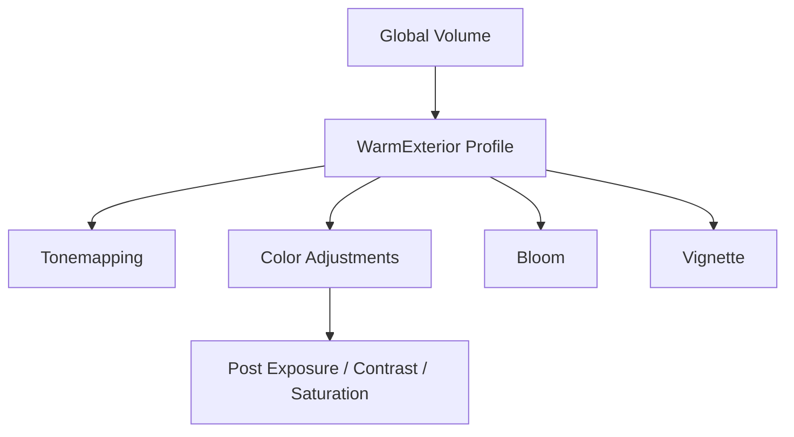

# Bài 02 — Xây dựng Volume Profile và phong cách hình ảnh

## 1. Tổng quan

Một bộ hậu kỳ hiệu quả không được hình thành bằng cách bật tất cả hiệu ứng. Nó phải xuất phát từ một **ý đồ thị giác**: người xem cần chú ý vào đâu, cảnh có trạng thái cảm xúc gì, những bề mặt nào cần nhấn mạnh, và người chơi có còn đọc rõ tương tác không? `Volume Profile` biến ý đồ đó thành một tập tham số có thể lưu, sử dụng lại, thử nghiệm và quản lý như các asset khác trong Unity.

Bài thực hành này triển khai hệ thống Volume trên **Unity 6.3 + URP**, xây dựng hai biến thể thị giác và dùng phép so sánh có kiểm soát để chọn cấu hình cuối. Các thiết lập/giá trị được gợi ý chỉ là điểm xuất phát thử nghiệm, không phải ngưỡng được Unity khuyến nghị cho tất cả project.

## 2. Mục tiêu

- **Tạo** Volume Profile chứa nhiều Volume Override thích hợp cho một scene.
- **Phân biệt** sự khác nhau giữa thêm Override và bật cờ ghi đè cho từng thuộc tính.
- **Hiệu chỉnh** Bloom, Tonemapping, Color Adjustments và Vignette theo một mục tiêu hình ảnh cụ thể.
- **So sánh** ít nhất hai phương án khi Camera, Lighting và bố cục được giữ nguyên.
- **Đo và báo cáo** sự thay đổi hiệu năng bằng điều kiện thử nhất quán.

## 3. Kiến thức nền

### 3.1. Volume, Profile và Override

Một `Volume` tham chiếu `Volume Profile`; trong Profile, mỗi `Volume Override` gom những thuộc tính của một hiệu ứng. Ví dụ, Profile `WarmExterior` có thể chứa:

Profile thường là **asset có thể chia sẻ**: nếu hai Volume cùng tham chiếu một asset và bạn chỉnh asset đó, cả hai cùng nhận thay đổi. Khi cần các biến thể độc lập, hãy tạo bản Profile riêng hoặc dùng tính năng nhân bản asset thích hợp.

Mỗi thuộc tính trong Override có một **checkbox**. Giá trị hiển thị trong Inspector nhưng checkbox chưa bật chưa có nghĩa là giá trị ấy sẽ được áp dụng khi hòa trộn Volumes. Đây là một trong những nguyên nhân phổ biến khiến người mới chỉnh tham số mà không thấy khác biệt.

### 3.2. Phân vai hiệu ứng

| Hiệu ứng | Điều khiển chính | Tác dụng thường gặp | Dấu hiệu lạm dụng |
|---|---|---|---|
| `Tonemapping` | `Mode` | Nén dải sáng, định hình tương phản và sắc màu đầu ra | Vùng sáng/tối mất chi tiết, tông màu lệch ý đồ |
| `Color Adjustments` | `Post Exposure`, `Contrast`, `Saturation`, `Color Filter`, `Hue Shift` | Chỉnh sáng, tương phản, độ rực và màu tổng thể | Vật quan trọng khó phân biệt với nền |
| `Bloom` | `Threshold`, `Intensity`, `Scatter` | Quầng sáng cho vùng sáng mạnh | Ảnh mờ, viền vật thể khó đọc |
| `Vignette` | `Intensity`, `Smoothness`, `Color` | Giảm sáng/màu ở rìa khung hình | Che HUD, tạo cảm giác nhìn qua ống quá rõ |
| `Depth of Field` | `Mode` cùng tham số tương ứng | Điều khiển vùng nét theo khoảng cách | Làm mờ vật thể người chơi cần quan sát |

`Depth of Field` trong URP có các chế độ `Gaussian` và `Bokeh`. Chế độ Gaussian dùng dải `Start`, `End` của vùng mờ phía xa; Bokeh dùng thông số mô phỏng ống kính như `Focus Distance`, `Focal Length`, `Aperture`. **Không nhầm `Focus Distance` của Bokeh với `Start/End` của Gaussian.**

## 4. Chuẩn bị dự án

1. Mở scene URP có ít nhất ba vùng giá trị rõ ràng: vùng rất sáng, vùng trung gian, vùng tối. Có thể đặt một khối phát sáng (Material `Emission`), một vật chính và một nền tối hơn.
2. Cố định vị trí Camera, thời điểm chiếu sáng, độ phân giải Game view và thiết lập Quality trong thời gian so sánh.
3. Xác nhận `Main Camera > Post Processing` đã bật, và `Volume Mask` có chứa Layer của Global Volume.
4. Tạo folder trong `Assets`, ví dụ `Assets/Art/PostProcessing/`, để dễ quản lý các Profile.
5. Chụp ảnh **Baseline** trước khi chỉnh hậu kỳ. Đừng bỏ qua bước này: nếu không có baseline thì không thể kết luận hiệu ứng nào thật sự cải thiện kết quả.

## 5. Các bước triển khai

### 5.1. Tạo Profile ban đầu

1. Chọn `GameObject > Volume > Global Volume` (nếu scene chưa có Volume cần thiết).
2. Trong Inspector của Volume, bấm **New** ở `Profile` để tạo asset.
3. Đặt tên và lưu Profile theo phong cách nhất quán, chẳng hạn `PP_Exterior_Warm`.
4. Chọn **Add Override** để thêm `Tonemapping`, `Color Adjustments`, `Bloom`, `Vignette`.
5. Với từng Override, chỉ bật những property thực sự cần điều chỉnh. Ví dụ, muốn đổi Saturation thì bật checkbox sát `Saturation`.

**Checkpoint 1:** Inspector có một Volume tham chiếu đúng Profile; Camera bật Post Processing; Game view thay đổi được khi hiệu chỉnh một thuộc tính đã bật Override.

### 5.2. Tạo phong cách ấm áp

Xác định trước ý đồ: cảnh chiều muộn, ánh sáng mềm, màu ấm, vẫn đọc được hình dạng của vật chính.

- `Tonemapping`: thử `Neutral` hoặc `ACES`, quan sát vùng highlight trước khi quyết định.
- `Color Adjustments`: tăng hoặc giảm nhẹ Saturation và Contrast; điều chỉnh Color Filter ấm **chỉ khi cần** vì nó ảnh hưởng toàn ảnh.
- `Bloom`: chọn vùng sáng nổi bật, bắt đầu với Intensity thấp; chỉ tăng nếu ánh sáng phát ra chưa đủ trực quan.
- `Vignette`: dùng nhẹ để dẫn mắt về giữa khung hình, không che UI.

Nên tuân theo thứ tự: **xác lập dải sáng → xử lý màu → tạo quầng sáng → nhấn vùng nhìn**. Đây là một quy trình biên tập thực hành, không phải trình tự render pass bắt buộc trong URP.

### 5.3. Tạo phong cách lạnh, bí ẩn

Sao chép Profile thành `PP_Exterior_Mysterious` và chỉnh khác phương án ấm áp. Có thể giảm Saturation, thay đổi cân bằng màu, kiểm soát vùng sáng bằng Bloom vừa phải và dùng Vignette nhẹ. Không dùng `Post Exposure` quá thấp để cố tạo không khí u tối: người chơi phải nhìn thấy nhân vật, lối đi và đối tượng tương tác.

**Checkpoint 2:** Có hai asset Profile riêng, có thể gán luân phiên cho Volume mà không bị chỉnh sửa đồng thời ngoài ý muốn.

### 5.4. So sánh có kiểm soát

Tạo một bảng kiểm thử như sau:

| Tiêu chí | Profile A | Profile B | Bằng chứng |
|---|---|---|---|
| Độ rõ nhân vật chính | Điền quan sát | Điền quan sát | Ảnh cùng góc Camera |
| Nhận diện vật tương tác | Điền quan sát | Điền quan sát | Vùng crop 100% |
| Cảm giác không khí | Điền quan sát | Điền quan sát | Nhận xét có lý do |
| Giữ chi tiết highlight/shadow | Điền quan sát | Điền quan sát | Ảnh trước/sau |
| Thời gian khung hình trên GPU | Số đo thực tế | Số đo thực tế | Profiler/bản build |

Đừng tự điền FPS/chi phí GPU nếu chưa đo. Khi đánh giá hiệu năng, so sánh cùng scene, camera, độ phân giải, thiết bị, chất lượng và khoảng thời gian lấy mẫu. Một thay đổi về FPS tổng **không chứng minh** rằng post-processing là nút thắt; hãy kiểm tra GPU profiling và các render pass liên quan.

## 6. Thử nghiệm nâng cao: ảnh hưởng của Layer và trọng số

### 6.1. Volume Mask

Đặt Volume lên Layer riêng, ví dụ `PostProcessing`, rồi bật/tắt Layer đó trong `Camera > Volume Mask`. Khi bỏ chọn Layer, Camera sẽ không lấy Volume ấy. `Volume Mask` **không đồng nghĩa** với `Culling Mask`: một cái chọn Volume dùng để điều khiển hậu kỳ, cái kia quyết định đối tượng nào được Camera render.

### 6.2. Weight và Priority

- `Weight` trong khoảng 0–1 điều chỉnh mức đóng góp của một Volume; gần 0 tức là ít/không đóng góp, gần 1 là đầy đủ theo điều kiện của Volume.
- `Priority` hỗ trợ xác định thứ tự/ưu tiên khi có nhiều Volume cùng tác động. Đừng trông chờ việc đặt Priority cao sẽ tự động bảo đảm hình ảnh cuối đúng ý nếu Weight, vị trí và property override không phù hợp.
- Với `Local Volume`, `Blend Distance` điều chỉnh vùng chuyển tiếp gần biên Collider; ý nghĩa cụ thể sẽ được sử dụng trong bài thử thách.

## 7. Debug và tối ưu

| Vấn đề | Quy trình kiểm tra |
|---|---|
| Profile thay đổi nhưng ảnh đứng yên | Kiểm tra Camera Post Processing → Volume Mask → checkbox Override → Weight. |
| Cả hai phương án thay đổi cùng lúc | Xác định chúng có đang dùng **chung một Profile asset** hay không. |
| Hình ảnh rực nhưng mất chủ thể | Tắt từng Override, kiểm tra hiệu ứng gây nhiễu thị giác, giảm mức tác động. |
| Dải sáng bị cắt khó đọc | Kiểm tra Tonemapping, Post Exposure, Material và nguồn sáng; so sánh với baseline. |
| Chuyển sang thiết bị yếu thì giật | Đo bản build thực tế; cân nhắc giảm chất lượng Bloom hoặc bỏ bớt hiệu ứng đắt. |

Trên thiết bị hạn chế tài nguyên, hiệu ứng nặng như Depth of Field hoặc Motion Blur cần được kiểm tra đặc biệt cẩn thận. Không thể suy ra chi phí từ tên hiệu ứng: cấu hình, độ phân giải và phần cứng quyết định kết quả đo.

## 8. Sản phẩm và checklist

**Sản phẩm nộp:** scene URP; hai Volume Profile độc lập; ảnh baseline và hai ảnh profile; bảng nhận xét; tối thiểu một phép đo hiệu năng có ghi điều kiện đo (nếu có thiết bị/bản build phù hợp).

- [ ] Camera bật `Post Processing`, Volume Mask đúng.
- [ ] Có hai Profile khác nhau và cách chuyển đổi rõ ràng.
- [ ] Có tối thiểu ba Override thực sự có tác dụng.
- [ ] Đã thử checkbox ghi đè và Weight để chứng minh hiểu cơ chế.
- [ ] Có so sánh ở cùng điều kiện render.
- [ ] Đã giải thích được lựa chọn thẩm mỹ và tác động tới khả năng quan sát.

## 9. Câu hỏi ôn tập

**Câu 1.** Hai Volume sử dụng chung Profile. Sau khi sửa asset Profile, điều gì có thể xảy ra?

A. Chỉ Volume được chọn hiện tại đổi.  
B. Cả hai Volume có thể nhận thiết lập đã sửa.  
C. Unity buộc tạo lại Camera.  
D. Collider tự thay đổi kích thước.

**Đáp án:** B. **Giải thích:** Profile là asset được tham chiếu và có thể được nhiều Volume dùng lại.

**Câu 2.** Đã nhập Saturation nhưng không thấy thay đổi. Giả thuyết phù hợp nhất là gì?

A. Scene không thể chứa Material.  
B. Layer của vật chính sai tag.  
C. URP không hỗ trợ Saturation.  
D. Checkbox override của Saturation chưa bật.

**Đáp án:** D. **Giải thích:** Thuộc tính không được bật Override sẽ không tham gia hòa trộn theo Profile.

**Câu 3.** Muốn mô phỏng vùng tiêu điểm bằng thông số `Focus Distance` và `Aperture`, nên sử dụng cấu hình nào?

A. `Depth of Field` ở chế độ `Bokeh`.  
B. `Bloom` với Threshold cao.  
C. `Color Adjustments` với Saturation thấp.  
D. `Vignette` với Intensity cao.

**Đáp án:** A. **Giải thích:** Đây là các tham số quang học dùng bởi Bokeh Depth of Field.

**Câu 4.** Kế hoạch kiểm thử nào cho phép so sánh chi phí hai Profile đáng tin cậy hơn?

A. So FPS của hai máy khác nhau.  
B. Đo trong hai scene không giống nhau.  
C. Giữ cùng thiết bị, scene, camera và độ phân giải; đo frame time.  
D. Chỉ nhìn độ sáng ảnh.

**Đáp án:** C. **Giải thích:** Điều kiện giống nhau hạn chế yếu tố gây nhiễu.

**Câu 5.** Phát biểu đúng về `Volume Mask` là gì?

A. Quyết định Collider được dùng để tính Physics.  
B. Lọc Layer của các Volume ảnh hưởng tới Camera.  
C. Thay thế toàn bộ `Culling Mask`.  
D. Thiết lập trực tiếp độ sáng của Bloom.

**Đáp án:** B. **Giải thích:** Volume Mask xác định lớp Volume có thể tham gia tính toán hiệu ứng cho Camera.

## 10. Tổng kết

Xây dựng Profile tốt là quá trình **đặt mục tiêu → chọn hiệu ứng → chỉnh một biến → kiểm chứng → so sánh → tối ưu**. Tư duy này giúp tránh việc lạm dụng hậu kỳ và tạo ra những lựa chọn thị giác có thể giải thích, tái sử dụng và đánh giá khách quan.

## 11. Tài liệu tham khảo và đối chiếu

- [Unity 6.3 — Create a Volume Profile in URP](https://docs.unity.com/en-us/engine/6000.3/manual/post-processing-and-full-screen-effects/urp/volumes-landing-page) — xem mục `Create a Volume Profile`.
- [Unity 6.3 — Configure Volume Overrides](https://docs.unity.com/en-us/engine/6000.3/manual/post-processing-and-full-screen-effects/urp/volumes-landing-page/volume-overrides) — checkbox và thuộc tính ghi đè.
- [Unity 6.3 — Color Adjustments](https://docs.unity.com/en-us/engine/6000.3/manual/post-processing-and-full-screen-effects/urp/effect-list/color-adjustments).
- [Unity 6.3 — Depth of Field](https://docs.unity.com/en-us/engine/6000.3/manual/post-processing-and-full-screen-effects/urp/effect-list/depth-of-field-urp/volume-override-reference).
- [Unity 6.3 — Camera Inspector, Volume Mask và Volume Trigger](https://docs.unity.com/en-us/engine/6000.3/manual/cameras/urp/camera-components-reference/camera-component-reference).

*Tài liệu tự biên soạn nhằm hỗ trợ thực hành; thông số đề xuất không phải thiết lập bắt buộc hoặc kết quả kiểm thử đã được đo.*
