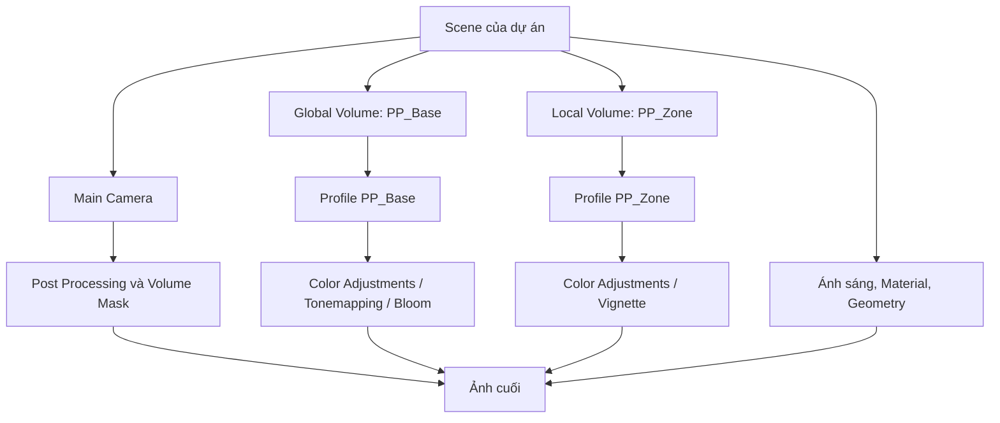

# Bài 04 — Áp dụng Post-processing vào dự án Unity

## 1. Bài toán

Một scene có ánh sáng, Material và mô hình đủ tốt vẫn có thể chưa truyền đạt được cảm xúc mong muốn. Trong một dự án game, hậu kỳ cần phục vụ **ý đồ hình ảnh và trải nghiệm người chơi**, không chỉ là bộ lọc làm ảnh rực rỡ. Mục tiêu của bài này là đưa các kỹ thuật URP post-processing vào một dự án hướng dẫn (guided project) hoặc scene tự tạo có phạm vi tương đương.

**Sản phẩm cuối:** ít nhất một scene hoàn chỉnh về hiệu ứng hậu kỳ, bao gồm phong cách nền (Global Volume), một biến đổi theo vị trí (Local Volume), dữ liệu so sánh trước/sau và kế hoạch đánh giá hiệu năng/khả năng quan sát.

Bạn có thể chọn bối cảnh **phòng triển lãm, khu phố ban đêm hoặc đường dẫn vào hang động**. Sự lựa chọn không làm thay đổi các yêu cầu kỹ thuật chính.

## 2. Mục tiêu và phạm vi

Sau dự án, người học có thể:

- **Thiết kế** một bảng định hướng thị giác gồm mục tiêu, chủ thể, tông màu và các rủi ro cần tránh.
- **Áp dụng** Global/Local Volume cho các trạng thái hình ảnh khác nhau.
- **Tổ chức** các asset Profile để dễ tái sử dụng và sửa đổi.
- **Đo lường** và kiểm thử chất lượng ảnh lẫn hiệu năng ở điều kiện có thể lặp lại.
- **Trình bày** lựa chọn hậu kỳ bằng ảnh minh chứng và lý do rõ ràng.

Bài tập này chỉ tập trung vào hậu kỳ; không yêu cầu phải xây một hệ thống gameplay, UI hoặc mô hình phức tạp mới. Nếu scene chưa có đối tượng để quan sát, dùng primitive và Material đơn giản vẫn đủ để đánh giá kỹ thuật.

## 3. Thiết kế giải pháp

### 3.1. Bảng định hướng hình ảnh

Trước khi mở Inspector, điền các câu hỏi:

| Nội dung | Ví dụ cho khu phố đêm | Quyết định cần đưa ra |
|---|---|---|
| Chủ thể | Cửa hàng sáng đèn | Người chơi có nhìn ra cửa hàng không? |
| Tông cảm xúc | Lạnh, hơi bí ẩn nhưng dễ đọc | Tương phản, Saturation, Color Filter ra sao? |
| Điểm nhấn | Biển hiệu neon | Bloom đến mức nào là đủ? |
| Khu vực đặc biệt | Ngõ tối | Có cần Local Volume với chuyển tiếp nhẹ không? |
| Giới hạn | UI và biển chỉ đường vẫn rõ | Có lạm dụng Vignette, DoF không? |

**Phân định trách nhiệm:** điều chỉnh hình khối bằng Model/Camera, ánh sáng thực bằng Lighting, bề mặt bằng Material và cảm giác ảnh cuối bằng Post-processing. Khi một vật thể không nổi bật do bố cục hoặc chiếu sáng sai, không nên mặc định sửa bằng cách tăng Bloom.

### 3.2. Kiến trúc scene đề xuất



Sơ đồ thể hiện mối quan hệ chức năng, không phải luồng kết xuất nội bộ. Local Volume có thể cùng ảnh hưởng với Global Volume; kết quả phụ thuộc vị trí Volume Trigger, Blend Distance, Weight, Priority và các property đã được bật Override.

Đặt tên asset rõ ràng, ví dụ:

```text
Assets/
  Art/
    PostProcessing/
      PP_Base.asset
      PP_Zone.asset
  Scenes/
    GuidedProject_PostProcessing.unity
  Scripts/
    (chỉ dùng nếu cần điều khiển bằng script)
```

Cấu trúc trên là **gợi ý tổ chức**, không phải quy định thư mục của Unity.

## 4. Các mốc triển khai

### 4.1. Mốc 1 — Khảo sát và khóa baseline

1. Mở scene của guided project và xác định rõ Render Pipeline đang sử dụng; phần triển khai dưới đây dành cho **URP**.
2. Chụp ảnh baseline tại Camera cố định; ghi độ phân giải Game view, Quality, thiết bị và phiên bản Unity.
3. Chọn ít nhất một **chủ thể chính**, một vùng sáng và một vùng tối để kiểm tra Bloom/Contrast.
4. Xác định tiêu chí có thể quan sát: “người xem phân biệt được chủ thể với nền”, “biển chỉ đường vẫn dễ đọc”, “không mất chi tiết sáng”.

**Checkpoint:** có ảnh baseline và mục tiêu hình ảnh một đoạn ngắn, trước khi chỉnh Profile.

### 4.2. Mốc 2 — Xây dựng Global Volume

1. Bật `Post Processing` trên Camera và kiểm tra `Volume Mask`.
2. Tạo `Global Volume`, gán một Profile riêng tên `PP_Base`.
3. Chọn một số Override có mục đích, thường bắt đầu bằng Tonemapping và Color Adjustments; chỉ thêm Bloom nếu có vùng sáng cần nhấn.
4. Tắt/bật lần lượt từng Override để xác định nó đang đóng góp gì.
5. Thay đổi một tham số mỗi lần; sau mỗi lần chỉnh, xem lại chủ thể chính và các vùng highlight/shadow.

**Checkpoint:** khi tắt Global Volume, có sự khác biệt thị giác có thể giải thích, nhưng cảnh vẫn ổn về mặt Lighting/Material.

### 4.3. Mốc 3 — Xây dựng Local Volume theo bối cảnh

1. Xác định ranh giới vùng thay đổi: cổng, hành lang, phòng, hoặc một khu vực sự kiện.
2. Tạo `Box Volume` (hoặc Local Volume cùng Collider thích hợp), đặt Collider bao quanh khu vực mong muốn và bật `Is Trigger`.
3. Gán Profile riêng `PP_Zone`; tránh sửa nhầm Profile nền.
4. Dùng `Blend Distance` tạo độ mượt phù hợp với vận tốc Camera/nhân vật; cân nhắc `Weight` và `Priority` nếu có các Volume khác chồng nhau.
5. Thử đường đi: xa vùng → rìa vùng → trong vùng → ra khỏi vùng.
6. Nếu Camera nhìn theo nhân vật từ xa, kiểm tra `Volume Trigger` đang đặt theo Camera hay nhân vật để kết quả thay đổi theo vị trí mong muốn.

**Checkpoint:** có video hoặc chuỗi ảnh cho thấy thay đổi hậu kỳ **phụ thuộc vị trí**; không phải do thay đổi thiết lập thủ công khi đang test.

### 4.4. Mốc 4 — Đánh giá nghệ thuật và trải nghiệm

Đánh giá bằng cùng một thiết lập Camera:

| Câu hỏi | Tình huống thử | Điều kiện đạt |
|---|---|---|
| Chủ thể chính nổi bật? | So sánh trước/sau và nhờ người khác chỉ ra chủ thể | Nhận diện rõ, không bị nền lấn át |
| Dẫn hướng chơi tốt? | Yêu cầu người thử tìm cửa/lối đi | Không mất hướng vì DoF/Vignette/Bloom |
| Chuyển vùng tự nhiên? | Đi qua biên Local Volume với vận tốc di chuyển thật | Không có bước nhảy hình ảnh gây khó chịu ngoài ý đồ |
| Màu sắc ổn định? | So các góc Camera sáng/tối trong scene | Không cháy sáng hoặc mất toàn bộ chi tiết quan trọng |
| UI rõ ràng? | Mở HUD và thông báo trên màn hình | Chữ, biểu tượng và cảnh báo đọc được |

Phản hồi người chơi là bằng chứng hữu ích nhưng không thay thế việc kiểm tra kỹ thuật. Nếu ai đó nhận xét “quá tối”, hãy xác định **vùng nào** tối và có ảnh hưởng đến nhiệm vụ chơi hay không.

### 4.5. Mốc 5 — Kiểm tra hiệu năng

Post-processing tiêu tốn tài nguyên theo các dạng khác nhau tùy hiệu ứng, độ phân giải và GPU. Với dự án thật, nên dùng Unity Profiler và thử trên **bản build ở thiết bị mục tiêu** thay vì chỉ nhìn FPS trong Editor.

Đề xuất quy trình A/B:

1. Giữ nguyên scene và Camera; đặt cùng độ phân giải, Quality và cách di chuyển.
2. Đo cấu hình **A: Post-processing tắt** trong cùng một khoảng quan sát.
3. Đo cấu hình **B: Post-processing bật** trong điều kiện tương tự.
4. Ghi ít nhất frame time tổng, các số đo GPU phù hợp với nền tảng, cùng một số phân vị hoặc khoảng biến thiên nếu đo nhiều frame.
5. Nếu B chậm hơn, tắt từng Override để xác định hiệu ứng gây tốn chi phí; không suy luận nguyên nhân chỉ từ một giá trị FPS.

Có thể dùng một ước lượng trực giác về ngân sách khung hình: để đạt 60 FPS, một khung hình có khoảng 16,7 ms; với 30 FPS là khoảng 33,3 ms. Đây là **mốc định hướng**, không có nghĩa tất cả thời gian đều là ngân sách của hậu kỳ hoặc CPU/GPU được cộng một cách đơn giản.

## 5. Điều khiển hiệu ứng bằng script (tùy chọn)

Nếu cần chuyển trạng thái do gameplay, bạn có thể thay đổi `Volume.weight` theo thời gian. Ví dụ C# đơn giản dưới đây gắn vào GameObject có `Volume`. Khi chạy Play mode, thay đổi `targetEnabled` ở Inspector để quan sát Weight chuyển dần; không cần Input Manager hay hệ thống trigger riêng.

```csharp
using UnityEngine;
using UnityEngine.Rendering;

[RequireComponent(typeof(Volume))]
public class VolumeWeightFader : MonoBehaviour
{
    [SerializeField] private bool targetEnabled = true;
    [SerializeField, Min(0f)] private float fadeSpeed = 1f;

    private Volume volume;

    private void Awake()
    {
        volume = GetComponent<Volume>();
    }

    private void Update()
    {
        float target = targetEnabled ? 1f : 0f;
        volume.weight = Mathf.MoveTowards(
            volume.weight, target, fadeSpeed * Time.deltaTime);
    }
}
```

Mã này **chỉ điều chỉnh Weight**, không tự phát hiện người chơi vào vùng và không thay thế cơ chế Blend Distance của Local Volume. Muốn sử dụng trong game, cần kết nối biến `targetEnabled` với sự kiện gameplay thích hợp. Trong dự án chạy thật, tránh chỉnh trực tiếp các Profile mặc định được URP cache ở cấp dự án khi cần cập nhật động; sử dụng Volume trong scene là cách rõ ràng hơn cho kịch bản này.

## 6. Checklist nghiệm thu (Definition of Done)

- [ ] Dự án chạy được và dùng URP, Camera bật Post Processing.
- [ ] Có Profile nền và ít nhất một Profile theo vùng, được đặt tên rõ ràng.
- [ ] Có tối thiểu hai Override được điều chỉnh theo mục tiêu hình ảnh.
- [ ] Local Volume tác động đúng vị trí và có kiểm chứng ranh giới/chuyển tiếp.
- [ ] Có baseline và ảnh so sánh cùng điều kiện.
- [ ] Có đánh giá ảnh hưởng tới khả năng nhìn và lối chơi.
- [ ] Có ghi chép hiệu năng nếu được triển khai trên nền tảng mục tiêu; không bịa số đo.
- [ ] Biết tắt từng effect để cô lập nguyên nhân lỗi hoặc chi phí.

## 7. Câu hỏi ôn tập

**Câu 1.** Vì sao nên xác định chủ thể chính trước khi thiết lập hậu kỳ?

A. Để biết cách tăng tất cả thông số đến mức tối đa.  
B. Để bỏ hoàn toàn chiếu sáng trong scene.  
C. Để hiệu ứng phục vụ khả năng đọc hình và ý đồ kể chuyện.  
D. Để không cần kiểm thử trên thiết bị mục tiêu.

**Đáp án:** C. **Giải thích:** Hậu kỳ phải hỗ trợ thông tin người xem cần tiếp nhận.

**Câu 2.** Với camera góc nhìn thứ ba, hiệu ứng cần kích hoạt khi **nhân vật** bước vào hang. Thuộc tính nào cần đặc biệt kiểm tra?

A. Camera `Volume Trigger`.  
B. Rigidbody Drag của cây cối.  
C. Texture Filter Mode của sàn.  
D. FOV của Lightmap.

**Đáp án:** A. **Giải thích:** Vị trí Volume Trigger có thể lấy theo nhân vật thay vì Camera để phù hợp ý đồ.

**Câu 3.** Khi A/B test chi phí Post-processing, phương pháp nào đúng?

A. A dùng độ phân giải thấp, B dùng độ phân giải cao.  
B. Chỉ nhìn màu của ảnh.  
C. So FPS trong hai project khác nhau.  
D. Giữ các điều kiện render và phần cứng nhất quán, đo frame time.

**Đáp án:** D. **Giải thích:** Muốn gán chênh lệch cho hiệu ứng cần kiểm soát biến gây nhiễu.

**Câu 4.** Trong mã mẫu, `Mathf.MoveTowards` dùng để làm gì?

A. Tạo Material từ texture.  
B. Đưa Weight của Volume dần về trạng thái mục tiêu.  
C. Tự động tính Volume Trigger.  
D. Làm Collider có dạng cầu.

**Đáp án:** B. **Giải thích:** Giá trị Weight tiến dần về 0 hoặc 1 theo tốc độ đặt trước.

**Câu 5.** Nếu hậu kỳ làm biển chỉ đường khó nhìn, quyết định phù hợp nhất là gì?

A. Tăng Bloom và Vignette cùng lúc.  
B. Xóa mọi ánh sáng khỏi scene.  
C. Xác định hiệu ứng gây cản trở và điều chỉnh để bảo toàn thông tin cần đọc.  
D. Bỏ qua vì ảnh trông điện ảnh.

**Đáp án:** C. **Giải thích:** Khả năng quan sát và tính sử dụng phải được đánh giá cùng chất lượng thẩm mỹ.

## 8. Tổng kết

Sản phẩm hậu kỳ tốt không chỉ có một ảnh đẹp mà còn có **lý do thiết kế, khả năng tái sử dụng, hiệu ứng chuyển vùng hợp lý và bằng chứng kiểm thử**. Phương pháp baseline → triển khai → A/B test → chỉnh sửa giúp đưa kỹ năng hậu kỳ từ bài học trong Editor sang quy trình phát triển game thực tế.

## 9. Tài liệu tham khảo và đối chiếu

- [Unity Learn — Creative Core: Post-processing](https://learn.unity.com/course/creative-core-post-processing) — mục tiêu kỹ năng tổng thể.
- [Unity 6.3 — Add post-processing in URP](https://docs.unity.com/en-us/engine/6000.3/manual/post-processing-and-full-screen-effects/urp/add-post-processing).
- [Unity 6.3 — Set up a Volume](https://docs.unity.com/en-us/engine/6000.3/manual/post-processing-and-full-screen-effects/urp/volumes-landing-page/set-up-a-volume).
- [Unity 6.3 — Camera Inspector, Volume Trigger](https://docs.unity.com/en-us/engine/6000.3/manual/cameras/urp/camera-components-reference/camera-component-reference).
- [Unity 6.3 — Volume component reference](https://docs.unity.com/en-us/engine/6000.3/manual/post-processing-and-full-screen-effects/urp/volumes-landing-page/volume-component-reference).

*Đây là hướng dẫn project tự biên soạn, sử dụng tài liệu kỹ thuật chính thức làm căn cứ; không phải tiêu chí chấm chính thức của Unity Learn.*
