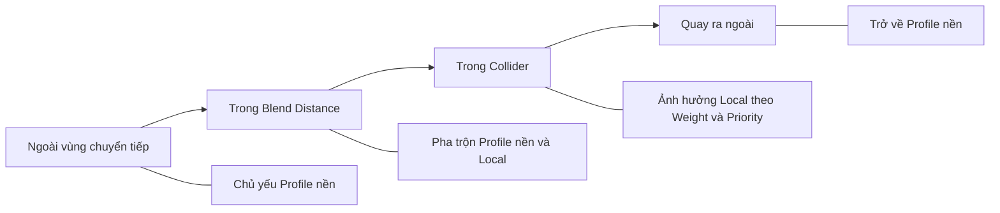

# Bài 03 — Thử thách tạo Local Volume

## 1. Bối cảnh và mục tiêu

Một khu rừng trong game có thể mang sắc xanh trong trẻo, trong khi một hang động lại có màu lạnh và độ tương phản đặc trưng. Để tạo sự thay đổi theo **vị trí**, ta không cần viết script thay toàn bộ thiết lập đồ họa mỗi khi người chơi bước qua ranh giới. Trong URP, `Local Volume` mô tả một vùng không gian chứa các thiết lập hậu kỳ, cho phép hòa trộn ảnh khi điểm đánh giá Volume di chuyển tới gần hoặc vào vùng đó.

**Thử thách:** thiết kế một scene có ít nhất hai khu vực mang sắc thái thị giác khác nhau. Khi di chuyển Camera (hoặc `Volume Trigger` được chỉ định), hậu kỳ phải chuyển từ trạng thái cơ sở sang trạng thái của khu vực đặc biệt và trở lại một cách có chủ ý.

Đây là **bài tập tự thực hiện**, vì vậy phần dưới cung cấp yêu cầu, cơ sở kỹ thuật và gợi ý kiểm tra thay vì giải sẵn toàn bộ cách bố trí và thông số.

## 2. Kết quả cần chứng minh

Sau khi hoàn thành, bạn cần:

1. **Phân biệt** Global Volume và Local Volume.
2. **Tạo** một vùng không gian có Collider để xác định phạm vi Local Volume.
3. **Điều chỉnh** `Blend Distance`, `Weight` và `Priority` dựa trên quan sát chuyển cảnh.
4. **Kiểm tra** ảnh ở bên ngoài, vùng chuyển tiếp và bên trong Local Volume.
5. **Giải thích** vì sao hiệu ứng có hoặc không có tác dụng ở vị trí bất kỳ.

## 3. Kiến thức cần dùng

### 3.1. Cơ chế vùng ảnh hưởng

- **Global Volume:** không phụ thuộc biên không gian, ảnh hưởng đến Camera ở mọi vị trí được phép.
- **Local Volume:** dùng Collider (ví dụ Box Collider hoặc Sphere Collider) để xác định vùng ảnh hưởng theo vị trí.
- **Blend Distance:** khoảng cách bên ngoài biên Collider, nơi ảnh hưởng bắt đầu chuyển từ 0 lên mức tương ứng; nếu bằng 0, chuyển đổi tại biên có thể rất đột ngột.
- **Weight:** trọng số tổng thể của Volume.
- **Priority:** hỗ trợ xử lý thứ tự/ưu tiên giữa những Volume có ảnh hưởng đồng thời.
- **Volume Trigger:** Transform mà Camera dùng làm vị trí đánh giá Volume; mặc định thường là Transform của Camera, nhưng trong camera góc nhìn thứ ba có thể chọn Transform nhân vật nếu muốn thay đổi theo vị trí nhân vật.



Không nên hiểu đây là chuyển đổi nhị phân “ngoài Collider = 0, trong Collider = 1” ở mọi cấu hình. Với Blend Distance lớn hơn 0, Local Volume đã có thể bắt đầu ảnh hưởng **trước khi** Camera thực sự đi vào Collider.

### 3.2. Mô hình khái niệm về trọng số

Để trực giác hóa, có thể gọi `f(d)` là hệ số chuyển tiếp theo khoảng cách tới biên Volume, với giá trị từ 0 đến 1. Khi đó đóng góp định tính có thể biểu diễn dưới dạng:

```text
độ ảnh hưởng xấp xỉ = Weight × f(khoảng cách)
```

Đây **không phải công thức nội bộ đầy đủ của Unity**, vì kết quả thực còn phụ thuộc nhiều Volume đồng thời, Priority và kiểu dữ liệu của thuộc tính Override. Mục đích là giúp bạn dự đoán khi tăng Weight hoặc Blend Distance sẽ có thay đổi nào cần thử nghiệm.

## 4. Đề bài thực hành

**Tình huống:** một nhân vật/Camera đi từ sân sáng vào phòng thí nghiệm bỏ hoang.

### Yêu cầu bắt buộc

- Dùng **Unity 6.3 + URP** với `Post Processing` bật trên Camera.
- Có ít nhất **một Global Volume** cho phong cách nền và **một Local Volume** cho vùng đặc biệt.
- Local Volume phải có Collider xác định đúng hình dạng khu vực. Nếu dùng `Box Volume` được tạo sẵn, kiểm tra `Box Collider` và bật `Is Trigger` theo hướng dẫn Unity.
- Có một `Volume Profile` dành riêng cho Local Volume với tối thiểu **hai thay đổi thị giác** (ví dụ Color Adjustments và Vignette).
- Người kiểm tra phải có cách đưa Camera hoặc Volume Trigger qua ít nhất **ba vị trí**: ngoài vùng, rìa vùng, trong vùng.
- Phải có minh chứng hiệu ứng **xuất hiện và biến mất khi di chuyển**, không chỉ thay đổi trong Inspector.
- Không để hiệu ứng làm mất khả năng nhận diện nhân vật, cửa ra hoặc vật tương tác quan trọng.

### Tiêu chí mở rộng

- Tạo thêm một Local Volume thứ hai có một vùng giao nhau để quan sát kết quả khi nhiều Volume đồng thời ảnh hưởng.
- Đánh giá hai giá trị `Blend Distance` khác nhau nhưng giữ nguyên Profile và Camera.
- Tùy chọn dùng `Volume Trigger` trỏ tới nhân vật trong game góc nhìn thứ ba, rồi so sánh với chế độ đánh giá từ Camera.

## 5. Gợi ý triển khai, không phải lời giải hoàn chỉnh

1. Kiểm tra project đúng render pipeline, Camera bật hậu kỳ và Layer của Volume được Volume Mask chấp nhận.
2. Tìm menu `GameObject > Volume > Box Volume` hoặc tạo GameObject với `Volume` ở chế độ Local và một Collider phù hợp.
3. Đặt Collider bao trùm khu vực dự định. Tránh dùng Mesh Collider phức tạp khi Box Collider hoặc Sphere Collider đã đáp ứng được yêu cầu.
4. Tạo Profile riêng cho vùng đặc biệt. Bật các property checkbox cần thiết trong từng Override.
5. Giữ Camera/Volume Trigger di chuyển theo một đường kiểm thử có thể lặp lại: từ xa → tới gần ranh giới → qua ranh giới → vào trung tâm → đi ra.
6. Quan sát khi điều chỉnh từng biến một: `Blend Distance`, `Weight`, `Priority` và các giá trị của Override.

**Lưu ý:** Collider dùng để xác định vùng ảnh hưởng không đòi hỏi vật thể phải chặn chuyển động. Trong bài này, `Is Trigger` nên được bật để vùng không vô tình trở thành chướng ngại vật vật lý.

## 6. Thiết kế bộ kiểm thử

Tạo bảng báo cáo với **dữ liệu do bạn quan sát**, không tự giả định kết quả:

| Ca kiểm thử | Điều kiện | Dự kiến | Thực tế | Ảnh minh chứng |
|---|---|---|---|---|
| T1 | Vị trí xa ngoài Local Volume | Profile nền chiếm ưu thế | ... | ... |
| T2 | Vị trí nằm trong Blend Distance | Bắt đầu pha trộn | ... | ... |
| T3 | Vị trí sâu trong Collider | Ảnh hưởng Local rõ hơn | ... | ... |
| T4 | `Weight = 0` | Local không còn đóng góp | ... | ... |
| T5 | Tắt checkbox của một thuộc tính Local Override | Thuộc tính đó không còn ghi đè | ... | ... |
| T6 | Di chuyển ra khỏi vùng và khoảng blend | Quay về phong cách nền | ... | ... |

Trường hợp Blend Distance bằng 0, T2 không còn vùng chuyển tiếp rộng; hãy ghi rõ cấu hình thay vì đánh giá sai. Nếu `Volume Trigger` được gán vào nhân vật thì vị trí cần ghi trong bảng là **vị trí Trigger**, không mặc định là vị trí Camera.

## 7. Các lỗi cần tự xử lý

| Triệu chứng | Câu hỏi chẩn đoán |
|---|---|
| Hiệu ứng áp dụng ở mọi vị trí | Volume có đang đặt `Global` thay vì `Local` không? Collider có được dùng không? |
| Không thấy tác động khi đi vào phòng | Camera bật hậu kỳ chưa, Layer/Volume Mask đúng chưa, Weight có bằng 0 không, Profile có override hợp lệ không? |
| Chuyển cảnh giật đột ngột | Blend Distance có bằng 0 hoặc quá nhỏ so với vận tốc di chuyển không? |
| Chuyển cảnh bắt đầu ở vị trí bất ngờ | Collider có bị lệch `Center`/`Size`/Transform không? Volume Trigger đặt ở đâu? |
| Profile nền bị phủ ngoài dự kiến | Các Volume nào cùng ghi đè thuộc tính? Weight, Priority và vùng hòa trộn đang ra sao? |
| Rê Camera nhưng ảnh không đổi | Volume Trigger có được gán vào nhân vật đứng yên thay vì Camera đang di chuyển không? |

## 8. Tiêu chí chấm và sản phẩm nộp

| Tiêu chí | Tỷ trọng |
|---|---:|
| Volume và Profile cấu hình đúng về mặt kỹ thuật | 30% |
| Hiệu ứng thay đổi theo vị trí, có chuyển tiếp phù hợp | 30% |
| Hình ảnh phục vụ chủ đích và không làm mất khả năng đọc scene | 20% |
| Báo cáo thử nghiệm, ảnh/video minh chứng và giải thích lỗi | 20% |

**Sản phẩm:** file scene + các Profile liên quan; một video ngắn hoặc chuỗi ảnh 3–5 vị trí; bảng kiểm thử đã điền; một đoạn 100–200 chữ giải thích lựa chọn Blend Distance/Weight/Priority.

## 9. Câu hỏi tự đánh giá

1. Vì sao ảnh hưởng Local Volume có thể xuất hiện **trước** khi Camera vào Collider?
2. Nếu tăng Priority mà không thấy thay đổi, ba điều gì khác cần kiểm tra?
3. Khi Camera cách nhân vật vài mét (góc nhìn thứ ba), nên dùng vị trí Camera hay nhân vật làm `Volume Trigger` cho hiệu ứng “bước vào hang”? Lý do là gì?
4. Vì sao `Weight = 0` là một kiểm tra hữu ích khi tìm lỗi?
5. Khi Local và Global cùng override Saturation, bạn sẽ thiết kế phép thử nào để xác định yếu tố ảnh hưởng nhiều nhất?

## 10. Tài liệu tham khảo và đối chiếu

- [Unity 6.3 — Set up a Volume in URP](https://docs.unity.com/en-us/engine/6000.3/manual/post-processing-and-full-screen-effects/urp/volumes-landing-page/set-up-a-volume) — ví dụ chính thức với Box Volume.
- [Unity 6.3 — Volume component reference](https://docs.unity.com/en-us/engine/6000.3/manual/post-processing-and-full-screen-effects/urp/volumes-landing-page/volume-component-reference) — Weight, Blend Distance, Priority.
- [Unity 6.3 — URP Camera Inspector](https://docs.unity.com/en-us/engine/6000.3/manual/cameras/urp/camera-components-reference/camera-component-reference) — Volume Mask, Volume Trigger.
- [Unity Learn — Creative Core: Post-processing](https://learn.unity.com/course/creative-core-post-processing) — vị trí của thử thách trong học phần.

*Đây là đề bài thực hành tự biên soạn, không phải đáp án chính thức hoặc bản sao nội dung bài thử thách trên Unity Learn.*
