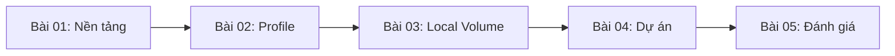

# Giáo trình Unity Creative Core — Post-processing (Tiếng Việt)

**Trọng tâm:** Unity 6.3 LTS · Universal Render Pipeline (URP) · 5 bài học và đánh giá.

## Mục lục

1. [Bài 01 — Nhập môn Post-processing](01-Tutorials/001-get-started-with-post-processing.md): cơ chế hậu kỳ, Camera, Volume, Bloom, các effect cơ bản.
2. [Bài 02 — Xây dựng Volume Profile](01-Tutorials/002-create-your-own-post-processing-profile.md): thiết kế hai phong cách, override, kiểm thử A/B và tối ưu.
3. [Bài 03 — Thử thách Local Volume](02-Exercises/003-challenge-create-a-local-volume.md): bài tập vùng ảnh hưởng, Collider, Blend Distance, Weight, Priority, Volume Trigger.
4. [Bài 04 — Áp dụng vào dự án](01-Tutorials/004-apply-post-processing-to-your-guided-project.md): thiết kế scene, các mốc triển khai, đánh giá, thử script điều khiển Weight.
5. [Bài 05 — Kiểm tra tổng kết](03-Quizzes/005-creative-core-post-processing-quiz.md): trắc nghiệm, đúng/sai, câu hỏi ngắn và bài thực hành đánh giá.

## Sơ đồ lộ trình

## Phạm vi và lưu ý phiên bản

- Các tài liệu được viết bằng tiếng Việt theo hướng học độc lập, đặt trọng tâm vào thao tác thực tế và kiểm chứng được.
- Các file đầu vào cung cấp tên bài, thứ tự và hướng dẫn học tập tổng quát, **không phải transcript chính thức** của video. Nội dung kỹ thuật được mở rộng, biên tập lại và đối chiếu với Unity Docs cho **Unity 6.3 + URP**.
- Hệ thống post-processing của HDRP và Built-in Render Pipeline khác URP. Không áp dụng máy móc hướng dẫn cũ của gói Post Processing Stack v2 vào URP.
- Cấu hình hiệu ứng là ví dụ để thực nghiệm, không phải preset chuẩn, benchmark hay số đo hiệu năng thực tế.
- Bài kiểm tra cuối học phần là bài tự biên soạn, không phải quiz chính thức của Unity Learn.

## Tham khảo chính

- [Unity Learn — Creative Core: Post-processing](https://learn.unity.com/course/creative-core-post-processing)
- [Unity 6.3 — Post-processing and full-screen effects in URP](https://docs.unity.com/en-us/engine/6000.3/manual/post-processing-and-full-screen-effects/urp)
- [Unity 6.3 — Add post-processing in URP](https://docs.unity.com/en-us/engine/6000.3/manual/post-processing-and-full-screen-effects/urp/add-post-processing)
- [Unity 6.3 — Volumes in URP](https://docs.unity.com/en-us/engine/6000.3/manual/post-processing-and-full-screen-effects/urp/volumes-landing-page)
- [Unity 6.3 — Post-processing effect availability](https://docs.unity.com/en-us/engine/6000.3/manual/post-processing-and-full-screen-effects/effect-availability-reference)

**Ngày đối chiếu:** 29/10/2026.
