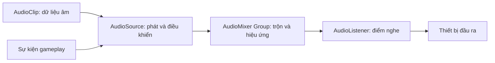

# Bài 01 — Nhập môn thiết kế âm thanh trong Unity

## 1. Tóm tắt và mục tiêu học tập

Âm thanh không chỉ làm cho thế giới ảo trở nên sống động mà còn truyền tải thông tin về hoạt động, vị trí, vật liệu, mức độ nguy hiểm và trạng thái của hệ thống. Một hình ảnh thác nước có thể gây ấn tượng, nhưng âm thanh nước chảy thay đổi khi người chơi tiến đến gần mới tạo được cảm giác hiện diện.

Sau bài học, người học có thể:

- Phân biệt âm thanh thuộc thế giới mô phỏng (*diegetic*) và âm thanh phục vụ người sử dụng (*non-diegetic*).
- Giải thích vai trò của `AudioClip`, `AudioSource`, `AudioListener` và `AudioMixer`.
- Nhập một tệp âm thanh, cấu hình `AudioSource` 2D/3D và kiểm chứng khi chạy scene.
- Lựa chọn âm nền, âm sự kiện và âm báo hiệu phù hợp với mục đích thiết kế.

## 2. Tư duy thiết kế soundscape

*Soundscape* là toàn bộ cảnh quan âm thanh mà người dùng cảm nhận trong một không gian hoặc thời điểm. Một soundscape tốt thường gồm nhiều lớp có chức năng khác nhau:

| Lớp âm thanh | Vai trò | Ví dụ |
|---|---|---|
| Ambience (âm môi trường) | Hình thành cảm giác địa điểm và thời tiết | Gió, mưa, tiếng côn trùng |
| Foley / SFX theo hành động | Xác nhận hành vi và vật liệu | Bước chân, cánh cửa mở, nhặt vật |
| Âm có nguồn cụ thể | Gợi ra vị trí hoặc khoảng cách | Thác nước, máy phát điện |
| Âm giao diện (UI) | Phản hồi thao tác | Chọn nút, xác nhận, báo lỗi |
| Music | Điều tiết nhịp độ, cảm xúc | Nhạc khám phá, chiến đấu |
| Dialogue | Kể chuyện và chỉ dẫn | Lời thoại nhân vật |

**Âm diegetic** là âm có nguyên nhân nằm trong thế giới câu chuyện: tiếng bước chân nhân vật, lửa cháy, radio đang bật. **Âm non-diegetic** thường chỉ tồn tại cho trải nghiệm của người chơi: nhạc nền biên tập, âm thông báo điểm số, hiệu ứng chuyển menu. Cần phân biệt khái niệm này với **âm 2D/3D**: diegetic/non-diegetic phân loại theo vai trò kể chuyện; 2D/3D phân loại theo cách hệ thống tính vị trí phát âm.

Bắt đầu thiết kế bằng câu hỏi: *Người chơi cần biết điều gì? Nguyên nhân gây âm thanh là gì? Âm thanh nên thay đổi khi hành động hoặc vị trí thay đổi ra sao?* Chỉ khi có câu trả lời mới chọn clip và công cụ phù hợp.

## 3. Kiến trúc âm thanh cơ bản của Unity

`AudioClip` là tài nguyên chứa dữ liệu âm thanh nhập vào dự án. `AudioSource` là component phát clip, điều chỉnh âm lượng, thời điểm phát, lặp và mức không gian hóa. `AudioListener` đại diện cho điểm nghe, thường nằm trên `Main Camera`. `AudioMixer` là thành phần tùy chọn để gom nhóm, cân bằng mức âm và áp dụng hiệu ứng. Sơ đồ thể hiện luồng xử lý khái niệm; một `AudioSource` có thể đi trực tiếp đến hệ thống phát âm mà không phải cấu hình Mixer riêng.

Trong một scene thông thường chỉ nên có **một `AudioListener` đang hoạt động**; nhiều listener có thể gây cảnh báo hoặc hành vi không mong muốn. Một scene lại có thể có rất nhiều `AudioSource`, nhưng số lượng thực sự nghe được còn phụ thuộc giới hạn voices và hiệu năng.

**Những thuộc tính cần nắm**

| Thuộc tính `AudioSource` | Cách hiểu | Ví dụ sử dụng |
|---|---|---|
| `Audio Resource` / `AudioClip` | Dữ liệu được phát | `Wind.ogg` |
| `Play On Awake` | Tự phát khi đối tượng khởi chạy | Ambience cần có ngay |
| `Loop` | Phát lặp khi hết clip | Gió, máy chạy |
| `Volume` | Hệ số mức phát của nguồn | Cân bằng nguồn mạnh/yếu |
| `Pitch` | Tốc độ phát và cao độ cảm nhận | Thay đổi nhẹ giữa các bước chân |
| `Spatial Blend` | Trộn giữa xử lý 2D và 3D | UI = 0, tiếng suối = 1 |
| `Priority` | Mức ưu tiên khi phân bổ voice | Âm gameplay quan trọng |
| `Output` | Nhóm đích trên Audio Mixer | `Ambience`, `SFX`, `Music` |

Giá trị `Spatial Blend = 0` là hoàn toàn 2D; `= 1` là hoàn toàn 3D; giá trị trung gian pha trộn hai dạng xử lý. Với nguồn 3D, độ lớn và cảm giác định hướng chịu ảnh hưởng bởi khoảng cách, đường suy giảm (*rolloff*) và thiết lập đầu ra.

## 4. Thực hành: tạo soundscape tối giản

**Chuẩn bị:** một scene 3D, `Main Camera`, hai clip âm thanh có quyền sử dụng (ví dụ `wind.ogg` và `stream.wav`). Có thể dùng đối tượng `Cube`/`Sphere` làm dấu vị trí nguồn.

1. Tạo thư mục `Assets/Audio/Clips`, kéo hai tệp âm vào `Project`. Chọn từng clip để xem phần Import Settings.
2. Tạo GameObject `Ambient_Wind`, thêm `AudioSource`, gán clip gió; bật `Play On Awake` và `Loop`, đặt `Spatial Blend = 0`.
3. Tạo GameObject `Stream_Source` ở một vị trí cách camera vài đơn vị; thêm `AudioSource`, gán tiếng suối; bật lặp, đặt `Spatial Blend = 1`.
4. Trong `Stream_Source`, thử `Rolloff Mode = Linear`, đặt `Min Distance` nhỏ hơn `Max Distance`. Đây là **thông số thử nghiệm**, không phải quy chuẩn cố định.
5. Chạy scene, thay đổi khoảng cách giữa Camera và suối. So sánh với âm gió 2D; sau đó tắt riêng từng `AudioSource` để đánh giá tác dụng của từng lớp.
6. Kiểm tra các hiện tượng: âm nền có bị lộ điểm nối loop; nhiều âm có che lấp nhau; tiếng suối có mô tả đúng vị trí hay không.

**Checkpoint:** gió tương đối ổn định khi camera di chuyển; tiếng suối biến đổi theo khoảng cách nếu cài đặt 3D và rolloff phù hợp. Nếu camera đứng yên, hãy di chuyển camera hoặc nguồn để tạo điều kiện kiểm thử.

## 5. Cơ sở âm học cần biết

Âm thanh là dao động áp suất lan truyền trong môi trường. Khi số hóa, tín hiệu được lấy mẫu theo thời gian. **Sample rate** (Hz) cho biết số mẫu trên giây, còn **bit depth** trong biểu diễn PCM quyết định độ phân giải biên độ. Trong hệ thống âm thanh thời gian thực, **latency** là độ trễ từ sự kiện đến khi nghe thấy âm; **clipping** xuất hiện khi mức tín hiệu vượt khả năng biểu diễn/đầu ra khiến tín hiệu bị méo.

Một âm nghe “to” hay “nhỏ” không chỉ do thanh `Volume`: còn phụ thuộc vào bản thân clip, khoảng cách 3D, Mixer, các hiệu ứng và mức âm đầu ra. Vì vậy, không nên dùng `Volume = 1` cho mọi nguồn rồi kỳ vọng cân bằng tự động.

## 6. Các lỗi thường gặp

| Hiện tượng | Kiểm tra có hệ thống |
|---|---|
| Không nghe thấy âm | `AudioClip` đã gán? `AudioSource`/GameObject bật? Có `AudioListener` hoạt động? Máy có bị mute? |
| Âm tự phát dù chưa tương tác | Kiểm tra `Play On Awake`; với âm sự kiện, thường tắt thuộc tính này |
| Đứng xa vẫn nghe rất to | `Spatial Blend` còn ở 2D? Đang dùng loại `Rolloff` nào? |
| Có thông báo nhiều Audio Listener | Tìm và vô hiệu hóa listener dư trong Camera khác |
| Âm không tự lặp | `Loop` chưa bật hoặc nguồn bị dừng bởi script |
| Nghe rối, thiếu phân lớp | Giảm bớt nguồn trùng dải tần, cân bằng mức âm, sử dụng Audio Mixer |

## 7. Thực hành ngắn

Tạo một cảnh gồm tiếng gió 2D, một đống lửa phát âm 3D và một tiếng báo nhặt vật chỉ phát khi người chơi kích hoạt. Ghi bảng gồm: mục đích âm, vị trí nguồn, `Play On Awake`, `Loop`, `Spatial Blend` và kết quả thử nghiệm.

## 8. Câu hỏi ôn tập

**Câu 1.** Trong Unity, thành phần nào trực tiếp phát nội dung của `AudioClip`?  
A. `AudioListener` · B. `Collider` · C. `AudioSource` · D. `Camera`

**Đáp án: C.** `AudioSource` chịu trách nhiệm phát clip và điều khiển tính chất phát lại.

**Câu 2.** Tiếng nhạc nền chỉ người chơi nghe thấy thường được xếp vào nhóm nào?  
A. Non-diegetic · B. Diegetic · C. Spatialized bắt buộc · D. Foley

**Đáp án: A.** Nhạc nền không có nguồn phát trong thế giới được mô phỏng thường là non-diegetic.

**Câu 3.** Một tiếng chuông gắn với vật thể trong không gian cần thay đổi theo khoảng cách. Cấu hình ban đầu thích hợp nhất là gì?  
A. `Loop = true` · B. `Spatial Blend = 0` · C. Tắt Listener · D. `Spatial Blend = 1`

**Đáp án: D.** Xử lý 3D giúp tiếng chuông chịu ảnh hưởng bởi vị trí và suy giảm theo khoảng cách.

**Câu 4.** Khi muốn âm không tự phát lúc scene bắt đầu, cần kiểm tra gì trước tiên?  
A. `Pitch` · B. `Play On Awake` · C. `Priority` · D. `Spread`

**Đáp án: B.** Thuộc tính này trực tiếp điều khiển việc tự phát khi khởi tạo.

**Câu 5.** Cặp khái niệm nào phân biệt *vai trò kể chuyện* chứ không phải cách xử lý vị trí?  
A. 2D/3D · B. Mono/Stereo · C. Diegetic/Non-diegetic · D. PCM/ADPCM

**Đáp án: C.** Diegetic/non-diegetic trả lời âm có thuộc thế giới kể chuyện hay không.

## 9. Tổng kết

Thiết kế âm thanh bắt đầu từ chức năng giao tiếp với người chơi, sau đó mới đến lựa chọn clip và cấu hình kỹ thuật. Trong Unity, chuỗi `AudioClip` → `AudioSource` → `AudioListener` là nền tảng; `AudioMixer` mở rộng khả năng quản lý nhiều lớp âm trong scene.

## 10. Tài liệu tham khảo

- [Unity Learn — Creative Core: Audio](https://learn.unity.com/project/creative-core-audio?courseId=630e6872edbc2a2e1b59d4ac).
- [Unity 6.3 — Audio overview](https://docs.unity.com/en-us/engine/6000.3/manual/audio).
- [Unity 6.3 — Set up an Audio Source](https://docs.unity.com/en-us/engine/6000.3/manual/audio/reference/class-audio-source/source-create).
- [Unity 6.3 — Audio Source reference](https://docs.unity.com/en-us/engine/6000.3/manual/audio/reference/class-audio-source).
