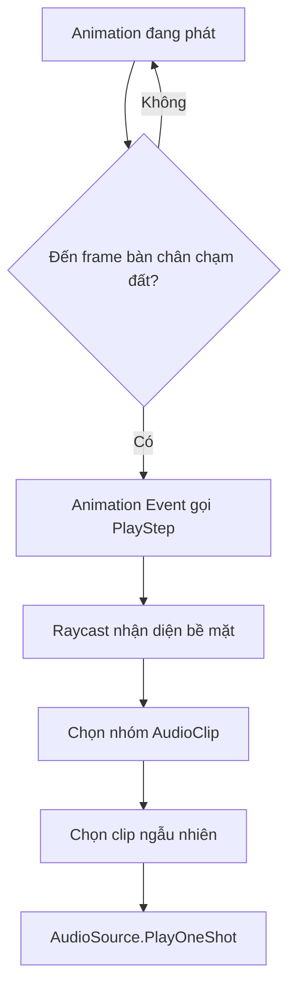

# Bài 02 — Tạo hiệu ứng âm thanh động và tiếng bước chân

## 1. Tóm tắt và mục tiêu

Âm thanh động (*dynamic sound effects*) thay đổi theo trạng thái hoặc hành động của nhân vật thay vì phát cố định. Tiếng bước chân là ví dụ điển hình: nó phải phát đúng lúc bàn chân chạm đất và có âm sắc phù hợp với cỏ, nước hoặc đá. Chỉ phát một mẫu âm ở tần suất cố định sẽ nhanh chóng gây cảm giác máy móc.

Kết thúc bài, người học có thể phân biệt cách kích hoạt âm thanh theo thời gian và theo sự kiện; cấu hình `Animation Event`; phát nhiều biến thể `AudioClip`; đọc `Tag` của bề mặt; và kiểm thử độ đồng bộ giữa chuyển động và âm thanh.

## 2. Lựa chọn cơ chế kích hoạt

| Phương pháp | Phù hợp | Điểm cần lưu ý |
|---|---|---|
| `Play On Awake` / `Loop` | Tiếng mưa, máy đang chạy | Không đồng bộ với hành động riêng lẻ |
| Timer / Coroutine | Tiếng chim kêu rải rác, hiệu ứng định kỳ | Lịch thời gian không luôn khớp chuyển động |
| `OnTriggerEnter` | Bước vào vùng, mở cửa, nhặt vật | Collider/trigger cần cấu hình đúng |
| `Animation Event` | Tiếp xúc chân, đòn đánh có keyframe xác định | Phải đặt chính xác vào clip animation |
| Sự kiện gameplay trong C# | Trúng đòn, thay đổi nhiệm vụ | Phụ thuộc nguồn phát sự kiện đúng thời điểm |

Đối với bước chân của nhân vật có hoạt ảnh đi/chạy, `Animation Event` thường là lựa chọn tự nhiên vì **sự kiện gắn với thời điểm tiếp xúc**, chứ không phải đoán từ một timer.



Một `Animation Event` gọi phương thức trên component của GameObject phát animation (hoặc đối tượng được hệ thống animation sử dụng). Vì vậy, khi không có phản ứng, kiểm tra **vị trí gắn script** và **tên phương thức phân biệt chữ hoa/chữ thường**.

## 3. Thiết lập scene và tài nguyên

**Cần có:** nhân vật có `Animator`, clip đi/chạy, `AudioSource` trên đối tượng quản lý âm bước chân, ít nhất một clip cho mỗi loại bề mặt; Collider cho sàn và những Tag `Grass`, `Water`, `Cave` nếu dùng ba vật liệu này.

### 3.1. Gắn Animation Events

1. Mở clip animation đi bộ qua `Animation` hoặc phần `Events` của import settings (tùy loại asset và cách import).
2. Tìm thời điểm bàn chân trái thực sự chạm đất, thêm Event có tên hàm `PlayStep`.
3. Lặp cho bàn chân phải. Với animation chạy, đặt event tương ứng với chu kỳ chạy, không sao chép mù mờ theo số frame.
4. Lưu/Apply thay đổi lên clip nếu quy trình import yêu cầu; lặp với clip hạ cánh nếu cần.
5. Đảm bảo component chứa `PlayStep` nằm trên đối tượng mà `Animator` có thể gọi event.

Ví dụ ở Unity Learn sử dụng sự kiện trong animation, có script `FootstepManager`, và thay đổi loại âm theo bề mặt cỏ, nước, hang đá. Cách triển khai bên dưới là **mã luyện tập độc lập**, không yêu cầu có sẵn bộ Starter Assets của khóa học.

### 3.2. Script bước chân theo bề mặt

Tạo file `FootstepSurfaceAudio.cs`, gắn vào GameObject có `Animator` tương ứng với event. Cấu hình `groundLayers` để chỉ bao gồm collider của sàn; đặt mảng clip trong Inspector. Vị trí raycast giả định gốc đối tượng gần chân; dự án có pivot khác phải điều chỉnh điểm bắt đầu và khoảng cách ray.

```csharp
using UnityEngine;

[RequireComponent(typeof(AudioSource))]
public class FootstepSurfaceAudio : MonoBehaviour
{
    [SerializeField] private LayerMask groundLayers = ~0;
    [SerializeField] private AudioClip[] grassSteps;
    [SerializeField] private AudioClip[] waterSteps;
    [SerializeField] private AudioClip[] caveSteps;
    [SerializeField] private float rayLength = 1.5f;
    [SerializeField] private float minInterval = 0.08f;

    private AudioSource source;
    private float nextAllowedTime;

    private void Awake()
    {
        source = GetComponent<AudioSource>();
        source.playOnAwake = false;
        source.loop = false;
    }

    // Được gọi bởi Animation Event tại thời điểm chân chạm đất.
    public void PlayStep()
    {
        if (Time.time < nextAllowedTime) return;

        Vector3 origin = transform.position + Vector3.up * 0.2f;
        if (!Physics.Raycast(origin, Vector3.down, out RaycastHit hit,
                rayLength, groundLayers, QueryTriggerInteraction.Ignore))
            return;

        AudioClip[] options = grassSteps;
        if (hit.collider.CompareTag("Water")) options = waterSteps;
        else if (hit.collider.CompareTag("Cave")) options = caveSteps;
        else if (!hit.collider.CompareTag("Grass")) return;

        if (options == null || options.Length == 0) return;
        AudioClip clip = options[Random.Range(0, options.Length)];
        if (clip == null) return;

        source.pitch = Random.Range(0.96f, 1.04f);
        source.PlayOneShot(clip, 0.8f);
        nextAllowedTime = Time.time + minInterval;
    }
}
```

**Cách cấu hình:** gắn Tag thích hợp cho collider thực tế của sàn; gán 2–5 biến thể bước chân mỗi loại; để `AudioSource` phát 3D nếu bước chân phải có vị trí trong thế giới. `Random.Range(0, options.Length)` với hai đối số nguyên lấy chỉ số từ 0 đến `Length - 1`. `PlayOneShot` cho phép phát từng clip mà không phải thay `source.clip` rồi gọi `Play`.

**Các giới hạn của ví dụ:** Raycast theo chiều xuống cần đúng hướng trọng lực; bề mặt nhiều lớp/địa hình phức tạp có thể cần hệ thống vật liệu riêng (ví dụ từ `Terrain` hoặc dữ liệu `PhysicMaterial`). `source.pitch` thay đổi trên cả `AudioSource`, nên nếu nhiều one-shot phát chồng nhau trên cùng source, việc đổi pitch có thể ảnh hưởng các tiếng đang phát; hệ thống lớn nên cân nhắc voice riêng hoặc pooling. `minInterval` chỉ là chống phát dồn, không thay thế đồng bộ animation.

## 4. Vì sao cần nhiều biến thể âm thanh?

Một âm bước chân được phát lặp nguyên vẹn dễ tạo ra **hiện tượng nghe thấy quy luật lặp**, trái với sự đa dạng ngoài đời. Hai hướng cải thiện đơn giản là dùng nhiều đoạn ghi khác nhau và thay đổi nhẹ `Pitch`/`Volume`. Tuy nhiên, thay đổi ngẫu nhiên quá rộng có thể làm cùng vật liệu nghe không nhất quán.

Thử nghiệm A/B: chạy 20 bước với một clip rồi chạy 20 bước với nhiều clip; so sánh cảm giác tự nhiên, mức lặp nhận biết được và độ đồng bộ hình–tiếng. Nên nghe qua tai nghe và cả loa ngoài ở mức âm an toàn.

## 5. Những lỗi thường gặp

| Lỗi | Nguyên nhân điển hình | Cách kiểm tra |
|---|---|---|
| Không có bước chân | Event không gọi đúng script/method | Tạm `Debug.Log` bên trong `PlayStep`; xem vị trí script |
| Luôn phát tiếng cỏ | Tag không gắn vào Collider trúng ray | In `hit.collider.name` và `tag` khi test |
| Một bước phát 2–3 tiếng | Event trùng, transition trùng hoặc nhiều script | Kiểm tra timeline animation và state transitions |
| Sai thời điểm tiếp xúc | Event nằm ở frame không đúng | Scrub animation và canh chân chạm sàn |
| Không xác định được mặt đất | Ray quá ngắn, sai layer, pivot quá cao | Bật Gizmos, xem collider/layer, tăng thử `rayLength` |
| Tiếng bước chân đè nhau | Clip dài, event dày, mức âm lớn | Cắt clip, hiệu chỉnh interval và quản lý voice |

## 6. Bài thực hành

Thử ba loại bề mặt `Grass`, `Water`, `Cave`. Với từng loại, tạo ít nhất ba biến thể. Di chuyển nhân vật qua ranh giới và quay một video ngắn chứng minh âm sắc thay đổi đúng bề mặt. Sau đó giải thích tại sao sự kiện hạ cánh có thể cần một âm khác với bước chân bình thường.

## 7. Câu hỏi ôn tập

**Câu 1.** Lý do chính chọn `Animation Event` cho bước chân là gì?  
A. Giảm kích thước `AudioClip` · B. Đảm bảo kích hoạt tại pha tiếp xúc của animation · C. Tự động phân loại bề mặt · D. Loại bỏ `AudioSource`

**Đáp án: B.** Event bám vào thời điểm cụ thể của hoạt ảnh.

**Câu 2.** Muốn chọn âm theo sàn cỏ/nước/đá, cần xác định gì trước khi chọn clip?  
A. Renderer của Camera · B. Số lượng light · C. Tên scene · D. Bề mặt mà chân tiếp xúc

**Đáp án: D.** Việc nhận diện collider, Tag hay vật liệu là đầu vào cho quyết định phát âm.

**Câu 3.** Tại sao một clip lặp đi lặp lại dễ kém tự nhiên?  
A. Tai người nhận ra mô thức lặp · B. Unity không phát được 2 clip · C. Spatial Blend luôn bằng 0 · D. Collider bị vô hiệu

**Đáp án: A.** Sự lặp chính xác khiến âm thanh dễ bị nhận diện là giả lập.

**Câu 4.** `PlayOneShot` phù hợp nhất trong trường hợp nào?  
A. Đổi scene · B. Di chuyển Camera · C. Phát một âm sự kiện ngắn · D. Thay đổi shader

**Đáp án: C.** Đây là API phát clip một lần, có thể dùng cho các SFX ngắn.

**Câu 5.** Event gọi đúng nhưng raycast không trúng sàn; kiểm tra gì đầu tiên?  
A. Skybox · B. Điểm bắt đầu, chiều dài ray và LayerMask · C. Resolution · D. Music mixer

**Đáp án: B.** Đây là ba điều kiện trực tiếp ảnh hưởng kết quả `Physics.Raycast`.

## 8. Tổng kết

Âm thanh tương tác cần được kích hoạt đúng sự kiện, đúng ngữ cảnh và có sự biến thiên hợp lý. Kết hợp `Animation Events`, nhận diện vật liệu, chọn ngẫu nhiên clip và kiểm thử chuyển động giúp tiếng bước chân trở thành một phần đáng tin cậy của thế giới ảo.

## 9. Tài liệu tham khảo

- [Unity Learn — Create dynamic sound effects](https://learn.unity.com/course/creative-core-audio/tutorial/create-dynamic-sound-effects-3?version=6.0).
- [Unity — Audio Source API](https://docs.unity3d.com/ScriptReference/AudioSource.html).
- [Unity — Animation Events](https://docs.unity3d.com/Manual/script-AnimationWindowEvent.html).
- [Unity — Physics.Raycast](https://docs.unity3d.com/ScriptReference/Physics.Raycast.html).
