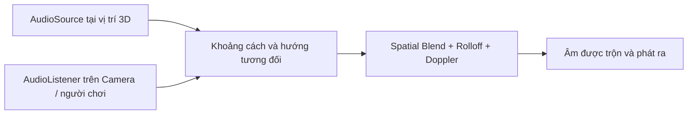
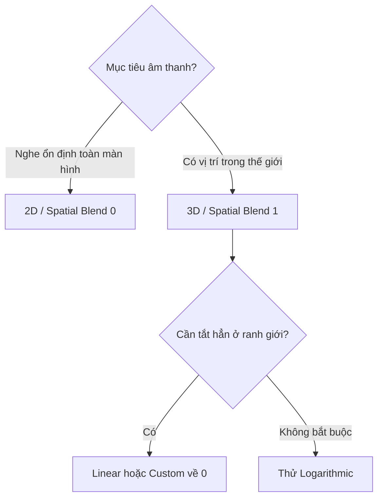

# Bài 03 — Thiết kế âm thanh không gian 3D

## 1. Tổng quan và mục tiêu

Âm thanh 3D (*spatial audio*) giúp người dùng nhận biết nơi phát sinh âm trong thế giới mô phỏng. Một thác nước nằm bên phải, tiếng chim trên cây và tiếng máy ở xa không nên nghe như ba đoạn nhạc phát đều từ tai nghe. Unity sử dụng `AudioSource`, `AudioListener` và các tham số không gian để mô phỏng một phần hiện tượng này.

Sau bài học, người học có thể phân biệt 2D và 3D; cấu hình `Spatial Blend`, `Min Distance`, `Max Distance` và `Volume Rolloff`; thiết kế các nguồn âm với khoảng cách khác nhau; và nhận diện giới hạn của mô phỏng âm thanh mặc định.

## 2. Cơ sở âm học và mô hình nghe

Trong môi trường thực, năng lượng âm lan truyền ra xa nguồn và thường suy giảm theo khoảng cách. Trong không gian tự do, đối với nguồn điểm lý tưởng, cường độ âm xấp xỉ tỉ lệ nghịch với bình phương khoảng cách. Thực tế còn chịu tác động của hướng phát, phản xạ, hấp thụ, che khuất và đặc điểm nguồn.

Unity **không mặc định giải một bài toán âm học đầy đủ** cho mọi vật thể. Thay vào đó, engine áp dụng các hàm suy giảm và xử lý định hướng có thể cấu hình. Bởi vậy, `Min Distance` và `Max Distance` là *tham số điều khiển mô phỏng*, không phải tự động biểu diễn khoảng cách nghe được thực tế.



## 3. Các thuộc tính quan trọng

| Thuộc tính | Ảnh hưởng | Gợi ý lựa chọn |
|---|---|---|
| `Spatial Blend` | 0 = 2D; 1 = 3D; giữa hai giá trị là trộn | Âm của vật thể: thường gần 1 |
| `Min Distance` | Trong vùng gần nguồn, mức âm không suy giảm theo rolloff khoảng cách | Điều chỉnh cảm giác gần |
| `Max Distance` | Giới hạn ảnh hưởng của một số đường suy giảm | Xem thêm khác biệt giữa các rolloff |
| `Rolloff Mode` | Hình dạng suy giảm âm khi xa nguồn | Linear, Logarithmic, Custom |
| `Doppler Level` | Mức hiệu ứng Doppler do chuyển động tương đối | Tắt hoặc giảm nếu âm rung bất thường |
| `Spread` | Độ trải các kênh trong không gian loa | Chỉ điều chỉnh khi cần |
| `Priority` | Ưu tiên chọn nguồn khi vượt ngân sách voice | Âm chỉ dẫn/gameplay ưu tiên hơn ambience phụ |

**Ba dạng Volume Rolloff**

- **Logarithmic:** giảm nhanh ở gần, sau đó suy giảm chậm; ở khoảng cách xa **không nhất thiết về chính xác 0**. Không nên hiểu `Max Distance` là ngưỡng tắt tuyệt đối ở mode này.
- **Linear:** giảm theo đường thẳng trong vùng thiết lập và về 0 tại `Max Distance` theo cách mô tả trong manual.
- **Custom:** người thiết kế vẽ đường cong âm lượng theo khoảng cách, phù hợp tình huống có yêu cầu đặc biệt.



Đường cong cần được điều chỉnh bằng **nghe thử trong bối cảnh thực**. Không có một bộ Min/Max áp dụng chính xác cho mọi loại âm, mọi quy mô scene hoặc mọi thiết bị.

## 4. Thực hành: thác nước và tiếng chim

**Chuẩn bị:** scene có đường đi cho camera/người chơi, hai đối tượng đại diện vị trí thác nước và cây có chim, hai `AudioClip` có giấy phép phù hợp.

1. Tạo `Waterfall_Audio` tại thác nước; thêm `AudioSource`, bật `Loop`, `Play On Awake`, `Spatial Blend = 1`.
2. Đặt `Rolloff Mode = Linear` và tự điều chỉnh `Min Distance`/`Max Distance` để âm nhỏ dần khi đi ra xa. Vừa di chuyển vừa nghe; ghi lại khoảng cách mà âm dần không nghe thấy.
3. Tạo `Bird_Audio` ở trên cây. Nếu chim kêu không liên tục, không bật loop cho một đoạn kêu ngắn; dùng một script kích hoạt theo khoảng thời gian biến thiên.
4. Quay camera sang trái/phải để quan sát khả năng định hướng. So sánh bằng cách chuyển tạm `Spatial Blend` sang 0.
5. Thử chuyển thác nước sang `Logarithmic` rồi `Custom`. Chỉ thay một tham số mỗi lần để nhận diện đúng ảnh hưởng.
6. Nếu muốn tiếng chim chỉ nghe trong vùng nhỏ, chọn đường suy giảm đưa âm về mức gần như không nghe được đúng lúc và kiểm tra bằng tai trên thiết bị đích.

**Checkpoint:** Người nghe có thể phân biệt tiếng thác gần/xa, xác định tương đối hướng phát, và nhận ra tác dụng của việc chuyển 2D ↔ 3D.

## 5. Ví dụ bổ sung: tiếng chim phát theo khoảng thời gian

Gắn script này lên GameObject có `AudioSource`. Đây là ví dụ nguồn 3D phát rải rác, độc lập với hệ thống animation.

```csharp
using System.Collections;
using UnityEngine;

[RequireComponent(typeof(AudioSource))]
public class RandomBirdCalls : MonoBehaviour
{
    [SerializeField] private AudioClip[] calls;
    [SerializeField] private float minDelay = 4f;
    [SerializeField] private float maxDelay = 9f;
    private AudioSource source;

    private void Awake()
    {
        source = GetComponent<AudioSource>();
        source.playOnAwake = false;
        source.loop = false;
        source.spatialBlend = 1f;
    }

    private IEnumerator Start()
    {
        while (true)
        {
            yield return new WaitForSeconds(
                Random.Range(Mathf.Max(0.1f, minDelay),
                             Mathf.Max(minDelay + 0.1f, maxDelay)));

            if (calls == null || calls.Length == 0) continue;
            AudioClip clip = calls[Random.Range(0, calls.Length)];
            if (clip != null) source.PlayOneShot(clip, 0.7f);
        }
    }
}
```

Đây là thiết kế ngẫu nhiên đơn giản, không tự kiểm tra một clip đang phát hay giới hạn số tiếng chim chồng nhau. Nếu clip dài hoặc cần sự im lặng tự nhiên, hãy dùng thời gian chờ phụ thuộc độ dài clip hoặc kiểm soát số voice.

## 6. Giới hạn và tối ưu hóa

**Âm 3D không đồng nghĩa âm được mô phỏng vật lý toàn diện.** Unity mặc định không tự suy ra vật cản làm giảm tần số cao hay phản xạ chi tiết của từng bức tường. Những hiệu ứng này cần lọc tín hiệu, vùng vang, raycast/occlusion hoặc giải pháp audio spatializer thích hợp.

Về tài nguyên, clip ngắn lặp nhiều lần có thể phù hợp `Decompress On Load` hoặc ADPCM tùy trường hợp, trong khi nhạc dài thường phù hợp `Streaming` hơn. Điều này là định hướng tối ưu dựa trên trade-off RAM/CPU, không phải quy tắc tuyệt đối. Kiểm tra `Audio Profiler`, CPU DSP và bộ nhớ trên **thiết bị đích** trước khi chốt cấu hình.

## 7. Chẩn đoán lỗi

| Vấn đề | Cách xác minh |
|---|---|
| Âm xa vẫn to | `Spatial Blend` khác 1? `Rolloff Mode` đang Logarithmic? |
| Âm mất nhanh bất thường | `Min/Max Distance` quá nhỏ, volume thấp, sai vị trí đối tượng |
| Không phân biệt hướng | Nguồn ở gần giữa, clip stereo rộng, cài đặt thiết bị xuất âm, listener không quay đúng |
| Âm “vút” khi nguồn di chuyển | Doppler quá cao hoặc velocity thay đổi đột ngột |
| Không nghe được một nguồn | Kiểm tra voice limit, `Priority`, Output Mixer, mute và volume |

## 8. Câu hỏi ôn tập

**Câu 1.** `Spatial Blend = 0` có nghĩa gì?  
A. Âm luôn tắt · B. Âm xử lý hoàn toàn 2D · C. Chỉ tiếng nói · D. Âm có reverb

**Đáp án: B.** 0 chọn xử lý 2D, không áp dụng đầy đủ tính toán suy giảm 3D.

**Câu 2.** Trong `Linear Rolloff`, vị trí nào được dùng làm điểm âm lượng suy giảm tới 0?  
A. `Min Distance` · B. `Priority` · C. `Spread` · D. `Max Distance`

**Đáp án: D.** Đó là ranh giới của đường giảm tuyến tính.

**Câu 3.** Cách mô tả nào đúng về mô phỏng âm 3D mặc định?  
A. Tự tính phản xạ mọi tường · B. Tự nhận diện vật liệu vật cản · C. Dùng vị trí, định hướng và đường suy giảm cấu hình · D. Chỉ phát âm đơn kênh qua loa trái

**Đáp án: C.** Hệ thống cho các tính năng spatial cơ bản, không phải bộ giải âm học đầy đủ.

**Câu 4.** Muốn nghe âm như giao diện HUD không phụ thuộc camera gần/xa nên khởi đầu với gì?  
A. 2D · B. Logarithmic 3D · C. Doppler cao · D. Custom Rolloff ngẫu nhiên

**Đáp án: A.** Âm UI thường không có nguồn thực trong thế giới 3D.

**Câu 5.** Kiểm thử tối ưu âm thanh đáng tin cậy nhất được thực hiện ở đâu?  
A. Chỉ trong Inspector · B. Chỉ bằng phỏng đoán · C. Chỉ đọc kích thước file · D. Trên thiết bị đích với Profiler và nghe thử

**Đáp án: D.** Các chi phí CPU, bộ nhớ và kết quả nghe thay đổi theo nền tảng.

## 9. Tổng kết và tài liệu tham khảo

Âm 3D giúp âm thanh có vị trí và khoảng cách, nhưng chất lượng phụ thuộc chủ yếu vào **lựa chọn đúng nguồn**, **đường suy giảm**, **cân bằng với các lớp khác** và **kiểm thử thực tế**.

- [Unity Learn — Creative Core: Audio](https://learn.unity.com/project/creative-core-audio?courseId=630e6872edbc2a2e1b59d4ac).
- [Unity 6.3 — Audio Source](https://docs.unity.com/en-us/engine/6000.3/manual/audio/reference/class-audio-source).
- [Unity 6.3 — Audio Clip Import Settings](https://docs.unity.com/en-us/engine/6000.3/manual/audio/reference/class-audio-clip).
