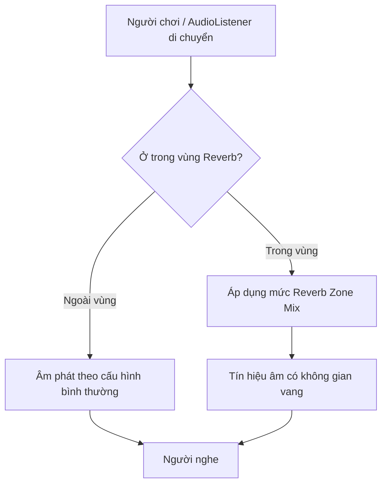
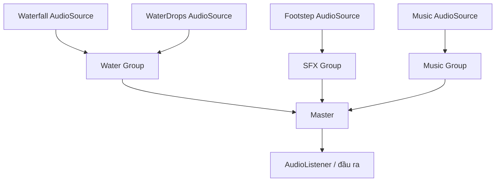

# Bài 04 — Hiệu ứng âm thanh: Reverb Zone, Filter và Audio Mixer

## 1. Tóm tắt và mục tiêu

Tiếng bước chân trên nền đá không chỉ có âm sắc khác tiếng bước chân trên cỏ mà còn thay đổi theo **không gian xung quanh**. Trong hang đá, các bề mặt cứng phản xạ năng lượng âm khiến người nghe cảm nhận sự vang và đôi khi các lần phản xạ tách biệt. Unity cho phép người thiết kế mô phỏng sự khác biệt bằng vùng `Audio Reverb Zone`, bộ lọc (`Audio Filters`), `AudioMixer` và `Priority`.

Sau bài học, người học có thể tạo vùng vang cho hang động; lựa chọn và so sánh reverb preset; thêm tiếng nước nhỏ giọt trong hang; cấu hình ưu tiên các nguồn; và gom nhiều nguồn vào Audio Mixer để cân bằng âm chung.

## 2. Vang, vọng và bộ lọc: phân biệt đúng

**Echo** là tiếng phản xạ có độ trễ đủ lớn để người nghe phân biệt với tiếng gốc. **Reverberation (reverb)** là phần năng lượng âm phản xạ nhiều lần trong môi trường và thường chồng lấn thành đuôi vang. Trong thực tế, một không gian có thể có cả echo lẫn reverb. `Audio Reverb Zone` là mô phỏng hiệu ứng không gian qua các tham số thiết kế; không phải phép tính ray tracing âm học tự động dựa trên lưới hình học của hang.

| Hiệu ứng | Cơ chế cảm nhận | Ví dụ |
|---|---|---|
| Reverb | Đuôi vang tạo cảm giác kích thước/vật liệu phòng | Hang đá, nhà thờ |
| Echo | Bản lặp có độ trễ | Tiếng hét vọng ở vách núi |
| Low-pass | Giảm năng lượng ở tần số cao | Âm sau tường, dưới nước theo cách mô phỏng |
| High-pass | Giảm năng lượng tần số thấp | Âm nhỏ, mỏng qua thiết bị truyền tin |
| Distortion | Tạo biến dạng phi tuyến/hài | Máy điện cũ, thiết bị hỏng |

Mức nghe thật còn phụ thuộc khoảng cách, phổ của clip gốc và pha trộn tín hiệu. Đừng áp dụng preset vang thật mạnh cho mọi nguồn; hậu quả có thể là giảm khả năng nghe rõ lời thoại và chỉ dẫn.

## 3. Tạo Audio Reverb Zone cho hang động



Sơ đồ chỉ mô tả ý tưởng xử lý. Thực tế lượng tác động còn tùy cấu hình của nguồn âm và các vùng reverb đang có.

1. Trong `Hierarchy`, tạo `Audio > Audio Reverb Zone`, đặt tên `Cave_Reverb`.
2. Đưa đối tượng này vào tâm không gian hang; chọn `Min Distance` để bao phủ phần chính trong hang và `Max Distance` tạo vùng chuyển tiếp qua cửa hang.
3. Chọn `Reverb Preset = Cave`.
4. Chạy scene, di chuyển `AudioListener` từ ngoài vào trong. Thử bật/tắt Reverb Zone trong Play Mode để so sánh A/B.
5. Thử hai preset có sắc thái trái ngược: `Padded Cell` (ít vang hơn) và `Stone Corridor` (vang kiểu hành lang đá). Dùng tai nghe để nhận xét đuôi âm và độ rõ.
6. Sau khi thử, đặt lại preset phù hợp với ý đồ mỹ thuật; kiểm tra cả tiếng bước chân lẫn thác nước gần hang.

**Lưu ý:** Vùng vang thường được kích hoạt theo vị trí nghe (`AudioListener`) và độ pha trộn. Nó không nhất thiết chỉ ảnh hưởng một nguồn âm “nằm trong hình cầu”. Kiểm tra `Reverb Zone Mix` trên `AudioSource` nếu kết quả không giống mong đợi.

## 4. Bổ sung tiếng nước nhỏ giọt

Tạo GameObject `Cave_WaterDrops`, đặt tại một góc hang và thêm `AudioSource` có clip giọt nước. Đặt `Spatial Blend = 1`, `Loop = true` nếu clip là ambience được thiết kế lặp mượt, và `Rolloff Mode = Linear`. Đặt phạm vi suy giảm vừa đủ để âm dễ nhận biết trong hang nhưng ít xuất hiện ngoài cửa. Nếu nguồn liên tục đang cạnh tranh với thác nước, giảm nhẹ âm thác hoặc phân nhóm Mixer; **tăng Priority không phải là giải pháp tự động tăng độ to**.

**Priority và voice management**

`AudioSource.priority` điều chỉnh mức ưu tiên khi hệ thống phải phân bổ nguồn âm phát; số **càng nhỏ thì độ ưu tiên càng cao**. Trong nhiều cấu hình, giá trị mặc định là 128. Khi nhiều nguồn cùng phát và vượt ngân sách voice, các nguồn kém ưu tiên hơn có thể bị ảo hóa hoặc không được chọn làm voice nghe được.

Nên ưu tiên âm chứa thông tin quan trọng cho gameplay (cảnh báo, thoại, tương tác), không đơn thuần nguồn phát lớn nhất. Nếu tiếng nước giọt khó nghe vì bị **masking** bởi tiếng thác, cần xử lý mức trộn/tần số chồng nhau; đổi Priority có thể không mang lại hiệu quả nếu vẫn còn đủ voices.

## 5. Audio Mixer và cấu trúc phân nhóm



`AudioMixer` cho phép kiểm soát âm lượng theo nhóm, gắn hiệu ứng ở cấp nhóm và sử dụng các bản trạng thái trộn (`Snapshots`). Điều này hiệu quả hơn khi phải chỉnh hàng trăm nguồn rải rác trong scene.

**Thực hành cấu hình:**

1. Mở `Window > Audio > Audio Mixer`, tạo một asset Mixer.
2. Trong phần `Groups`, tạo `Water`, `SFX` và `Music` dưới `Master`.
3. Trong `AudioSource > Output` của tiếng thác và nước nhỏ giọt, chọn group `Water`; tiếng bước chân vào `SFX`.
4. Phát scene rồi thay đổi `Attenuation` của group `Water`, nghe sự khác biệt mà không sửa từng AudioSource.
5. Nếu cần, thêm hiệu ứng tại group thích hợp (ví dụ `Low Pass` hay `SFX Reverb`) và quan sát thứ tự xử lý. Kiểm tra CPU bằng `Profiler > Audio` nếu sử dụng nhiều hiệu ứng.

**Snapshots** thích hợp khi muốn chuyển trạng thái tổng thể (ví dụ trong hang/ngoài hang, menu/gameplay). Các tham số đã *Expose to script* và điều khiển bằng `AudioMixer.SetFloat` có hành vi tương tác đặc biệt với snapshot; hãy quyết định rõ thông số do snapshot hay script làm chủ.

**Điều chỉnh một AudioMixer Group từ C#**

Tạo tham số exposed tên `WaterVolumeDb` từ mức `Attenuation` của group `Water`. Đoạn mã dưới đây minh họa phép đổi mức tuyến tính sang decibel và có thể gọi từ UI Slider 0–1. Gán Mixer asset trong Inspector.

```csharp
using UnityEngine;
using UnityEngine.Audio;

public class WaterMixerVolume : MonoBehaviour
{
    [SerializeField] private AudioMixer mixer;

    // Có thể gọi từ Unity UI Slider.OnValueChanged(float)
    public void SetWaterVolume(float linear)
    {
        if (mixer == null) return;
        float clamped = Mathf.Clamp01(linear);
        float dB = 20f * Mathf.Log10(Mathf.Max(0.0001f, clamped));
        mixer.SetFloat("WaterVolumeDb", dB);
    }
}
```

Công thức kỹ thuật: `dB = 20 × log10(amplitude)` cho **tỉ số biên độ**, nên giá trị 1 tương ứng 0 dB; 0.5 xấp xỉ −6 dB. `linear = 0` được giới hạn nhỏ nhất `0.0001` để tránh log(0) và cho khoảng −80 dB. Đây là ánh xạ UI phổ biến, không đồng nghĩa công thức mô phỏng cảm nhận âm lượng hoàn hảo. Không gọi `AudioMixer.SetFloat` trong `Awake`/`OnEnable`; Unity khuyến nghị `Start` hoặc các thời điểm sau đó.

## 6. Kiểm thử và tối ưu

| Hiện tượng | Cách xử lý |
|---|---|
| Trong hang vẫn nghe khô | Kiểm tra vị trí `AudioListener`, bán kính zone, preset, `Reverb Zone Mix` |
| Mọi âm đều vang quá mức | Giảm send/reverb, giới hạn vùng hiệu ứng và cân bằng dry/wet |
| Mixer đổi nhóm nhưng âm không đổi | Kiểm tra trường `Output` của từng AudioSource |
| Clip khó nghe dù ưu tiên cao | Kiểm tra masking và mức nhóm, không chỉ `Priority` |
| CPU DSP tăng | Giảm số hiệu ứng nặng, rà soát Audio Profiler |
| Script điều chỉnh âm không tác dụng | Kiểm tra chính tả exposed parameter và `SetFloat` trả về `true` hay `false` |

## 7. Thực hành và tiêu chí hoàn thành

Tạo âm hang đá với ít nhất hai nguồn (`Footsteps` và `WaterDrops`) cùng một `Audio Reverb Zone`. So sánh âm thanh trước/sau khi vào hang, quay video ngắn, chụp cấu trúc Mixer, giải thích lựa chọn độ ưu tiên nguồn. Ghi lại một thay đổi làm âm nghe rõ hơn mà không tăng tổng âm lượng một cách tùy tiện.

## 8. Câu hỏi ôn tập

**Câu 1.** Khác biệt cốt lõi giữa echo và reverb là gì?  
A. Echo là phản xạ tách biệt về thời gian; reverb thường tạo đuôi vang chồng lấn · B. Echo chỉ có trong 2D · C. Reverb chỉ dùng cho lời thoại · D. Hai khái niệm không liên quan phản xạ

**Đáp án: A.** Đây là phân biệt theo đặc điểm thời gian và khả năng nhận diện phản xạ.

**Câu 2.** Với AudioSource Priority, số nhỏ hơn biểu thị gì?  
A. Ít âm lượng hơn · B. Ít hiệu ứng hơn · C. Ít kênh hơn · D. Độ ưu tiên cao hơn

**Đáp án: D.** Priority phục vụ lựa chọn voice, không phải thanh âm lượng.

**Câu 3.** Hai nguồn âm nước cần giảm đồng thời 6 dB: giải pháp quản trị phù hợp nhất?  
A. Xóa clip · B. Route cả hai vào group `Water` và giảm group · C. Đổi Tag · D. Tắt Listener

**Đáp án: B.** Group giúp trộn các nguồn cùng loại từ một vị trí điều khiển.

**Câu 4.** Khi âm khó nghe vì âm khác có phổ tương tự che lấp, cách xử lý trực tiếp hơn là gì?  
A. Tăng Priority xuống 0 · B. Tăng frame rate · C. Cân bằng mức âm / phổ tần trong mix · D. Tắt Spatial Blend

**Đáp án: C.** Masking là vấn đề cảm nhận/trộn tín hiệu, không tự được giải bằng ưu tiên.

**Câu 5.** Vì sao cần tránh gọi `AudioMixer.SetFloat` trong `Awake`?  
A. Unity cảnh báo có thể tạo hành vi không mong muốn ở giai đoạn đó · B. C# không hỗ trợ float · C. Audio Mixer không có asset · D. Listener bị tạo hai lần

**Đáp án: A.** API documentation đề nghị gọi từ `Start` hoặc sau đó.

## 9. Tổng kết và tài liệu tham khảo

Thiết kế vang tạo cảm giác không gian; Audio Mixer giúp duy trì độ rõ và tính nhất quán; Priority giúp xử lý khi nguồn phát cạnh tranh vì giới hạn voice. Mỗi công cụ giải quyết **một vấn đề khác nhau**, không nên dùng thay thế lẫn nhau.

- [Unity Learn — Add special effects to existing audio](https://learn.unity.com/tutorial/add-special-effects-to-existing-audio-3).
- [Unity 6.3 — Audio Mixer](https://docs.unity.com/en-us/engine/6000.3/manual/audio/mixer).
- [Unity 6.3 — Audio Reverb Filter](https://docs.unity.com/en-us/engine/6000.3/manual/audio/reference/filters/class-audio-reverb-filter).
- [Unity — AudioMixer.SetFloat](https://docs.unity.cn/6000.1/Documentation/ScriptReference/Audio.AudioMixer.SetFloat.html).
