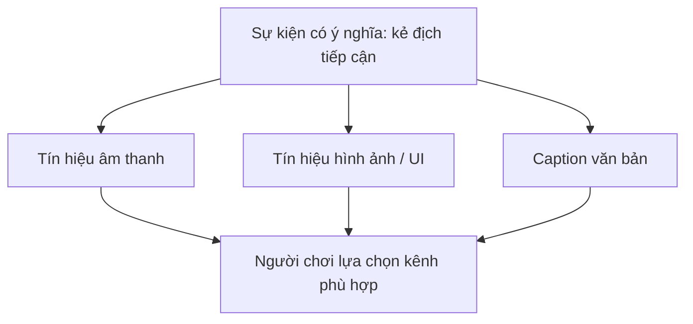

# Bài 05 — Thiết kế âm thanh có khả năng tiếp cận

## 1. Tổng quan và mục tiêu

Âm thanh có vai trò truyền đạt quan trọng, nhưng không phải ai cũng nghe được đầy đủ mọi tần số, âm lượng hoặc hướng phát. Ngoài khác biệt về thính lực, người chơi còn có thể tắt tiếng, sử dụng loa đơn kênh, chơi ở nơi ồn hoặc gặp khó khăn với việc phân biệt nhiều tiếng cùng lúc. Vì vậy, thông tin gameplay quan trọng không nên phụ thuộc duy nhất vào âm thanh.

Sau bài học, người học có thể phân tích rủi ro khi truyền đạt bằng âm thanh; thiết kế phụ đề và mô tả âm thanh (caption); tách nhóm âm lượng qua Mixer; cung cấp phản hồi thị giác thay thế; và xây dựng bộ kiểm thử với chế độ mute.

## 2. Nguyên tắc thiết kế đa kênh



Ví dụ: một kẻ địch bắn từ phía phải. Tiếng súng là phản hồi tốt cho người nghe, nhưng cần cân nhắc thêm mũi tên chỉ hướng nguy hiểm, cảnh báo trên HUD hoặc hiệu ứng hình ảnh dễ phân biệt. Chỉ dùng hiệu ứng màu mà không có hình dạng/biểu tượng khác cũng có thể loại trừ một số người chơi.

### 2.1. Subtitles và captions

- **Subtitles:** tập trung vào nội dung lời thoại được nói. Tùy trường hợp, chúng có thể chứa tên người nói.
- **Closed captions:** ngoài lời nói còn có thể mô tả âm phi ngôn ngữ quan trọng, đặc điểm hoặc hướng của âm: `[Tiếng bước chân ở bên trái]`, `[Chuông cảnh báo vang lên]`.

Chất lượng phụ đề không chỉ là “có chữ”: người chơi cần có thời gian đọc, chữ tương phản với nền, không che thông tin quan trọng và có tùy chọn điều chỉnh kích thước nếu phù hợp. Với âm báo liên quan gameplay, mô tả phải đủ cụ thể để hỗ trợ quyết định; tránh biến caption thành văn bản dài và dày đặc.

### 2.2. Người nghe có thể cần điều chỉnh gì?

| Tính năng | Lợi ích | Kiểm thử |
|---|---|---|
| Thanh âm lượng `Master` | Điều khiển tổng mức | Từ thấp đến tắt tiếng |
| `Music`, `SFX`, `Dialogue` riêng | Giữ lời thoại rõ khi nhạc lớn | Tắt nhạc nhưng giữ tiếng cảnh báo |
| Subtitles / captions | Tiếp nhận nội dung qua chữ | Chơi không bật loa |
| Hình ảnh chỉ hướng âm | Biết phương hướng sự kiện | Đeo tai nghe một bên hoặc mono |
| Chế độ mono (nếu hỗ trợ) | Giảm phụ thuộc phân tách trái/phải | Kiểm thử toàn bộ cues quan trọng |
| Lưu lựa chọn truy cập | Không cần chỉnh lại mỗi lần | Khởi động lại game và xác nhận |

Không nên dùng âm cực lớn hoặc bất ngờ làm cách duy nhất để báo hiệu nguy hiểm. Tạo tùy chọn giảm cường độ các âm gây giật mình khi phù hợp với thể loại sản phẩm.

## 3. Thiết kế menu âm lượng bằng Audio Mixer

Tạo Mixer có các nhóm `Master`, `Music`, `SFX`, `Dialogue`. Trên mỗi nhóm cần điều khiển từ UI, expose tham số âm lượng, ví dụ `MusicDb`, `SfxDb`, `DialogueDb`.

Một hàm đổi Slider sang decibel có thể dùng như sau:

```csharp
using UnityEngine;
using UnityEngine.Audio;

public class AccessibleAudioSettings : MonoBehaviour
{
    [SerializeField] private AudioMixer mixer;

    // Unity UI Slider có giá trị 0..1.
    public void SetMusic(float value) => SetLevel("MusicDb", value);
    public void SetSfx(float value) => SetLevel("SfxDb", value);
    public void SetDialogue(float value) => SetLevel("DialogueDb", value);

    private void SetLevel(string parameter, float value)
    {
        if (mixer == null) return;
        float db = 20f * Mathf.Log10(Mathf.Max(0.0001f, Mathf.Clamp01(value)));
        mixer.SetFloat(parameter, db);
    }
}
```

**Cấu hình:** tạo Canvas với 3 Slider (0–1), trong `On Value Changed (Single)` chọn các phương thức tương ứng. Gán `AudioMixer` trong Inspector. Nếu muốn lưu cấu hình, lưu **giá trị Slider chuẩn hóa 0–1** bằng `PlayerPrefs`, khôi phục trong `Start` rồi áp dụng mức Mixer; đặt giá trị mặc định phù hợp và cho phép người chơi khôi phục mặc định.

`PlayerPrefs` thích hợp cho tùy chọn không nhạy cảm như âm lượng; không nên sử dụng làm kho chứa dữ liệu bí mật. Mã trên chỉ minh họa phần điều khiển Mixer, **chưa tự lưu và tải lại** các mức âm.

## 4. Phụ đề cho các âm quan trọng

Một cách luyện tập là tạo `TextMeshProUGUI` và điều khiển nội dung bằng một script. Cách đơn giản dưới đây phù hợp cho sự kiện lần lượt, nhưng chưa phải hệ thống phụ đề hoàn chỉnh có hàng đợi, phụ đề trùng nhau hay bản địa hóa.

```csharp
using System.Collections;
using TMPro;
using UnityEngine;

public class AudioCaptionDisplay : MonoBehaviour
{
    [SerializeField] private TextMeshProUGUI captionText;
    private Coroutine hideRoutine;

    private void Start()
    {
        if (captionText != null) captionText.text = string.Empty;
    }

    public void ShowCaption(string message)
    {
        if (captionText == null) return;
        captionText.text = message;
        if (hideRoutine != null) StopCoroutine(hideRoutine);
        hideRoutine = StartCoroutine(ClearAfterDelay(3f));
    }

    private IEnumerator ClearAfterDelay(float seconds)
    {
        yield return new WaitForSeconds(seconds);
        if (captionText != null) captionText.text = string.Empty;
        hideRoutine = null;
    }
}
```

Đặt một component này trong UI Canvas có `TextMeshProUGUI` (cần TextMesh Pro hiện diện trong project) và gọi `ShowCaption("[Tiếng bước chân ở bên trái]")` khi sự kiện âm thanh xảy ra. Ở hệ thống thực tế, các caption cần được gắn với cùng **sự kiện gameplay** với âm phát, có hàng đợi ưu tiên, hiển thị thời lượng phù hợp nội dung, localization và tùy chọn bật/tắt.

## 5. Thử nghiệm khả năng tiếp cận theo tình huống

1. **Không có âm thanh:** tắt toàn bộ âm lượng rồi thử hoàn thành nhiệm vụ. Người chơi có mất thông tin về cảnh báo hay hướng đi không?
2. **Chỉ có thoại:** tắt Music và SFX. Nội dung câu thoại có vẫn dễ hiểu và đầy đủ trên phụ đề?
3. **Tín hiệu một phía:** giả lập đầu ra mono hoặc chỉ nghe một bên; thông báo vị trí quan trọng có kênh hình ảnh thay thế?
4. **Nền giao diện phức tạp:** thử caption trên nền sáng, tối, nhiều chuyển động. Chữ có dễ đọc?
5. **Cấu hình lâu dài:** bật caption, điều chỉnh âm lượng, thoát và vào lại; lựa chọn có được lưu?
6. **Người dùng thật:** mời người thử với nhu cầu truy cập khác nhau; không chỉ dựa vào suy đoán của người phát triển.

## 6. Các lỗi thiết kế thường gặp

| Cách làm không phù hợp | Giải pháp thiết kế |
|---|---|
| Cảnh báo chỉ bằng tiếng beep | Thêm biểu tượng/trạng thái trực quan có ý nghĩa |
| Chỉ có một volume chung | Tách nhóm âm nhạc, SFX, thoại |
| Phụ đề không hiện khi âm phát ngoài màn hình | Caption nguồn âm quan trọng, kèm hướng nếu cần |
| Dựa vào màu đỏ/xanh để diễn đạt | Dùng thêm ký hiệu, chữ hoặc chuyển động |
| Cài đặt không được lưu | Dùng cấu hình lưu vĩnh viễn phù hợp |
| Âm quá dày che lấp thoại | Ưu tiên độ rõ, kiểm soát mixer/ducking và kiểm thử |

## 7. Bài thực hành

Tạo một scene có âm cảnh báo kẻ địch, lời thoại hướng dẫn và nhạc nền. Cài đặt ba Slider âm lượng riêng; caption cho âm cảnh báo; biểu tượng chỉ hướng nguy hiểm. Hoàn thành bài khi người thử có thể nhận biết tín hiệu thiết yếu **trong điều kiện tắt âm toàn bộ**. Lưu video đối chứng âm bật/âm tắt và bảng lỗi trước/sau khi sửa.

## 8. Câu hỏi ôn tập

**Câu 1.** Vì sao cảnh báo nguy hiểm không nên chỉ truyền qua âm thanh?  
A. Người chơi có thể không nghe được hoặc đã tắt tiếng · B. Unity không có AudioSource · C. Captions luôn làm game chậm · D. Mixer tự tạo biểu tượng

**Đáp án: A.** Cần có phương thức truyền thông tin tương đương để tránh bỏ lỡ hành động quan trọng.

**Câu 2.** Nội dung `[Tiếng kính vỡ phía sau]` phù hợp nhất với gì?  
A. FPS · B. Texture · C. Closed caption · D. Collider

**Đáp án: C.** Đây là mô tả âm phi ngôn ngữ quan trọng.

**Câu 3.** Tính năng nào giúp giảm nhạc nền nhưng giữ tiếng thoại?  
A. Tăng Doppler · B. Các nhóm âm lượng riêng trong AudioMixer · C. Tắt Camera · D. Đổi Shader

**Đáp án: B.** Tách bus cho phép điều chỉnh từng lớp.

**Câu 4.** Một tiếng chỉ phát ở tai phải mà không có dấu hiệu khác sẽ gây rủi ro gì?  
A. Tăng sample rate · B. Thay đổi pitch · C. Giảm draw calls · D. Bỏ lỡ thông tin hướng với người nghe mono hoặc một bên

**Đáp án: D.** Việc truyền tín hiệu chỉ qua chênh lệch trái/phải không đủ khả năng tiếp cận.

**Câu 5.** Kiểm thử nào trực tiếp nhất để kiểm tra gameplay không phụ thuộc âm thanh?  
A. Chơi toàn bộ nhiệm vụ ở chế độ mute · B. Chỉ thử trên loa đắt tiền · C. Tắt ánh sáng · D. Tăng hết các âm lên 100%

**Đáp án: A.** Kiểm thử mute làm lộ các thông tin quan trọng chỉ có trong kênh âm thanh.

## 9. Tổng kết và tài liệu tham khảo

Âm thanh phục vụ trải nghiệm, nhưng thông tin quan trọng phải đến được với người dùng qua các kênh phù hợp. Hãy thiết kế caption, tín hiệu hình ảnh và tùy chọn âm lượng ngay từ đầu thay vì vá ở cuối quy trình.

- [Microsoft — Xbox Accessibility Guidelines, mục 103–105](https://learn.microsoft.com/gaming/accessibility/guidelines).
- [Microsoft — Xbox Accessibility Guideline 104: Subtitles and captions](https://learn.microsoft.com/en-au/gaming/accessibility/xbox-accessibility-guidelines/104).
- [Microsoft — Xbox Accessibility Guideline 105: Audio accessibility](https://learn.microsoft.com/en-au/gaming/accessibility/xbox-accessibility-guidelines/105).
- [Game Accessibility Guidelines — Basic](https://gameaccessibilityguidelines.com/basic/).
- [Unity 6.3 — Audio Mixer](https://docs.unity.com/en-us/engine/6000.3/manual/audio/mixer).
