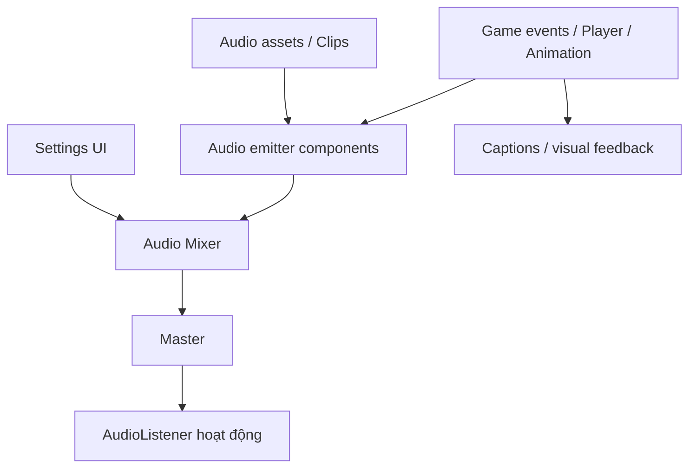

# Bài 07 — Tích hợp âm thanh vào dự án Creative Core

## 1. Bài toán dự án

Trong một dự án hoàn chỉnh, âm thanh phải phục vụ cơ chế tương tác, nhịp kể chuyện, định hướng không gian và khả năng tiếp cận. Một soundscape chạy tốt ở scene thử nghiệm vẫn có thể gặp lỗi khi tích hợp: camera mới tạo thêm `AudioListener`, các scene sử dụng Mixer khác nhau, event chạy khi pause, hoặc clip được phát trước lúc người chơi hành động.

Bài này hướng dẫn quy trình đưa hệ thống audio vào **dự án đang phát triển**, ví dụ cửa hàng khoa học viễn tưởng, thị trấn ven biển hoặc mô hình kiến trúc. Chọn một bối cảnh phù hợp thay vì thêm mọi ví dụ cùng lúc.

## 2. Mục tiêu và định nghĩa hoàn thành

Sau khi hoàn tất, dự án cần có một bản thiết kế âm thanh ngắn; nguồn ambience; ít nhất một nguồn 3D; ít nhất một SFX theo tương tác; Mixer chia nhóm; lựa chọn âm lượng dễ thao tác; và bộ kiểm thử gồm nghe bình thường, nghe ở mức thấp và chơi mute.

Một tích hợp đạt chất lượng khi: âm chỉ phát khi đúng trạng thái; không mất bất ngờ khi thay scene; khối lượng âm được kiểm soát; và thông tin gameplay quan trọng có cách biểu đạt không phụ thuộc vào âm thanh.

## 3. Phân tích nhu cầu theo bối cảnh

| Bối cảnh | Âm nền | Nguồn 3D | Âm tương tác | Hiệu ứng |
|---|---|---|---|---|
| Cửa hàng tương lai | Điều hòa, tiếng máy êm | Thiết bị/robot cạnh quầy | Chạm màn hình, mở cửa | Low-pass qua phòng khác |
| Thị trấn ven biển | Gió, sóng xa | Hải âu, chuông tàu, đài phun | Bước chân, nhặt đồ | Rolloff theo khoảng cách |
| Phòng trưng bày kiến trúc | Room tone nhẹ | Đài nước hoặc âm thanh lắp đặt | Nút thông tin, cửa | Reverb theo phòng |

Với mỗi âm, xác định tính năng mà người dùng **cần** và tính năng chỉ **trang trí**. Âm phục vụ nhiệm vụ có mức ưu tiên thiết kế cao hơn một lớp ambience phụ.

## 4. Kiến trúc dự án đề xuất



Sơ đồ phân tách **nguồn sự kiện**, **nguồn âm** và **điều khiển trộn**. Với dự án lớn, có thể thêm Audio Manager hoặc event bus ở lớp trung gian; với prototype nhỏ, script trực tiếp trên đối tượng có thể đủ và dễ debug hơn. Tránh tạo một singleton phức tạp khi chưa có nhu cầu qua scene.

## 5. Kế hoạch triển khai

### 5.1. Milestone 1 — Kiểm kê scene

Duyệt hierarchy và lập bảng tất cả `AudioSource`, `AudioListener`, clip, nhóm Mixer và sự kiện có thể phát âm. Đặc biệt kiểm tra prefab camera; nếu các scene được load additive, bảo đảm không có nhiều listener hoạt động đồng thời. Xem xét âm nào nên tiếp tục khi chuyển scene, âm nào phải ngừng.

### 5.2. Milestone 2 — Quy ước asset và mixer

Gợi ý cấu trúc:

```text
Assets/
└── Audio/
    ├── Clips/
    │   ├── Ambience/
    │   ├── Interactions/
    │   └── UI/
    ├── Mixers/
    ├── Scripts/
    └── Documentation/
```

Thiết lập một Audio Mixer với `Master`, `Music`, `Ambience`, `SFX`, `Dialogue` (bỏ nhóm không dùng). Dùng tên nhất quán, tránh trộn toàn bộ nguồn vào Master nếu dự án cần tùy chỉnh âm lượng theo loại.

### 5.3. Milestone 3 — Tích hợp âm môi trường và tương tác

Tạo ambience phát lặp phù hợp; thiết lập `Spatial Blend` theo vai trò của từng nguồn. Chọn ít nhất một điểm âm 3D và nghe thử ở gần/xa. Kết nối SFX với một sự kiện có điều kiện như nhấn nút hoặc mở cửa; tắt `Play On Awake` cho các nguồn chỉ phát theo sự kiện.

Nếu đã có hệ thống animation nhân vật, đặt bước chân theo `Animation Event` hoặc event từ state machine. Không tái tạo một bộ footstep thứ hai khi đã có script cũ; cần kiểm tra xung đột để tránh phát đôi.

### 5.4. Milestone 4 — Kiểm soát trạng thái

Xác định ba tình huống:

- **Gameplay:** phát ambience và SFX theo hành động.
- **Pause/menu:** giữ hoặc giảm ambience theo chủ đích; âm UI vẫn nghe được.
- **Scene transition:** dừng hoặc crossfade những nguồn cần chuyển tiếp; không để nguồn cũ phát trùng khi scene mới xuất hiện.

Không mặc định mọi audio phải dừng bằng `Time.timeScale = 0`: `AudioSource` không tự đồng bộ hoàn toàn với mọi yêu cầu pause gameplay. Nếu cần pause toàn bộ âm, kiểm tra `AudioListener.pause` và `AudioSource.ignoreListenerPause` theo thiết kế. Thử riêng UI và nhạc để xác nhận hành vi mong muốn.

### 5.5. Milestone 5 — Accessibility và tối ưu hóa

Thêm menu âm lượng, caption/thông báo hình ảnh cho âm thiết yếu và lưu cấu hình khi cần. Chọn cách load clip phù hợp: clip rất ngắn phát thường xuyên có thể dùng `Decompress On Load`; âm dài như nhạc/ambience có thể ưu tiên `Streaming` để giảm bộ nhớ giải nén. Đây là lựa chọn phụ thuộc mục tiêu nền tảng và kết quả đo, không phải mặc định luôn đúng.

## 6. Kiểm thử tích hợp và nghiệm thu

| ID | Tình huống | Kết quả mong đợi |
|---|---|---|
| T01 | Bắt đầu scene | Chỉ ambience được thiết kế tự phát |
| T02 | Đến gần nguồn âm | Mức nghe thay đổi có chủ đích |
| T03 | Nhấn tương tác | SFX phát đúng một lần cho mỗi sự kiện |
| T04 | Pause / resume | Âm gameplay và UI hoạt động theo thiết kế |
| T05 | Chuyển scene | Không có nguồn rác hoặc listener trùng |
| T06 | Slider Music/SFX | Nhóm tương ứng thay đổi, nhóm khác vẫn đúng |
| T07 | Chơi ở chế độ mute | Không bỏ lỡ thông tin thiết yếu |
| T08 | Bật nhiều âm cùng lúc | Không gây khó nghe/clipping đáng kể |

**Deliverables:** scene hoặc build hoạt động; `AudioDesign.md`; ảnh cấu trúc Mixer và Inspector; video demo; bảng kiểm thử với kết quả pass/fail; ghi công asset.

**Definition of Done:** tất cả tình huống quan trọng đều có kết quả đã kiểm chứng; các lỗi còn tồn tại được mô tả bằng cách tái hiện, không bị che giấu chỉ vì demo ngắn chạy tốt.

## 7. Điểm dễ sai khi đưa vào dự án thật

| Tình huống | Hướng xử lý |
|---|---|
| `DontDestroyOnLoad` tạo bản sao Audio Manager | Kiểm soát vòng đời instance và không tạo trùng |
| Prefab camera có thêm listener | Chỉ giữ listener đang phục vụ người chơi |
| UI Slider đổi giá trị nhưng Mixer không đổi | Kiểm tra exposed name, output routing, callback |
| Scene mới mất âm nền | Kiểm tra vòng đời nguồn, clip tham chiếu và tự phát |
| Âm trên Pause vẫn tiếp tục ngoài ý muốn | Xác định rõ chính sách pause âm thay vì chỉ sửa Time Scale |
| Phát âm gấp nhiều lần sau load additive | Kiểm tra đăng ký event trùng / nhiều listener xử lý sự kiện |

## 8. Câu hỏi ôn tập

**Câu 1.** Khi chuyển scene xuất hiện cảnh báo hai `AudioListener`, cần làm gì?  
A. Tăng Priority · B. Kiểm tra camera/scene và bảo đảm chỉ một listener hoạt động · C. Đổi codec · D. Tắt hết AudioSource

**Đáp án: B.** Nhiều listener hoạt động là lỗi cấu hình scene thường gặp.

**Câu 2.** Vì sao nên tạo nhóm Music và SFX riêng trong Mixer?  
A. Để giảm số GameObject · B. Để mỗi nhóm có shader khác · C. Để tăng sample rate · D. Để điều chỉnh và kiểm thử độc lập các lớp âm

**Đáp án: D.** Tách nhóm hỗ trợ mixing và khả năng tiếp cận.

**Câu 3.** Tại sao không nên mặc định Time.timeScale = 0 sẽ dừng đúng mọi âm?  
A. Time Scale không phải cơ chế chính sách audio đầy đủ · B. Chỉ hoạt động với Camera · C. Không có trên Unity · D. Luôn khiến clip bị hỏng

**Đáp án: A.** Cần xác định pause/resume audio độc lập theo yêu cầu trò chơi.

**Câu 4.** Một cảnh có nhiều đoạn thoại dài, lựa chọn tối ưu nào cần xem xét và đo?  
A. Tất cả clip PCM uncompressed · B. Mỗi thoại có listener riêng · C. Streaming/Compression/Memory trade-off bằng Profiler · D. Tăng volume lên 1

**Đáp án: C.** Thiết kế load type ảnh hưởng RAM, CPU và trải nghiệm trên nền tảng đích.

**Câu 5.** Bằng chứng tích hợp tốt nhất cho SFX tương tác là gì?  
A. Có file `.wav` · B. Thử nghiệm event chỉ phát khi điều kiện đúng, kèm trường hợp không được phát · C. Có audio đẹp · D. Có nhiều source

**Đáp án: B.** Test cả điều kiện đúng và sai chứng minh sự kiện được nối chính xác.

## 9. Tổng kết và tài liệu tham khảo

Tích hợp audio là công việc thiết kế hệ thống: xác định mục đích, quản trị tài nguyên, chọn cơ chế tương tác, cân bằng mức âm và kiểm thử giữa các trạng thái. Một scene tốt là scene người dùng **nghe đúng thứ cần nghe, vào đúng lúc**, hoặc vẫn tiếp nhận được thông tin khi không thể nghe.

- [Unity Learn — Creative Core: Audio](https://learn.unity.com/project/creative-core-audio?courseId=630e6872edbc2a2e1b59d4ac).
- [Unity 6.3 — Audio](https://docs.unity.com/en-us/engine/6000.3/manual/audio).
- [Unity 6.3 — Audio Import Settings](https://docs.unity.com/en-us/engine/6000.3/manual/audio/reference/class-audio-clip).
- [Unity 6.3 — Audio Mixer](https://docs.unity.com/en-us/engine/6000.3/manual/audio/mixer).
