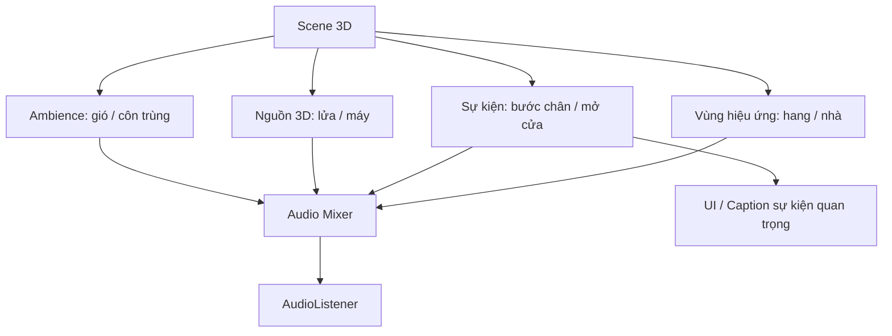

# Bài 06 — Thử thách: Tự thiết kế một soundscape

## 1. Bối cảnh và mục tiêu sản phẩm

Một scene 3D có mô hình đẹp nhưng thiếu âm thanh thường chưa tạo được cảm giác môi trường sống. Nhiệm vụ của bạn là thiết kế một **cảnh quan âm thanh độc lập**, trong đó từng lớp có vai trò và vị trí rõ ràng; âm phản ứng hợp lý với hành động của người chơi; hiệu ứng môi trường giúp tạo bối cảnh; và thông tin thiết yếu không bị mất khi tắt tiếng.

Bài này là **thử thách thực hành**, vì vậy không đưa một đáp án hay bộ script hoàn chỉnh. Người học có quyền lựa chọn clip, kịch bản và phong cách nhưng phải kiểm chứng được những yêu cầu chức năng đã thiết kế.

## 2. Đề bài

**Tình huống đề xuất:** dựng khung cảnh *trại lửa gần một căn nhà vào ban đêm* hoặc lựa chọn một môi trường khác có đủ đối tượng phát âm như bãi biển, khu chợ, ga tàu, nhà kho, hang đá.

Thiết kế ít nhất **5 hiệu ứng/nguồn âm có ý nghĩa riêng** trong soundscape, bao gồm các nhóm sau:

- **Âm nền môi trường:** ví dụ gió đêm hoặc côn trùng; có thể là 2D hoặc 3D tùy ý đồ.
- **Âm có vị trí trong thế giới:** ví dụ tiếng lửa cháy, quạt điện hoặc máy phát; cấu hình suy giảm khoảng cách 3D.
- **Âm theo sự kiện:** ví dụ tiếng mở cửa, bước chân theo chuyển động hoặc nhặt vật.
- **Âm chịu hiệu ứng đặc biệt:** ví dụ vang trong không gian kín hoặc lọc qua cánh cửa.
- **Âm truyền tải trạng thái:** ví dụ tiếng chuông nhiệm vụ hoặc cảnh báo; có tín hiệu hình ảnh/caption thay thế nếu thiết yếu cho gameplay.

Năm nhóm này là **bộ tiêu chí tự biên soạn cho bài thực hành** nhằm kiểm tra toàn diện các kỹ năng học được; không mặc định là nguyên văn yêu cầu chấm điểm của Unity Learn. Có thể dùng một số nguồn âm đáp ứng nhiều tiêu chí nhưng phải có ít nhất năm trải nghiệm âm khác biệt mà người thử nhận ra được.

## 3. Kiến thức cần vận dụng

| Chủ đề | Kỹ năng kiểm chứng |
|---|---|
| `AudioClip` + `AudioSource` | Nhập và phát clip đúng sự kiện |
| 2D / 3D | Chọn đúng `Spatial Blend` |
| Rolloff | Điều chỉnh cảm giác khoảng cách |
| Animation / Trigger event | Phát đúng thời điểm tương tác |
| Reverb / Filter / Mixer | Thể hiện sự khác biệt của không gian |
| Priority và trộn âm | Đảm bảo âm quan trọng được nghe rõ |
| Accessibility | Không để thông tin gameplay chỉ có qua âm |

## 4. Kiến trúc soundscape cần xây dựng

Sơ đồ xác định các nhánh trách nhiệm, không nhất thiết mỗi nhóm là một scene hoặc script riêng. Mỗi nhánh phải có một test case chứng minh nó hoạt động.

## 5. Quy trình triển khai theo mốc

### 5.1. Mốc A — Kế hoạch âm thanh

Lập **Audio Design Sheet** trước khi thêm asset. Với mỗi âm, ghi: tên, vai trò, nguồn phát, 2D/3D, chế độ lặp, cơ chế kích hoạt, vị trí và cấp độ ưu tiên. Ghi rõ giấy phép sử dụng âm thanh và tên tác giả cần ghi công nếu asset yêu cầu.

Ví dụ:

| ID | Âm | Vị trí / vai trò | Kích hoạt | Dấu hiệu đạt |
|---|---|---|---|---|
| A1 | Gió | Ambience diện rộng | Loop | Nghe ổn định khi đi lại |
| A2 | Lửa cháy | Đống lửa 3D | Loop | Đến gần nghe rõ hơn |
| A3 | Mở cửa | Cánh cửa | Trigger | Chỉ phát lúc mở |
| A4 | Bước chân | Nhân vật | Animation Event | Đúng nhịp chân |
| A5 | Tiếng vang | Không gian kín | Zone/Effect | Vào vùng nhận thấy khác biệt |

### 5.2. Mốc B — Âm nền và nguồn 3D

Tạo đối tượng phát âm cho ambience và nguồn có vị trí. Kiểm tra `Play On Awake`, `Loop`, `Spatial Blend` và `Rolloff Mode`. Thử nghe từng âm độc lập trước khi bật cả scene, tránh che lấp khiến khó nhận diện lỗi.

### 5.3. Mốc C — Tương tác

Tạo ít nhất một tương tác có điều kiện rõ: bước qua cửa, bước chân chạm đất hoặc nhặt vật. Kiểm chứng âm **không phát** khi điều kiện chưa xảy ra và **phát đúng** khi điều kiện xảy ra. Nếu chọn va chạm/trigger, xác nhận cấu hình Collider và Rigidbody/CharacterController phù hợp với sự kiện Unity đang dùng.

### 5.4. Mốc D — Hiệu ứng và Mixer

Thêm ít nhất một `Audio Reverb Zone` hoặc `Audio Filter`; chỉnh một nhóm trên `AudioMixer` để cân bằng nhiều nguồn. Thực hiện so sánh A/B bật/tắt hiệu ứng, tự trả lời hiệu ứng có hỗ trợ câu chuyện/địa điểm hay chỉ gây ồn.

### 5.5. Mốc E — Kiểm thử và cải tiến

Thử ba tình huống: đi từ xa đến gần, thực hiện tương tác lặp, và tắt toàn bộ âm thanh. Ghi nhận một vấn đề thực sự (ví dụ nghe rối, tiếng cửa tự phát, không biết nguồn nguy hiểm khi mute), sửa đúng một nguyên nhân trước khi kiểm thử lại.

## 6. Các tiêu chí nghiệm thu

- [ ] Scene có ít nhất năm trải nghiệm âm khác nhau, với chức năng rõ ràng.
- [ ] Có âm môi trường và âm có nguồn phát trong không gian 3D.
- [ ] Có âm được kích hoạt bởi hành động/sự kiện.
- [ ] Có thử nghiệm trước/sau với reverb, filter hoặc hiệu ứng Mixer.
- [ ] Có đánh giá khả năng nghe rõ các âm quan trọng khi cùng phát.
- [ ] Có cơ chế hình ảnh/caption cho mọi tín hiệu âm **thiết yếu** của nhiệm vụ.
- [ ] Có file scene/project chạy được, video demo và bảng kiểm thử.
- [ ] Có ghi công/giấy phép cho các asset âm thanh sử dụng.

**Rubric gợi ý tự chấm (100 điểm)**

| Hạng mục | Điểm | Bằng chứng |
|---|---:|---|
| Thiết kế soundscape hợp ngữ cảnh | 20 | Bản thiết kế và demo |
| Phát âm 2D/3D, khoảng cách chính xác với ý đồ | 20 | Kiểm tra gần/xa |
| Tính tương tác, đồng bộ sự kiện | 20 | Test tương tác |
| Hiệu ứng, Mixer, cân bằng | 15 | A/B hiệu ứng |
| Accessibility | 15 | Kiểm thử mute |
| Tài liệu, debug, bản demo | 10 | Bảng test và video |

Bảng điểm trên phục vụ tự đánh giá, không phải hệ thống điểm chính thức của Unity Learn.

## 7. Gợi ý xử lý vấn đề (không phải lời giải)

Nếu tiếng môi trường nghe rối, hãy thử mute từng layer rồi kiểm tra lớp nào trùng chức năng; nếu âm 3D không thay đổi khoảng cách, kiểm tra `Spatial Blend` và rolloff; nếu event không phát, tạm log callback; nếu effect thiếu rõ ràng, thử đổi preset và so sánh ở cùng vị trí nghe. Với nguồn âm dài, xem lại Import Settings và `Audio Profiler` trước khi tối ưu.

## 8. Sản phẩm cần nộp

Một thư mục dự án chứa scene, script và các audio assets hợp lệ; một video demo ngắn thể hiện ba tình huống kiểm thử; `AudioDesign.md` giải thích lựa chọn âm; `TestReport.md` ghi lỗi, cách tái hiện, thay đổi và kết quả kiểm tra lại. Nếu sử dụng tài nguyên theo giấy phép yêu cầu attribution, thêm file `CREDITS.md`.

## 9. Câu hỏi tự đánh giá

**Câu 1.** Điều gì chứng minh một hiệu ứng là 3D có suy giảm khoảng cách chứ không phải chỉ gắn trên đối tượng?  
A. Có icon AudioSource · B. Có mesh · C. Mức nghe thay đổi có thể kiểm chứng khi người nghe di chuyển · D. Đổi tên object

**Đáp án: C.** Cần quan sát hành vi nghe, không chỉ sự tồn tại của component.

**Câu 2.** Khi âm cửa phát ngay lúc Play nhưng bạn muốn phát khi mở cửa, kiểm tra gì trước?  
A. `Play On Awake` · B. `Skybox` · C. `Lightmap` · D. `Collider Material`

**Đáp án: A.** Bật tự phát là nguyên nhân thường gặp nhất.

**Câu 3.** Dữ liệu nào phù hợp nhất để chứng minh đã sửa một lỗi?  
A. Tên tác giả clip · B. Một screenshot bất kỳ · C. Chỉ mô tả cảm giác · D. Tình huống tái hiện, kết quả trước/sau và cách sửa

**Đáp án: D.** Đây là chứng cứ có thể kiểm tra lại.

**Câu 4.** Khi nguồn SFX quan trọng bị âm nhạc che, phương án đầu tiên hợp lý là gì?  
A. Đổi Camera · B. Cân bằng các nhóm Mixer, ưu tiên độ rõ · C. Xóa hết Collider · D. Tăng tất cả âm lượng

**Đáp án: B.** Mix tốt giải quyết cạnh tranh về cảm nhận mà không làm tổng tín hiệu quá lớn.

**Câu 5.** Vì sao cần thử scene ở chế độ mute?  
A. Để tăng hiệu ứng Doppler · B. Để phát hiện âm lỗi · C. Để phát hiện thông tin thiết yếu chỉ truyền qua âm thanh · D. Để giảm kích thước build

**Đáp án: C.** Đây là phép kiểm chứng tính tiếp cận rất trực tiếp.

## 10. Tài liệu tham khảo

- [Unity Learn — Creative Core: Audio, thử thách Your own soundscape](https://learn.unity.com/project/creative-core-audio?courseId=630e6872edbc2a2e1b59d4ac).
- [Unity 6.3 — Audio Mixer](https://docs.unity.com/en-us/engine/6000.3/manual/audio/mixer).
- [Unity — Audio Clip Import Settings](https://docs.unity.com/en-us/engine/6000.3/manual/audio/reference/class-audio-clip).
- [Game Accessibility Guidelines — Hearing](https://gameaccessibilityguidelines.com/full-list/).
