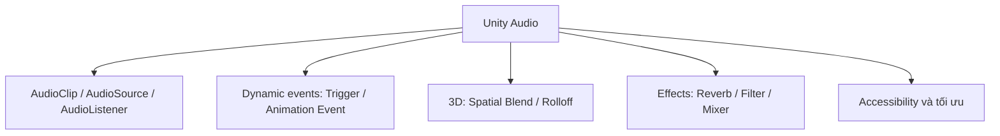

# Bài 08 — Ôn tập và đánh giá Creative Core Audio

## 1. Mục tiêu và hướng dẫn

Bài kiểm tra này đánh giá khả năng **giải thích nguyên lý và chọn cấu hình thực tế** cho hệ thống âm thanh Unity. Các tình huống bao gồm nguồn âm, kích hoạt theo sự kiện, âm không gian, reverb, Mixer, tối ưu và khả năng tiếp cận.

Đây là **bộ câu hỏi luyện tập độc lập bằng tiếng Việt**, không phải đáp án hoặc bản sao của bài quiz chính thức trên Unity Learn. Mỗi câu có bốn lựa chọn và một phương án phù hợp nhất. Bạn có thể chọn mục tiêu tự đánh giá từ 10/12 câu trở lên, nhưng đây **không phải ngưỡng đậu chính thức**. Đáp án không kèm theo để giữ đúng hình thức bài đánh giá; sau khi hoàn thành, người học nên đối chiếu với kiến thức và thử nghiệm trong các bài học.

## 2. Bản đồ kiến thức

Muốn làm tốt, bạn cần phân biệt giữa **thời điểm phát âm**, **vị trí nghe**, **xử lý hiệu ứng**, **độ ưu tiên phát** và **mục đích truyền đạt**. Các yếu tố có liên quan nhưng không thay thế cho nhau.

## 3. Bài trắc nghiệm

### Câu 1

Một scene Unity 3D có nhiều nguồn âm trên các đối tượng khác nhau. Thông thường nên có bao nhiêu `AudioListener` hoạt động để nghe chính xác cảnh này?

A. Một trên mỗi `AudioSource`  
B. Một trên mỗi vật thể tương tác  
C. Một `AudioListener` đang hoạt động  
D. Ít nhất hai để tạo stereo

### Câu 2

Nhạc nền dùng để tạo cảm xúc, nhưng không phát ra từ bất kỳ vật thể nào trong thế giới trò chơi, thuộc nhóm nào?

A. Non-diegetic  
B. Diegetic  
C. Foley  
D. Âm thanh vị trí bắt buộc

### Câu 3

Khi nhập một tệp `.wav` hoặc `.ogg` được Unity hỗ trợ vào Project, tài nguyên dùng làm nội dung phát của `AudioSource` có kiểu nào?

A. `AudioListener`  
B. `AudioMixer`  
C. `AudioReverbZone`  
D. `AudioClip`

### Câu 4

Bạn muốn tiếng cửa chỉ phát khi nhân vật kích hoạt công tắc, nhưng âm phát ngay sau khi nhấn Play trong Editor. Thuộc tính nên kiểm tra đầu tiên là gì?

A. `Doppler Level`  
B. `Play On Awake`  
C. `Spread`  
D. `Max Distance`

### Câu 5

Một bước chân phải phát đúng lúc chân đặt xuống nền trong animation. Cách đồng bộ thích hợp là gì?

A. Phát theo timer cố định mỗi giây  
B. Cho `Loop` vĩnh viễn  
C. Dùng `Animation Event` ở khung hình tiếp xúc  
D. Đặt AudioSource trên Main Camera

### Câu 6

Tiếng chuông gắn với một ngọn tháp cần thay đổi theo vị trí và khoảng cách của người nghe. Cấu hình khởi đầu phù hợp nhất?

A. `Spatial Blend = 1` và thiết lập rolloff  
B. `Spatial Blend = 0` và tắt Listener  
C. `Loop = false` là đủ  
D. Bật `Play On Awake` là đủ

### Câu 7

Trong chế độ `Linear Rolloff`, nếu muốn âm giảm dần và trở về 0 tại một ranh giới thiết kế, thông số nào xác định ranh giới đó?

A. `Pitch`  
B. `Priority`  
C. `Min Distance`  
D. `Max Distance`

### Câu 8

Bạn muốn tiếng bước chân khi vào hang có đuôi vang rõ hơn so với ngoài đồng trống. Giải pháp hợp ngữ cảnh nhất là gì?

A. Tăng sample rate của clip  
B. Tạo `Audio Reverb Zone` có preset phù hợp  
C. Thêm một AudioListener thứ hai  
D. Đặt `Spatial Blend = 0` cho mọi nguồn

### Câu 9

Trong Unity, đặt `AudioSource.priority` từ 128 xuống 64 chủ yếu tạo tác động gì?

A. Làm clip to gấp đôi  
B. Đổi âm thanh thành mono  
C. Tăng mức ưu tiên khi phân bổ voice  
D. Tăng pitch của clip

### Câu 10

Bạn muốn người chơi điều chỉnh âm lượng nhạc, hiệu ứng và thoại độc lập với nhau. Kiến trúc nào phù hợp nhất?

A. Audio Mixer với các nhóm Music, SFX, Dialogue  
B. Một AudioSource duy nhất cho tất cả âm  
C. Một AudioListener cho mỗi nhóm  
D. Chỉ dùng `Time.timeScale`

### Câu 11

Lựa chọn nào thường phù hợp hơn để giảm chi phí bộ nhớ cho một đoạn nhạc nền dài, với điều kiện vẫn đo trên nền tảng đích?

A. Luôn chọn PCM không nén  
B. Tăng số kênh không cần thiết  
C. Dùng tất cả clip ở `Decompress On Load`  
D. Xem xét `Streaming` trong Audio Import Settings

### Câu 12

Bạn thiết kế một cảnh báo nguy hiểm chỉ bằng tiếng động phát từ bên trái. Thay đổi nào giúp tăng khả năng tiếp cận nhất?

A. Tăng âm lượng tối đa  
B. Bổ sung biểu tượng chỉ hướng hoặc caption thích hợp  
C. Tắt camera  
D. Đổi clip sang định dạng khác

## 4. Bài đánh giá tình huống

**Tình huống A — Thác nước nghe quá lớn:** Một `AudioSource` tiếng thác cách người chơi khá xa vẫn nghe to. Người học phải liệt kê ít nhất ba giả thuyết có thể kiểm chứng (`Spatial Blend`, `Rolloff`, `Volume`, routing Mixer, vị trí listener), sau đó đề xuất trình tự thử chỉ thay một yếu tố mỗi lần.

**Tình huống B — Bước chân lặp không tự nhiên:** Một nhân vật phát đúng thời điểm nhưng chỉ dùng một clip. Người học giải thích cách dùng mảng clip/biến thể, kỹ thuật random và giới hạn của việc thay `Pitch` trên một `AudioSource` khi nhiều one-shot chồng nhau.

**Tình huống C — Người chơi tắt âm:** Một nhiệm vụ yêu cầu tìm cánh cửa dựa hoàn toàn vào tiếng bíp. Người học đề xuất ít nhất hai tín hiệu thị giác và kế hoạch kiểm thử mute để chứng minh nhiệm vụ vẫn hoàn thành được.

### Tiêu chí tự chấm bài tình huống

Mỗi tình huống đạt yêu cầu khi có: mô tả đúng nguyên nhân có thể xảy ra, cách kiểm tra cụ thể trong Unity Editor/Play Mode, dự đoán kết quả thay đổi, và tiêu chí xác nhận sau khi sửa.

## 5. Tổng kết

Sử dụng Unity Audio hiệu quả đòi hỏi nhiều hơn việc gán một tệp âm: bạn phải lựa chọn **nguồn và thời điểm phát**, **xử lý vị trí**, **hiệu ứng**, **cân bằng mức trộn**, **ngân sách tài nguyên** và **khả năng tiếp cận**. Những quyết định này cần được đánh giá bằng hành vi thực tế của scene và người chơi.

## 6. Tài liệu tham khảo

- [Unity Learn — Creative Core: Audio Quiz](https://learn.unity.com/course/creative-core-audio/quiz/creative-core-audio-quiz?version=6.0).
- [Unity 6.3 — Audio](https://docs.unity.com/en-us/engine/6000.3/manual/audio).
- [Unity 6.3 — Audio Source](https://docs.unity.com/en-us/engine/6000.3/manual/audio/reference/class-audio-source).
- [Unity 6.3 — Audio Mixer](https://docs.unity.com/en-us/engine/6000.3/manual/audio/mixer).
- [Microsoft — Xbox Accessibility Guidelines](https://learn.microsoft.com/gaming/accessibility/guidelines).
