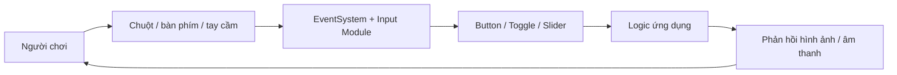

# Bài 01 — Nhập môn thiết kế giao diện người dùng trong Unity

> **Creative Core · UI · Bài học nền tảng · Unity 6.3**  
> **Kết quả:** Phân biệt UI/UX và ba hệ thống UI trong Unity; thiết lập một scene nền để xây dựng màn hình tiêu đề và menu cài đặt.

## 1. Tóm tắt và mục tiêu học tập

Giao diện người dùng (*User Interface — UI*) là lớp thông tin và điều khiển giúp người chơi giao tiếp với ứng dụng. Trong game 3D, UI có thể hiển thị điểm số, mục tiêu, nút tạm dừng, trạng thái nhiệm vụ, thanh âm lượng hay bảng điều khiển đặt trong thế giới ảo. UI tốt không chỉ đẹp: nó phải dễ nhận biết, có phản hồi tương tác và không che khuất nội dung quan trọng.

Sau bài này, người học có thể giải thích chức năng của UI trong game; phân biệt UI, UX, thiết kế tương tác và kiến trúc thông tin; chọn một hệ thống UI phù hợp; chuẩn bị một scene để thiết kế giao diện.

## 2. UI, UX và các lĩnh vực liên quan

Câu hỏi trước tiên không phải là “màu nút nào đẹp?” mà là “người chơi muốn làm gì và họ có biết phải thao tác ở đâu không?”. Ví dụ, để bật nhạc trong menu cài đặt, người chơi cần nhìn thấy nhãn rõ ràng, một điều khiển phù hợp và phản hồi sau khi thay đổi.

| Khái niệm | Câu hỏi trọng tâm | Ví dụ trong game |
| --- | --- | --- |
| `UX` (User Experience) | Người chơi có đạt mục tiêu một cách dễ chịu, thuận tiện không? | Có thể vào cài đặt và quay lại game mà không bị mất tiến độ |
| `IxD` (Interaction Design) | Người chơi thực hiện thao tác và nhận phản hồi thế nào? | Nhấn nút Settings mở đúng menu |
| `UI` (User Interface Design) | Thành phần hiển thị được sắp xếp, thể hiện ra sao? | Nhãn, nút, icon, màu và kích thước rõ ràng |
| Information Architecture | Thông tin và chức năng được tổ chức thế nào? | Nhóm âm thanh và đồ họa thành các khu vực khác nhau |
| Visual Design | Màu sắc, tỷ lệ, typography tạo ấn tượng gì? | Bảng màu nhất quán với bối cảnh game |

Các lĩnh vực có quan hệ chồng lấn; không nên xem đây là các vai trò hoàn toàn tách biệt. Trong một dự án nhỏ, cùng một người có thể thiết kế bố cục, viết mã và kiểm tra tính dễ dùng.

## 3. Những thành phần cơ bản của UI trong Unity

- **Text / Label:** truyền tải tiêu đề, hướng dẫn và phản hồi.
- **Image:** hiển thị nền bảng, biểu tượng, viền hay hình minh họa.
- **Button:** thực hiện một hành động tức thời, chẳng hạn mở cài đặt.
- **Toggle:** lựa chọn hai trạng thái, chẳng hạn bật/tắt nhạc.
- **Slider:** điều chỉnh một giá trị trong khoảng, chẳng hạn âm lượng.
- **Canvas:** bề mặt chứa và tổ chức các đối tượng thuộc hệ `uGUI`.
- **EventSystem:** điều phối các sự kiện con trỏ, chọn và điều hướng với module input thích hợp.



Sơ đồ thể hiện vòng lặp phản hồi. UI không nên chỉ đổi màu khi người dùng nhấn, mà còn phải cập nhật đúng trạng thái của hệ thống được điều khiển.

## 4. Ba hệ thống UI trong Unity

| Hệ thống | Cơ chế chính | Khi nào sử dụng |
| --- | --- | --- |
| **Unity UI (`uGUI`)** | `GameObject`, `Canvas`, `RectTransform`, `Component` | Giao diện trong game theo workflow của Creative Core; đặc biệt thuận tiện cho Canvas World Space |
| **UI Toolkit** | `UIDocument`, cây `VisualElement`, `UXML`, `USS` | Giao diện Editor, công cụ và nhiều màn hình runtime dạng tài liệu |
| **IMGUI** | Mã C# dựng giao diện theo kiểu immediate-mode | Debug, inspector hoặc công cụ Editor đặc thù |

Unity tiếp tục phát triển UI Toolkit. Không nên hiểu rằng chỉ có một hệ thống phù hợp với mọi dự án: hãy đánh giá yêu cầu hiển thị trong thế giới 3D, công cụ thiết kế, thư viện sẵn có và phương thức tương tác. Bộ bài này thực hành `uGUI` để sử dụng trực tiếp `Canvas`, `Button`, `Toggle`, `Slider`.

## 5. Thiết lập scene thực hành

### 5.1. Chuẩn bị

Sử dụng một dự án Unity 6 tương thích. Có thể dùng dự án mẫu của Unity Learn, mở scene `Assets/CreativeCore_UI/Scenes/TutorialScene_UI_Outdoor` nếu đã tải tài nguyên mẫu, hoặc tự tạo một scene có Camera, Directional Light và vài GameObject 3D để làm hậu cảnh.

### 5.2. Quy trình

1. Mở scene và lưu bản sao dưới tên `UI_Title_Menu.unity` để tránh sửa trực tiếp bản gốc.
2. Định vị `Main Camera` sao cho cảnh nền có chủ thể rõ ràng và còn khoảng trống dành cho tiêu đề.
3. Điều chỉnh ánh sáng hoặc vật thể nếu hậu cảnh khiến vùng đặt chữ quá rối.
4. Chạy **Play** để kiểm tra framing thực tế qua Game view; trở lại Edit mode trước khi sửa cấu trúc lâu dài.
5. Ghi lại hành động chính mà UI cần hỗ trợ: mở cài đặt, tắt nhạc, thay âm lượng, đóng cài đặt.

Một cây đối tượng dự kiến khi hoàn tất các bài thực hành:

```text
Scene
├── Main Camera
├── Directional Light
├── Environment
├── Music Source (AudioSource)
├── Canvas
│   ├── Title Text (TextMeshProUGUI)
│   ├── Settings Button (Button)
│   └── Settings Menu (Image)
│       ├── Settings Text (TextMeshProUGUI)
│       ├── Exit Button (Button)
│       ├── Music Toggle (Toggle)
│       └── Volume Slider (Slider)
└── EventSystem
```

`Canvas` quản lý hình ảnh/điều khiển, trong khi trạng thái âm thanh và logic ứng dụng có thể đặt trên GameObject khác. Việc tách phần hiển thị khỏi dữ liệu giúp tránh cấu trúc khó bảo trì.

## 6. Nguyên tắc giao diện dễ sử dụng

Ưu tiên **khả năng đọc** (kích thước chữ và tương phản), **tính nhất quán** (các nút cùng loại phản hồi giống nhau), **khả năng nhận diện** (nút đóng rõ ràng), **khả năng tiếp cận** (không dựa vào màu đơn thuần) và **khả năng thích ứng** (không tràn khỏi màn hình khi đổi tỷ lệ).

Ví dụ, một nút màu xanh lá chưa đủ để người dùng hiểu rằng âm thanh đang bật; nên kết hợp nhãn “Âm nhạc”, trạng thái Toggle và phản hồi nghe được.

## 7. Thực hành và kiểm tra

Tạo một scene nền và lập bảng thử nghiệm gồm ba thao tác: mở ứng dụng, tìm vị trí cài đặt, xác định cách trở về màn hình chính. Chụp một ảnh Game view; nhận xét ngắn xem vật thể nào chiếm sự chú ý và vị trí nào phù hợp để hiển thị tiêu đề.

Lỗi dễ gặp: nhầm UI với toàn bộ UX; chọn hệ thống UI chỉ theo xu hướng; chỉnh sửa trong Play mode rồi tưởng thay đổi được lưu; đặt nội dung UI trên hậu cảnh không đủ tương phản.

## 8. Câu hỏi ôn tập

**Câu 1.** Nhóm công việc nào chủ yếu thuộc thiết kế UI?  
A. Xây dựng thuật toán pathfinding  
B. Lập kế hoạch marketing  
C. Bố cục, nhãn và hình thức của menu  
D. Tối ưu shader nước  
**Đáp án: C.** **Giải thích:** UI tập trung vào các thành phần người dùng trực tiếp nhìn và thao tác.

**Câu 2.** Muốn dựng một bảng điều khiển 3D chứa các Button trong cảnh theo cách tiếp cận của bài học, nên dùng gì?  
A. uGUI với World Space Canvas  
B. Chỉ dùng IMGUI  
C. Chỉ dùng shader  
D. Audio Mixer  
**Đáp án: A.** **Giải thích:** Canvas ở World Space có thể đặt, xoay và tương tác trong không gian 3D.

**Câu 3.** Vì sao UI cần phản hồi sau thao tác?  
A. Để tăng số polygon  
B. Để người dùng biết thao tác có được ghi nhận hay không  
C. Để loại bỏ âm thanh  
D. Để khóa FPS  
**Đáp án: B.** **Giải thích:** Phản hồi củng cố mối liên hệ giữa hành động và kết quả.

**Câu 4.** Thành phần nào thường điều phối sự kiện chọn và nhập liệu trong uGUI?  
A. Sprite Editor  
B. Directional Light  
C. Mesh Collider  
D. EventSystem  
**Đáp án: D.** **Giải thích:** EventSystem cùng module input xử lý những tương tác UI tương ứng.

**Câu 5.** Người chơi khó tìm chức năng chỉnh nhạc giữa nhiều menu. Vấn đề liên quan trực tiếp nhất đến điều gì?  
A. Độ phân giải texture  
B. Bản đồ UV  
C. Kiến trúc thông tin và cấu trúc điều hướng  
D. Hệ thống hạt  
**Đáp án: C.** **Giải thích:** Việc tổ chức chức năng quyết định khả năng tìm kiếm thông tin.

## 9. Tổng kết và tài liệu tham khảo

Thiết kế UI bắt đầu từ mục tiêu tương tác; uGUI cung cấp một hệ thống dựa trên GameObject và Canvas để xây dựng menu, HUD và điều khiển cơ bản. Sản phẩm của bài này là một scene 3D có framing sẵn sàng cho UI.

- [Unity Learn — Get started with user interfaces](https://learn.unity.com/pathway/creative-core/unit/creative-core-ui/tutorial/get-started-with-user-interfaces?version=6.3)
- [Unity Learn — Creative Core: UI](https://learn.unity.com/pathway/creative-core/unit/creative-core-ui?version=6.3)
- [Unity Manual — Comparison of UI systems](https://docs.unity3d.com/cn/current/Manual/UI-system-compare.html)

*Ghi chú: Bài học tiếng Việt tự biên soạn và bổ sung có đối chiếu tài liệu Unity; không phải bản dịch chính thức.*
