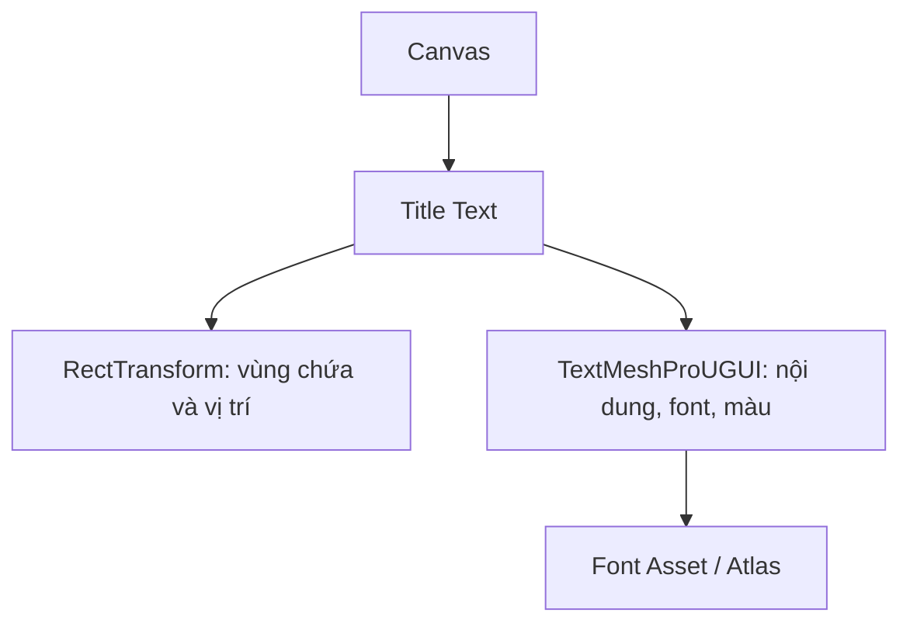

# Bài 02 — Tạo và định dạng tiêu đề bằng TextMeshPro

> **Creative Core · UI · Thực hành có hướng dẫn · Unity 6.3**  
> **Kết quả:** Một tiêu đề dễ đọc, nằm tại vị trí chủ định trong Canvas và thích hợp với cảnh nền.

## 1. Tóm tắt và mục tiêu học tập

Chữ viết là phương tiện truyền tải nhiệm vụ, trạng thái và lựa chọn tới người chơi. Khi thiết kế màn hình chính, tiêu đề cần thể hiện phong cách trò chơi nhưng đồng thời bảo đảm tính rõ ràng. Bài này sử dụng `TextMeshProUGUI` trong `uGUI` thay vì Text legacy.

Sau bài học, người học có thể thêm TextMeshPro vào Canvas, định dạng phông và căn lề, kiểm soát vùng chứa chữ, đánh giá độ tương phản, tạo font asset hợp lệ.

## 2. Kiến thức cốt lõi

### 2.1. Canvas, RectTransform và TextMeshPro

`TextMeshProUGUI` hiển thị chữ trong Canvas, cung cấp các thuộc tính như `Text Input`, `Font Asset`, `Font Size`, `Font Style`, `Vertex Color`, `Alignment` và chế độ xuống dòng. `RectTransform` là hộp hình chữ nhật kiểm soát vị trí và kích thước vùng chứa chữ.

Cần phân biệt **cỡ chữ** với **kích thước vùng chứa**: tăng `Font Size` mà không mở rộng `RectTransform` có thể khiến chữ bị cắt hoặc xuống dòng ngoài ý muốn.

### 2.2. Bốn yếu tố quyết định khả năng đọc

| Yếu tố | Nguyên tắc thực hành |
| --- | --- |
| Font | Chọn phông phân biệt ký tự rõ, hỗ trợ tiếng Việt nếu dùng nhãn có dấu |
| Kích thước | Kiểm tra kích thước khi chạy tại màn hình mục tiêu, không chỉ trong Scene view |
| Tương phản | Tránh chữ trùng màu, hòa lẫn vào vùng sáng/tối của ảnh nền |
| Nội dung | Dùng từ quen thuộc; hạn chế thay chữ bằng biểu tượng hoặc ký tự trang trí khó đọc |

Không thể đảm bảo khả năng truy cập bằng một thuộc tính đơn lẻ; việc hỗ trợ trình đọc màn hình còn phụ thuộc nền tảng và giải pháp accessibility của dự án.

## 3. Tạo tiêu đề trong Unity Editor

1. Trong `Hierarchy`, nhấp phải → `UI` → `Text - TextMeshPro`. Unity tự tạo Canvas và EventSystem khi cần. Nếu được hỏi, chọn **Import TMP Essentials**.
2. Đổi tên GameObject vừa tạo thành `Title Text`.
3. Chọn `RectTransform`: với anchor ở giữa và kích thước phù hợp, đặt `Pos X = 0`, `Pos Y = 0` để căn giữa theo anchor; dịch `Pos Y` lên nếu vật thể hậu cảnh che mất chữ.
4. Trong `TextMeshPro - Text (UI)`, thay `New Text` bằng tên game, ví dụ **THÀNH PHỐ ÁNH SÁNG**.
5. Tăng chiều rộng vùng chứa. Chọn `Text Wrapping Mode` thích hợp: `No Wrap` khi tiêu đề phải nằm trên một dòng; cho phép wrap nếu màn hình hẹp hoặc tên dài.
6. Chỉnh `Font Asset`, `Font Size`, `Alignment` và `Vertex Color`. Kiểm tra nội dung ở Game view và cả khi bật Play mode.

Không nên bật `Auto Size` để “sửa” mọi lỗi tràn chữ: nó có thể làm chữ thu nhỏ quá mức. Ưu tiên bố cục đủ rộng và kiểm thử nhiều kích thước trước khi dùng tự co giãn có giới hạn.

## 4. Nhập font ngoài

Font thông thường (ví dụ `.ttf` hoặc `.otf`) chưa phải là một TMP Font Asset hoàn chỉnh. Quy trình đề xuất:

1. Chọn một phông có giấy phép phù hợp, ví dụ từ [Google Fonts](https://fonts.google.com/).
2. Import tệp font vào `Assets/Fonts`.
3. Tạo TMP Font Asset từ tệp hoặc dùng Font Asset Creator, tùy phiên bản Editor.
4. Kiểm tra bộ glyph tiếng Việt (ă, â, ê, ô, ơ, ư, đ và dấu thanh). Có thể cần Atlas Population Mode phù hợp hoặc fallback font asset.
5. Gán Font Asset vào tiêu đề và thử cả chữ in thường, in hoa và tiếng Việt có dấu.

Font Asset chứa thông tin hiển thị glyph; nếu atlas không có ký tự, có thể xuất hiện ô vuông hoặc ký hiệu thay thế. Hãy kiểm tra cảnh báo trong Console và cấu hình fallback.

## 5. Bài thực hành: hai phương án typography

Thiết kế cùng một tiêu đề theo hai phương án: (A) sáng và tối giản, (B) đậm chất game fantasy. Mỗi phương án lưu ảnh Game view và nhận xét ba điểm: mức độ tương phản, phân cấp thị giác và hành vi khi thu hẹp cửa sổ.

**Tiêu chí:** tiêu đề đọc được trong 3 giây đầu; không bị cắt; vùng chữ không che điểm nhấn của môi trường; phông hỗ trợ ký tự được sử dụng.

## 6. Các lỗi thường gặp

| Hiện tượng | Khả năng gây ra | Cách kiểm tra |
| --- | --- | --- |
| Không thấy tiêu đề | Object tắt, nằm ngoài Canvas, màu có Alpha 0 | Kiểm tra `SetActive`, `RectTransform`, `Vertex Color` |
| Chữ bị cắt | `RectTransform` quá nhỏ, Overflow/Wrap chưa phù hợp | Mở rộng vùng chứa, rà soát Text Wrapping |
| Chữ biến thành ô vuông | Font Asset thiếu glyph | Dùng font hỗ trợ Unicode cần thiết, cấu hình fallback |
| Đẹp trong Scene view nhưng xấu trong Game view | Chưa thử kích thước/tỷ lệ màn hình | Dùng Game view nhiều cấu hình |

## 7. Câu hỏi ôn tập

**Câu 1.** Chữ được tạo qua `UI > Text - TextMeshPro` và đặt trong Canvas thường dùng component nào để hiển thị?  
A. TextMeshProUGUI  
B. MeshFilter  
C. AudioSource  
D. Light  
**Đáp án: A.** **Giải thích:** TextMeshProUGUI là thành phần văn bản dành cho uGUI.

**Câu 2.** Khi nội dung bị cắt dù font hiển thị đúng, bước đầu phù hợp nhất là gì?  
A. Tắt Camera  
B. Tăng số polygon  
C. Kiểm tra kích thước RectTransform và chế độ wrapping  
D. Đổi Render Pipeline  
**Đáp án: C.** **Giải thích:** Hộp chứa và quy tắc xuống dòng chi phối giới hạn văn bản.

**Câu 3.** Vì sao cần kiểm tra ký tự tiếng Việt khi dùng phông mới?  
A. Để giảm kích thước scene  
B. Vì Font Asset có thể thiếu glyph mang dấu  
C. Vì Unity không cho viết tiếng Việt  
D. Vì Canvas chỉ xử lý ASCII  
**Đáp án: B.** **Giải thích:** Chữ không có trong atlas hoặc fallback có thể xuất hiện sai.

**Câu 4.** Nhận định nào đúng về `No Wrap`?  
A. Luôn làm chữ tự thu nhỏ  
B. Luôn giúp chữ đủ tương phản  
C. Luôn tránh được tràn màn hình  
D. Ngăn tự động xuống dòng nhưng vẫn cần vùng chứa đủ rộng  
**Đáp án: D.** **Giải thích:** Không xuống dòng không đồng nghĩa với việc nội dung chắc chắn vừa khung.

**Câu 5.** Tiêu đề nhạt màu đặt lên nền trời rất sáng nên xử lý thế nào?  
A. Tăng số lượng nút  
B. Bổ sung vật lý Rigidbody  
C. Đổi màu chữ hoặc thêm lớp nền tương phản hợp lý  
D. Tắt EventSystem  
**Đáp án: C.** **Giải thích:** Tương phản là điều kiện quan trọng để đọc chữ dễ dàng.

## 8. Tổng kết và tài liệu tham khảo

`TextMeshProUGUI` phối hợp với `RectTransform` để tạo chữ rõ, linh hoạt. Sản phẩm bài học là một màn hình có tiêu đề dễ đọc, font asset hợp lệ và có ảnh đối chiếu tại kích thước Game view khác nhau.

- [Unity Learn — Add a title to your scene](https://learn.unity.com/pathway/creative-core/unit/creative-core-ui/tutorial/add-a-title-to-your-scene-3?version=6.3)
- [Unity Learn — Manage screen size and anchors](https://learn.unity.com/pathway/creative-core/unit/creative-core-ui/tutorial/manage-screen-size-and-anchors?version=6.3)
- [WebAIM — Contrast and color accessibility](https://webaim.org/articles/contrast/)

*Bài học tiếng Việt tự biên soạn và đối chiếu tài liệu kỹ thuật; không phải bản dịch chính thức.*
