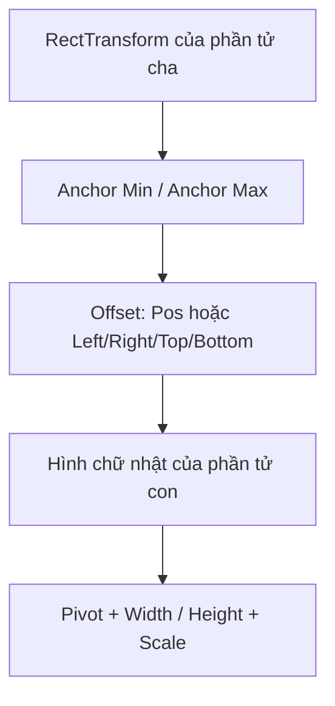

# Bài 03 — Thiết kế UI thích ứng với độ phân giải và Anchors

> **Creative Core · UI · Bài học + lab · Unity 6.3**  
> **Kết quả:** Tiêu đề và nút Settings không trôi khỏi vị trí khi thay đổi kích thước Game view.

## 1. Tổng quan và mục tiêu

UI hoạt động trên màn hình có kích thước và tỷ lệ khác nhau. Một nút trông như nằm ở góc phải tại tỷ lệ 16:9 có thể dịch vào giữa hoặc tràn khỏi khung tại 4:3. Hai công cụ chính trong `uGUI` là **anchors của RectTransform** và **Canvas Scaler**.

Sau bài này, người học có thể kiểm tra `aspect ratio`, cấu hình anchor/pivot, phân biệt co giãn theo vùng và theo tỷ lệ màn hình, và kiểm thử layout trên các độ phân giải khác nhau.

## 2. Các khái niệm nền tảng

### 2.1. Tỷ lệ khung hình, độ phân giải và vùng hiển thị

- **Resolution:** số pixel theo chiều rộng và chiều cao, ví dụ 1920×1080.
- **Aspect ratio:** tỷ số giữa chiều rộng và chiều cao; 1920×1080 tương ứng 16:9.
- **Game view:** vùng mô phỏng kết quả hiển thị trong Unity Editor; `Free Aspect` thuận tiện để thử nhiều hình dạng cửa sổ.

Tăng độ phân giải không nhất thiết thay đổi tỷ lệ khung hình. Ngược lại, hai thiết bị có cùng độ phân giải dọc nhưng chiều rộng khác nhau sẽ cho vùng bố cục khác.

### 2.2. RectTransform, anchor và pivot

`RectTransform` cho phép xác định hình chữ nhật của UI dựa trên hình chữ nhật cha. Các anchor dùng giá trị chuẩn hóa: (0,0) là góc dưới-trái; (0.5,0.5) là giữa; (1,1) là trên-phải. **Pivot** là điểm tham chiếu khi định vị, xoay và đổi kích thước đối tượng.

| Cấu hình | Hành vi |
| --- | --- |
| Anchor cố định ở góc phải-trên | Giữ offset so với góc phải-trên của vùng cha |
| Anchor cố định tại trung tâm | Giữ offset so với tâm; không tự giữ sát góc |
| `anchorMin != anchorMax` | Cho phép hình chữ nhật dãn theo kích thước cha trên các trục có anchor tách nhau |
| Pivot thay đổi | Thay đổi điểm xoay/định vị của chính phần tử; không thay chức năng anchor |

Khi anchor trùng nhau, Inspector thường hiện `Pos X`, `Pos Y`, `Width`, `Height`. Khi anchor tách nhau, các trường offset như `Left`, `Right`, `Top`, `Bottom` xuất hiện. Vì vậy, không nên sao chép mù quáng thông số giữa hai đối tượng có anchor khác nhau.

## 3. Canvas Scaler — cách điều chỉnh tỷ lệ toàn UI

| UI Scale Mode | Ý nghĩa | Lưu ý |
| --- | --- | --- |
| `Constant Pixel Size` | UI giữ kích thước theo pixel (ngoại trừ Scale Factor) | Có thể trông rất nhỏ trên màn hình độ phân giải cao |
| `Scale With Screen Size` | Co giãn theo `Reference Resolution` và `Screen Match Mode` | Thích hợp cho phần lớn menu theo màn hình; cần chọn Match hợp lý |
| `Constant Physical Size` | Ước lượng kích thước vật lý bằng DPI | Kết quả phụ thuộc độ tin cậy của DPI thiết bị |

Với `Scale With Screen Size`, chọn `Reference Resolution` phù hợp với bản thiết kế (ví dụ 1920×1080 là **giá trị minh họa**, không phải chuẩn bắt buộc). `Match Width or Height = 0` thiên về chiều rộng; `1` thiên về chiều cao; `0.5` cân bằng cả hai bằng phương thức tính của Canvas Scaler.

**Phân biệt:** Anchor xác định *vị trí/biên tương đối so với cha*, còn Canvas Scaler xác định *cách tỷ lệ UI được quy đổi theo màn hình*. Muốn UI thích ứng cần phối hợp cả hai, thay vì chỉ tăng Scale của GameObject.

## 4. Lab: Giữ nút Settings ở góc màn hình

1. Trong Scene view, hiển thị Canvas (nhấp đúp GameObject `Canvas` trong Hierarchy) và bật chế độ `2D` để chỉnh thuận tiện.
2. Tại Game view, chọn `Free Aspect`; kéo thay đổi chiều rộng/hẹp rồi ghi nhận vị trí của nút.
3. Tạo `UI > Button - TextMeshPro`, đổi tên thành `Settings Button`; sửa nhãn thành “Settings”.
4. Chọn nút, nhấn **T** để dùng `Rect Tool`; trong `RectTransform > Anchor Presets`, chọn góc phải-trên.
5. Đặt `Pivot` (1,1) nếu muốn định vị theo góc phải-trên của chính nút; chỉnh `Pos X` âm và `Pos Y` âm để tạo lề trong cho góc đó.
6. Thu/phóng Game view; nút phải giữ khoảng cách hợp lý đến mép thay vì trôi vào giữa. Sau đó thử anchor ở giữa để so sánh và trả lại anchor ở góc.
7. Trên Canvas chọn `Canvas Scaler > Scale With Screen Size`, khai báo `Reference Resolution` và thử Match = 0, 0.5, 1.

### 4.1. Bảng kiểm thử tối thiểu

| Môi trường mô phỏng | Cần quan sát |
| --- | --- |
| 16:9, độ phân giải thấp | Nút và tiêu đề có còn đọc được không? |
| 16:9, độ phân giải cao | UI có quá nhỏ hoặc quá lớn không? |
| 4:3 | Khoảng cách tới góc có giữ đúng không? |
| 9:16 | Có che lấp, cắt chữ hoặc xếp chồng không? |

Các thông số trên chỉ là test case; không phải bảo đảm hỗ trợ tuyệt đối mọi thiết bị. Với thiết bị có notch hoặc cutout, cần thêm thiết kế theo `Screen.safeArea` khi triển khai thực tế.

## 5. Lỗi và nguyên nhân

| Lỗi | Cách xác minh và khắc phục |
| --- | --- |
| Nút trôi ra giữa khi cửa sổ rộng ra | Anchor đang ở giữa; chuyển sang anchor góc tương ứng |
| Cả menu to bất thường | Kiểm tra Canvas Scaler và `Reference Resolution`, tránh tăng `localScale` tùy ý |
| Thành phần bị kéo dãn | Anchor bị tách hoặc layout group đang điều khiển kích thước |
| `Pos X` biến thành `Left/Right` | Đây là hệ quả hợp lệ khi anchor ở chế độ stretch |
| Thay Pivot làm nút dịch vị trí | Offset có thể được Unity điều chỉnh theo pivot; kiểm tra lại giá trị sau thay đổi |

## 6. Câu hỏi ôn tập

**Câu 1.** Nút cần luôn cách góc trên-phải của Canvas một khoảng ổn định. Lựa chọn nào phù hợp?  
A. Anchor ở giữa  
B. Anchor phải-trên  
C. Thay đổi Camera FOV  
D. Giảm Alpha  
**Đáp án: B.** **Giải thích:** Anchor cố định góc giúp vị trí giữ offset tương ứng khi cha đổi kích thước.

**Câu 2.** Một đối tượng UI có `anchorMin` khác `anchorMax` theo trục ngang; điều gì có thể xảy ra?  
A. Chỉ hiện trong Scene view  
B. Tự tắt EventSystem  
C. Tự tải sprite mới  
D. Chiều rộng có thể dãn theo vùng cha  
**Đáp án: D.** **Giải thích:** Anchor tách nhau tạo cơ chế stretch theo phần tử cha.

**Câu 3.** Thuộc tính nào tác động tới cách giao diện co giãn theo độ phân giải màn hình?  
A. Canvas Scaler  
B. Audio Clip  
C. Particle Lifetime  
D. Rigidbody Mass  
**Đáp án: A.** **Giải thích:** Canvas Scaler quy định chế độ tỷ lệ của UI.

**Câu 4.** Pivot khác anchor chủ yếu ở điểm nào?  
A. Pivot là tên font  
B. Pivot là sự kiện click  
C. Pivot là điểm tham chiếu định vị/xoay của phần tử  
D. Pivot là chế độ render  
**Đáp án: C.** **Giải thích:** Pivot gắn với chính hình chữ nhật; anchor gắn với quan hệ phần tử cha.

**Câu 5.** Cách kiểm chứng bố cục đúng là gì?  
A. Chỉ xem Scene view  
B. Chạy ở nhiều aspect ratio và độ phân giải trong Game view  
C. Chỉ tăng font cho đến khi vừa  
D. Tắt Canvas Scaler  
**Đáp án: B.** **Giải thích:** Cần thử nhiều hình dạng và kích thước để phát hiện tràn và dịch vị trí.

## 7. Tổng kết và tài liệu tham khảo

Responsive UI trong uGUI không tự xuất hiện khi có Canvas. Phải cấu hình anchor/pivot cho từng nhóm phần tử, kết hợp Canvas Scaler và chạy kiểm thử trên các tỷ lệ khác nhau.

- [Unity Learn — Manage screen size and anchors](https://learn.unity.com/pathway/creative-core/unit/creative-core-ui/tutorial/manage-screen-size-and-anchors?version=6.3)
- [Unity Manual — Basic Layout](https://docs.unity.cn/2023.2/Documentation/Manual/UIBasicLayout.html)
- [Unity Manual — Canvas Scaler](https://docs.unity.cn/2023.1/Documentation/Manual/script-CanvasScaler.html)
- [Unity Technologies/uGUI — Designing UI for Multiple Resolutions](https://github.com/Unity-Technologies/uGUI/blob/main/com.unity.ugui/Documentation~/HOWTO-UIMultiResolution.md)

*Bài học tiếng Việt tự biên soạn và đối chiếu tài liệu kỹ thuật; không phải bản dịch chính thức.*
