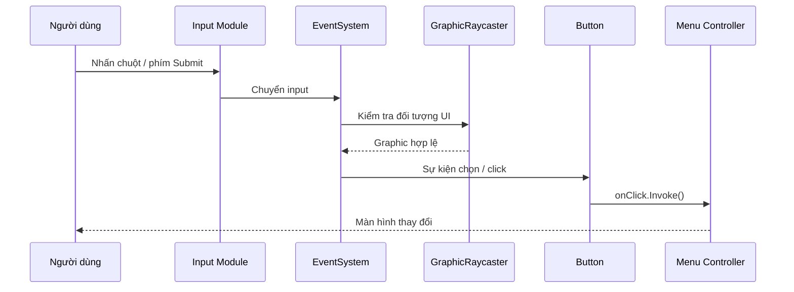

# Bài 05 — Lập trình tương tác Button và điều hướng menu

> **Creative Core · UI · Bài học + lab · Unity 6.3**  
> **Kết quả:** Nút Settings mở màn hình cài đặt; nút Close quay lại tiêu đề; các nút có phản hồi hover/press/disabled.

## 1. Tổng quan và mục tiêu

Giao diện chỉ thật sự hữu ích khi người chơi có thể tương tác. `Button` biểu diễn một hành động cụ thể; `On Click()` là sự kiện được phát ra khi thao tác nhấn hợp lệ hoàn tất. Với `uGUI`, ta có thể liên kết sự kiện ngay trong Inspector mà chưa cần viết mã, hoặc viết mã C# khi luồng màn hình phức tạp.

Sau bài này, người học có thể mô tả luồng sự kiện của Button, cấu hình phản hồi thị giác, dùng `GameObject.SetActive(bool)` qua Inspector và tổ chức logic điều hướng thành một `MonoBehaviour` độc lập.

## 2. Hệ thống sự kiện của uGUI



`EventSystem` điều phối input và selection; Canvas thường cần `GraphicRaycaster` để UI nhận tương tác con trỏ. Một nút có thể không hoạt động nếu Canvas/GameObject bị tắt, `Button.interactable = false`, bị Image khác chặn raycast, hoặc chưa cấu hình input module tương thích với thiết lập Input System của dự án.

## 3. Trạng thái và phản hồi của Button

| Trạng thái | Gợi ý biểu đạt |
| --- | --- |
| Normal | Màu nền trung tính, nhãn đọc được |
| Highlighted | Thay tint nhẹ khi hover |
| Pressed | Tương phản rõ hơn để xác nhận nhấn |
| Selected | Biểu thị focus khi điều hướng bằng keyboard/controller |
| Disabled | Phân biệt không khả dụng; tránh chỉ dùng màu quá nhạt khiến chữ khó đọc |

Trong `Button > Transition`, có thể chọn `Color Tint`, `Sprite Swap`, `Animation` hoặc `None`. Kiểm tra `Target Graphic`: thông thường trỏ đến Image của nút, nhưng có thể chọn graphic phù hợp với phong cách giao diện.

## 4. Lab A — Tạo điều hướng không cần mã

Giả sử Canvas có `Title Text`, `Settings Button`, `Settings Menu` (con gồm `Exit Button`). Khởi đầu: bật `Title Text`, `Settings Button`; tắt `Settings Menu`.

### 4.1. Nút mở Settings

1. Chọn `Settings Button > Button > On Click()` → nhấn `+`.
2. Kéo `Settings Menu` từ Hierarchy vào ô Object của sự kiện.
3. Chọn `GameObject > SetActive(bool)`, bật checkbox tham số **true**.
4. Tạo hai mục `On Click` khác, lần lượt trỏ tới `Title Text` và `Settings Button`, chọn `SetActive(false)`.
5. Chạy Play và nhấn Settings. Kỳ vọng: menu hiển thị; tiêu đề và nút mở ẩn đi.

### 4.2. Nút quay về Title

Trên `Exit Button`, thêm các sự kiện: `Settings Menu.SetActive(false)`, `Title Text.SetActive(true)` và `Settings Button.SetActive(true)`. Không tắt toàn bộ `Canvas` hay `EventSystem` vì sẽ làm mất khả năng tương tác cần thiết.

**Phân biệt:** các `On Click` này là cấu hình *persistent listeners* trong Inspector. Nếu chọn nhầm target object hoặc nhầm giá trị bool, ứng dụng có thể ở trạng thái sai mà không có lỗi biên dịch.

## 5. Lab B — Chuyển sang một controller bằng C#

Khi menu có nhiều màn hình, tập trung logic vào một class sẽ dễ quản lý hơn việc cấu hình nhiều sự kiện riêng lẻ.

```csharp
using UnityEngine;

public class MenuController : MonoBehaviour
{
    [SerializeField] private GameObject titleText;
    [SerializeField] private GameObject settingsButton;
    [SerializeField] private GameObject settingsMenu;

    private void Start()
    {
        ShowTitle();
    }

    public void ShowSettings()
    {
        if (titleText != null) titleText.SetActive(false);
        if (settingsButton != null) settingsButton.SetActive(false);
        if (settingsMenu != null) settingsMenu.SetActive(true);
    }

    public void ShowTitle()
    {
        if (settingsMenu != null) settingsMenu.SetActive(false);
        if (titleText != null) titleText.SetActive(true);
        if (settingsButton != null) settingsButton.SetActive(true);
    }
}
```

Tạo GameObject `UI Controller`, gắn component `MenuController`, kéo ba tham chiếu vào Inspector. Trên `Settings Button`, chỉ gọi `MenuController.ShowSettings`; trên `Exit Button`, gọi `MenuController.ShowTitle`. **Gỡ các listener SetActive cũ** trước khi thay bằng controller để tránh hai hệ thống tranh nhau chỉnh trạng thái.

Đặt controller lên một GameObject luôn hoạt động trong scene (không đặt trong `Settings Menu` đang bị tắt), để sự kiện và khởi tạo có thể chạy như dự định.

## 6. Kiểm thử, xử lý lỗi và mở rộng

| Kiểm thử | Kết quả kỳ vọng |
| --- | --- |
| Mở scene | Chỉ Title Text và nút Settings xuất hiện |
| Nhấn Settings | Cài đặt xuất hiện, title ẩn |
| Nhấn Close | Quay lại màn hình chính |
| Nhấn Tab hoặc điều hướng tay cầm | Trạng thái focus có thể nhận biết nếu Input Module đã cấu hình |
| Đặt `interactable = false` | Button không phát `onClick` qua tương tác thông thường |

Các lỗi thường gặp: thiếu EventSystem; sai `GraphicRaycaster`; panel trong suốt chắn nút; target được đặt dưới một GameObject đã disable; nút tự tắt trước khi các listener liên quan hoạt động như mong muốn; nghe nhầm hiệu ứng hover là click.

## 7. Câu hỏi ôn tập

**Câu 1.** `Button.onClick` có ý nghĩa chính nào?  
A. Đổi độ phân giải toàn máy  
B. Chuyển texture sang Sprite  
C. Phát hành động khi thao tác kích hoạt Button hợp lệ  
D. Tạo EventSystem mới mỗi frame  
**Đáp án: C.** **Giải thích:** OnClick là UnityEvent của Button, dùng để gọi các handler được cấu hình.

**Câu 2.** Muốn mở `Settings Menu` bằng Inspector, nên chọn hàm nào?  
A. `GameObject.SetActive(true)`  
B. `Camera.Render()`  
C. `Rigidbody.AddForce()`  
D. `Time.timeScale = 0`  
**Đáp án: A.** **Giải thích:** SetActive(true) kích hoạt GameObject được tham chiếu.

**Câu 3.** Tại sao controller không nên đặt trên Settings Menu vốn bị deactivate ở thời điểm khởi đầu?  
A. Vì MenuController phải là asset  
B. Vì các callback/lifecycle trên GameObject inactive có thể không hoạt động như mong muốn  
C. Vì TextMeshPro không dùng class  
D. Vì Unity chỉ cho một component  
**Đáp án: B.** **Giải thích:** Tách controller khỏi đối tượng bị ẩn giúp quản lý trạng thái ổn định.

**Câu 4.** Muốn biểu thị rõ trạng thái keyboard focus của Button, cần kiểm tra gì?  
A. Texture compression  
B. Shadow Cascades  
C. Mesh topology  
D. Selected Color / Navigation / EventSystem  
**Đáp án: D.** **Giải thích:** Điều hướng UI và style trạng thái Selected quyết định phản hồi focus.

**Câu 5.** Một nút hiển thị bình thường nhưng click không có tác dụng. Bước nào có ích nhất trước tiên?  
A. Thay mọi script  
B. Tăng FPS  
C. Kiểm tra EventSystem, raycaster, các listener và đối tượng che phía trên  
D. Bake lightmap  
**Đáp án: C.** **Giải thích:** Các yếu tố này quyết định Button có nhận được click và gọi hành động hay không.

## 8. Tổng kết và tài liệu tham khảo

`Button`, `EventSystem` và `On Click()` cho phép liên kết thao tác với thay đổi màn hình. Bắt đầu từ `SetActive(bool)` trong Inspector, sau đó chuyển sang C# controller khi luồng trạng thái phức tạp.

- [Unity Learn — Add basic button functionality](https://learn.unity.com/pathway/creative-core/unit/creative-core-ui/tutorial/add-basic-button-functionality-3?version=6.3)
- [Unity Learn — Working with UI in Unity](https://learn.unity.com/tutorial/working-with-ui-in-unity)

*Bài học tiếng Việt tự biên soạn và đối chiếu tài liệu kỹ thuật; không phải bản dịch chính thức.*
